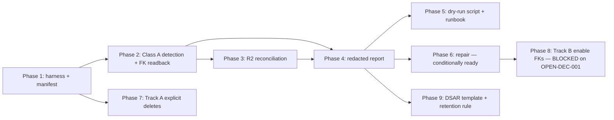

# Plan: D1/R2 Referential Integrity Orphan Audit

**Status:** `CONDITIONALLY READY`
**Plan profile:** exhaustive
**Verification mode:** `emulated` (readiness cap 97; high-blast-radius status cap → CONDITIONALLY READY until owner/independent review). The Improve-Plan-Prompt audit used 3 independent native subagents; the final verifier is emulated.
**Date:** 2026-07-07 (improved under `Improve-Plan-Prompt.md`)
**Folder:** `.ai/03_plans/2026-07-07-d1-r2-referential-integrity-orphan-audit`

## What this plan is

A **planning-only** package that designs a read-only-first, dry-run-first, owner-gated orphan-audit and remediation capability for cross-store referential integrity across D1 records (69 tables, 38 migrations) and R2 upload objects (binding `ARCH_UPLOADS_R2`). It does **not** implement the audit, mutate D1/R2/migrations/code, or change Git state.

## Implementation start document

**`11_IMPLEMENTATION_PLAN.md`** — the authoritative execution guide.

Start there after reading this README and `01_EXECUTIVE_SUMMARY.md`.

## Phase order + dependency graph



| Phase | Status | Gate |
|---|---|---|
| 1 — harness + manifest | implementation-ready | tests |
| 2 — Class A detection + FK readback | implementation-ready | TEST-001/002 |
| 3 — R2 reconciliation | implementation-ready | reconcile test |
| 4 — redacted report | implementation-ready | TEST-003 |
| 5 — dry-run script + runbook | implementation-ready | smoke |
| 6 — repair | **conditionally ready** | reviewer sign-off |
| 7 — Track A explicit deletes | implementation-ready | cascade-off test |
| 8 — Track B enable FKs | **blocked** | OPEN-DEC-001 |
| 9 — DSAR template + retention rule | implementation-ready | retention test |

## Headline finding (P0)

**No `PRAGMA foreign_keys = ON` exists in `src/` or `migrations/`.** D1/SQLite defaults FK enforcement off per connection, so every declared `ON DELETE CASCADE / SET NULL` is unverified at runtime. Combined with:
- The **0014 publication cluster (7 tables) has zero FK declarations** — integrity is application-only.
- **Project delete relies on transitive cascade** for `estimate_sheet_events`/`estimate_sheet_adjustments` (the estimate-delete path does it explicitly — asymmetric).
- **Multiple production delete paths desync R2 from D1** (user image/attachment DELETE routes, bulk project delete two-phase, cleanup job that never sets terminal statuses).

Full evidence: `03_SOURCE_AND_CODEBASE_AUDIT.md` §0, §4, §7.

## Requirement/task/test traceability

- Requirements: `04_REQUIREMENTS_SPECIFICATION.md` (FR/DATA/SEC/PERF/REL/OPS/TEST/DOC/ARCH).
- Tasks: `11_IMPLEMENTATION_PLAN.md` (T1.1–T9.2).
- Tests: `12_TEST_AND_VALIDATION_STRATEGY.md` (execution matrix).
- Full map: `16_REQUIREMENTS_TRACEABILITY_MATRIX.md`.

## Blocked decisions

| Decision | Blocks | Owner | Recommendation |
|---|---|---|---|
| OPEN-DEC-001 — enable `PRAGMA foreign_keys=ON` (Track B)? | Phase 8, DATA-004, TEST-004 | Philip | Yes, after Track A + clean dry-run repair |
| OPEN-DEC-002 — workspace/user hard-delete (DSAR closure) | full DSAR erasure | Philip | Separate pack |
| OPEN-DEC-003 — implement `uploads_orphaned` retention rule here? | DB-CHG-004 | Philip | Yes (Phase 9) |

Details: `15_DECISIONS_ASSUMPTIONS_AND_ALTERNATIVES.md`.

## Stale-plan revalidation checklist

Before implementing, re-verify (the codebase is in fast iteration):
- [ ] `rg "foreign_keys|PRAGMA" src/ migrations/` still empty (or note if changed).
- [ ] `migrations/` count still 38 (new migration → re-derive manifest, update `03` §1) AND the business-table count is still 69 (`rg -oi 'CREATE TABLE[^(]*' migrations/*.sql | sort -u | rg -v hmac_rebuild | wc -l`).
- [ ] `src/lib/projects/actions.ts` batch region (602–757) unchanged (Track A target).
- [ ] `src/lib/publication/actions.ts` `revokeProjectPublication` (~1012-1026) unchanged (SEC-004/T7.2 target — verify it still retains `password_hash`).
- [ ] `src/lib/uploads/cleanup-job.ts` status-mapping region (~431) unchanged (ORPH-012 premise depends on no path setting `status='deleted'`).
- [ ] `src/lib/compliance/retention-core.ts` `DEFAULT_RETENTION_RULES` unchanged.
- [ ] `package.json` still has no `cf:orphan-audit` script (confirm greenfield).
- [ ] `wrangler.jsonc` bindings (`ARCH_DB`, `ARCH_UPLOADS_R2`) unchanged.
- [ ] The 0014 publication cluster still has no `REFERENCES`.
- [ ] The cost-library 0028 table set unchanged (5 tables; a new cost-library migration changes the count and manifest target).

## Commands to run before the first edit

```
git status --short --branch
rg "foreign_keys|PRAGMA" src/ migrations/
ls migrations/ | wc -l
rg "cf:orphan" package.json
```

## Files explicitly off-limits

- `migrations/supabase/*` (legacy; never extend).
- Any Cloudflare resource outside `wrangler.jsonc` bindings (`ebxxqidacheyapmmzavr`, unrelated accounts).
- `.ai/09_archive/*`.
- Git history (no rebase/force).
- No automatic branch/worktree creation (shared live worktree — AGENTS.md).

## Files and systems intentionally unaffected

- All Server Actions / Route Handlers (audit not in request path).
- Workshop UI (`src/app/workshop/**`) — no UI in core scope.
- Better Auth tables (read-only).
- Durable Object `COLLAB_ROOMS` (room-local SQLite, not in D1↔R2 graph).
- Cloudflare Images (`IMAGES`) — transform-only, no object namespace.
- Existing crons (0/15/30 3:*) — unchanged (DB-CHG-004 adds a rule the retention cron sweeps; no cron change).

## External proof required before production rollout

- Preview dry-run completes ≤60s + ≤ cost cap (`13`).
- Repair gate tests green + independent reviewer sign-off (Phase 6).
- OPEN-DEC-001 resolved + clean preview dry-run repair (Phase 8).
- P0 count == 0 on preview before prod dry-run.

## Archive policy

Do **not** archive automatically. Archive (move to `.ai/09_archive/`) only after:
- Phases 1–5, 7, 9 land and pass their gates, AND
- Phase 6 (repair) lands with reviewer sign-off, AND
- OPEN-DEC-001 is resolved (Phase 8 either lands or is explicitly deferred with rationale).

Partial completion stays in `.ai/03_plans/` with the phase status table above updated.

## Document index

| Doc | Purpose |
|---|---|
| `00_AGENT_COORDINATION.md` | Master goal, orchestration, ledger, skills |
| `01_EXECUTIVE_SUMMARY.md` | The 2-minute read |
| `02_FEATURE_BRIEF_AND_SCOPE.md` | Brief, in/out of scope, assumptions, open decisions |
| `03_SOURCE_AND_CODEBASE_AUDIT.md` | Evidence base — tables, edges, R2 map, orphan risks |
| `04_REQUIREMENTS_SPECIFICATION.md` | Stable requirement IDs + shadow-path matrix |
| `05_UX_UI_ACCESSIBILITY_PLAN.md` | Operator report surface (no customer UI) |
| `06_ARCHITECTURE_AND_TECHNICAL_DESIGN.md` | Current/target architecture, AD decisions |
| `07_DATA_DATABASE_API_NETWORK_PLAN.md` | DB change blueprints, access-path matrix |
| `08_SECURITY_PRIVACY_THREAT_MODEL.md` | Threat model, credential taxonomy |
| `09_PERFORMANCE_RELIABILITY_OBSERVABILITY.md` | Evaluators, budgets, cardinality |
| `10_BLAST_RADIUS_AND_DEPENDENCIES.md` | Impact tiers, dependency graph |
| `11_IMPLEMENTATION_PLAN.md` | **Execution guide** — phases + tasks T1.1–T9.2 |
| `12_TEST_AND_VALIDATION_STRATEGY.md` | Test execution matrix + adversarial matrix |
| `13_ROLLOUT_ROLLBACK_AND_OPERATIONS.md` | Runbook, gates, cadence |
| `14_RISK_REGISTER.md` | RISK-001–016 |
| `15_DECISIONS_ASSUMPTIONS_AND_ALTERNATIVES.md` | DEC-001–006, OPEN-DEC-001–003, ASSUMP-001–008 |
| `16_REQUIREMENTS_TRACEABILITY_MATRIX.md` | Full traceability |
| `17_FINAL_READINESS_REVIEW.md` | Verifier audit + scores |
| `18_STACK_CONTRACT_AND_PRODUCTION_STANDARDS.md` | Cross-cutting stack gates |
| `19_RESEARCH_REVIEW_AND_QA_EVIDENCE.md` | Research, skills, adversarial, gaps |
| `20_COST_MODEL_AND_PRICING_INPUTS.md` | R2 `list()` cost inputs |
| `21_PROVIDER_PARITY_MATRIX.md` | N/A with reason (single-provider) |

## Confirmation

No application code, tests, migrations, schemas, infrastructure, configuration, or Git state was modified. Only files inside this folder were created.
