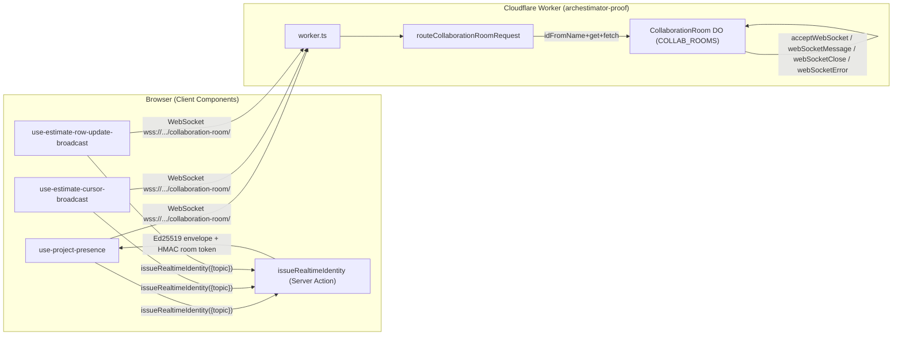
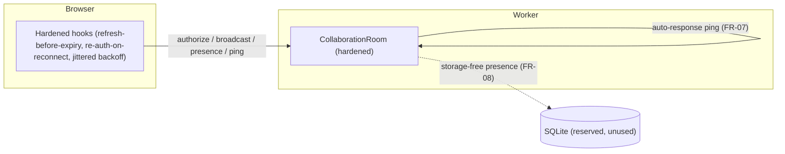

# 06 — Architecture and Technical Design

## Current-state architecture

- **Single DO class**, sharded by room name (`idFromName(topic)`). One instance per topic
  globally (single-threaded, serialized).
- **WebSocket Hibernation API**: sockets survive DO eviction on the Cloudflare network; the
  DO's in-memory state does **not** survive (constructor reruns on wake).
- **Two cryptographics**: HMAC room token (DO verifies) + Ed25519 envelope (receivers verify
  client-side).
- **Zero DO storage**: presence is reconstructed from `getWebSockets()`+attachments each
  change. `new_sqlite_classes` is provisioned but unused.

## Target-state architecture

Same shape, with the hardening layers added:

### Component boundaries (unchanged) and additions

| Boundary | Current | Target |
|---|---|---|
| Worker → DO routing | `routeCollaborationRoomRequest` | unchanged |
| DO upgrade/auth | `fetch` + `authorizeSocket` | add cap-then-authz (SEC-02), reject close code |
| DO message dispatch | `webSocketMessage` | add per-sender rate cap (FR-05) |
| DO presence | `readPresenceState` (index key) | stable per-user key + rehydrate (FR-03) |
| DO lifecycle | `webSocketClose/Error` | add alarm-based prune (FR-07) |
| Browser socket | `CollaborationRoomBrowserSocket` | reconnect/re-authorize (FR-06) |
| Hooks | subscribe once | refresh-before-expiry + re-auth-on-reconnect (FR-06) |
| Telemetry | no prod sink | Workers Observability logs sink (REL-02) |

## Key technical decisions (rationale in `15_…`)

- **Cap-then-authz (SEC-02):** enforce the connection cap in `fetch` **before**
  `verifyRealtimeRoomToken`. Prevents a CPU-amplification DoS where an attacker floods
  upgrades to force HMAC work. Rejected alternative: authz-then-cap (DoS amplifier).
- **Stable presence key from envelope `sub` (FR-03):** key presence by the verified user id,
  collapse same-user multi-socket, rebuild on every change/wake. Rejected: index keying
  (fragile); persisting presence in SQLite (unnecessary for ephemeral signal).
- **Refresh-before-expiry, jittered (FR-06):** each client refreshes its own credentials
  ~30s before the 300s expiry with jitter, avoiding a thundering herd at the top of each
  minute. Rejected: global refresh; long TTL (weakens security).
- **Alarm-based prune, cleared when room empties (FR-07):** use the single DO alarm for
  stale-socket pruning, but clear it when `getWebSockets()` is empty so an idle room
  hibernates (no GB-s bleed). Rejected: `setInterval` (prevents hibernation, against the
  `durable-objects` skill's explicit rule).
- **Auto-response ping (FR-07):** `ctx.setWebSocketAutoResponse` answers a fixed ping string
  without waking the DO — cheap liveness. The prune deadline uses pong timestamps on the
  attachment.
- **Storage-free presence (FR-08):** keep SQLite unused for presence; reserve it for a
  future audit/seat-count feature. Make the decision explicit.

## State ownership

| State | Owner | Survives hibernation? |
|---|---|---|
| Connection cap count | DO `getWebSockets().length` | Yes (re-derived) |
| Per-socket authorization | `ws.serializeAttachment({authorized})` | Yes (attachment survives) |
| Per-socket presence payload | `ws.serializeAttachment({presence})` | Yes (attachment survives) |
| Per-socket last-pong | `ws.serializeAttachment({lastPong})` | Yes (attachment survives) |
| Presence snapshot | derived on each change/wake from attachments | n/a (not stored) |
| Broadcast rate window | DO in-memory `Map<userId, {count, windowStart}>` | **No** — resets on wake (acceptable; rate cap is a soft guard) |
| Client identity envelope | hook `envelopeRef` | n/a (client-side) |
| Client verified-peer cache | hook `verifiedCacheRef` | n/a (client-side) |

## Data flow (broadcast, hardened)

1. Client A (authorized) sends `{type:"broadcast", event, payload}`.
2. DO `webSocketMessage`: re-check `isSocketAuthorized` (topic+exp).
3. **FR-05:** check A's per-window budget; if exceeded → `rate_limited`, stop.
4. DO `broadcast`: O(n) loop over `getWebSockets()`, skip sender + unauthorized peers,
   `sendJson`. (Cap keeps n bounded.)
5. Peers' hooks receive; if cursor/row event, verify envelope client-side; apply.

## Control flow (reconnect, hardened)

1. Socket closes (server close, deploy, or eviction-induced).
2. Hook `subscribe` callback receives `CLOSED`/`CHANNEL_ERROR`.
3. **FR-06:** `scheduleResubscribe` with jittered backoff; on reopen, **re-issue identity**
   and `authorize` the new socket before `track`.
4. If close persists beyond 3 retries, stop (current behavior); user sees graceful fade.

## Failure boundaries

| Boundary | Failure mode | Behavior |
|---|---|---|
| Worker → DO | DO binding missing | 503 `collaboration_room_binding_missing` (existing) |
| DO upgrade | non-WS request | 426 (existing, FR-02 tests it) |
| DO upgrade | cap exceeded | 1013 close before authz (FR-04/SEC-02) |
| DO message | unauthorized | `auth_required` (existing) |
| DO message | token expired | `auth_failed` (existing); FR-06 prevents mid-session |
| DO hibernation | in-memory wipe | rehydrate from attachments (FR-03/FR-07) |
| Client → Worker | network loss | backoff + reconnect + re-authz (FR-06) |
| Client identity | envelope expired | refresh (FR-06); peers reject stale (existing) |
| Telemetry sink | sink throws | swallowed (existing) — but now logs to Workers Logs (REL-02) |

## Architectural alternatives (rejected — full rationale in `15_…`)

1. **Cross-room fan-out via Queues/parent DO:** rejected — closed-beta load is per-room; a
   single DO per room is the documented sharding unit. Revisit only if a cap forces multi-DO.
2. **Persist presence in D1/SQLite:** rejected — ephemeral signal; persistence adds write
   cost and retention headaches. Reserved for a future audit feature (FR-08).
3. **Server-driven draining on deploy:** rejected — platform does not support it; reconnect
   is client-side by platform contract.
4. **Long-lived tokens (24h):** rejected — weakens the short-lived-credential property.
5. **A separate rate-limiter DO:** rejected — the room DO is the single sharded authority;
   rate-limiting inside it is simpler and correct (DEC-DO-08).

## Diagrams deferred

- No deployment-flow diagram (no deploy change beyond optional `vars`).
- No migration-sequence diagram (no D1 migration — FR-08 keeps storage unused).
