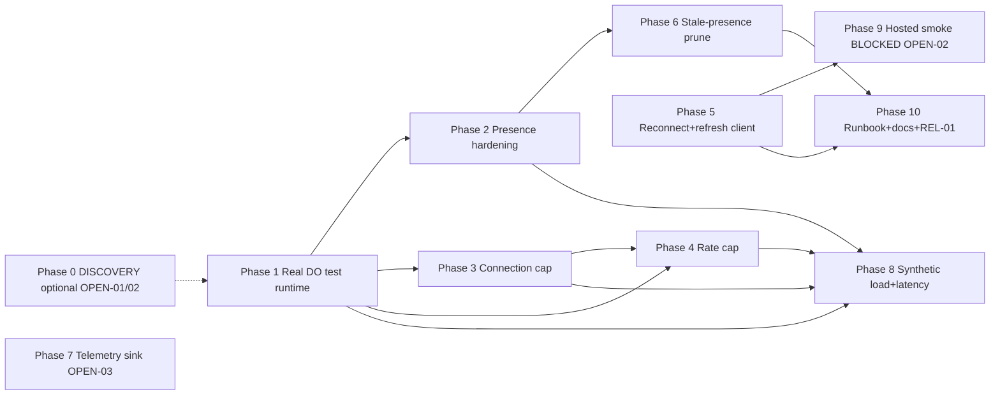

# Plan Pack — Durable Object Realtime Scale Readiness

**Plan folder (absolute):** `/Users/philiplewis/Documents/archestimator/.ai/03_plans/2026-07-07-durable-object-realtime-scale-readiness`
**Date:** 2026-07-07 (Asia/Manila) · **Profile:** `exhaustive` · **Mode:** planning-only (no application code changed)

## Plan status (canonical suite label)

**`CONDITIONALLY READY`**

The feature-implementation slices (Phases 1–8, 10) are implementation-ready: exact
paths/symbols, objective acceptance criteria, complete shadow-path matrices, and external
decisions isolated with options/recommendation. Four owner-gated decisions
(OPEN-01/02/03 + SEC-OPEN-01) and the hosted-soak slice (TEST-02) remain blocked and are
explicitly isolated — they do not block the rest. Older status aliases: `READY` =
`IMPLEMENTATION-READY`; `READY WITH EXTERNAL DECISIONS` = `CONDITIONALLY READY`.

> If `Create-Implementation-Prompt.md` later produces `IMPLEMENTATION_PLAN.md`, that file
> supersedes `11_IMPLEMENTATION_PLAN.md` as the execution overlay. Until then,
> **start at `11_IMPLEMENTATION_PLAN.md`**.

## Implementation start document

`11_IMPLEMENTATION_PLAN.md` — 10 phases (Phase 0 DISCOVERY optional; Phases 1–10
implementation-ready).

## Phase order + dependency graph



- Phase 1 is the prerequisite for DO-side proofs (2,3,4,6,8).
- Phase 5 (client) is independent of DO phases; Phase 9 depends on Phase 5 + OPEN-02.
- Phase 7 is independent (distinct file).
- Phase 10 depends on 5 + 6 (for REL-01 tests).

## Requirement / task / test traceability

- Requirements: `04_REQUIREMENTS_SPECIFICATION.md` (FR/REL/PERF/SEC/OPS/TEST/DOC).
- Tasks: `11_IMPLEMENTATION_PLAN.md` (T-x.y.z → exact path/symbol).
- Tests: `12_TEST_AND_VALIDATION_STRATEGY.md` (Test Execution Matrix).
- End-to-end map: `16_REQUIREMENTS_TRACEABILITY_MATRIX.md`.
- Adversarial: `19_RESEARCH_REVIEW_AND_QA_EVIDENCE.md` (AQ-01..AQ-20).

## Blocked decisions table

| ID | Decision | Owner | Effect if unresolved | Default if proceeding |
|---|---|---|---|---|
| OPEN-01 | numeric cap (`ARCH_REALTIME_ROOM_CAP`) + send-budget (`ARCH_REALTIME_SEND_BUDGET`) values; whether project-wide cursors (D-1) may enable for closed beta | Philip | caps use defaults | ASSUMP-04 (~256 cap) + documented budget |
| OPEN-02 | hosted soak scope (real Worker, multiple WS clients) | Philip | TEST-02 deferred; hosted PERF-01 slice deferred | rely on Miniflare TEST-01 + REL-01; hosted claims stay `inferred` |
| OPEN-03 | production telemetry sink (Workers Logs now vs. Clarity/Sentry later) | Philip | sink defaults | Workers Logs (DEC-DO-07) |
| SEC-OPEN-01 | `issueRealtimeIdentity` issuance rate-limit posture for closed beta (add a durable per-user limiter, or accept short-TTL+authz-probe cost as the bound) | Philip | Security score <95; closed beta runs under option (b) | option (b): short TTL (300s) + authz-probe cost |

## Final readiness (after Improve pass)

`CONDITIONALLY READY` — overall **90/100** (`17_FINAL_READINESS_REVIEW.md`). `verification_mode:
emulated` (lead authored revisions; separate omission-review subagent; honest cap). The
implementation-ready slices are Phases 1–8 + 10; Phase 9 is BLOCKED-EXTERNAL on OPEN-02. To
reach `IMPLEMENTATION-READY`: resolve OPEN-01/02/03/SEC-OPEN-01 + an independent reviewer or
owner sign-off (lifts the `emulated` cap).

## Stale-plan revalidation checklist

Before executing any phase, re-validate:
- [ ] `git status` clean; re-read `src/lib/cloudflare/collaboration-room.ts`,
      `src/hooks/use-project-presence.ts`, `wrangler.jsonc`, `package.json` (concurrent-agent safety).
- [ ] Cloudflare DO limits still match `18_…` (check the official docs URL; 2,048-byte
      attachment, 32,768 sockets/DO, hibernation state-loss).
- [ ] `@cloudflare/vitest-pool-workers` version still compatible with `wrangler ^4.105.0`.
- [ ] OPEN-01/02/03 status (re-confirm with owner or proceed with documented defaults).
- [ ] No sibling pack has changed the realtime files (check `00_AGENT_COORDINATION.md`
      sibling-plan dependency list).

## Commands / checks before the first edit

```bash
git status --short --branch                # clean main, shared worktree
rg -n "class CollaborationRoom" src/lib/cloudflare/collaboration-room.ts
rg -n "acceptWebSocket" src/lib/cloudflare/collaboration-room.ts
bun run type-check   # with NODE_OPTIONS=--max-old-space-size=8192 (known-red ledger)
bun run test:dom     # baseline the existing realtime tests
```

## Files explicitly off-limits (for the planning task; also guidance for impl)

- Any file outside this plan folder (planning task).
- Historical Supabase project `ebxxqidacheyapmmzavr`; the unrelated `archestimator`
  provider project; any Cloudflare account/project not bound in `wrangler.jsonc`.
- No Git branch/worktree creation, no commits/pushes (shared-worktree branch policy).

## Files / systems intentionally unaffected

D1 `ARCH_DB` (no migration), R2 `ARCH_UPLOADS_R2`, Queue `UPLOAD_JOBS_QUEUE`, cron
triggers, Email `EMAIL`, Better Auth sessions, Cloudflare WAF/DDoS, the
`presence-surface.ts` coarse-surface contract, the `realtime-room-token.ts`/`realtime-identity*`
cryptographics (preserved, not weakened).

## External proof that remains required before production rollout

- OPEN-02 hosted smoke (TEST-02): presence sync, reconnect-after-close, survive-token-expiry
  against the production Worker.
- Hosted PERF-01 p95 measurement (only if OPEN-02 approved).
- Workers Logs confirmation that the six realtime event types appear (post-deploy
  `wrangler tail`).

## Document index (21 documents)

| # | Document | Purpose |
|---|---|---|
| 00 | `00_AGENT_COORDINATION.md` | Master goal, lanes, ledger, skills, verification mode |
| 01 | `01_EXECUTIVE_SUMMARY.md` | Headline findings, decisions, scores preview |
| 02 | `02_FEATURE_BRIEF_AND_SCOPE.md` | Brief, scope model, assumptions |
| 03 | `03_SOURCE_AND_CODEBASE_AUDIT.md` | File/symbol audit + call chain |
| 04 | `04_REQUIREMENTS_SPECIFICATION.md` | Requirements + shadow-path matrices |
| 05 | `05_UX_UI_ACCESSIBILITY_PLAN.md` | Preservation + degradation states |
| 06 | `06_ARCHITECTURE_AND_TECHNICAL_DESIGN.md` | Current/target arch, decisions |
| 07 | `07_DATA_DATABASE_API_NETWORK_PLAN.md` | Data ownership, wire schema, no-DB-change |
| 08 | `08_SECURITY_PRIVACY_THREAT_MODEL.md` | STRIDE, denial tests, credential taxonomy |
| 09 | `09_PERFORMANCE_RELIABILITY_OBSERVABILITY.md` | Budgets, failure modes, observability |
| 10 | `10_BLAST_RADIUS_AND_DEPENDENCIES.md` | Direct/transitive impact, sibling plans |
| 11 | `11_IMPLEMENTATION_PLAN.md` | **Execution guide** — phases, tasks, durable goals |
| 12 | `12_TEST_AND_VALIDATION_STRATEGY.md` | Test Execution Matrix, commands |
| 13 | `13_ROLLOUT_ROLLBACK_AND_OPERATIONS.md` | Knobs, rollback, runbook |
| 14 | `14_RISK_REGISTER.md` | R1–R15 (R15 = SEC-OPEN-01) |
| 15 | `15_DECISIONS_ASSUMPTIONS_AND_ALTERNATIVES.md` | DEC-DO-01..08, ASSUMP-01..05, OPEN-01..03, SEC-OPEN-01 |
| 16 | `16_REQUIREMENTS_TRACEABILITY_MATRIX.md` | Requirement → task → test → rollout |
| 17 | `17_FINAL_READINESS_REVIEW.md` | Scores, verifier matrix, verdict |
| 18 | `18_STACK_CONTRACT_AND_PRODUCTION_STANDARDS.md` | Cross-cutting stack decisions |
| 19 | `19_RESEARCH_REVIEW_AND_QA_EVIDENCE.md` | Research, AQ matrix, PERF evaluator, cycles |
| — | `README.md` | This file (entrypoint) |
| — | `PROMPT.md` | Original task brief |

## Archive policy

Archive after full implementation + verification of all phases, OR archive only the
completed slices (Phase 1 first, since it unblocks proofs). Do not auto-archive while
OPEN-01/02/03 remain unresolved. Move to `.ai/09_archive/` on completion.
