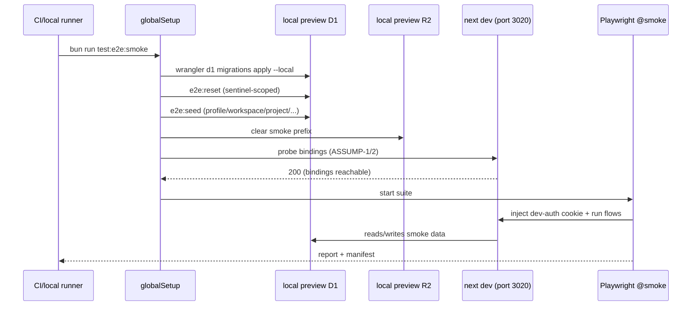

# 06 — Architecture and Technical Design

## Current-state architecture (E2E/test surface)

```
 Developer runs `bun run test:e2e`
        │
        ▼
 playwright.config.ts (testDir ./e2e, port 3020, chromium-only, no globalSetup,
                       storageState opt-in, trace on-first-retry)
        │
        ├── webServer: `bun run dev --port 3020`  (Next dev server)
        │        │
        │        └── @opennextjs/cloudflare getCloudflareContext({async:true})
        │                reads wrangler.next-dev.jsonc
        │                ARCH_DB → preview D1 (363c756a-…)
        │                ARCH_UPLOADS_R2 → preview bucket (…-uploads-dev)
        │                UPLOAD_JOBS_QUEUE, EMAIL, IMAGES
        │
        ├── 9 self-contained specs (no shared fixtures/POMs/auth helper)
        │     • 3 ungated (auth-gate, landing-visual, landing-audit) ← only these ran in old CI
        │     • 6 env-gated (dev-auth cookie or ARCHESTIMATOR_E2E_* flags) ← silently skip
        │
        └── Auth (two paths, both incomplete for automation):
              (a) PLAYWRIGHT_STORAGE_STATE  ← wired, no generator, no committed file
              (b) dev-auth cookie bypass     ← works, but needs a manually-seeded
                                              D1 profiles row for DEV_AUTH_EMAIL
```

**Gaps:** no fixture layer; no seed; no `globalSetup`/`globalTeardown`; no `retries`; no `@smoke`/`@quarantine` project split; CI disabled and binding-less.

## Target-state architecture

```
 Developer/CI runs `bun run test:e2e:smoke`
        │
        ▼
 playwright.config.ts  (+ globalSetup, retries, @smoke/@quarantine projects,
                         custom fixture layer via test.extend)
        │
        ├── globalSetup (runs once, before webServer poll)
        │     1. wrangler d1 migrations apply ARCH_DB --local   (idempotent)
        │     2. e2e:reset  (scoped delete of smoke sentinel rows + R2 prefix)
        │     3. e2e:seed   (idempotent insert: profile, workspace, project,
        │                    estimate, library item, publications, recipient)
        │     4. binding reachability probe (ASSUMP-1/2 falsification)
        │
        ├── webServer: `bun run dev --port 3020` (UNCHANGED — D-2)
        │
        ├── e2e/fixtures/        ← typed builders (accounts, projects, estimates,
        │   accounts.ts             library, publications, recipients, uploads)
        │   projects.ts           • sentinel-UUID convention
        │   estimates.ts          • composable overrides
        │   library.ts
        │   publications.ts
        │   recipients.ts
        │   uploads.ts
        │   index.ts
        │
        ├── e2e/helpers/
        │   auth.ts              ← injectDevAuthCookie(page), skipUnlessSmoke(flag)
        │   selectors.ts         ← role/label/testid policy
        │   env.ts               ← read+validate e2e env contract
        │
        ├── e2e/globalSetup.ts   ← orchestrates reset/seed/probe
        ├── e2e/globalTeardown.ts ← reset (leave no orphans)
        │
        └── e2e/smoke/*.spec.ts   ← the 15 smoke flows (tagged @smoke)
              01-auth-gate.spec.ts
              02-auth-bypass.spec.ts
              03-terms.spec.ts
              04-dashboard.spec.ts
              05-project-create.spec.ts
              06-estimate-edit.spec.ts
              07-library.spec.ts
              08-export.spec.ts
              09-publish.spec.ts
              10-share-open.spec.ts
              11-share-password.spec.ts
              12-recipient-inbox.spec.ts
              13-upload.spec.ts
              14-feedback.spec.ts
              15-signout.spec.ts

 scripts/e2e/
   seed-local.ts            ← reads e2e/fixtures + writes local preview D1
   reset-local.ts           ← scoped delete by sentinel ids/emails + R2 prefix
   sql/smoke-profile.sql    ← profile INSERT (ON CONFLICT DO NOTHING)
   sql/smoke-workspace.sql  ← workspace + owner membership
   sql/smoke-project.sql    ← project + estimate + priced row
   sql/smoke-library.sql    ← cost-library component + price option
   sql/smoke-publication.sql← open + password publications + recipient

 .env.e2e.example          ← single source-of-truth env contract (committed, no real secrets)
```

## Key architectural decisions (full rationale in `15_*`)

### D-1 — Dev-auth-cookie bypass is the primary smoke auth path
- **Why:** already the de-facto pattern in every authed spec; localhost-scoped; deterministic; no email inbox / no Google account needed.
- **Rejected alternatives:** (a) full magic-link automation — non-deterministic, slow, needs mailbox; (b) Google OAuth automation — needs seeded Google account + CI secrets, brittle; (c) `PLAYWRIGHT_STORAGE_STATE` as primary — no generator exists, and a one-time manual login doesn't reseed cleanly.
- **Opt-in production-staging path:** `storageState` generated against a deployed preview with real Better Auth is documented as a future enhancement (OPEN-1), not Phase-1.

### D-2 — webServer stays `bun run dev`; local-isolated preview D1/R2
- **Why:** OpenNext `getCloudflareContext` already gives `next dev` real local bindings reading `wrangler.next-dev.jsonc`; no miniflare/pool-workers swap needed; keeps the change surface small.
- **Local D1 = preview id `363c756a-…`** applied via `wrangler d1 migrations apply ARCH_DB --local`; **local R2 = preview bucket `archestimator-proof-uploads-dev`**.
- **Rejected:** (a) remote D1 seeding — shared state, flake, pollutes real data, violates isolation; (b) miniflare/`vitest-pool-workers` swap — large change, out of smoke scope; (c) test-only Worker deploy — heavier than needed.

### D-3 — Smoke = routing/interaction/data proof, not visual regression
- Visual work stays with the untouched `frontdoor-landing-visual.spec.ts` + `landing-audit.spec.ts`.
- **Rejected:** broad visual regression matrix (poor cost/value for closed beta).

### D-4 — Explicit env-gated skip (umbrella + sub-flags)
- One `ARCHESTIMATOR_E2E_SMOKE=1` umbrella + per-flow sub-flags; every skip names the missing flag. CI opts in incrementally.

### D-5 — retries:1 on CI + 2-strikes quarantine
- `@smoke` project: `retries: 1`. A flaky smoke test → `@quarantine` project (non-blocking) after 2 failures/14 days.

### D-6 — Seed is script-based, local-only, idempotent, sentinel-scoped — NOT a migration
- **Why:** migrations are schema + shared across all envs; seed data must be local-preview-only and resettable. A `migrations/` seed would pollute remote `ARCH_DB` when applied. Scripts scope deletes/inserts to sentinel ids so they can't touch real data.

## Auth setup design (detailed)

**`e2e/helpers/auth.ts`**:
```ts
// pseudo-shape (not implementation signature)
export async function injectDevAuthCookie(page: Page): Promise<void> {
  const secret = requireEnv("ARCHESTIMATOR_DEV_AUTH_BYPASS_SECRET"); // ≥32 chars
  await page.context().addCookies([{
    name: "archestimator-dev-auth-bypass",
    value: secret,
    domain: "127.0.0.1", path: "/", httpOnly: false, sameSite: "Lax",
  }]);
}
export function skipUnlessSmoke(subFlag?: string): void { /* test.skip with reason */ }
```
Mirrors the proven recipe in `e2e/route-transition-performance.spec.ts:148-161`.

**Custom fixture (`test.extend`)** exposing `authedPage` (page + cookie injected), `smokeData` (resolved fixture ids from seed). Specs opt in via `test.use({})` or per-test fixture args.

## Terms-gate handling

Two options; executor picks based on T4.0 discovery (whether terms acceptance is a DB column or a Server Action):
- **Option A (preferred):** seed the smoke profile with terms-accepted (if a `terms_accepted_at`-style column exists) so the gate doesn't prompt — fastest, most deterministic.
- **Option B:** assert the terms prompt in FR-S3 then accept via UI; rely on the accept action's persistence.

Either way FR-S3 proves both the prompt and the post-accept render. The choice is a Phase-4 discovery outcome, not a blocker.

## Fixture layer design (FR-FX1)

Typed builders, composable, sentinel-keyed:
- `makeSmokeAccount(overrides?)` → `{ id, email, role }` (email lowercased; role ∈ ceo/admin/member).
- `makeProject(overrides?)` → `{ id, workspaceId, name, ... }` (default id `22222222-2222-4222-8222-222222222222` to match `ESTIMATES_E2E_PROJECT_ID`).
- `makeEstimate`, `makeEstimateNode`, `makeEstimateRow`, `makeLibraryItem`, `makePublication({password?})`, `makeRecipient`, `makeUploadFile`.
- All under `e2e/fixtures/`; `index.ts` re-exports. No `any`. Sentinel UUIDs documented in-file.

## Environment contract (ARCH-ENV1) — `.env.e2e.example`

Single committed template. Categories:
- **Run control:** `PLAYWRIGHT_PORT=3020`, `ARCHESTIMATOR_E2E_SMOKE=1` (+ sub-flags).
- **Auth (dev-only):** `ARCHESTIMATOR_DEV_AUTH_BYPASS=1`, `ARCHESTIMATOR_DEV_AUTH_EMAIL=e2e-smoke@example.test` (a **dedicated smoke email**, not a real user), `ARCHESTIMATOR_DEV_AUTH_BYPASS_SECRET=<32+ char local-only placeholder>`, `ARCHESTIMATOR_DEV_AUTH_ADMIN_DB=1` (only for flows needing seeded data).
- **Better Auth (local vals):** `BETTER_AUTH_SECRET=<local>`, `BETTER_AUTH_URL=http://127.0.0.1:3020`, `BETTER_AUTH_TRUSTED_ORIGINS=http://127.0.0.1:3020`.
- **Publication secrets (local vals):** `PUBLICATION_TOKEN_ENCRYPTION_SECRET`, `PUBLICATION_TOKEN_HASH_SECRET`, `PUBLICATION_ACCESS_COOKIE_SECRET` (all 32+ char local placeholders).
- **Feature gates (flipped for smoke):** `CLOSED_BETA_ACCESS_ENABLED=false` (unless testing the gate), `PROJECT_INVITE_ENTRY_ENABLED=false` (unless FR-invite), `ARCHESTIMATOR_AI_ENABLED=false`, `UPLOAD_JOBS_ENABLED=0`, `ARCHESTIMATOR_EMAIL_DELIVERY_ENABLED=false`.
- **Storage:** `ARCHESTIMATOR_UPLOAD_STORAGE_PROVIDER=cloudflare-r2`, `ARCHESTIMATOR_IMAGE_PROCESSING_PROVIDER=node-sharp`.
- **LOUD WARNING block:** dev-auth bypass + these secrets must never be set in any deployed/preview/prod env or CI runner pointed at remote bindings.

## Component boundaries & state ownership (Relevant because the harness observes app state)

- Smoke reads app state through the **rendered DOM / route responses**, not by importing app internals. No `vi.mock` in E2E (that's vitest's job).
- Authenticated state = cookie (dev-auth) — owned by the harness's `injectDevAuthCookie`.
- Seeded data = owned by `scripts/e2e/seed-local.ts` writing local preview D1.
- No client bundle impact (no app code change except optional minimal `data-*` testids, gated per-task).

## Cache / revalidation

Not in scope (smoke observes; it doesn't change caching). Publication snapshot freshness is the app's concern; smoke asserts the snapshot renders, not cache semantics.

## Concurrency / shared-worktree safety (per AGENTS.md + Multi-Agent Directive §6)

- All harness files are **new** under `e2e/`, `scripts/e2e/`, `.env.e2e.example`, and plan folder. Disjoint from app source.
- The only files the executor **edits** (not creates): `playwright.config.ts` (additive: globalSetup, retries, projects), `package.json` (additive scripts), `.env.example` (additive doc lines), and optional per-flow `data-*` testids in app components. Each edit is a named, scoped, reversible task in `11_*`. The executor re-reads each file immediately before editing and coordinates via file-scope ownership.
- Seed/reset scripts touch **only local preview D1/R2** (sentinel-scoped), never remote `ARCH_DB` or production buckets.

## Route-specific App Router boundary/cache contracts (Improve-Plan-Prompt §4)

The harness **observes** these routes; it does not change them. This section documents the **current** rendering/cache posture the smoke depends on, proven from repo evidence. **Cache Components is NOT in use** in the touched scope (no `use cache` / `cacheLife` / `cacheTag` in `src/app/workshop/**`, `src/app/share/**`, `src/app/api/share/**`, or `src/app/api/projects/**` — verified by grep). Routes use classic `force-dynamic` + per-request auth. No Next.js 14/15 fetch-cache assumptions are carried.

| Route / handler | File | Rendering | Server-owned data → Client boundary | Request-time APIs (→ dynamic) | Cache/revalidation | Smoke dependency |
|---|---|---|---|---|---|---|
| `/` + public marketing (`/about`, `/features`, `/pricing`, `/contact`, `/privacy`, `/terms`, `/trust`, `/security`) | `src/app/<seg>/page.tsx` | static / `force-static` (e.g. `/new`) | server data only; minimal props to client | none | static/cached (landing) | 01 (no console err) |
| `/login` | `src/app/login/page.tsx` | dynamic (auth-aware redirect) | LoginForm `"use client"` (minimal: email + Google) | cookies (session check via proxy) | no-store (auth) | 01 (Google btn + email field) |
| `/workshop/**` | `src/app/workshop/**/page.tsx` + `layout.tsx` | **dynamic** (proxy-stamped `x-archestimator-auth-verified`/`-terms-accepted` headers; per-request auth) | server: auth context, RBAC; client: TanStack Query for mutations, Zustand for UI state | `cookies`, `headers` (via proxy + `getCurrentUserContext`) | no-store (auth-gated, per-user) | 02–07, 09, 12, 14, 15 |
| `/share/[token]` | `src/app/share/[token]/page.tsx` (`dynamic="force-dynamic"`, line 34) | **dynamic** | server: token resolve, password gate, recipient session; client: ShareReviewWorkspace (`"use client"`) | `params`, `cookies`, `searchParams` (recipient) | **no-store** (token-bearing, per-recipient); OG metadata redacts totals/client-name | 10, 11 |
| `/api/share/[token]` + `/password` `/comment` `/decision` `/session` `/activity` `/events` `/unsubscribe` | `src/app/api/share/[token]/*/route.ts` (all `force-dynamic`) | **dynamic** route handlers | JSON DTOs (snapshot omits secrets; password returns pass/fail) | `request`, `cookies` | no-store; same-origin on POST/DELETE | 10, 11 |
| `/api/projects/[id]/estimates/[eid]/export/proposal.xlsx` | `.../export/proposal.xlsx/route.ts` (`force-dynamic`, line 18; nodejs, `maxDuration=60`) | **dynamic** | xlsx binary (audience-scoped) | `request`, `cookies` | no-store; download headers; per-user rate limit | 08 |
| `/api/component-library/attachments/direct-upload` | `.../direct-upload/route.ts` | dynamic | reserve/finalize DTO (short-lived upload target; no long-lived secret) | `request`, `cookies` | no-store; admission-control stateful | 13 |
| `/api/health` | `src/app/api/health/route.ts` | dynamic | status JSON (no secrets) | none | none | globalSetup probe |

**Revalidation:** no smoke-touched mutation uses `revalidatePath`/`revalidateTag`/`updateTag` for the harness's sake. App mutations (createProject, etc.) do their own invalidation (existing behavior, unchanged). Smoke observes the post-mutation render via Playwright auto-waiting — it does not depend on a specific cache-invalidation primitive, only on the rendered result reflecting the write (read-your-writes is the app's responsibility, proven by existing vitest).

**Server Action direct-POST threat model:** every smoke-relevant Server Action (`createProject:833`, `createEstimate:2311`, `createProjectPublication:775`, `signOut`) calls `requireAuth`/RBAC internally — they are directly-reachable POST endpoints that validate auth inside the action (not relying on the proxy alone). Smoke hits them through the UI form (progressive-enhancement path), which is the same surface real users use.

**No Cache Components migration needed for this plan.** If a future Cache Components migration happens (sibling concern), the smoke's no-store assumptions for auth/share/upload/export remain valid because those routes are explicitly `force-dynamic`.

## Diagrams


