# 06 — Architecture and Technical Design

## 6.1 Current-state architecture (activation-relevant slice)

```mermaid
flowchart LR
  A[Closed-beta allowlist] --> B[Better Auth magic-link/Google]
  B --> C[Terms clickwrap gate]
  C --> D[ensureDefaultWorkspace lazily provisions workspace]
  D --> E["/workshop WorkshopPage RSC"]
  E -->|Promise.all batched| F[Homebase summary RPC]
  F --> G[WorkshopDashboard bento]
  G --> H[LibraryHubCard: New project only enabled action]
  H --> I[NewProjectForm createProjectRecord]
  I --> J[createEstimateSheetDraft auto-seeds first estimate]
  J --> K[Estimate editor empty-tab affordance]
  K --> L[createProjectPublication terminal rung]
```

Gaps vs target: no first-run welcome surface; no durable milestones; no activation events; library/projects/publisher zero states missing or thin.

## 6.2 Target-state architecture

```mermaid
flowchart LR
  A[Closed-beta allowlist] --> B[Better Auth]
  B --> C[Terms clickwrap]
  C --> D[ensureDefaultWorkspace + seed milestone row 0]
  D --> E["/workshop WorkshopPage RSC"]
  E -->|Promise.all batched + milestone read| F[Homebase summary incl. activationMilestones/firstRun]
  F --> G{firstRun?}
  G -->|yes| H[WorkspaceWelcomePanel above bento]
  G -->|no| I[WorkshopDashboard bento]
  H --> J[NewProjectForm]
  J --> K[createProjectRecord + emit event + idempotent milestone]
  K --> L[createEstimateSheetDraft + emit + milestone]
  L --> M[Estimate editor + milestones on first area/template/line item]
  M --> N[createProjectPublication + emit + terminal milestone]
  N --> O[Activation event sink: observability logger typed schema]
```

## 6.3 Component boundaries and ownership

| New/changed module | Responsibility | Server/client | Owner |
|---|---|---|---|
| `src/components/workshop/dashboard/WorkspaceWelcomePanel.tsx` (new) | Renders first-run welcome above bento; opens `NewProjectModal`; dismiss control. | Client (`"use client"` for modal open state + dismiss action) | Dashboard lane |
| `src/components/workshop/dashboard/WorkshopDashboard.tsx` (changed) | Renders panel when `firstRun===true`, else bento-only. | Client | Dashboard lane |
| `src/components/workshop/dashboard/lib.ts` (changed) | Extend `WorkshopDashboardData` with `activationMilestones`, `firstRun`. | Shared types | Dashboard lane |
| `src/lib/activation/milestones.ts` (new) | Repository: idempotent `markMilestone(workspaceId, col)`, `getMilestones(workspaceId)`. | Server-only | Data lane |
| `src/lib/activation/events.ts` (new) | Typed activation-event emitter; sink = existing observability logger (mirrors `estimate-mutation-telemetry.ts`). | Server-only | Data lane |
| `src/lib/projects/actions.ts` (changed) | Emit `project_created`; write `first_project_created_at`. | Server Action | Data lane |
| `src/lib/estimates/actions.ts` (changed) | Emit `estimate_created`/`area_created`/`template_inserted`/`line_item_created`; write respective milestones. | Server Action | Data lane |
| `src/lib/publication/actions.ts` (changed) | Emit `publication_created`; write terminal milestone. | Server Action | Data lane |
| `src/lib/repositories/workspace-repository.ts` (changed) | On `ensureDefaultWorkspace` create, seed milestone row 0. | Server-only | Data lane |
| `src/components/workshop/projects-page-client.tsx` (changed) | Zero-projects `<EmptyState>`. | Client | Projects lane |
| `src/components/workshop/library/**` (changed) | Library/templates/overview zero states. | Client | Library lane |
| `src/components/workshop/publisher/PublisherEmptyState.tsx` (changed, minor) | Ladder-aware secondary CTA. | Client | Publisher lane |

## 6.4 State ownership (right layer for each kind)

- **Server-authoritative:** milestone timestamps (`workspace_activation_milestones` in D1). The single source of truth for "has the user reached rung N."
- **Client-only (cosmetic):** the optional contextual hint chip's dismissed state (`localStorage`). Lossy by design; does not affect gating.
- **Server Component fetch:** `/workshop` RSC reads milestones in the existing homebase `Promise.all` wave (no new round trip — see PERF-001).
- **TanStack Query:** unchanged — existing dashboard cache invalidation (`router.refresh()` after mutations) re-reads milestones.
- **Zustand:** not introduced for activation; no cross-component client state justifies it.
- **URL state:** none added (welcome is not shareable state).

## 6.5 Cache/revalidation/freshness contract

- **Active data path:** the homebase read is `getWorkshopHomebaseData()` → `getWorkshopHomebaseDataAppPath()` (`workspace-repository.ts:1776/2129`). It is a plain uncached `Promise.all` of 6 SQL reads inside the `/workshop` RSC. The `getWorkshopHomebaseDataRpcPath()` (L2125) is **disabled** (`return null`) and gated behind an unset env flag; its SQL is off-limits (legacy `supabase/migrations`). Treat the RPC path as dead.
- **Milestone read placement:** append the single-row milestone `SELECT` as a **7th parallel arm** to the `Promise.all` at `workspace-repository.ts:2140`. It runs in parallel with the existing 6 reads — same one wave, one extra arm. There is no existing cache layer on this path to extend; freshness is per-request (RSC).
- Read-your-writes: after `createProjectRecord`, `router.refresh()` (already in `NewProjectForm.tsx:336`) re-fetches the homebase, which re-reads milestones → `firstRun` flips false → panel hides. No new invalidation primitive.
- Cross-workspace isolation: milestones are `workspace_id`-scoped; the homebase query already filters by the caller's workspace. No cross-workspace leak.
- Failure behavior: if the milestone read fails (caught in the app-path), default `activationMilestones=null` and `firstRun = (projects.length === 0)` (panel still eligible when empty, since a missing row means "not dismissed") — logged via observability; the projects-list zero state (FR-003) remains the durable recovery path.

## 6.6 Server/Client boundary decisions

- `WorkspaceWelcomePanel` is `"use client"` only because it owns `NewProjectModal` open state and the dismiss action. It receives `firstRun: boolean` + `milestones` snapshot as props from the RSC; it does not fetch.
- All milestone/event logic is server-only (`src/lib/activation/**`); never imported into client bundles. `NEXT_PUBLIC_` exposure: none.
- No Server Action is added solely for activation; existing actions (`createProjectRecord`, `createEstimateSheetDraft`, `createEstimateNode`, `insertEstimateTemplateIntoEstimate`, `createProjectPublication`) gain the emit+milestone calls inline.

## 6.7 React/Next.js review gate (per directive §4A)

- ✅ Default Server Components; `"use client"` scoped to the smallest interactive boundary (the panel's modal/dismiss).
- ✅ No server-only data in client bundles (`src/lib/activation/**` server-only).
- ✅ State colocated; derived where possible (`firstRun` is derived from `activationMilestones`, not mirrored).
- ✅ No effect-driven render derivation; the panel's only effect is focus management on mount/unmount (with cleanup).
- ✅ Stable keys: panel is a singleton (no list keys).
- ✅ Semantic primitives: `Button`, `section[aria-labelledby]`, live-region.
- ✅ Next.js 16 cache model: relies on the existing homebase summary cache; no new `use cache`/`cacheLife`/`cacheTag` introduced. (No Cache Components migration assumed; if one lands later, the milestone read folds into the same dynamic data fetch.)

## 6.8 Architectural alternatives considered

| Alternative | Rejected because |
|---|---|
| Full Joyride tour library (`react-joyride`) | Adds a dependency + a tour-registry + per-tour persistence; owner posture is no required tour; product-led empty states are cheaper and match the no-intake-gate decision. |
| Per-user onboarding profile table (Joyride plan's `user_onboarding_tours`) | Supabase-stale; over-engineered for "did the user reach rung N"; one row per workspace is enough. |
| Client-side activation analytics (SDK in `/workshop`) | Adds a third-party script + consent surface + bundle cost; server-emitted structured events cover the funnel with zero client footprint for closed beta. |
| Required onboarding wizard at `/workshop/onboarding` | Forbidden by owner decision; `auth-onboarding-guard.test.ts` enforces collapse to `/workshop`. |
| Re-adding the cleared library overview content | Owner deliberately cleared it (`data-library-overview="empty"`); only a first-run empty state is added. |

## 6.9 Coupling, failure boundaries, integration points

- The activation layer is a **thin cross-cutting concern**: it hooks into existing mutations (emit + idempotent milestone) and reads one extra column group in the homebase query. Failure of the activation layer must not break the core estimating flow — emits are fire-and-log (caught + logged, never thrown to the user), milestone writes are wrapped so a D1 error degrades to "panel may show/hide incorrectly" not "create project fails."
- Integration points: `createProjectRecord`, `createEstimateSheetDraft`, `createEstimateNode`, `insertEstimateTemplateIntoEstimate`, `insertEstimateRowItemFromLibrary`, `createProjectPublication`, `ensureDefaultWorkspace`, homebase summary RPC, `WorkshopDashboard`, `projects-page-client`, library clients, `PublisherEmptyState`.
