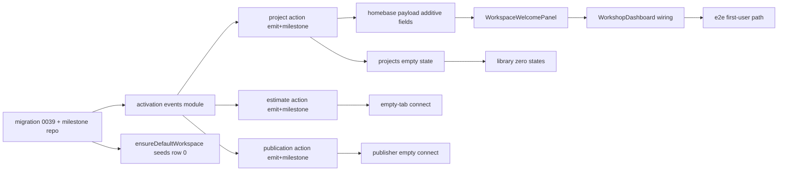

# 10 — Blast Radius and Dependencies

## 10.1 Impact classification legend

`Required change` · `Probable change` · `Possible change` · `Verification only` · `Explicitly unaffected`.

## 10.2 Impact inventory

| Area | Specific surface | Classification | Rationale |
|---|---|---|---|
| Users (creators) | First-run welcome, zero states | Required change | The point of the feature |
| Users (invited collaborators) | Welcome surface visibility in an adopted workspace | Possible change | OPEN-DEC-02; collaborators adopt an existing workspace that already has projects, so they likely never see the panel. Decision needed for the rare empty-collaborator case. |
| Routes | `/workshop` | Required change | RSC reads milestones + renders panel conditionally |
| Routes | `/workshop/projects`, `/workshop/library`, `/workshop/library/components`, `/workshop/library/templates`, `/workshop/publisher` | Required change | Zero states added/connected |
| Routes | `/workshop/onboarding` | Explicitly unaffected | Stays a redirect (owner decision) |
| Components | `WorkshopDashboard`, `LibraryHubCard` (minor), `projects-page-client`, library clients, `PublisherEmptyState` | Required change | Zero states + panel wiring |
| Components | `NewProjectModal`/`NewProjectForm`, `EmptyState` primitive | Verification only / reuse | Reused unchanged |
| Components | `RecentProjectsList`, `RecentSheetsList`, `ContinueCard`, `FavoritesTree` | Verification only | Render below the panel; unchanged behavior |
| Server Actions | `createProjectRecord`, `createEstimateSheetDraft`, `createEstimateNode`, `insertEstimateTemplateIntoEstimate`, `insertEstimateRowItemFromLibrary`, `createProjectPublication` | Required change (emit + milestone only) | Inline activation hooks; core behavior unchanged |
| Repository | `workspace-repository.ts` `ensureDefaultWorkspace` | Probable change | Seed milestone row 0 on workspace creation |
| Data | New table `workspace_activation_milestones` (migration `0039`) | Required change | New metadata table |
| Data | `projects`, `estimates`, `estimate_nodes`, `cost_library_items`, `estimate_templates`, `project_publications` | Verification only | Read for reconciliation only; schema unchanged |
| API | Homebase summary RPC | Required change (additive) | Optional `activationMilestones`/`firstRun` fields |
| Auth/session/beta/terms | Existing gates | Verification only | Activation begins after these; no changes |
| Tests | Existing dashboard/homebase/onboarding-guard/empty-tab tests | Verification only | Must stay green; extended additively |
| Tests | New activation tests | Required change | New milestone/event/UX coverage |
| Analytics | None today → server-emitted activation events | Required change | New (closed-beta scope) |
| Monitoring | Existing observability logger | Probable change | New `scope: "activation"` tag |
| Docs | `16-onboarding-activation-readiness.md`, `decisions.md`, `known-issues.md` | Required change (post-impl) | Reconcile phases + record approach |
| Deployment | `wrangler.jsonc` bindings | Explicitly unaffected | No new bindings |
| Existing features | Project/estimate/library/publisher flows | Verification only | Core behavior preserved; activation is a thin overlay |
| Backward compat | Old homebase payload consumers | Verification only | New fields optional; old clients unaffected |
| Concurrent dev | Sibling 2026-07-07 plan stubs | Possible coordination | They are prompt-only stubs; this pack is the first to operationalize activation. Coordinate during implementation via file-scope ownership. |

## 10.3 Dependency graph (implementation order)

## 10.4 Critical-path coupling

The critical path is: **migration + milestone repo → events module → action hooks → homebase payload → welcome panel → dashboard wiring → e2e**. Library/projects/publisher zero states are parallel-safe once the events module exists.

## 10.5 Compatibility

- Migration is additive (new table); no existing column changed.
- Homebase payload changes are additive optional.
- No public API contract change.
- No client bundle breaking change (panel is a new additive component).
- No Worker Env binding change → no `cf:typegen` needed.

## 10.6 Documentation impact (post-implementation)

| Doc | Change |
|---|---|
| `.ai/01_roadmap/16-onboarding-activation-readiness.md` | Mark operationalized phases shipped; Required Analytics Events → emitted. |
| `.ai/10_state/decisions.md` | Append product-led activation decision + milestones table. |
| `.ai/10_state/known-issues.md` | Note activation ladder shipped; immutable/PDF still deferred. |
| This plan folder | Archive after full implementation (per `README.md` archive policy). |
