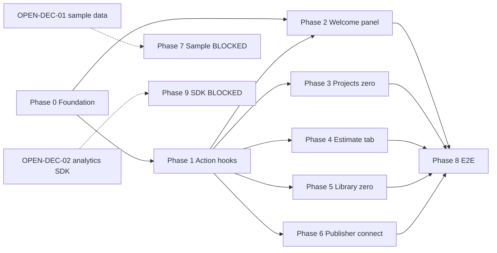

# Plan Pack — First User Activation & Empty Workspace

**Date (Asia/Manila):** 2026-07-07
**Plan profile:** exhaustive
**Plan status:** `CONDITIONALLY READY` (overall readiness 95; capped by emulated verification at 97, and held at 95 pending owner/independent acceptance — see `17_FINAL_READINESS_REVIEW.md`)
**Verification mode:** `emulated` (author = verifier; a separate native adversarial-review lane ran independently in cycle 3 — its P0/P1 findings were corrected; see `17_…` §17.7)

> This is a **planning-only** pack. No application code, tests, migrations, schemas, infrastructure, configuration, or Git state was modified. All writes are confined to this folder.

## What this pack delivers

A product/UX plan for the **first-user activation ladder**: closed-beta entry → first project → first estimate → first area/template/line item → first publishable proposal. It defines activation success criteria, every zero/empty state, guided next actions, sample/demo data policy, durable onboarding milestones, analytics/evidence, tests, and connections to the sibling 2026-07-07 plan stubs.

The keystone decision: activation is **product-led** (empty states + durable milestones + optional contextual hints), not a required wizard — per the owner decision that authenticated users land directly on `/workshop` with no intake gate.

## Implementation start here

**Primary execution guide:** `11_IMPLEMENTATION_PLAN.md`

**Phase order (dependency-aware):**

1. **Phase 0 — Foundation** (migration `0039` + `src/lib/activation/{milestones,events}.ts`) — root; nothing else starts without it.
2. **Phase 1 — Server-Action hooks** (emit + idempotent milestone in the 5 rung actions + `ensureDefaultWorkspace` seed) — depends on P0.
3. **Phase 2 — Homebase payload + dashboard welcome panel** (the keystone UX) — depends on P0 + P1.
4. **Phase 3 — Projects list zero state** — depends on P1.
5. **Phase 4 — Estimate empty-tab connection** (extend, don't rebuild) — depends on P1.
6. **Phase 5 — Library zero states** (components/templates/overview) — depends on P1.
7. **Phase 6 — Publisher empty-state connection + terminal rung surfacing** — depends on P1.
8. **Phase 7 — Opt-in sample project** — **`BLOCKED-EXTERNAL` on OPEN-DEC-01.**
9. **Phase 8 — E2E first-user path + analytics review** — depends on P0–P6.
10. **Phase 9 — Consent-gated analytics SDK upgrade** — **`BLOCKED-EXTERNAL` on OPEN-DEC-02` (optional).**

**Implementation-ready now:** Phases 0–6 + 8. **Blocked:** Phase 7 (OPEN-DEC-01), Phase 9 (OPEN-DEC-02).

## Dependency graph

## Blocked decisions table

| ID | Decision | Owner | Blocks | Recommendation |
|---|---|---|---|---|
| OPEN-DEC-01 | Sample/demo data policy (none vs opt-in sample vs templated demo) | Philip | Phase 7 | (b) opt-in starter sample, default off |
| OPEN-DEC-02 | (i) Collaborator welcome visibility; (ii) when to add a consent-gated analytics SDK | Philip | Phase 9; minor copy for (i) | (i) show to any member when empty; (ii) defer SDK to post-beta |

See `15_DECISIONS_ASSUMPTIONS_AND_ALTERNATIVES.md`.

## Stale-plan revalidation checklist (before executing)

- [ ] Confirm `0038_*` is still the latest migration; renumber `0039_*` if not.
- [ ] Re-confirm `createEstimateSheetDraft` still auto-seeds an empty estimate from `NewProjectForm` (`rg "createEstimateSheetDraft" src/components/workshop/NewProjectForm.tsx`).
- [ ] Re-confirm `LibraryHubCard` "New estimate sheet" disabled-when-no-project behavior (`src/components/workshop/dashboard/LibraryHubCard.tsx`).
- [ ] Re-confirm `auth-onboarding-guard.test.ts` still asserts login → `/workshop` with no gate.
- [ ] Re-confirm `EmptyState` primitive API (`src/components/ui/empty-state.tsx`).
- [ ] Re-confirm `workshop-homebase-summary-rpc-contract.test.ts` is still the payload contract owner.
- [ ] Re-read every file in `11_IMPLEMENTATION_PLAN.md` immediately before editing it.

## Commands / checks to run before the first edit

- `git status --short --branch` (shared worktree)
- `bun run type-check`
- `bun run lint`
- `bunx vitest run tests/vitest/auth-onboarding-guard.test.ts tests/vitest/estimate-empty-tab-state.test.tsx tests/vitest/estimate-sheet-create-empty-tree.test.ts tests/vitest/workshop-homebase-summary-rpc-contract.test.ts --maxWorkers=1` (baseline green)

## Files explicitly off-limits (do not change as part of this plan)

- `src/app/workshop/onboarding/page.tsx` — stays a redirect (owner decision).
- `supabase/migrations/*`, `supabase/seed.sql`, `data/local/seed.json` — historical only.
- Any provider project outside `wrangler.jsonc` bindings.
- The stale Joyride plan folder (`2026-06-03-react-joyride-onboarding-implementation-plan`) — do not execute; this pack supersedes it for the activation path.

## Files and systems intentionally unaffected

- Auth/session/beta/terms gates (activation begins after them).
- R2 / Durable Objects / Queues / Email / Images bindings.
- `RecentProjectsList` / `RecentSheetsList` / `ContinueCard` / `FavoritesTree` behavior (panel renders above them).
- Immutable/PDF proposal packages (sibling stub).
- Public marketing landing page (explicit constraint).

## External proof that remains required before production rollout

- Closed-beta first cohort reaches `first_publication_created_at` (funnel completion).
- Hosted/production RUM/CWV once the sibling telemetry stub lands (performance evaluator upgrade).
- Owner acceptance of this `CONDITIONALLY READY` package (lifts to `IMPLEMENTATION-READY` for Phases 0–6 + 8) and resolution of OPEN-DEC-01 (Phase 7) / OPEN-DEC-02 (Phase 9).

## Traceability

- Requirements → `16_REQUIREMENTS_TRACEABILITY_MATRIX.md`.
- Test matrix → `12_TEST_AND_VALIDATION_STRATEGY.md`.
- Decisions/alternatives → `15_…`. Risks → `14_…`. Readiness → `17_…`.

## Document index

| Doc | Purpose |
|---|---|
| `00_AGENT_COORDINATION.md` | Master goal, agents, skills, source authority, conflicts |
| `01_EXECUTIVE_SUMMARY.md` | One-paragraph current/target state + findings + verdict |
| `02_FEATURE_BRIEF_AND_SCOPE.md` | Brief, scope in/out, stakeholders, assumptions, constraints, success metrics |
| `03_SOURCE_AND_CODEBASE_AUDIT.md` | Evidence-grounded map of every touched surface |
| `04_REQUIREMENTS_SPECIFICATION.md` | Stable requirement IDs + acceptance criteria + shadow paths |
| `05_UX_UI_ACCESSIBILITY_PLAN.md` | Screen states, a11y, copy, regressions to guard |
| `06_ARCHITECTURE_AND_TECHNICAL_DESIGN.md` | Current/target architecture, boundaries, state ownership, alternatives |
| `07_DATA_DATABASE_API_NETWORK_PLAN.md` | Migration blueprint, access-path matrix, integrity, reconciliation |
| `08_SECURITY_PRIVACY_THREAT_MODEL.md` | Threat model, credential taxonomy, abuse, privacy |
| `09_PERFORMANCE_RELIABILITY_OBSERVABILITY.md` | Evaluator contract, budgets, failure modes, rollout gates |
| `10_BLAST_RADIUS_AND_DEPENDENCIES.md` | Impact inventory, dependency graph, compatibility |
| `11_IMPLEMENTATION_PLAN.md` | **Execution guide** — phases, tasks, exact paths/symbols, durable-goal contracts |
| `12_TEST_AND_VALIDATION_STRATEGY.md` | Test execution matrix, commands, manual QA |
| `13_ROLLOUT_ROLLBACK_AND_OPERATIONS.md` | Rings, gates, rollback, runbook |
| `14_RISK_REGISTER.md` | Risk table with mitigations |
| `15_DECISIONS_ASSUMPTIONS_AND_ALTERNATIVES.md` | Decisions, open decisions, assumptions, rejected alternatives |
| `16_REQUIREMENTS_TRACEABILITY_MATRIX.md` | Requirement → evidence mapping |
| `17_FINAL_READINESS_REVIEW.md` | Scores, PASS conditions, deficiencies, verifier recommendation |
| `18_STACK_CONTRACT_AND_PRODUCTION_STANDARDS.md` | Cross-cutting stack production decisions |
| `19_RESEARCH_REVIEW_AND_QA_EVIDENCE.md` | Research, review cycles, adversarial matrix, evaluator, gaps |
| `PROMPT.md` | Original brief (preserved) |

## Archive policy

Archive this folder to `.ai/09_archive/` after Phases 0–6 + 8 are fully implemented and verified, and after OPEN-DEC-01/02 are resolved (Phase 7/9 either implemented or explicitly dropped). Do not archive automatically mid-implementation.
