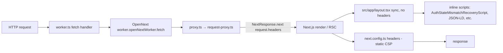
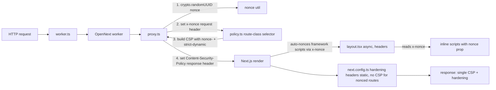

# 06 — Architecture and Technical Design

## 6.1 Current-state architecture

- **CSP source:** static strings in `next.config.ts headers()` (`:20-47, 154-288`).
- **Nonce:** none.
- **Proxy:** injects request headers for auth gating; sets `Cache-Control`; no CSP.
- **Root layout:** synchronous; renders inline scripts sitewide without nonces.
- **Result:** `'unsafe-inline'` + `'unsafe-eval'` required everywhere to make the
  inline scripts run.

## 6.2 Target-state architecture

**Three new modules under `src/lib/csp/`:**

| Module | Responsibility | Public contract |
|---|---|---|
| `src/lib/csp/nonce.ts` | Generate a per-request nonce | `generateCspNonce(): string` → base64 of `crypto.randomUUID()` |
| `src/lib/csp/policy.ts` | Build the CSP string per route class + env | `buildCspPolicy({ routeClass, nonce, isDev }): string` |
| `src/lib/csp/route-class.ts` | Map a pathname to a route class | `resolveCspRouteClass(pathname): 'landing'|'workshop'|'invite'|'share'|'auth'|'default'` |

**Proxy change** (`src/lib/auth/request-proxy.ts`): after the existing auth-gating
logic and before/within `createRequestPathResponse`, generate the nonce, build the
policy, set `x-nonce` on the request headers (so server components can read it), and
set `Content-Security-Policy` on the response. **Serial work** — must not be split
from the existing auth logic (shared critical path; one agent).

**Layout change** (`src/app/layout.tsx`): become `async`, `const nonce = (await
headers()).get('x-nonce') ?? ''`, pass to the inline-script components. A server-only
`NonceContext` (React context) or prop-drilling both work; prop-drilling is simpler
given the small fan-out.

## 6.3 Per-route-class target policies

All policies share: `default-src 'self'`, `base-uri 'self'`, `frame-ancestors 'none'`,
`object-src 'none'`, `form-action 'self'`, `style-src 'self' 'unsafe-inline'`,
`img-src 'self' data: blob:`, `font-src 'self' data:`, `worker-src 'self'`,
`upgrade-insecure-requests`, plus `Reporting-Endpoints`/`report-to`.

| Route class | script-src (prod) | connect-src | Extra img-src | Extra | Mode per phase |
|---|---|---|---|---|---|
| landing | `'self' 'nonce-{n}' 'strict-dynamic' https://static.cloudflareinsights.com https://www.googletagmanager.com https://www.clarity.ms` | `'self' https://cloudflareinsights.com https://*.cloudflareinsights.com https://www.google-analytics.com https://region1.google-analytics.com https://www.clarity.ms https://*.clarity.ms` | avatar hosts (`*.ggpht.com *.googleusercontent.com`) | — | P5 enforced (or Report-Only per DEC-11) |
| workshop | `'self' 'nonce-{n}' 'strict-dynamic' https://maps.googleapis.com` (+ `'unsafe-eval'` dev) | `'self' wss: ws:` (+ dev local) | maps + avatar + ggpht/googleusercontent | `frame-src` none (drop unused) | P4 enforced |
| invite | `'self' 'nonce-{n}' 'strict-dynamic'` | `'self'` | avatar hosts | — | P3 enforced |
| share | `'self' 'nonce-{n}' 'strict-dynamic'` | `'self'` | avatar hosts (if avatars render) | no analytics, no maps (tracking-free per OPEN-DEC-008) | P3 enforced |
| auth (`/login`, `/signup`, `/access-required`, `/auth/callback`) | `'self' 'nonce-{n}' 'strict-dynamic'` | `'self'` | — | — | P5 enforced |
| default / catch-all | `'self' 'nonce-{n}' 'strict-dynamic'` | `'self'` | — | minimal | P5 enforced |

**Dropped from workshop policy (unused, per `03` §3.5):** `fonts.googleapis.com`
(style-src), `fonts.gstatic.com` (font-src), `frame-src https://*.google.com`,
`child-src 'self' blob:`.

**Notes:**
- `'strict-dynamic'` lets nonced scripts load their own dependencies without expanding
  the allowlist (MDN; web.dev). GA4/Clarity/Cloudflare are kept in the allowlist as a
  belt-and-braces measure for the initial-load bootstrap before nonce propagation.
- When a nonce is present, browsers ignore `'unsafe-inline'` (MDN); we remove it
  anyway for clarity (SEC-03).
- API routes (`/api/*`) get **no `script-src`-bearing CSP** (JSON responses); they
  keep the hardening headers. The one exception is the new `/api/csp-report` endpoint,
  which needs no CSP at all (it receives reports, doesn't serve HTML).

## 6.4 Static-page nonce problem and resolution

The official guide is explicit: **nonces require dynamic rendering.** A statically
cached page would freeze a nonce into the build, breaking the per-request uniqueness
guarantee.

| Route class | Currently dynamic? | Resolution |
|---|---|---|
| `/share/:token` | Yes (`force-dynamic` + `no-store`) | No cost — enforce freely |
| `/workshop/*` | Yes (auth-gated, reads headers/cookies) | No cost — enforce freely |
| `/invite/:token` | Yes (token-bearing, dynamic) | No cost — enforce freely |
| `/login`, `/signup`, `/access-required`, `/auth/callback` | Mostly dynamic (auth) | No cost |
| landing (`/`, `/about`, ...) | **Static-cached** (`s-maxage=31536000`) | **Cost** — enforcing nonced CSP forces dynamic; TTFB impact (DEC-11) |

**Resolution for landing:** two viable options, owner decision (DEC-11):
- **(A) Enforce nonced CSP, accept dynamic.** Marketing pages render per request.
  Cloudflare edge still caches assets; HTML TTFB increases modestly. Simpler, stronger
  security.
- **(B) Keep marketing Report-Only.** Marketing pages stay static-cached; only
  `/share`, `/workshop`, `/invite`, `/auth` enforce. Weaker but zero perf cost. The
  marketing pages still ship a CSP (Report-Only with allowlist) so violations are
  observed.

**Recommendation (DEC-11):** Option A for the authenticated/token surfaces (already
dynamic) + Option B deferred for marketing until TTFB is measured. I.e., enforce on
`/share`, `/workshop`, `/invite`, `/auth` in P3–P5; keep marketing Report-Only until
the perf gate (PERF-01) clears, then flip. This matches the "phased rollout" stop
condition.

## 6.5 Header-ownership resolution

To avoid double CSP headers (SEC-09):

- **During Report-Only phase (P1):** the proxy emits `Content-Security-Policy-Report-Only`
  with the nonce. The existing `next.config.headers()` Report-Only strings are
  **removed** for those route classes in the same change (so only the proxy owns CSP).
  Hardening headers stay in `next.config.headers()`.
- **During Enforced phase (P3–P5):** the proxy emits `Content-Security-Policy`
  (enforced). The enforced `/share` block in `next.config.headers()` (`:191-206`) is
  reduced to hardening headers + `Cache-Control: no-store` only (CSP removed).

`next.config.headers()` after full rollout contains **only** hardening headers
(`X-Content-Type-Options`, `X-Frame-Options`, `Referrer-Policy`, HSTS, X-Robots-Tag
where relevant) and `Cache-Control` for `/share`. No CSP strings remain there.

## 6.6 Reporting endpoint design

- `src/app/api/csp-report/route.ts` — POST handler.
  - Accept `Content-Type: application/csp-report` (legacy `report-uri` format) and
    `application/reports+json` (Reporting API format).
  - Parse, redact `document-uri` query string, drop `blocked-uri` to host-only, never
    log cookies/tokens.
  - Rate-limit per-IP (reuse existing limiter pattern if present; else a simple
    in-DO or in-memory counter — note: Workers has no shared in-memory across
    isolates; use a Durable Object or D1-backed counter if abuse protection must be
    strong, or accept per-isolate counting for first-users volume).
  - Return 204 (legacy) or 200 (Reporting API success).
  - Log a structured event for observability (counts by directive, route, sample).
- `Reporting-Endpoints` header: `{"csp-endpoint":"/api/csp-report"}`.
- `report-to` directive in the CSP: `report-to csp-endpoint`.
- Also keep legacy `report-uri /api/csp-report` for older browsers during transition
  (optional; `report-to` is the modern path).

## 6.7 worker.ts fallback injection point

`worker.ts:93` (`return normalizeAuthStateMismatchRedirectResponse(response, request)`)
is the outermost response wrapper. If the proxy path ever fails to set the CSP (e.g.,
an OpenNext edge case), `worker.ts` could inject it as a fallback. **Not the primary
path** — the proxy is correct because it can also set the request header for server
components. Listed as a contingency in `14_RISK_REGISTER.md`.

## 6.8 Data flow / state ownership

CSP adds no persistent state. The nonce is per-request, in-memory only (request
header + response header + HTML attribute). No D1/R2/DO/Queue/KV state. The
`/api/csp-report` endpoint may write structured logs (observability) but no durable
application state in P1.

## 6.9 Architectural alternatives considered

| Alternative | Pros | Cons | Decision |
|---|---|---|---|
| **Proxy nonce** (chosen) | Official Next.js pattern; auto-nonces framework scripts; reads `x-nonce` in layout; single source | Requires moving CSP out of `next.config.headers()` | **CHOSEN** (DEC-01) |
| Worker-only rewrite (`worker.ts` sets CSP) | Keeps CSP out of Next layer | Cannot set the `x-nonce` request header for server components → would need a different propagation; harder to test locally; rejected by OPEN-DEC-007 | Rejected |
| Keep static CSP in `next.config.headers()` with `'unsafe-inline'` | Zero work | Does not achieve strict CSP; does not satisfy the brief | Rejected |
| `'strict-dynamic'` with hashes instead of nonce | Works for static pages | Hashes are brittle (any script change breaks); doesn't help inline scripts that change per render; nonce is simpler | Rejected for primary; nonce chosen |
| Trusted Types | Strongest | Breaks GA4/Clarity; large rollout; deferred (DEC-09) | Deferred |

## 6.10 Cache, revalidation, and freshness

CSP does not interact with Next.js Cache Components / `use cache` / TanStack Query.
The only cache interaction is the **static-page→dynamic** flip for marketing pages
(§6.4). No `cacheTag`/`revalidateTag` changes. The `/share` `Cache-Control: no-store`
is preserved (it already guarantees a fresh nonce per request).
