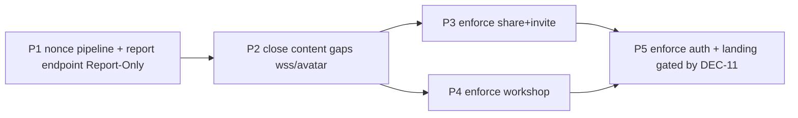

# 11 — Implementation Plan

Authoritative execution guide for the future implementation AI. Phased, dependency-
aware, with exact paths/symbols, proof gates, and rollback per phase. **Implementation
must not begin until README + `17` record `IMPLEMENTATION-READY` or `CONDITIONALLY
READY` and the owner accepts the conditions.**

Plan profile: `exhaustive`. Phases are independently landable where noted. Each phase
has a durable-goal contract (Goal ID, scope, evidence, stop/blocker condition).

## Phase ordering and dependency graph

- P1, P2 are Report-Only → **safe**, no user-visible breakage possible.
- P3, P4, P5 are Enforced → each gated by the observation window (OPS-02) and browser
  proof (TEST-03).
- P3 and P4 are independent of each other (different route classes) but both depend on
  P2.
- P5 depends on DEC-11 (marketing perf) and on P3+P4 (proven enforcement pattern).

## Global prerequisites (before P1)

- Re-read `next.config.ts`, `src/proxy.ts`, `src/lib/auth/request-proxy.ts`,
  `src/app/layout.tsx`, `worker.ts` immediately before edits (shared worktree).
- `git status --short --branch` to coordinate with concurrent agents.
- Confirm Next.js version `16.2.10` (`node -e "console.log(require('next/package.json').version)"`).
- Re-read the official CSP guide (`node_modules/next/dist/docs/01-app/02-guides/content-security-policy.md`).

## Phase 1 — Nonce pipeline + reporting endpoint (Report-Only)

**Goal ID:** CSP-P1
**Objective:** Introduce the nonce generation/propagation infrastructure and the CSP
reporting endpoint, emitting a **Report-Only** nonced CSP alongside the existing
behavior. No enforcement; zero user-visible risk.
**Requirements addressed:** SEC-01, SEC-02 (partial — propagation wired but not
required to function under enforcement yet), SEC-08, ARCH-01 (partial), ARCH-02,
ARCH-03, SEC-09 (partial — begin removing static CSP for routes the proxy now owns),
TEST-01, TEST-02.
**Prerequisites:** global prerequisites.
**Parallelizable:** the 3 new `src/lib/csp/*` files + the `/api/csp-report` route are
disjoint from the proxy/layout edits → parallel-safe lanes.
**Sequential:** the proxy edit depends on `csp/policy.ts` + `csp/nonce.ts` existing;
the layout edit depends on the proxy setting `x-nonce`.

### Work packages

#### WP-1.1 — `src/lib/csp/nonce.ts` (new)
- **Path:** `src/lib/csp/nonce.ts`
- **Responsibility:** `generateCspNonce(): string` → `Buffer.from(crypto.randomUUID()).toString('base64')` (Workers-compatible; `crypto.randomUUID` is global in Workers + nodejs_compat).
- **Contract:** pure function, no side effects, returns base64 string ≥ 22 chars.
- **Why no existing file:** no nonce infra exists (`03` §3.6).
- **Validation:** unit test asserts length, base64 charset, uniqueness across 1000 calls.
- **Complexity:** Small.
- **Parallelization:** Parallel-safe.

#### WP-1.2 — `src/lib/csp/route-class.ts` (new)
- **Path:** `src/lib/csp/route-class.ts`
- **Responsibility:** `resolveCspRouteClass(pathname): CspRouteClass` mapping pathname → `'landing' | 'workshop' | 'invite' | 'share' | 'auth' | 'default'`.
- **Mapping rules:** `/share/*`→share; `/workshop/*`→workshop; `/invite/*`→invite; `/login`,`/signup`,`/access-required`,`/auth/*`→auth; `/`,`/about`,`/features`,`/pricing`,`/contact`,`/trust`,`/privacy`,`/terms`,`/security`,`/new`→landing; else→default. Reuse the existing `PUBLIC_ROUTE_PREFIXES` / `PROTECTED_PREFIXES` constants in `request-proxy.ts` where they overlap (DRY).
- **Validation:** unit test per route class.
- **Complexity:** Small.
- **Parallelization:** Parallel-safe.

#### WP-1.3 — `src/lib/csp/policy.ts` (new)
- **Path:** `src/lib/csp/policy.ts`
- **Responsibility:** `buildCspPolicy({ routeClass, nonce, isDev, reportEndpoint }): string` producing the full CSP string per §6.3 table. Includes `report-to csp-endpoint`.
- **Contract:** pure; no `'unsafe-inline'` on script-src for enforced classes; `'unsafe-eval'` only when `isDev`; `style-src 'self' 'unsafe-inline'` always; `connect-src` includes `wss:` (+`ws:` dev).
- **Validation:** unit test asserting each directive per route class + env.
- **Complexity:** Medium.
- **Parallelization:** Parallel-safe (depends on WP-1.2 types only).

#### WP-1.4 — `/api/csp-report` route handler (new)
- **Path:** `src/app/api/csp-report/route.ts`
- **Responsibility:** POST handler per `06` §6.6. Accept both content-types, redact, rate-limit (per-IP, simple counter; note Workers per-isolate caveat in `06`), return 204/200/400/413/429, structured log.
- **Validation:** route handler unit test (`tests/vitest/csp-report-endpoint.test.ts`): valid legacy report → 204; valid Reporting API → 200; malformed → 400; oversized → 413; flood → 429; redaction of query strings.
- **Complexity:** Medium.
- **Parallelization:** Parallel-safe (disjoint from proxy/layout).

#### WP-1.5 — Proxy nonce + Report-Only CSP (serial critical path)
- **Path:** `src/lib/auth/request-proxy.ts` (edit); `src/proxy.ts` (matcher update).
- **Symbols:** the `proxy(request)` function (`:130`); `createRequestPathResponse()`.
- **Change:** after existing auth-gating, generate nonce (`generateCspNonce`), resolve route class, build Report-Only policy, set `x-nonce` request header + `Content-Security-Policy-Report-Only` response header. Add `Reporting-Endpoints` header. Update `config.matcher` to exclude prefetch (`missing: next-router-prefetch, purpose: prefetch`).
- **Header-ownership (SEC-09 partial):** remove the Report-Only CSP strings from `next.config.headers()` for the route classes the proxy now owns (`/`, `/about`, `/features`, `/pricing`, `/contact` landing block; `/workshop`; `/invite`). Keep the 4 hardening headers there. `/share` enforced block stays untouched in P1 (it's enforced, not Report-Only — handled in P3).
- **Validation:** `tests/vitest/csp-nonce-proxy.test.ts`: invoke `proxy()` with mock `NextRequest`, assert `x-nonce` present, CSP-Report-Only present with `'nonce-{value}'` matching, two requests → two nonces, prefetch request → no nonce, hardening headers still present (from next.config).
- **Risks:** RISK-01 (double header) — mitigated by removing static CSP; RISK-04 (proxy complexity) — serialize, full `test:dom` run.
- **Complexity:** Large.
- **Parallelization:** **Sequential** — one agent; do not split.

#### WP-1.6 — Root layout reads nonce (serial, after WP-1.5)
- **Path:** `src/app/layout.tsx` (edit).
- **Change:** make `RootLayout` `async`; `const nonce = (await headers()).get('x-nonce') ?? '';` pass to `AuthStateMismatchRecoveryScript`, `LandingStructuredData`. Provide nonce to client-tree for the landing scripts via a small server-component wrapper or context.
- **Validation:** type-check; DOM test that nonce prop is passed.
- **Complexity:** Medium.
- **Parallelization:** Sequential after WP-1.5.

#### WP-1.7 — Inline script components accept nonce (parallel after WP-1.6)
- **Paths:** `src/components/auth/AuthStateMismatchRecoveryScript.tsx`; `src/components/landing/CloudflareWebAnalytics.tsx`; `src/components/landing/ClarityScript.tsx`; `src/components/landing/LandingAnalyticsLoader.tsx` (pass nonce to `GoogleAnalytics`); `src/components/landing/structured-data.tsx`; `src/components/landing-v3/ArchestimatorLandingPage.tsx`; `src/app/workshop/pending-invite/route.ts`; `src/lib/cloudflare/worker-route-optimizations.ts`.
- **Change:** accept `nonce?: string` prop; pass to `<Script nonce={nonce}>`; inject `nonce="..."` into the two server-rendered HTML `<script>` strings.
- **Validation:** DOM/unit tests per component.
- **Complexity:** Small ×8.
- **Parallelization:** Parallel-safe per file (disjoint).

#### WP-1.8 — Rewrite existing CSP tests (parallel)
- **Paths:** `tests/vitest/landing-security-headers.test.ts`; `project-location-map-csp.test.ts`; `project-publication-security-headers.test.ts`; `project-publication-security.test.ts` (P11 placeholders); `next-config-workshop-headers.test.ts`.
- **Change:** test the proxy output (invoke `proxy()`, assert response headers) instead of static `next.config` strings.
- **Validation:** `bunx vitest run <files>` green.
- **Complexity:** Medium.
- **Parallelization:** Parallel-safe per file.

### P1 exit criteria
- `bun run test:dom` green (all rewritten + new tests).
- `bun run type-check` + `bun run lint` green.
- Browser smoke: landing + workshop + share + invite load; DevTools shows ONE `Content-Security-Policy-Report-Only` header with a `'nonce-...'`; framework scripts carry the nonce; no console errors.
- `/api/csp-report` returns 204 for a synthetic report.
- Observation window (OPS-02) starts: telemetry accumulates for ≥ N days (recommend 3–7) before P3.

### P1 stop/blocker condition
- Stop: all exit criteria met + observation window accumulating.
- Blocker: if the proxy-owned CSP conflicts with OpenNext response handling (double header not resolved) → BLOCKED-ARCHITECTURE; fall back to Report-Only via `next.config.headers()` (revert SEC-09 partial) and document.

### P1 rollback
- Disable the nonce branch in the proxy via env flag (e.g. `ARCHESTIMATOR_CSP_NONCE_ENABLED=false` → proxy skips nonce/CSP, behavior identical to today). Restore the static Report-Only CSP strings in `next.config.headers()`.

## Phase 2 — Close content gaps (Report-Only)

**Goal ID:** CSP-P2
**Objective:** Fix the `connect-src wss:` gap (SEC-06), the avatar img-src gap on landing (SEC-07), and resolve the seed-host decision (DEC-12). Still Report-Only.
**Requirements:** SEC-06, SEC-07, DEC-12.
**Prerequisites:** P1.
**Parallelizable:** policy edits are in `csp/policy.ts` (single owner).

### Work packages
- WP-2.1 — Add `wss:` (prod) / `ws:` (dev) to `connect-src` in `policy.ts` for workshop + share (collab may apply to both). Unit test.
- WP-2.2 — Add avatar hosts (`*.ggpht.com`, `*.googleusercontent.com`, `lh3.googleusercontent.com`) to `img-src` for landing + default policy. Unit test.
- WP-2.3 — **DEC-12 decision applied:** either migrate seed `imageUrl` hosts in `src/components/workshop/estimate-tree-data.ts` to local `/component-thumbnails/` (preferred — removes external dependency), OR addlist them to workshop `img-src` + `next.config` `remotePatterns`. Record the decision in `.ai/10_state/decisions.md`.

### P2 exit criteria
- Policy unit tests assert `wss:` and avatar hosts present.
- Browser proof on `/workshop`: collaboration WebSocket connects (no CSP violation report); avatar renders.
- Browser proof on landing: logged-in user avatar renders.

### P2 rollback
- Revert the policy lines in `csp/policy.ts`.

## Phase 3 — Enforce on `/share` + `/invite`

**Goal ID:** CSP-P3
**Objective:** Flip `/share/:path*` and `/invite/:path*` from Report-Only to Enforced nonced CSP. These are token-bearing routes already `no-store`/dynamic — no perf cost, highest security value.
**Requirements:** SEC-03, SEC-04, ARCH-01, OPS-01, OPS-02.
**Prerequisites:** P1 observation window clean (OPS-02); P2.

### Work packages
- WP-3.1 — In `policy.ts`, add an `enforced: boolean` (or route-class-level mode). For share + invite, emit `Content-Security-Policy` (not `-Report-Only`). Proxy sets the enforced header.
- WP-3.2 — In `next.config.headers()`, remove the enforced CSP from the `/share` block (`:191-206`); keep `Cache-Control: no-store` + hardening headers. (SEC-09 completion for `/share`.)
- WP-3.3 — Remove `/invite` Report-Only CSP from `next.config.headers()` (already owned by proxy since P1).
- WP-3.4 — Browser proof (TEST-03) on `/share/[token]`: proposal renders; tabs/comments/decisions work; password/session flows work; no CSP violations; DevTools shows single enforced `Content-Security-Policy` with `'nonce-...'`, no `'unsafe-inline'`.
- WP-3.5 — Browser proof on `/invite/[token]`: invite-accept flow completes; no violations.

### P3 exit criteria
- Browser proofs clean (no violations, all flows work).
- `test:dom` green.
- Telemetry: zero unexpected violations on share/invite over 24h post-enforcement.

### P3 rollback
- Flip share+invite back to Report-Only in `policy.ts` (one-line mode change). Restore `/share` enforced CSP in `next.config.headers()` if needed.

## Phase 4 — Enforce on `/workshop`

**Goal ID:** CSP-P4
**Objective:** Flip `/workshop/*` to Enforced nonced CSP. Already dynamic (auth-gated); no perf cost.
**Requirements:** SEC-03, SEC-04, SEC-06 (verified by proof).
**Prerequisites:** P3 proven; P2.

### Work packages
- WP-4.1 — `policy.ts`: workshop route class emits enforced CSP. Proxy applies.
- WP-4.2 — Remove workshop Report-Only CSP from `next.config.headers()` (SEC-09 completion for workshop).
- WP-4.3 — Browser proof (TEST-03) on `/workshop`: sidebar, library, projects, estimates, settings load; Google Maps project-location renders; collaboration WebSocket connects (SEC-06); no violations.

### P4 exit criteria
- Browser proof clean (incl. Maps + WebSocket).
- `test:dom` green.
- Telemetry: zero unexpected workshop violations over 24h.

### P4 rollback
- Flip workshop back to Report-Only in `policy.ts`.

## Phase 5 — Enforce on auth + landing (gated by DEC-11)

**Goal ID:** CSP-P5
**Objective:** Enforce on `/login`, `/signup`, `/access-required`, `/auth/callback` (low risk, already dynamic) and on landing routes (gated by DEC-11 perf measurement). Remove all CSP strings from `next.config.headers()` (only hardening headers remain).
**Requirements:** SEC-03, SEC-04, ARCH-01 (complete), PERF-01, DEC-11.
**Prerequisites:** P3 + P4; DEC-11 owner decision; PERF-01 TTFB measurement.

### Work packages
- WP-5.1 — Measure TTFB baseline on landing routes (`09` §9.1 evaluator). Record in `09-ttfb-baseline.md`.
- WP-5.2 — `policy.ts`: auth + landing (if DEC-11 A) route classes emit enforced CSP.
- WP-5.3 — Remove all remaining CSP from `next.config.headers()`. Only hardening headers + `/share` `Cache-Control: no-store` remain.
- WP-5.4 — If DEC-11 B (landing stays Report-Only for now): landing policy stays Report-Only; document the residual risk + the future flip condition.
- WP-5.5 — Browser proof (TEST-03) on `/login`, `/signup`, `/access-required`, `/auth/callback`, and (if A) landing: OAuth sign-in completes; `AuthStateMismatchRecoveryScript` runs; analytics load under consent; no violations.
- WP-5.6 — Measure TTFB after; record in `09-ttfb-after.md`; compare to baseline; if regression > DEC-11 threshold → revert landing to Report-Only (DEC-11 B).

### P5 exit criteria
- Auth routes enforced + proven.
- Landing: either enforced (A, perf within threshold) or documented Report-Only (B) with residual risk recorded.
- `next.config.headers()` contains no CSP strings.
- Full `bun run validate` green.
- Update `.ai/10_state/current-state.md` P0.2 → CLOSED (or PARTIAL with documented residual if landing is B).

### P5 rollback
- Flip landing back to Report-Only (if A→B revert). Auth can stay enforced (low risk) or revert.

## Per-task template (applies to every WP)

Each WP has: Task ID, Requirement IDs, objective, exact target paths/symbols, inputs,
instructions, expected output, failure cases, tests, validation procedure, completion
evidence, parallelization class, complexity. (Captured inline above per WP.)

## Files explicitly off-limits during implementation

- `migrations/*` — no D1 changes.
- `supabase/migrations/*` — legacy archaeology; never touch.
- `wrangler.jsonc`, `wrangler.next-dev.jsonc` — no header block needed; do not add one without re-verifying OpenNext compatibility.
- `open-next.config.ts` — no overrides needed.
- Any D1/R2/DO/Queue/Email source under `src/lib/{cloudflare,compliance,collaboration,uploads,ai}...` — data plane untouched.
- `DESIGN.md`, Storybook stories — not security surfaces.
- Git branches/worktrees — none created (shared worktree).

## Files intentionally unaffected

- All `/api/*` JSON route handlers (except the new `/api/csp-report`).
- D1/R2/DO/Queue/Email.
- Better Auth (`src/lib/auth/*` except `request-proxy.ts`).
- `src/components/ui/*` (except `spinner.tsx`'s `<style>` — covered by style-src, no change).
