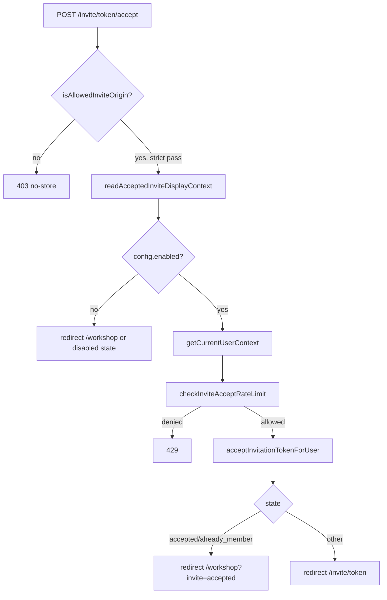
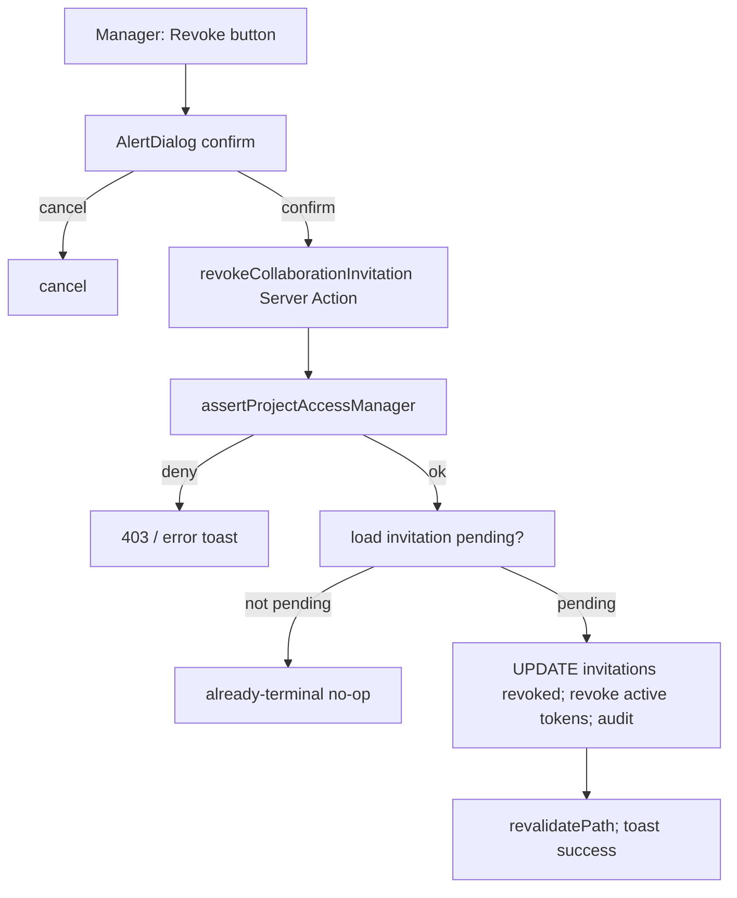

# Architecture and Technical Design

**Current-state architecture** is documented in `03_SOURCE_AND_CODEBASE_AUDIT.md`. This doc defines the **target-state** for the hardening and the contracts that cut across phases. No application code is changed by this planning task.

## 1. Current-state architecture (summary)

```
Email link → GET /invite/[token] (RSC page.tsx)
  → resolveInviteEntryState: gate → shape check → rate limit → hashInviteToken → resolveCollaborationInvitationFromCloudflareD1
  → state machine renders: signed-out-preview | signed-in-preview | wrong-account | terminal

Signed-out → POST /invite/[token]/continue (continue/route.ts)
  → rate limit → createPendingInviteBridge → set archestimator_pending_invite cookie → redirect /login?next=/workshop/pending-invite
  [NO ORIGIN CHECK — SEC-02 gap]

Auth round-trip (Better Auth magic-link / Google) → session established
  → resolvePostAuthDestination allows /workshop/pending-invite
  → workshop/page.tsx redirects to /workshop/pending-invite on cookie presence

GET /workshop/pending-invite (workshop-pending-invite/route.ts)
  → readPendingInviteBridge → acceptPendingInviteBridge → acceptInvitationTokenForUser → membership created
  → interstitial → redirect /workshop?invite=accepted
  → clearPendingInviteCookie (unless wrong-account)

Signed-in → POST /invite/[token]/accept (accept/route.ts)
  → isAllowedInviteOrigin [FAILS OPEN ON MISSING — SEC-01 gap] → getCurrentUserContext → rate limit → acceptInvitationTokenForUser → membership

Wrong account → POST /invite/[token]/sign-out (sign-out/route.ts)
  → isAllowedInviteOrigin → Better Auth sign-out → clear session cookies [MISSING ATTRS — SEC-04 gap]

Manager → inviteProjectCollaborator / resendProjectInviteEmail / copyProjectInviteLink (actions.ts)
  → issueInviteEntryLink (implicit revoke of prior tokens) → email/copy
  [NO EXPLICIT REVOKE — SEC-07 gap]
```

## 2. Target-state architecture (after hardening)

```
Email link → GET /invite/[token] (unchanged state machine)

Signed-out → POST /invite/[token]/continue (continue/route.ts)
  → isAllowedInviteOrigin [NEW — SEC-02] → rate limit → createPendingInviteBridge → cookie → redirect

POST /invite/[token]/accept (accept/route.ts)
  → isAllowedInviteOrigin [TIGHTENED — SEC-01, deny-on-missing in prod] → ... → membership

POST /invite/[token]/sign-out (sign-out/route.ts)
  → isAllowedInviteOrigin [TIGHTENED] → Better Auth sign-out → clear session cookies [FULL ATTRS — SEC-04]

Manager → revokeCollaborationInvitation (NEW Server Action — SEC-07)
  → assertProjectAccessManager → UPDATE invitations SET lifecycle_state='revoked', revoked_at → revoke active tokens → audit event
  → publisher members panel revoke button (UX-03, A11Y-01)

Disabled flag → resolve/continue/accept deny or short-circuit safely [SEC-05, OPEN-SEC-02]
```

## 3. Component boundaries and contracts

### 3.1 `isAllowedInviteOrigin` (target contract)
- **File:** `src/lib/collaboration/invite-origin.ts` (unchanged location).
- **Signature:** `isAllowedInviteOrigin(request: Request): boolean` (unchanged) — or optionally `isAllowedInviteOrigin(request, { strict }): boolean` if DEC-01 adds the env toggle internally.
- **Target policy:**
  1. Derive `appHost` (existing logic).
  2. **In production** (`NODE_ENV === 'production'` and host not localhost): if `appHost` undeterminable → **deny** (was allow). If Origin present → must equal `appHost`. Elif Referer present → must equal `appHost`. **Else (both missing) → deny** (was allow).
  3. **In dev** (non-prod or localhost): preserve current allow-on-missing behavior so local form-post testing works.
  4. Optional `ARCHESTIMATOR_INVITE_ORIGIN_STRICT` env (default `true` in prod) to relax in emergencies.
- **Callers (target):** `accept/route.ts`, `sign-out/route.ts`, **`continue/route.ts`** (new).

### 3.2 `createPendingInviteBridge` / `readPendingInviteBridge` (unchanged — non-regression)
- Contract unchanged: hash-only payload, HMAC, 30-min TTL. SEC-03 non-regression gate.

### 3.3 `revokeCollaborationInvitation` (NEW Server Action)
- **File:** `src/lib/collaboration/actions.ts`.
- **Signature (target):**
  ```ts
  // (illustrative shape only — not a code snippet to copy; final signature defined at implementation)
  revokeProjectInvitation({ projectId, invitationId }): Promise<{ ok: true } | { ok: false, error: string }>
  revokeEstimateSheetInvitation({ estimateId, invitationId }): Promise<...>
  ```
- **Sequence:** `assertProjectAccessManager`/`assertEstimateAccessManager` → load invitation (must be `lifecycle_state='pending'`) → `UPDATE collaboration_invitations SET lifecycle_state='revoked', revoked_at=now, revoked_reason=?` → `UPDATE collaboration_invitation_tokens SET revoked_at=now, revoked_by=? WHERE invitation_id=? AND used_at IS NULL AND revoked_at IS NULL` → insert `collaboration_invite_revoked` audit → return.
- **Already-terminal guard:** if invitation is `accepted`/`expired`/`revoked` → return `{ ok: false, error: 'already-terminal' }` (no state change, no audit).

### 3.4 `checkInviteRateLimit` fail-closed (target)
- **File:** `src/lib/collaboration/invite-entry.ts`.
- **Target:** when `readInviteEntryConfig().enabled === false`, the resolve/continue/accept checks return a deny result (or callers short-circuit to the disabled state). Create/resend behavior decided by OPEN-SEC-02.

### 3.5 Cookie clear attributes (target)
- **Files:** `src/app/invite/[token]/sign-out/route.ts`, `src/lib/collaboration/pending-invite-actions.ts`.
- **Target:** both session-cookie clears use `{ httpOnly:true, secure: NODE_ENV==='production', sameSite:"lax", path:"/", maxAge:0 }`. Consider extracting a `clearBetterAuthSessionCookies(response)` helper to avoid duplication (the same pattern exists in 3 places: sign-out route, `signOutForPendingInvite`, and `set-cookie-forwarding.ts`'s OAuth clear).

## 4. Data flow and control flow

- **No new data flows.** The hardening tightens existing checks and adds one manager-only mutation (revoke).
- **No new background jobs, queues, or crons** (ARCH-02).
- **No new external integrations** (email stays synchronous; DEC-10).
- **Audit events flow** unchanged: `collaboration_audit_events` via `recordCollaborationAuditEvent`. New event type `collaboration_invite_revoked`.

## 5. State ownership (state machine)

- **URL state:** the raw token in `/invite/[token]` (public, shareable, bearer). The `?next=/workshop/pending-invite` and `/workshop?invite=<state>` params are transient navigation state.
- **Server state:** D1 `collaboration_invitations.lifecycle_state` (`pending` → `accepted_by_recipient` | `direct_granted_existing_user` | `revoked` | `expired`). D1 `collaboration_invitation_tokens.used_at`/`revoked_at`.
- **Client state:** the `archestimator_pending_invite` cookie (HMAC-signed bridge, 30-min TTL). TanStack Query for the members-panel mutation (existing pattern).
- **Session state:** Better Auth session cookie (DB-backed, cookie cache disabled).

No state-ownership changes in this hardening.

## 6. Cache and revalidation

- Invite routes are **not cached** (`Cache-Control: no-store` enforced on `/invite/*` in `next.config.ts` + per-response headers). The proxy treats `/invite` as a public prefix and does not auth-gate it.
- After revoke (SEC-07), the manager's members panel must reflect the change — `revalidatePath` on the project/estimate workshop path (existing pattern in sibling actions like `removeProjectCollaborator`).
- The bridge cookie is not cacheable (HMAC + TTL).
- **Cache Components posture:** invite routes are not on the Cache Components `use cache` path. No `cacheLife`/`cacheTag` boundaries exist on `/invite/*` or `/workshop/pending-invite`. Token-bearing responses default to no-store (verified: `next.config.ts:248-257` `appAndInviteHardening` headers + per-route `Cache-Control: no-store`). Read-your-own-writes for the accept/revoke mutations is satisfied by `revalidatePath` on the workshop route, not by cache-tag invalidation.

## 6.5 Route-specific App Router boundary/cache contract (per Improve directive §4)

One row per affected route. Rendering model, request-time APIs, server-owned data, what crosses to the client, cache control, and the exact revalidation primitive. All facts from current source.

| Route | Rendering model | Request-time APIs | Server-owned data | Crosses to client | Cache control | Revalidation primitive |
|---|---|---|---|---|---|---|
| `src/app/invite/[token]/page.tsx` (RSC) | Dynamic (token in path + `headers()` for Origin/current-email probe); `runtime=nodejs`-compatible RSC | `params` (Promise), `headers()` (for `readInviteCurrentBetterAuthEmail`) | `readInviteEntryConfig`, `resolveCollaborationInvitationFromCloudflareD1`, current Better Auth email | Sanitized `InviteResolutionRow` + state kind (no raw token, no token_hash) | `no-store` (`next.config.ts:248-257`) + `Referrer-Policy: no-referrer` | None (read-only resolve; `last_opened_at` UPDATE is a side-effect, not a revalidation) |
| `src/app/invite/[token]/accept/route.ts` | Route Handler, `force-dynamic` (mutating POST) | `params` (Promise), `request.formData()`, `getCurrentUserContext` (reads session cookie) | `acceptInvitationTokenForUser` RPC | None — 303 redirect to `/workshop?invite=...` (no body) | `no-store` on 429/403; redirect response | None on the route itself; the RPC mutates D1. Workshop redirect target re-renders server-side. No `revalidatePath` needed (redirect). |
| `src/app/invite/[token]/continue/route.ts` | Route Handler, dynamic (GET + POST) | `params` (Promise) | `readInviteEntryConfig`, `createPendingInviteBridge` | None — 303 redirect + `Set-Cookie: archestimator_pending_invite` | `no-store` (cookie set) | None (cookie is the handoff; no D1 mutation until `/workshop/pending-invite`) |
| `src/app/invite/[token]/sign-out/route.ts` | Route Handler, dynamic (POST) | `params` (Promise), `request.headers` (origin), Better Auth handler | Better Auth `/api/auth/sign-out` (internal same-origin request) | None — 303 redirect + session-cookie clear | `no-store` | None |
| `src/app/workshop/pending-invite/route.ts` | Route Handler, dynamic (GET), proxy-auth-gated | `cookies()` (bridge cookie + session) | `readPendingInviteBridge`, `acceptPendingInviteBridge` (→ membership RPC) | HTML interstitial (meta-refresh); banner state in URL | `no-store`, `Referrer-Policy: no-referrer` | Bridge-cookie clear on success; no `revalidatePath` (redirect handles freshness) |
| `revokeProjectInvitation` / `revokeEstimateSheetInvitation` (NEW `"use server"` Server Actions) | Server Action (POST endpoint) | `cookies()` (session), `headers()` (Next.js built-in Server-Action origin check) | `assertProjectAccessManager`/`assertEstimateAccessManager`, `revokeCollaborationInvitationInCloudflareD1` | `{ ok } | { ok:false, error }` DTO | n/a (Server Action) | **`revalidatePath('/workshop/projects/[id]')`** (and estimate path) after revoke so the members panel reflects the revoked invitation — mirrors `removeProjectCollaborator`. |

**Server/Client boundary notes:**
- The invite page is a Server Component; the only client-crossing payload is the sanitized state row (revoked → nulled details).
- The accept/continue/sign-out/pending-invite routes return **redirects**, not JSON bodies, so no client DTO crosses except the cookie and the redirect URL.
- The revoke Server Action is invoked from a `"use client"` button in the publisher members panel; its return DTO is `{ ok }`. No raw token or `token_hash` in the DTO.
- **No Route Handler is called from a Server Component** in this flow (page.tsx calls the resolve data function directly, not the route handler — correct per App Router guidance).
- **No mutation during render.** All mutations are in Route Handlers (accept) or Server Actions (revoke), never in the RSC render path. The `last_opened_at` UPDATE in resolve is an analytics side-effect inside the data function, not a user-visible mutation.

## 7. Server/Client component boundaries

- **No new `"use client"` boundaries** except the revoke button + confirmation dialog (already a client island in the publisher panel). The origin tightening is server-only.
- Invite page (`page.tsx`) stays a Server Component.
- Continue/accept/sign-out routes stay Route Handlers (no `"use client"`).

## 8. Migration impact (database)

- **One additive migration:** `0038_collaboration_invitation_revoke_reason.sql` — adds nullable `revoked_reason TEXT` to `collaboration_invitations`. Full blueprint in `21_DATABASE_CHANGE_BLUEPRINTS.md`.
- **No Worker Env binding changes** → `cf:typegen` not required.
- **No generated-types changes** for the invite flow beyond the new column (the repository row type picks it up as optional).

## 9. Framework decisions (Next.js 16 / React 19)

- Route Handlers (`accept`, `continue`, `sign-out`) — unchanged pattern; `params` is a `Promise` (Next.js 15+ async dynamic params, already in use).
- Server Action (`revokeCollaborationInvitation`) — `"use server"` in `actions.ts`, same pattern as sibling actions.
- `next/headers` `cookies().set` — used in route handlers for cookie clear (existing pattern).
- No Cache Components / `use cache` interaction (invite routes are no-store).
- No Suspense/streaming change (invite page is a single RSC render with no streaming boundary today).

## 10. Architectural alternatives considered (full detail in `15`)

| Decision | Options | Recommended |
|---|---|---|
| Origin policy | (a) deny-on-missing + env toggle; (b) double-submit CSRF token (like publication); (c) Sec-Fetch-Site only | **(a)** — least new surface, fixes the gap, matches repo's same-host comparison pattern. (b) is heavier; (c) is insufficient alone. |
| Continue-route guard | (a) reuse `isAllowedInviteOrigin`; (b) separate CSRF token | **(a)** — consistency with accept/sign-out. |
| Revoke surface | (a) new Server Action + UI button; (b) extend resend to "resend-or-revoke"; (c) implicit only (status quo) | **(a)** — explicit, auditable, matches manager mental model. |
| Fail-closed rate limits | (a) deny resolve/continue/accept when disabled; (b) keep fail-open; (c) separate "disabled" hard-gate in routes | **(a)** with route-level disabled-state short-circuit — OPEN-SEC-02 confirms. |
| Pepper separation | (a) require `REALTIME_IDENTITY_SIGNING_KEY`; (b) status quo | **(a)** — key separation hygiene; OPEN-REL-02 confirms rollout. |
| `auth_trigger` enum | (a) wire login-time grant; (b) remove enum value | **OPEN-SEC-01** — recommend (b) remove unless a product need exists. |

## 11. Failure boundaries

- **Origin helper:** pure function, no I/O — cannot fail beyond a thrown parse error (caught).
- **Revoke action:** D1 transaction (or batched statements) — failure rolls back; manager sees error toast; invitation stays pending.
- **Cookie clear:** cannot fail (in-memory response mutation).
- **Email (unchanged):** circuit breaker + degrade-to-manual-share.

## 12. Diagrams

### Invite accept flow (target-state)



### Revoke flow (new)


