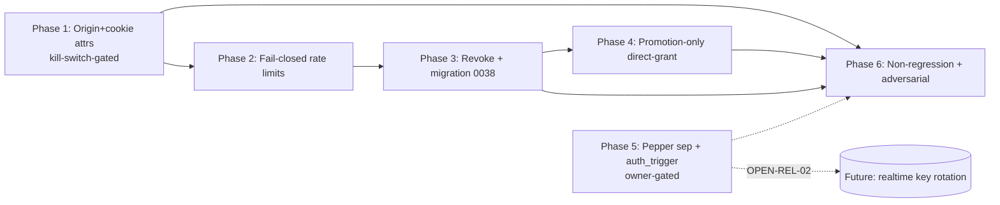

# Implementation Plan

> **Execution boundary:** This is the authoritative execution guide for the future implementation AI. `IMPLEMENTATION-READY` / `CONDITIONALLY READY` means **planning** is complete; it does not auto-authorize execution. The owner must approve implementation, and each phase has its own review/QA gate.

**Phase order:** **Phase 1** (origin + cookie-attr hardening — release-blocking, kill-switch-gated) → **Phase 2** (rate-limit fail-closed) → **Phase 3** (explicit revoke + migration `0038`) → **Phase 4** (direct-grant promotion-only) → **Phase 5** (pepper separation + `auth_trigger` cleanup — owner-gated) → **Phase 6** (non-regression + adversarial audit + hosted-proof extension).

Phases 1→2→3 are sequential (P2's disabled-flag short-circuit depends on P1's route changes being stable; P3's revoke UI depends on the route layer being hardened). P4 can run parallel to P3 (disjoint files in `actions.ts` but different functions — serialize on shared-file risk). P5 is owner-gated and independent. P6 follows all others.

## Phase 1 — Origin + cookie-attribute hardening (release-blocking, kill-switch-gated)

**Durable-goal contract:**
- **Goal ID:** P1-ORIGIN
- **Objective:** Close the fail-open origin guard and the cookie-attribute gap on the three mutating invite routes.
- **Scope:** `accept`, `sign-out`, `continue` routes; `invite-origin.ts`; `signOutForPendingInvite`; env examples.
- **Requirements covered:** SEC-01, SEC-02, SEC-04, ARCH-01, FR-03 (preserve).
- **Required evidence:** Updated `invite-accept-origin.test.ts`, `project-invite-sign-out-route.test.ts`; new `invite-continue-origin.test.ts`; green `bun run test -- invite-origin`; manual curl proof on preview.
- **Completion audit:** AC-SEC-01a-e, AC-SEC-02a-c, AC-SEC-04a-b all pass; FR-03 manual e2e on preview (signed-out invite → continue → accept).
- **Checkpoint artifacts:** `invite-origin.ts` diff, route diffs, test output.
- **Stop condition:** All Phase-1 ACs pass + FR-03 preview proof + 24h 403-rate monitoring plan in place.
- **Blocker condition:** If tightening blocks >1% of legitimate accept/continue traffic on preview → engage kill switch (`ARCHESTIMATOR_INVITE_ORIGIN_STRICT=false`) and replan.
- **Review gate:** Code review on `invite-origin.ts` rewrite + route edits.
- **QA gate:** Adversarial matrix AQ-01..AQ-05 (origin scenarios) pass.

### P1 Tasks

#### P1-T1 — Tighten `isAllowedInviteOrigin` to deny-on-missing in production
- **Task ID:** P1-T1
- **Req IDs:** SEC-01, ARCH-01
- **Objective:** Rewrite `isAllowedInviteOrigin` so that in production (`NODE_ENV==='production'` and host not localhost), a request with neither Origin nor Referer matching the app host is denied; the undeterminable-app-host branch also denies in production. In dev, preserve the allow path.
- **Why:** Closes the brief's confirmed permissive-origin finding (`invite-origin.ts:27,39`).
- **Target path (existing):** `src/lib/collaboration/invite-origin.ts` (rewrite `isAllowedInviteOrigin` L22-40; keep `readUrlHost`, `readAppHost`).
- **Target symbols:** `isAllowedInviteOrigin`, `readAppHost`.
- **Inputs/dependencies:** Optional env `ARCHESTIMATOR_INVITE_ORIGIN_STRICT` (default `true` in prod, ignored in dev). Read via `process.env`.
- **Detailed instructions:**
  1. Add a `isStrictInviteOriginEnabled()` helper reading `ARCHESTIMATOR_INVITE_ORIGIN_STRICT` (default true when `NODE_ENV==='production'`, false otherwise) — or read inline.
  2. In `isAllowedInviteOrigin`: derive `appHost`. If strict enabled: if `!appHost` → return `false`. If Origin present → return `originHost === appHost`. Elif Referer present → return `refererHost === appHost`. Else → return `false`. If strict disabled: preserve current behavior (the localhost/dev path).
  3. Add an inline comment documenting the production deny-on-missing policy and the kill switch.
- **Expected output:** A rewritten helper that denies on missing headers in prod.
- **Failure cases:** Over-blocking legitimate same-site POST (mitigated by Origin-on-form-POST); env-toggle relax.
- **Tests/val:** Extend `tests/vitest/invite-accept-origin.test.ts` with: no-header-POST-denied-in-prod, no-header-POST-allowed-in-dev, cross-host-denied, same-host-allowed, kill-switch-relaxes. Add a prod-vs-dev env switcher in the test.
- **Completion evidence:** Test output showing all cases pass.
- **Parallelization:** Sequential (single owner file).
- **Complexity:** Small.

#### P1-T2 — Convert Continue CTA to form POST + add `isAllowedInviteOrigin` to `/invite/[token]/continue`
- **Task ID:** P1-T2
- **Req IDs:** SEC-02
- **Objective:** Switch the signed-out "Continue" CTA from an `<a>` to a form POST (so the browser sends `Origin`), then add the origin guard to the continue route on POST before the cookie is set.
- **Why:** `continue/route.ts` mints a state-changing cookie with no origin check today. The current CTA at `src/app/invite/[token]/page.tsx:165` is `<a href="/invite/<token>/continue">` — a GET navigation that carries no `Origin` header, and `/invite/*` sets `Referrer-Policy: no-referrer` (`next.config.ts:272`), so a tightened origin guard would block the legitimate flow unless the CTA becomes a form POST (which always sends `Origin`).
- **Source evidence (verified 2026-07-07):** `src/app/invite/[token]/page.tsx:165` (`<a className={inviteActionClassName} href={...}/continue}>Continue to Archestimator</a>`); `next.config.ts:272` (`Referrer-Policy: no-referrer` under `appAndInviteHardening`); `src/app/invite/[token]/page.tsx:157` (the Accept CTA already uses `<form action=... method="post">` — the pattern to mirror).
- **Target paths (existing):**
  - `src/app/invite/[token]/page.tsx` (Continue CTA, ~L165) — change `<a>` → `<form method="post" action={`/invite/${encodeURIComponent(rawToken)}/continue`}>` with a submit button labeled "Continue to Archestimator", mirroring the Accept form at L157.
  - `src/app/invite/[token]/continue/route.ts` — `continueToAuth` (L39).
- **Target symbols:** the Continue CTA JSX in `page.tsx`; `continueToAuth` in `continue/route.ts`.
- **Detailed instructions:**
  1. In `page.tsx` (~L165), replace the `<a>` with a `<form method="post" action={`/invite/${encodeURIComponent(rawToken)}/continue`}>` containing a `<button type="submit" className={inviteActionClassName}>Continue to Archestimator</button>`. Match the Accept form's structure (L157) for consistency.
  2. In `continueToAuth` (`continue/route.ts:39`), immediately after decoding the token (L41) and before `checkInviteContinueRateLimit` (L43), add: `if (!isAllowedInviteOrigin(request)) return NextResponse.json({ error: "Invalid request origin." }, { status: 403, headers: { "Cache-Control": "no-store" } });`
  3. The GET handler remains for direct-link/back-navigation resilience but the primary CTA is now POST. Verify the GET path also passes the guard (it will, since the guard treats same-host Referer or a same-site navigation permissively in dev; in prod a bare GET with no Origin/Referer is denied — acceptable because the CTA is now POST).
- **Inputs/dependencies:** P1-T1 (the tightened helper).
- **Expected output:** Continue route rejects no-header/cross-host POSTs in prod; the legitimate form-POST CTA carries `Origin` and is allowed.
- **Failure cases:** None residual — the form-POST switch guarantees `Origin` on the legitimate path. (If a user bookmarked the `/continue` GET URL directly, prod denies it without Origin/Referer; acceptable — the CTA is the documented entry point.)
- **Tests/val:** New `tests/vitest/invite-continue-origin.test.ts` covering: (a) POST no-Origin/Referer → 403 in prod; (b) POST cross-host Origin → 403; (c) POST same-host Origin → cookie set + redirect (the legitimate form-POST path); (d) dev env → allowed. Plus extend `project-invite-entry-route.test.ts` to assert the rendered CTA is a `<form method="post">` (DOM assertion), not an `<a>`.
- **Completion evidence:** Test output green; DOM assertion confirms form-POST CTA.
- **Parallelization:** Sequential after P1-T1.
- **Complexity:** Small.

#### P1-T3 — (Already covered by P1-T1) sign-out route inherits the tightened guard
- **Task ID:** P1-T3
- **Req IDs:** SEC-01
- **Objective:** No code change beyond P1-T1 — `sign-out/route.ts:25` already calls `isAllowedInviteOrigin`. Verify the tightened behavior applies and the existing test covers the no-header case.
- **Why:** The route already calls the helper; P1-T1's rewrite flows through automatically.
- **Target path (existing):** `src/app/invite/[token]/sign-out/route.ts` (no edit expected).
- **Tests/val:** Extend `tests/vitest/project-invite-sign-out-route.test.ts` with a no-header-denied-in-prod case.
- **Complexity:** Small.

#### P1-T4 — Set full security attributes on the sign-out cookie clear
- **Task ID:** P1-T4
- **Req IDs:** SEC-04
- **Objective:** The sign-out route and `signOutForPendingInvite` clear session cookies with `{ httpOnly:true, secure: NODE_ENV==='production', sameSite:"lax", path:"/", maxAge:0 }`.
- **Why:** Today they use `{ maxAge:0, path:"/" }` only (hygiene gap).
- **Target paths (existing):** `src/app/invite/[token]/sign-out/route.ts:42-43`; `src/lib/collaboration/pending-invite-actions.ts:42-51`.
- **Target symbols:** `signOutAndReturn` cookie clear; `signOutForPendingInvite` cookie clear.
- **Detailed instructions:** Consider extracting a shared `clearBetterAuthSessionCookies(response)` helper for the **2 session-token-clear sites** (`sign-out/route.ts:42-43`, `pending-invite-actions.ts:48-49`). If extracted, place it in `src/lib/auth/` (e.g. `session-cookie-helpers.ts`) and reuse. Otherwise inline the attribute object at both sites. (Note: `set-cookie-forwarding.ts:135` clears OAuth-state cookies, a different family — not in scope.)
- **Tests/val:** Extend `project-invite-sign-out-route.test.ts` + `workshop-pending-invite.test.tsx` to assert Set-Cookie attributes.
- **Complexity:** Small.

#### P1-T5 — Document `ARCHESTIMATOR_INVITE_ORIGIN_STRICT` in env examples
- **Task ID:** P1-T5
- **Req IDs:** SEC-01, DOC-01
- **Objective:** Add the new env var to `.env.example` and `.dev.vars.example` with a comment.
- **Target paths (existing):** `.env.example`, `.dev.vars.example`.
- **Complexity:** Trivial.

---

## Phase 2 — Rate-limit fail-closed when feature flag disabled

**Durable-goal contract:**
- **Goal ID:** P2-FAILCLOSED
- **Objective:** Invite resolve/continue/accept deny safely when `readInviteEntryConfig().enabled === false`, instead of bypassing rate limits.
- **Requirements covered:** SEC-05.
- **Required evidence:** Extended `project-invite-feature-flag.test.ts`; route-level disabled-state short-circuit visible.
- **Completion audit:** AC-SEC-05a/b pass; OPEN-SEC-02 confirmed.
- **Stop condition:** Disabled flag → resolve/continue/accept deny (not silent allow).
- **Blocker condition:** OPEN-SEC-02 unresolved → defer Phase 2.
- **Review gate:** Code review on the disabled-flag branch change.
- **QA gate:** AQ-09 (disabled-flag-bypass) passes.

### P2 Tasks

#### P2-T1 — Add disabled-state short-circuit to the continue route (scoped: resolve + accept already safe)
- **Task ID:** P2-T1
- **Req IDs:** SEC-05
- **Objective:** Add a `!config.enabled` short-circuit to `/invite/[token]/continue` so it does not mint the bridge cookie when the feature is disabled. (Scope corrected during the Improve pass: the resolve page at `page.tsx:66` and the accept route at `accept/route.ts:100` **already short-circuit safely** when disabled — verified in source — so they are non-regression targets, not work items. Only the continue route fails open.)
- **Why:** `continue/route.ts:39-72` has no `!config.enabled` check; it relies on the rate limiter, which returns `allowed:true` when disabled (`invite-entry.ts:184-185`). So a disabled flag still allows bridge-cookie minting on the continue route.
- **Source evidence (verified 2026-07-07):** `accept/route.ts:99-100` (`const config = readInviteEntryConfig(); if (!config.enabled) return redirectToPath(request, "/workshop");`); `page.tsx:64-68` (`if (!config.enabled || !isRouteTokenShapeValid(rawToken)) return { kind: "invalid" ...}`); `continue/route.ts:39-72` (NO such check).
- **Target path (existing):** `src/app/invite/[token]/continue/route.ts`.
- **Target symbol:** `continueToAuth` (L39).
- **Detailed instructions:**
  1. In `continueToAuth`, immediately after decoding the token (L41), add: `const config = readInviteEntryConfig(); if (!config.enabled) return redirectToInvite(request, rawToken);` (reusing the existing `redirectToInvite` helper at L27) — before the rate-limit check and before `createPendingInviteBridge`. This mirrors the accept route's pattern.
  2. Optionally also harden `checkInviteRateLimit`'s disabled branch to return a deny result (belt-and-suspenders; not strictly needed once the route short-circuits). Document the choice in code comments.
  3. Do NOT modify the resolve page or accept route (they already short-circuit).
- **Tests/val:** Extend `tests/vitest/project-invite-feature-flag.test.ts`: (a) flag off → continue sets NO cookie + redirects to invite; (b) non-regression: flag off → resolve renders disabled (already passes); (c) non-regression: flag off → accept redirects to `/workshop` (already passes).
- **Complexity:** Small (single-route guard, mirroring an existing pattern).

---

## Phase 3 — Explicit revoke + migration `0038`

**Durable-goal contract:**
- **Goal ID:** P3-REVOKE
- **Objective:** Managers can explicitly revoke a pending invitation; schema gains `revoked_reason`.
- **Requirements covered:** SEC-07, SEC-15, FR-01, DATA-01, UX-03, A11Y-01, ARCH-03.
- **Required evidence:** New `project-collaboration-revoke-invitation.test.ts`; migration test; revoke UI component test; hosted proof harness extended for revoke.
- **Completion audit:** AC-SEC-07a-e, AC-DATA-01a/b, AC-UX-03a-c, AC-A11Y-01a-d pass.
- **Stop condition:** Manager revoke works end-to-end; revoked invitation resolves to terminal revoked with nulled details.
- **Blocker condition:** UI placement conflict in publisher panel → DISCOVERY sub-step.
- **Review gate:** Code review on revoke action + RPC + UI; migration review.
- **QA gate:** AQ-06 (revoke), AQ-11 (IDOR on revoke).

### P3 Tasks

#### P3-T1 — Migration `0038_collaboration_invitation_revoke_reason.sql`
- **Task ID:** P3-T1
- **Req IDs:** DATA-01
- **Objective:** Add nullable `revoked_reason TEXT` to `collaboration_invitations`.
- **Target path (new):** `migrations/0038_collaboration_invitation_revoke_reason.sql`.
- **DISCOVERY-REQUIRED sub-step:** Confirm D1's SQLite version supports `ALTER TABLE ... DROP COLUMN` (3.35.0+) via `bun run cf:d1:read "SELECT sqlite_version();"` against `ARCH_DB`. Stop condition: version string recorded; rollback path confirmed.
- **SQL sketch:** see `21_DATABASE_CHANGE_BLUEPRINTS.md`.
- **Tests/val:** New `tests/vitest/migration-0038-revoke-reason.test.ts` or extend `infosec-db-pending-review-contract.test.ts`.
- **Complexity:** Small.

#### P3-T2 — `revokeInvitationInD1` RPC
- **Task ID:** P3-T2
- **Req IDs:** SEC-07, SEC-15, ARCH-03
- **Objective:** New RPC in `invitation-d1-store.ts` that revokes a pending invitation + active tokens + audit.
- **Target path (existing):** `src/lib/collaboration/invitation-d1-store.ts` (new function).
- **Target symbols:** new `revokeInvitationInD1`, wrappers `revokeCollaborationInvitationInCloudflareD1`.
- **Detailed instructions:**
  1. `revokeInvitationInD1({ invitationId, revokedBy, revokedReason })`: load invitation; if `lifecycle_state !== 'pending'` return `{ ok:false, reason:'already-terminal', lifecycle_state }`; else `db.batch([UPDATE invitations SET lifecycle_state='revoked', revoked_at=now, revoked_reason=?, updated_at=now WHERE id=?, UPDATE tokens SET revoked_at=now, revoked_by=? WHERE invitation_id=? AND used_at IS NULL AND revoked_at IS NULL, INSERT audit event])`.
  2. Audit event `collaboration_invite_revoked` with metadata `{ revoked_reason?, scope, project_id?, estimate_id? }`. No raw token.
- **Tests/val:** New `tests/vitest/collaboration-invitation-d1-store.test.ts` cases (or a focused new file): revoke pending → revoked + tokens revoked + audit; revoke already-accepted → no-op; revoke already-revoked → no-op.
- **Complexity:** Medium.

#### P3-T3 — `revokeProjectInvitation` / `revokeEstimateSheetInvitation` Server Actions
- **Task ID:** P3-T3
- **Req IDs:** SEC-07, SEC-15, ARCH-03
- **Objective:** New `"use server"` actions in `actions.ts` wrapping the RPC behind manager access.
- **Target path (existing):** `src/lib/collaboration/actions.ts` (new functions).
- **Detailed instructions:** Mirror `removeProjectCollaborator`/`removeEstimateSheetCollaborator` shape: `assertProjectAccessManager`/`assertEstimateAccessManager` → `revokeCollaborationInvitationInCloudflareD1` → `revalidatePath`. Return `{ ok }` shape for the UI.
- **Tests/val:** New `tests/vitest/project-collaboration-revoke-invitation.test.ts`: manager success; non-manager deny (SEC-15); cross-workspace deny; already-terminal no-op; audit event.
- **Complexity:** Medium.

#### P3-T4 — Revoke UI in publisher members panel
- **Task ID:** P3-T4
- **Req IDs:** SEC-07, UX-03, A11Y-01
- **Objective:** Add a pending-invitations list section + revoke button + confirmation dialog to the publisher members panel.
- **Source evidence (verified 2026-07-07):** `src/components/workshop/publisher/PublisherProjectMembersPanel.tsx` (472 lines) is the panel. **Today it renders *accepted members* only** — the comment at L305 says "Project members appear here after they are invited." **Pending invitations are NOT rendered as rows today** (grep confirms no `lifecycle_state`/invitation-row JSX in this file; `PublisherRosterRow.tsx` is for *publication* roster rows, a different surface). So SEC-07's revoke UI requires first adding a "Pending invitations" section that lists rows from the collaboration summary's pending-invitation data (already available server-side via `workspace-repository.ts:2611-2770` `pendingInvitations`).
- **Target paths (existing):**
  - `src/components/workshop/publisher/PublisherProjectMembersPanel.tsx` — add a "Pending invitations" subsection (below the members list) that maps over pending invitation rows; each row shows email + role + a "Revoke" `Button`.
  - `src/components/workshop/publisher/publisher-queries.ts` — extend the panel's query to include pending invitations (the server already exposes them via the collaboration summary).
- **Detailed instructions:**
  1. Extend the panel's data query to fetch pending invitations (scope: `lifecycle_state='pending'`, `expires_at > now`) for the project/estimate, reusing the existing collaboration-summary `pendingInvitations` shape.
  2. Render a "Pending invitations" subsection (only when ≥1 pending) with one row per invitation: invited email, role label, expiry, and a destructive `Button` "Revoke".
  3. Wire the button to an `AlertDialog` confirmation ("Revoke invitation for <email>? They'll no longer be able to accept." / Cancel + Revoke), reusing the existing `pendingRemoval` dialog pattern at L455-461 as the structural template.
  4. On confirm, call `revokeProjectInvitation`/`revokeEstimateSheetInvitation` via TanStack Query mutation (existing pattern); on success show a toast ("Invitation revoked.") and rely on the Server Action's `revalidatePath` to refresh the list.
  5. Keyboard/a11y: Tab-reachable button; Enter/Space activate; dialog focus-trap + restore to trigger; Esc cancel; accessible name `Revoke invitation for <email>`; live-region success announcement. Match the existing removal-dialog a11y behavior.
- **Expected output:** Pending invitations render with a working, confirmed, a11y revoke control; accepted members are unaffected.
- **Failure cases:** The pending-invitations query shape mismatch (mitigated: reuse `pendingInvitations` from the collaboration summary verbatim). Concurrent edits to the panel (RISK-03) — coordinate via the file-ownership ledger.
- **Tests/val:** New `tests/vitest/publisher-revoke-invite.test.tsx`: (a) panel renders a "Pending invitations" section when ≥1 pending; (b) revoke button present on pending rows only; (c) confirmation dialog opens on click; (d) keyboard path (Tab → button, Enter, dialog trap, Esc cancel, focus restore); (e) accessible name via `aria-label`/`getByRole`. Manual: Playwright/keyboard pass on a preview deploy for the focus-trap + restore (browser-only claim per AGENTS.md verification policy).
- **Completion evidence:** Component test green; manual keyboard transcript on preview.
- **Parallelization:** Sequential after P3-T3 (the action it calls).
- **Complexity:** Medium-Large (adds a new panel subsection, not just a button — larger than the original estimate).

#### P3-T5 — Extend hosted proof harness for revoke
- **Task ID:** P3-T5
- **Req IDs:** SEC-07
- **Objective:** The `/api/internal/collaboration-invitation-proof` harness exercises revoke: revoke → resolve returns terminal revoked with nulled details.
- **Target paths (existing):** `src/lib/cloudflare/collaboration-invitation-proof-router.ts`; tests `cloudflare-d1-collaboration-invitation-proof-script.test.ts`, `cloudflare-hosted-collaboration-invitation-proof-script.test.ts`.
- **Complexity:** Small-Medium.

---

## Phase 4 — Direct-grant promotion-only role writes

**Durable-goal contract:**
- **Goal ID:** P4-PROMOTE
- **Objective:** Direct-grant upserts use highest-role-wins, matching accept.
- **Requirements covered:** SEC-10.
- **Stop condition:** AC-SEC-10a/b pass.
- **Review gate:** Code review on the CASE change.

### P4 Tasks

#### P4-T1 — Make ONLY the direct-grant call sites promotion-only (NOT the shared helper)
- **Task ID:** P4-T1
- **Req IDs:** SEC-10
- **Objective:** The two **direct-grant** call sites (`inviteProjectCollaborator` L973, `inviteEstimateSheetCollaborator` L1094) must not downgrade an existing higher-role member. The shared `upsertProjectMemberInD1`/`upsertEstimateSheetMemberInD1` helpers must **keep their current overwrite semantics** because two other callers (`updateProjectCollaboratorRole` L1326, `upsertSheetOwnerBeforeRestricting` L1512) **intentionally** use them for role changes, including legitimate downgrades guarded by the "at least one owner/admin" check.
- **Source evidence (verified 2026-07-07, corrects the original SEC-10 framing):**
  - `actions.ts:973` `upsertProjectMemberInD1(context, profile.id, role, directGrantedAt)` — direct-grant (the SEC-10 target).
  - `actions.ts:1094` `upsertEstimateSheetMemberInD1(context, profile.id, role, directGrantedAt)` — direct-grant (the SEC-10 target).
  - `actions.ts:1326` `upsertProjectMemberInD1(context, userId, role)` — inside `updateProjectCollaboratorRole`, the **explicit role-change** surface that intentionally downgrades (with the `hasOtherProjectManager` guard at L1317-1324). **Must keep overwrite semantics.**
  - `actions.ts:1512` `upsertEstimateSheetMemberInD1(context, context.currentUserId, "owner")` — inside `upsertSheetOwnerBeforeRestricting`, promotes self to owner. **Must keep overwrite semantics** (promotion-only would also work here, but it's not the SEC-10 concern).
- **Why the original "change the shared helper" framing was wrong:** a blanket promotion-only `ON CONFLICT` CASE in the shared helper would break `updateProjectCollaboratorRole`'s ability to demote a manager to editor/viewer — a legitimate, guard-protected manager action. This was caught during the Improve-pass source re-verification.
- **Target paths (existing):**
  - `src/lib/collaboration/actions.ts:936-1053` (`inviteProjectCollaborator`) and `:1055-1175` (`inviteEstimateSheetCollaborator`) — at the direct-grant branch (around L973 / L1094), guard the upsert so it does not write a role lower than the existing member's current role. Preferred: read the existing role first (or use a `CASE` in the `ON CONFLICT DO UPDATE` scoped to these call sites) and keep the higher rank.
  - **Do NOT modify** `upsertProjectMemberInD1`/`upsertEstimateSheetMemberInD1` themselves.
- **Detailed instructions:**
  1. Add a small helper, e.g. `resolveDirectGrantRole(existingRole, invitedRole)`, returning the higher-rank role (reuse `collaborationRoleRank`).
  2. In the direct-grant branch of `inviteProjectCollaborator`/`inviteEstimateSheetCollaborator`, before calling the upsert, resolve the effective role (if a membership row already exists, use `resolveDirectGrantRole`; else use the invited role).
  3. Leave the shared upsert helpers and `updateProjectCollaboratorRole` untouched.
- **Tests/val:** Extend `tests/vitest/project-collaboration-actions.test.ts`: (a) direct-grant a lower role than an existing member's → existing role unchanged; (b) direct-grant a higher role → promoted; (c) **regression:** `updateProjectCollaboratorRole` demoting a manager to editor still works (proves the shared helper was not changed).
- **Completion evidence:** Test output green including the `updateProjectCollaboratorRole` regression case.
- **Parallelization:** Sequential (single file, `actions.ts`) — partition from P3-T3 which also edits `actions.ts`.
- **Complexity:** Medium (scoped guard + regression test, larger than the original "Small-Medium" because of the caller-analysis correction).

---

## Phase 5 — Pepper separation + `auth_trigger` cleanup (owner-gated)

**Durable-goal contract:**
- **Goal ID:** P5-PEPPER
- **Objective:** Separate realtime identity signing from the invite pepper; resolve the dead `auth_trigger` enum.
- **Requirements covered:** SEC-09, SEC-11.
- **Stop condition:** AC-SEC-09a-c, AC-SEC-11a pass.
- **Blocker condition:** OPEN-REL-02 (realtime key rotation) and OPEN-SEC-01 (`auth_trigger`) unresolved → defer.

### P5 Tasks

#### P5-T1 — Require `REALTIME_IDENTITY_SIGNING_KEY`
- **Task ID:** P5-T1
- **Req IDs:** SEC-09, DOC-01
- **Objective:** `realtime-identity-server.ts` requires its own key; no fallback to invite pepper.
- **Target paths (existing):** `src/lib/collaboration/realtime-identity-server.ts:41-55`; `src/lib/collaboration/realtime-room-token.ts:7`; `.env.example`, `.dev.vars.example`.
- **Detailed instructions:** Replace the fallback with a required-read (throw/disable if unset, matching the pepper-required pattern). Document the new var. **Rollout:** rotate the realtime key; existing sessions re-handshake on next connection (coordinate with owner — OPEN-REL-02).
- **Tests/val:** Update `project-collaboration-realtime.test.ts`, `cloudflare-collaboration-room-auth.test.ts`; add missing-key denial test.
- **Complexity:** Medium (rollout coordination).

#### P5-T2 — Resolve `auth_trigger` enum (OPEN-SEC-01-gated)
- **Task ID:** P5-T2
- **Req IDs:** SEC-11
- **Objective:** Per owner decision: (a) wire login-time grant in `account-actions.ts`/`account-setup.ts`, or (b) remove the enum value via migration `0039` (table rebuild for CHECK change).
- **Blocker:** OPEN-SEC-01.
- **Recommended:** (b) remove, unless a product need exists.
- **Complexity:** Small (remove) / Medium (wire).

---

## Phase 6 — Non-regression audit + adversarial pass + hosted-proof extension

**Durable-goal contract:**
- **Goal ID:** P6-AUDIT
- **Objective:** Confirm all non-regression gates (SEC-03/06, FR-02/03/04/05/06, UX-01/02, A11Y-02, PERF-01/02, REL-02, DATA-02) hold after Phases 1-5.
- **Stop condition:** All non-regression tests green; `rg` scan confirms no raw tokens in changed source or this plan folder; hosted proof harness green.

### P6 Tasks

#### P6-T1 — Run the full invite test suite + proof harness
- **Task ID:** P6-T1
- **Req IDs:** SEC-03, SEC-06, FR-02, FR-03, FR-04, FR-05, FR-06, PERF-01, DATA-02
- **Objective:** `bun run test -- invite` + `bun run test -- collaboration` + proof-script tests all green.
- **Complexity:** Small.

#### P6-T2 — Raw-token leak scan
- **Task ID:** P6-T2
- **Req IDs:** SEC-06
- **Objective:** `rg` changed source + this plan folder for base64url-shaped 32+ char strings; confirm only structural descriptions, no live tokens. Confirm audit events use `token_hint`.
- **Complexity:** Trivial.

#### P6-T3 — Adversarial matrix execution
- **Task ID:** P6-T3
- **Req IDs:** TEST-02
- **Objective:** Execute AQ-01..AQ-14 from `19` §5 (or document which are static-review-only).
- **Complexity:** Medium.

---

## Parallelization classification

- **Parallel-safe:** P3-T1 (migration) ∥ P3-T2 (RPC) ∥ P3-T5 (proof harness) — disjoint files. P1-T4 (cookie attrs) ∥ P1-T5 (env docs).
- **Sequential (dependency):** P1-T1 → P1-T2/P1-T3 (helper before routes). P2-T1 after P1 stable. P3-T3 after P3-T2. P3-T4 after P3-T3.
- **Sequential (shared-file risk):** P3-T2, P3-T3, P4-T1 all edit `actions.ts` / `invitation-d1-store.ts` — serialize or carefully partition.
- **Not worth delegating:** P1-T5, P6-T2 (trivial).

## Risks / rollback (per phase — full in `13` + `14`)
- P1: env kill switch `ARCHESTIMATOR_INVITE_ORIGIN_STRICT=false` (no redeploy).
- P2: revert route short-circuits (fail-open returns — known lower-risk posture).
- P3: revert action + UI; migration column harmless if left.
- P4: revert CASE (overwrite returns).
- P5: restore realtime fallback.

## Documentation updates
- `.env.example`, `.dev.vars.example` (P1-T5, P5-T1).
- `.ai/10_state/decisions.md` + `current-state.md` at closeout (DOC-02).
- This plan pack (authoritative for the work).

## Dependency graph

