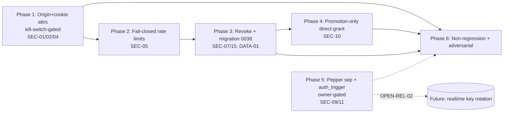

# Invite Token Flow Hardening — Plan Pack

> **Plan status: `CONDITIONALLY READY`**
> Readiness aliases: maps to legacy `READY WITH EXTERNAL DECISIONS`.
> Reason: every internally-resolvable planning decision is closed, but the plan
> *cannot* reach `IMPLEMENTATION-READY` from this planning-only session because
> (a) verification is `emulated` (no native independent verifier dispatched) and
> (b) three owner decisions remain open (OPEN-SEC-01, OPEN-SEC-02, OPEN-REL-02).
> Per the Suite Authority Contract, `emulated` verification caps overall
> readiness at **97** and caps an exhaustive auth-adjacent pack at
> **`CONDITIONALLY READY`** until an independent reviewer or the owner signs off.
> See [`17_FINAL_READINESS_REVIEW.md`](./17_FINAL_READINESS_REVIEW.md).
>
> **`verification_mode: emulated`** — separated specialist passes by the lead
> agent. Phases 1–4 are implementation-ready slices pending owner sign-off;
> Phase 5 is owner-gated on OPEN-REL-02/OPEN-SEC-01.

**Plan profile:** `exhaustive` (auth/invite/shared-link flow — mandatory plan-pack surface per `archestimator-plan-pack/SKILL.md` §1)
**Created:** 2026-07-07 (Asia/Manila)
**Plan folder:** `.ai/03_plans/2026-07-07-invite-token-flow-hardening/`
**Mode:** planning only. No application code, tests, migrations, configs, or provider state changed by this task.

## Start here

This is a **planning-only** pack that converts the invite token lifecycle hardening brief ([`PROMPT.md`](./PROMPT.md)) into an implementation-ready specification. A future implementation AI executes [`11_IMPLEMENTATION_PLAN.md`](./11_IMPLEMENTATION_PLAN.md) phase by phase. **Do not implement from this README alone** — read `11` and the linked phase docs.

The collaboration invite flow already has strong primitives (peppered token hashing, never-stored raw tokens, audit events, rate limits, wrong-account denial, replay detection). This plan closes the **fail-open gaps** and **missing surfaces**:

1. **SEC-01:** origin guard fails open on missing Origin+Referer → deny-on-missing in prod.
2. **SEC-02:** `/continue` route has no origin check → add it.
3. **SEC-04:** sign-out cookie clear missing attributes → fix.
4. **SEC-05:** rate limits vanish when feature flag disabled → fail-closed.
5. **SEC-07:** no explicit invitation revoke surface → add action + UI.
6. **SEC-09:** pepper reused for realtime signing → separate keys.
7. **SEC-10:** direct-grant can downgrade roles → promotion-only.
8. **SEC-11:** `auth_trigger` dead enum → resolve (owner decision).

## Headline findings (full detail in `01_EXECUTIVE_SUMMARY.md` + `03_SOURCE_AND_CODEBASE_AUDIT.md`)

- The brief's claim ("Origin/referer validation appears permissive when headers are missing") is **confirmed by source**: `src/lib/collaboration/invite-origin.ts:39` returns `true` when both headers are absent.
- `/invite/[token]/continue` sets a state-changing bridge cookie with **no origin check at all**.
- There is **no explicit revoke surface** — revocation is a side-effect of re-issuing a token.
- The sign-out route clears session cookies with **no security attributes**.
- All invite rate limits **bypass when the feature flag is disabled**.
- The invite pepper is **reused for realtime identity signing** (key-separation gap).

## Blocked decisions (owner)

| ID | Decision | Blocks | Recommended |
|---|---|---|---|
| OPEN-SEC-01 | Wire `accepted_via='auth_trigger'` login-time grant vs remove the enum value (SEC-11) | Phase 5 (P5-T2) | **Remove** (no product need found) |
| OPEN-SEC-02 | Confirm fail-closed rate limits when flag disabled (SEC-05) | Phase 2 (P2-T1) | **Fail-closed** with route-level disabled-state short-circuit |
| OPEN-REL-01 | Build async invite-email queue + bounce webhook now vs defer (DEC-10) | Future work | **Defer** (not required for hardening) |
| OPEN-REL-02 | Confirm `REALTIME_IDENTITY_SIGNING_KEY` rollout (SEC-09) | Phase 5 (P5-T1) | **Require** the key (coordinate realtime re-handshake) |

## Dependency graph



**Phase order:** Phase 1 (origin + cookie attrs, kill-switch-gated, release-blocking) → Phase 2 (fail-closed rate limits) → Phase 3 (explicit revoke + migration `0038`) → Phase 4 (promotion-only direct-grant) → Phase 5 (pepper separation + `auth_trigger` cleanup, owner-gated) → Phase 6 (non-regression + adversarial audit + hosted-proof extension).

## Requirement/task/test traceability

- Requirements: [`04_REQUIREMENTS_SPECIFICATION.md`](./04_REQUIREMENTS_SPECIFICATION.md) (SEC/FR/ARCH/DATA/UX/A11Y/PERF/REL/TEST/DOC).
- Implementation tasks: [`11_IMPLEMENTATION_PLAN.md`](./11_IMPLEMENTATION_PLAN.md) (P1–P6, tasks `P#-T#`).
- Full trace: [`16_REQUIREMENTS_TRACEABILITY_MATRIX.md`](./16_REQUIREMENTS_TRACEABILITY_MATRIX.md).
- Test matrix: [`12_TEST_AND_VALIDATION_STRATEGY.md`](./12_TEST_AND_VALIDATION_STRATEGY.md).
- Adversarial matrix: [`19_RESEARCH_REVIEW_AND_QA_EVIDENCE.md`](./19_RESEARCH_REVIEW_AND_QA_EVIDENCE.md) §5.

## Stale-plan revalidation checklist (before executing any phase)

- [ ] `git status` clean of invite-related conflicts; recheck concurrent work on `src/components/workshop/publisher/*` (RISK-03).
- [ ] `rg 'isAllowedInviteOrigin' src/` — confirm the helper still lives in `src/lib/collaboration/invite-origin.ts` and the three mutating routes still call it (or the continue route still lacks it, confirming SEC-02 is still needed).
- [ ] Confirm the latest migration number (at planning time `0037_remove_preloaded_component_categories.sql` was latest, so this pack's revoke migration is `0038`; if more concurrent migrations land, renumber `0038`/`0039` accordingly). Run `ls migrations/ | sort | tail -1`.
- [ ] Re-read `src/lib/collaboration/invite-origin.ts`, `continue/route.ts`, `accept/route.ts`, `sign-out/route.ts` for concurrent changes.
- [ ] Confirm `ARCHESTIMATOR_INVITE_TOKEN_PEPPER` is still the realtime fallback in `realtime-identity-server.ts` (else SEC-09 may be partially resolved).
- [ ] Confirm OPEN-SEC-01/02, OPEN-REL-02 resolution status with the owner.

## Commands/checks to run before the first edit

```bash
# Re-read current state
git status
rg 'isAllowedInviteOrigin' src/
ls migrations/ | tail -3

# Baseline the invite test suite (must be green before changing anything)
bun run test -- invite
bun run test -- collaboration-invitation-d1-store
bun run type-check
```

After each phase, run the phase-specific focused tests in [`12`](./12_TEST_AND_VALIDATION_STRATEGY.md) §1.

## Files explicitly off-limits (this planning pass)

- Any file outside `.ai/03_plans/2026-07-07-invite-token-flow-hardening/`.
- All application source, tests, migrations, configs, provider state (this is a planning-only task).

## Files and systems intentionally unaffected

- `src/proxy.ts` / `src/lib/auth/request-proxy.ts` — proxy layer unchanged.
- `src/lib/auth/better-auth-cloudflare.ts` — Better Auth config unchanged.
- `src/app/share/[token]/**` — publication/share flow (sibling plan).
- Closed-beta allowlist (`CLOSED_BETA_ALLOWLIST_STATUSES`) — separate feature.
- `wrangler.jsonc` bindings — no new bindings (ARCH-02).
- Better Auth tables (`user`/`session`/`account`/`verification`) — Better-Auth-generated.

## External proof still required before production rollout (future phases)

- **Phase 1:** 24h 403-rate monitoring on `/invite/[token]/{accept,continue}` in Cloudflare Workers Analytics (<1% threshold); manual FR-03 e2e on preview (signed-out invite → continue → auth → pending-invite → accepted).
- **Phase 3:** migration `0038` applied to preview D1 + readback; hosted proof harness extended for revoke; manager revoke manual proof on preview.
- **Phase 5:** realtime key rotation on preview; realtime sessions healthy.
- **Phase 6:** `rg` token-leak scan clean; full invite test suite green; `bun run build` bundle delta within noise.

## Archive policy

- **Do not archive automatically.** Archive the pack to `.ai/03_plans/_archive/` (or per repo convention) only after the owner confirms the hardening is fully implemented, monitored, and the open decisions are resolved. Phase 5 may remain unimplemented (owner-gated) — archive Phases 1–4 separately if the owner chooses partial archival.

## Document index

| Doc | Purpose |
|---|---|
| [`PROMPT.md`](./PROMPT.md) | The caller's brief (preserved unchanged) |
| [`00_AGENT_COORDINATION.md`](./00_AGENT_COORDINATION.md) | Master `/goal`, lanes, ledger, skills used |
| [`01_EXECUTIVE_SUMMARY.md`](./01_EXECUTIVE_SUMMARY.md) | Headline findings, decisions, readiness scores |
| [`02_FEATURE_BRIEF_AND_SCOPE.md`](./02_FEATURE_BRIEF_AND_SCOPE.md) | Brief verbatim, scope, non-goals, constraints |
| [`03_SOURCE_AND_CODEBASE_AUDIT.md`](./03_SOURCE_AND_CODEBASE_AUDIT.md) | Source map with file:line evidence |
| [`04_REQUIREMENTS_SPECIFICATION.md`](./04_REQUIREMENTS_SPECIFICATION.md) | SEC/FR/ARCH/DATA/UX/A11Y/PERF/REL/TEST/DOC + shadow paths |
| [`05_UX_UI_ACCESSIBILITY_PLAN.md`](./05_UX_UI_ACCESSIBILITY_PLAN.md) | Journeys, states, revoke UX, a11y |
| [`06_ARCHITECTURE_AND_TECHNICAL_DESIGN.md`](./06_ARCHITECTURE_AND_TECHNICAL_DESIGN.md) | Current/target architecture, contracts, diagrams |
| [`07_DATA_DATABASE_API_NETWORK_PLAN.md`](./07_DATA_DATABASE_API_NETWORK_PLAN.md) | Schema, migration, API/rate-limit/idempotency |
| [`08_SECURITY_PRIVACY_THREAT_MODEL.md`](./08_SECURITY_PRIVACY_THREAT_MODEL.md) | Threat model, credential taxonomy summary, residual risk |
| [`09_PERFORMANCE_RELIABILITY_OBSERVABILITY.md`](./09_PERFORMANCE_RELIABILITY_OBSERVABILITY.md) | Hot-path impact, evaluator, failure modes, monitoring |
| [`10_BLAST_RADIUS_AND_DEPENDENCIES.md`](./10_BLAST_RADIUS_AND_DEPENDENCIES.md) | Direct/transitive impact, concurrent-work safety |
| [`11_IMPLEMENTATION_PLAN.md`](./11_IMPLEMENTATION_PLAN.md) | **Execution guide** — Phases P1–P6 with tasks |
| [`12_TEST_AND_VALIDATION_STRATEGY.md`](./12_TEST_AND_VALIDATION_STRATEGY.md) | Test layers, execution matrix, denial/a11y tests |
| [`13_ROLLOUT_ROLLBACK_AND_OPERATIONS.md`](./13_ROLLOUT_ROLLBACK_AND_OPERATIONS.md) | Sequencing, gates, rollback, monitoring |
| [`14_RISK_REGISTER.md`](./14_RISK_REGISTER.md) | RISK-01..12 with mitigations |
| [`15_DECISIONS_ASSUMPTIONS_AND_ALTERNATIVES.md`](./15_DECISIONS_ASSUMPTIONS_AND_ALTERNATIVES.md) | DEC-01..10, assumptions, rejected alternatives |
| [`16_REQUIREMENTS_TRACEABILITY_MATRIX.md`](./16_REQUIREMENTS_TRACEABILITY_MATRIX.md) | Requirement → evidence → task → test |
| [`17_FINAL_READINESS_REVIEW.md`](./17_FINAL_READINESS_REVIEW.md) | Scores, PASS conditions, verification matrix, residual gaps |
| [`18_STACK_CONTRACT_AND_PRODUCTION_STANDARDS.md`](./18_STACK_CONTRACT_AND_PRODUCTION_STANDARDS.md) | Cross-cutting stack production bar |
| [`19_RESEARCH_REVIEW_AND_QA_EVIDENCE.md`](./19_RESEARCH_REVIEW_AND_QA_EVIDENCE.md) | Research, adversarial matrix, evaluator, gaps |
| [`20_ATTACK_SURFACE_AND_CREDENTIAL_MATERIAL.md`](./20_ATTACK_SURFACE_AND_CREDENTIAL_MATERIAL.md) | Credential taxonomy, attack surface inventory |
| [`21_DATABASE_CHANGE_BLUEPRINTS.md`](./21_DATABASE_CHANGE_BLUEPRINTS.md) | Migration `0038` (revoke_reason, additive) + conditional `0039` (auth_trigger removal) blueprints |
