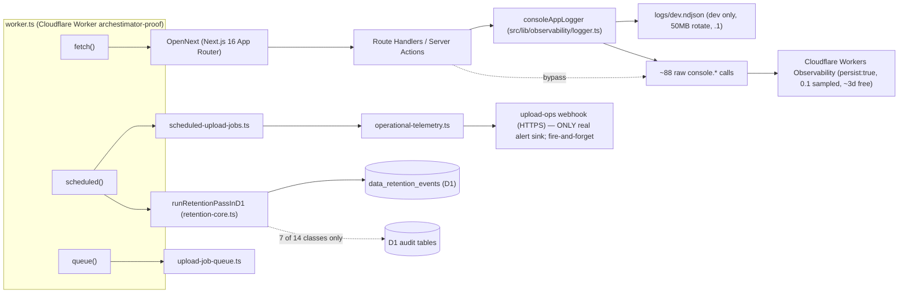
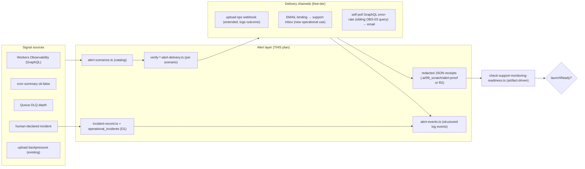

# 06 — Architecture and Technical Design

## Current-state architecture (observability/alert/retention slice)



**Key architectural facts:** (1) Workers Observability is a passive sink, not an alerter. (2) Only
one real alert-delivery path (upload-ops webhook) and it swallows failures. (3) Retention enforces
7 of 14 schedule classes. (4) No incident/alert table. (5) Readiness = operator flags.

## Target-state architecture



## Component boundaries and ownership

| Component | Responsibility | Owner (this plan) | Boundary |
|---|---|---|---|
| `alert-scenarios.ts` (new) | Typed catalog of S-01..S-07 | Phase 1 | Pure data; no I/O. Consumed by verifiers + runbook. |
| `verify-*-alert-delivery.ts` (new scripts) | Real send→receive→receipt per scenario | Phase 1 | scripts/; redact output; write receipt; honest `note`. |
| `alert-proof-schema.ts` (new) | Receipt JSON schema + validators | Phase 1 | Shared by scripts + readiness verifier. |
| `incident-record.ts` (new) | Build/redact incident rows + events | Phase 4 | Server-only; admin-authz write path. |
| `alert-events.ts` (new) | Structured log event builders | Phase 2 | Replaces swallowed `.catch(()=>{})` with logged outcomes. |
| `check-support-monitoring-readiness.ts` (rewrite) | Artifact-driven launch gate | Phase 5/6 | Backward-compatible flag fallback marked deprecated. |
| `retention-core.ts` (extend) | +7 rules | Phase 3 | Coordinate time/row budget with sibling REL-02. |
| `operational-telemetry.ts` (extend) | Log outcome instead of swallow | Phase 2 | Keep fire-and-forget *behavior* (don't block uploads) but log `failed`. |
| migration `0040` (new) | `operational_incidents` + events | Phase 4 | Next free slot. |

## Shared contracts

### Receipt schema (`alert-proof-schema.ts`)
```ts
type AlertProofClass = "local-automated" | "provider-backed";
type AlertProofReceipt = {
  scenarioId: S01..S07;
  channel: "upload-ops-webhook" | "email-to-support" | "graphql-poll" | "dashboard-observation";
  sentAt: string;            // ISO
  ackSignal: string;         // redacted marker, e.g. "webhook-200" or "inbox-token:<hash>"
  ackObservedAt: string | null;
  proofClass: AlertProofClass;
  redactionAttestation: { passedThroughRedactForLog: true; scannedForSecrets: true; };
  note: string;              // honesty scope, mirrors verify-upload-alert-delivery.ts
  generatedBy: string;      // script name + version
};
```

### Alert log event schema (`alert-events.ts`)
```ts
type OperationalAlertEvent = {
  event: "operational_alert_sent" | "operational_alert_failed" | "operational_alert_suppressed"
       | "incident_declared" | "incident_escalated" | "incident_closed";
  scenarioId?: Sxx;
  channel?: string;
  outcome: "delivered" | "failed" | "suppressed";
  targetMarker: string;   // host-only or hash; NEVER raw email/url/token
  incidentId?: string;
  reason?: string;        // redacted
};
```

## Failure boundaries

- **Alert delivery failure** must not break the feature that triggered it (keep fire-and-forget for
  upload-ops) BUT must be *logged* (`operational_alert_failed`), not swallowed.
- **Verifier failure** (exit 1) must not break the build/deploy; it is a launch gate, not a CI
  wall. Documented in `13_…`.
- **Retention rule error** must not abort the whole pass (sibling REL-02 bounds it); a bad rule
  logs `retention_pass_failed` and continues.
- **Incident write failure** must not crash the declaring admin action; returns a typed error.

## Integration points

- **Sibling observability pack (one-directional dependency):** request-id (FR-03 correlation),
  error-taxonomy (S-02 signal), Analytics Engine metrics (optional S-02 signal), GraphQL query
  defs (OBS-03, used by S-02 poller), redaction enforcement (SEC-01, consumed by this pack's
  redaction attestation but the *fix* is theirs). If any of these is descoped, FR-03/S-02
  re-validate (stale-plan checklist in README).
- **Beta-feedback pack:** `DATA-02` feedback purge couples to `OPEN-DEC-004`; this pack's incident
  format is orthogonal but the runbook cross-references feedback-triage.
- **D1/R2 backup pack:** retention ≠ backup; a restore resurrects purged rows — runbook states the
  post-restore re-erasure check.
- **wrangler.jsonc:** no new binding required by default. If evidence artifacts are stored in R2
  (DATA-04 option), reuse `ARCH_UPLOADS_R2` under a redacted key namespace OR a new bucket
  (owner decision `OPEN-EVID-01`); do not enable paid R2 tier.

## Architectural alternatives (rejected)

| Alternative | Rejected because |
|---|---|
| Build a new paid alerting stack (PagerDuty/Datadog) | Violates PROMPT free-tier constraint; `OPEN-ALERT-02` owner-gated. |
| Store incidents in Workers Observability only / flat file | Not queryable, not durable, not auditable; D1 is the bounded relational store. |
| Make the readiness verifier a CI-blocking test | Launch-readiness is a release gate, not a per-commit wall; would block unrelated PRs. |
| Monkey-patch `console` globally to force redaction | Owned by sibling SEC-01; risky global mutation. This pack inventories, doesn't enforce. |
| Add a 4th cron for evidence cleanup | All 3 cron slots taken; reuse the retention pass or a scripts/ manual step (DATA-04). |
