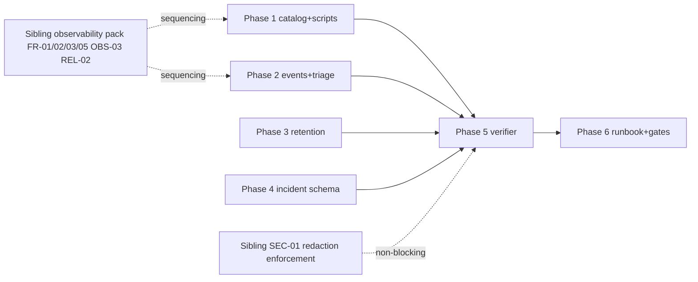

# 11 — Implementation Plan

Authoritative execution guide for the future implementation AI. Phases are dependency-aware.
Each phase carries a durable-goal contract (Phase ID, objective, requirements, evidence, exit
criteria, stop/blocker condition). Tasks have exact paths/symbols or are explicitly marked
`BLOCKED-*`/`DISCOVERY-REQUIRED`.

**Cross-cutting rule:** stay on the current shared `main` worktree; coordinate concurrent packs
via `LOOP_LEDGER.md`; re-read touched files immediately before edits; no auto-branch/worktree.

**Sibling dependency note:** Phases 1 (S-02/S-05 slices) and 2 depend on the sibling observability
pack's request-id/error-taxonomy/GraphQL-query work. If that pack is not yet implemented, those
slices sequence after it; the rest (S-01/S-03/S-04/S-06/S-07, incident schema, retention rules,
redaction inventory, readiness verifier) can proceed independently.

---

## Phase 1 — Alert scenario catalog + delivery-proof scripts

**Objective:** Replace operator-flag theater with artifact-based proof for every alert scenario.
**Requirements:** FR-01, FR-02, FR-03, FR-04, TEST-02, TEST-03.
**Prerequisites:** none for S-01/S-03/S-04/S-06/S-07; sibling pack for S-02/S-05 precision.
**Exit criteria:** all 7 verify scripts exist, redact output, write receipts, pass TEST-02/TEST-03.

### Task P1-T1 — Alert scenario catalog (FR-01)
- **ID:** P1-T1. **Req:** FR-01. **Complexity:** Small.
- **Objective:** typed catalog of S-01..S-07.
- **New file:** `src/lib/observability/alert-scenarios.ts` — exported `ALERT_SCENARIOS` const
  (array of `{id, severity, signalSource, channel, ownerRole, slaAckMin, slaResolveHours}`).
- **Why:** single source of truth consumed by verifiers + runbook + TEST-03.
- **Inputs:** `09_…` §2; `04_…` FR-01.
- **Failure cases:** catalog drifts → TEST-03 catches.
- **Tests:** `tests/vitest/alert-scenarios.test.ts` — asserts all 7 ids present, no dup, channels
  ∈ allowed set.
- **Validation:** `bunx vitest run tests/vitest/alert-scenarios.test.ts`.
- **Parallelization:** parallel-safe (disjoint file).
- **Completion evidence:** test green + static review.

### Task P1-T2 — Receipt schema + redaction attestation (FR-03)
- **ID:** P1-T2. **Req:** FR-03, SEC-02. **Complexity:** Small.
- **New file:** `src/lib/observability/alert-proof-schema.ts` — `AlertProofReceipt` type +
  `validateReceipt` + `redactReceipt` (calls `redactForLog`).
- **Tests:** `tests/vitest/alert-proof-schema.test.ts` — rejects unredacted receipt; validates
  fixture.
- **Parallelization:** parallel-safe.

### Task P1-T3..T9 — Per-scenario verify scripts (FR-04)
- **IDs:** P1-T3 (S-01), T4 (S-02), T5 (S-03 extend), T6 (S-04), T7 (S-05), T8 (S-06), T9 (S-07).
  **Complexity:** Medium each.
- **New files:** `scripts/verify-uptime-alert-delivery.ts`,
  `verify-error-rate-alert-delivery.ts`, `verify-queue-dlq-alert-delivery.ts`,
  `verify-cron-failure-alert-delivery.ts`, `verify-incident-escalation-alert-delivery.ts`,
  `verify-retention-alert-delivery.ts`; **modified:** `scripts/verify-upload-alert-delivery.ts`
  (extend to log outcome + write receipt).
- **Each script:** gates on `*_PROOF=1` + `*_HOSTED_OBSERVED=1`; performs real round-trip; calls
  `redactReceipt`; writes `.ai/99_scratch/alert-proof/<scenario-id>.json`; prints honest `note`.
- **Models on:** existing `verify-upload-alert-delivery.ts` structure.
- **Tests:** TEST-02 (verifier consumes receipts); each script has a `--dry-run-self-test` that
  validates its own redaction on a planted-secret fixture.
- **DISCOVERY-REQUIRED (T4 S-02, T7 S-05):** exact GraphQL query shape for error-rate + cron
  summary. Discovery scope: Cloudflare Workers Observability GraphQL docs + sibling OBS-03 query
  defs. Stop condition: a query that returns error count by outcome in a time window.
- **BLOCKED-EXTERNAL (T3/T4/T6/T7 hosted receipt):** real provider-backed receipts need live
  destinations + `OPEN-ALERT-01` (poller host) — implementation can build the script + local-
  automated path now; `proofClass: provider-backed` is the launch gate (GATE-02).
- **Parallelization:** parallel-safe across scripts (disjoint files).
- **Completion evidence:** scripts run locally (local-automated receipts); provider-backed marked
  as external gate.

### Task P1-T10 — TEST-03 catalog/registry agreement check
- **ID:** P1-T10. **Req:** TEST-03. **Complexity:** Small.
- **New file:** `tests/vitest/alert-proof-registry.test.ts` — asserts `ALERT_SCENARIOS` ids ==
  verify-script registry ids.
- **Parallelization:** after P1-T1.

**Phase 1 stop condition:** 7 scripts exist, redact, write receipts, TEST-02/TEST-03 green.
**Phase 1 blocker condition:** `OPEN-ALERT-01` (poller host) blocks provider-backed S-02/S-05 only.

---

## Phase 2 — Triage ownership + structured alert events

**Objective:** name owners/SLAs and replace swallowed alert failures with logged outcomes.
**Requirements:** OPS-01, OPS-02. **Prerequisites:** Phase 1 (scenario catalog).

### Task P2-T1 — Alert event builders (OPS-02)
- **New file:** `src/lib/observability/alert-events.ts` — `buildOperationalAlertEvent`,
  `buildIncidentEvent`; redacted `targetMarker`.
- **Modified:** `src/lib/uploads/operational-telemetry.ts` — replace `.catch(()=>{})` (line 200)
  with `.catch(err => emitLogRecord(buildOperationalAlertEvent({outcome:"failed",...})))`; keep
  fire-and-forget (do not rethrow / block uploads).
- **Tests:** `tests/vitest/alert-events.test.ts` — asserts no raw token/email/url in event;
  `tests/vitest/upload-operational-telemetry.test.ts` (extend) — asserts failure is logged.
- **Parallelization:** P2-T1 modifies `operational-telemetry.ts` — coordinate with any upload-pack
  work via `LOOP_LEDGER`.

### Task P2-T2 — Triage matrix in readiness output (OPS-01)
- **Modified:** `scripts/check-support-monitoring-readiness.ts` — emit `triageMatrix` mapping each
  S-* + audit class to `{owner, ackSLA, resolveSLA, escalation}`; require owner labels non-empty
  (exit 1 if missing).
- **Tests:** covered by Phase 5 readiness-verifier tests.

**Phase 2 stop:** events redacted + logged on failure; triage matrix emitted; owners required.

---

## Phase 3 — Retention TTL enforcement (7 unenforced classes)

**Objective:** the daily cron stops leaving log/platform data unbounded.
**Requirements:** DATA-02, DATA-03, DATA-04. **Prerequisites:** none (use local budget defaults
if sibling REL-02 not landed).

### Task P3-T1 — Correct `logs_worker_observability` TTL (DATA-03)
- **Modified:** `.ai/10_state/compliance/retention-schedule.md` — row to `~3d (free)/30d+ (Logpush/
  Workers Paid)`, platform-managed, with `OPEN-RET-01` upgrade note.
- **Cross-check:** `privacy-notice-draft.md` §5 — confirm no "logs 30d" user-facing promise
  (there is not). **DISCOVERY-REQUIRED:** grep all `.ai/10_state/compliance/` + `privacy/` for any
  "30 day" + "log" conflation; correct if found.
- **Validation:** static doc review + official-doc citation in `19_…`.

### Task P3-T2 — Add retention rules (DATA-02)
- **Modified:** `src/lib/compliance/retention-core.ts` `DEFAULT_RETENTION_RULES` — add
  `uploads_orphaned` (coordinate seam with `src/lib/uploads/cleanup.ts`
  `DEFAULT_UPLOAD_RETENTION_POLICY`), `sessions_expired` (confirm Better Auth `session` table
  shape via generated migration readback), 3 AI classes (forward-compat no-op).
- **DISCOVERY-REQUIRED:** read the Better Auth generated D1 migration to confirm `session` table
  name + `expires_at` column. Stop condition: exact SELECT validated against the schema.
- **Add acknowledgement rows** (not D1 rules) for `logs_worker_observability`/`logs_email_delivery`
  in the schedule.
- **Tests:** extend `tests/vitest/compliance-retention-repository.test.ts` — per-new-rule row-
  selection fixture; dry-run produces 0 deletes on empty; `budget_reached` honored.
- **Parallelization:** modifies `retention-core.ts` — coordinate with sibling REL-02 if concurrent.

### Task P3-T3 — Evidence-artifact retention policy (DATA-04)
- **Modified:** `.gitignore` (confirm `.ai/99_scratch/` excluded — it is, since `99_scratch` is
  local-only per AGENTS.md); `retention-schedule.md` (add `evidence_artifacts` 90d class);
  `scripts/check-support-monitoring-readiness.ts` (prune step for >90d receipts).
- **`OPEN-EVID-01`:** owner chooses gitignored-local vs R2 proof store.

**Phase 3 stop:** 7 classes have rules/acknowledgement; TTL corrected; artifact policy set.

---

## Phase 4 — Incident record schema + runbook declare/close

**Objective:** "we had an incident" becomes queryable.
**Requirements:** DATA-01, FR-05. **Prerequisites:** none.

### Task P4-T1 — Migration `0040` (DATA-01)
- **New file:** `migrations/0040_operational_incidents.sql` (SQL in `07_…` DB-01).
- **DISCOVERY-REQUIRED:** read `migrations/0034_data_retention_events.sql` to get the exact
  `class_name` CHECK text; add `operational_incidents`/`operational_incident_events` to the
  allowed set (or confirm they're not needed if incidents aren't retention-swept).
- **Coordinate:** `LOOP_LEDGER` — confirm `0039` (beta-feedback) is not concurrently claiming
  `0040`.
- **Tests:** local apply (`cf:d1:migrate:local` equivalent) + `EXPLAIN` stale query.
- **Validation:** `bun run cf:d1:migrate` local success.

### Task P4-T2 — Incident record builder (FR-05)
- **New file:** `src/lib/observability/incident-record.ts` — `buildIncidentRow`,
  `buildIncidentEvent`, admin-authz Server Action `declareIncident`/`closeIncident` (scoped,
  Better Auth admin check).
- **Tests:** `tests/vitest/incident-record.test.ts` — redacts `related_request_ids`/`detail`;
  rejects unredacted; non-admin → 403 (role-matrix test).
- **Parallelization:** disjoint from P1/P2/P3 files.

### Task P4-T3 — Runbook declare/close (DOC-01 slice)
- **New section in** `13_…`: copy-pasteable declare/escalate/close + the stale-incident query.

**Phase 4 stop:** migration applies; builder redacts; admin-authz tested; runbook step exists.

---

## Phase 5 — Readiness verifier (artifact-driven) + redaction scan

**Objective:** GATE-01 — verifier fails loud on missing/stale/unredacted artifacts.
**Requirements:** GATE-01, GATE-02, SEC-02, TEST-01, TEST-02. **Prerequisites:** Phases 1, 3, 4.

### Task P5-T1 — Rewrite readiness verifier (GATE-01)
- **Modified:** `scripts/check-support-monitoring-readiness.ts` — artifact-driven; checks 7
  receipts (FR-03), 4 owner labels (OPS-01), incident table exists (DATA-01), retention rules
  count = 14 (DATA-02), no stale open incidents (FR-05d), artifacts redacted (SEC-02),
  `logs_worker_observability` TTL corrected in schedule (DATA-03); emits `launchReady`/`missing`/
  `proofClass`; legacy flag fallback marked deprecated.
- **Tests:** `tests/vitest/support-monitoring-readiness.test.ts` — fails on missing/stale/
  unredacted; passes on valid fixture set; rejects `local-automated` for the 4 critical scenarios
  (GATE-02).

### Task P5-T2 — Redaction-scan test (SEC-02 / TEST-02)
- **New file:** `tests/vitest/alert-proof-redaction-scan.test.ts` — scans
  `.ai/99_scratch/alert-proof/*.json` for secret-shaped strings (email, bearer, JWT, 32+ hex,
  `password=`/`token=`); non-empty match fails; includes a planted-secret fixture that must fail.

**Phase 5 stop:** verifier + scan green on a valid fixture; red on missing/unredacted.

---

## Phase 6 — Runbook, launch gates, first-24h/72h

**Objective:** GATE-03 + DOC-01. **Prerequisites:** Phases 1–5.

### Task P6-T1 — Runbook (DOC-01)
- **New file/section:** `13_…` — find-by-request-id, read-error-log, alert scenarios, declare/
  escalate/close incident, budget/retention thresholds, rollback, escalation contacts,
  first-24h/72h checklists, paid-upgrade triggers (`OPEN-ALERT-02`/`OPEN-RET-01`).

### Task P6-T2 — Launch-gate checklist (GATE-01/02/03)
- **In** `13_…` + `README`: the exact go/no-go gates; provider-backed proof required for
  S-01/S-02/S-05/S-06; first-24h/72h review owners + checklists; rollback trigger.

**Phase 6 stop:** runbook complete; launch gates documented; readiness verifier is the executable
form of GATE-01/02.

---

## Dependency graph

## Files off-limits to this plan's implementation

- `src/lib/observability/redact.ts` (sibling SEC-01 owns enforcement).
- The ~88 `console.*` bypass call sites (sibling SEC-01 owns migration).
- `wrangler.jsonc` observability/`analytics_engine`/sampling (sibling OBS-01/02).
- `worker.ts` request-id/try-catch (sibling FR-01/03) — *except* the optional cron-failure alert
  hook which this plan may add *after* sibling FR-02 lands, coordinated via `LOOP_LEDGER`.
- Feedback SLA columns / `beta_feedback_submissions` schema (beta-feedback pack).
- D1 backup automation (backup pack).

## New files summary (exact repo-relative paths)

- `src/lib/observability/alert-scenarios.ts`
- `src/lib/observability/alert-proof-schema.ts`
- `src/lib/observability/alert-events.ts`
- `src/lib/observability/incident-record.ts`
- `migrations/0040_operational_incidents.sql`
- `scripts/verify-uptime-alert-delivery.ts`
- `scripts/verify-error-rate-alert-delivery.ts`
- `scripts/verify-queue-dlq-alert-delivery.ts`
- `scripts/verify-cron-failure-alert-delivery.ts`
- `scripts/verify-incident-escalation-alert-delivery.ts`
- `scripts/verify-retention-alert-delivery.ts`
- `tests/vitest/alert-scenarios.test.ts`
- `tests/vitest/alert-proof-schema.test.ts`
- `tests/vitest/alert-events.test.ts`
- `tests/vitest/incident-record.test.ts`
- `tests/vitest/alert-proof-registry.test.ts`
- `tests/vitest/support-monitoring-readiness.test.ts`
- `tests/vitest/alert-proof-redaction-scan.test.ts`
- Runbook section in `13_ROLLOUT_ROLLBACK_AND_OPERATIONS.md` (this pack)
