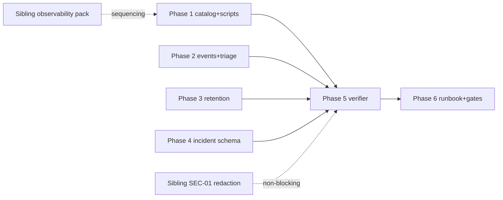

# Observability Alert Proof and Log Retention — Plan Pack

**Plan folder:** `.ai/03_plans/2026-07-07-observability-alert-proof-and-log-retention`
**Date:** 2026-07-07 (Asia/Manila)
**Profile:** `exhaustive` · **Mode:** `planning-only` (no application code changed by this pack)
**Status:** **`CONDITIONALLY READY`** (overall readiness **94/100**; see `17_FINAL_READINESS_REVIEW.md`)

## What this plan is

A planning package that converts Archestimator's **operator-flag theater** into **provable
operational readiness** before the first closed-beta user. The PROMPT's stop condition — *"support
and alert readiness can be proven without hand-wavy operator claims"* — is not met today: the
readiness script's own `note` admits it verifies nothing, only one real alert path exists
(upload-ops, fire-and-forget), and 7 of 14 retention classes are unenforced.

This pack owns the **operational proof layer**: alert scenarios + delivery proof, triage
ownership, incident records, retention TTL policy, evidence retention, tests, and launch gates.
It deliberately does **not** own the observability plumbing (request IDs, error taxonomy, metrics,
budgets, redaction *enforcement*) — that is the sibling
`2026-07-07-cloudflare-worker-production-observability-and-budgets` pack. Boundary in `02_…`.

## Implementation entrypoint

**Start at:** `11_IMPLEMENTATION_PLAN.md`
**Phase order:** 1 (alert catalog + proof scripts) → 2 (triage + alert events) → 3 (retention TTLs)
→ 4 (incident schema + runbook) → 5 (readiness verifier + redaction scan) → 6 (runbook + gates).

Phases 1 (S-02/S-05 slices) and 2 sequence after the sibling observability pack's request-id/
error-taxonomy/GraphQL work; the rest can proceed independently.

## Dependency graph

## Blocked / owner-delegated decisions

| ID | Decision | Impact if unresolved |
|---|---|---|
| `OPEN-ALERT-01` | Free external cron host for S-02/S-05 poller | provider-backed proof for those scenarios blocked → GATE-02 |
| `OPEN-ALERT-02` | Paid alerting (PagerDuty/Datadog) | defer until 24/7 coverage demand |
| `OPEN-RET-01` | Logpush/Workers Paid for >3d log retention | RCA window tight on free (~3d) |
| `OPEN-EVID-01` | Evidence store: gitignored-local vs R2 | low impact (default local) |
| `OPEN-DEC-004` | Final retention TTL counsel sign-off | draft enforcement proceeds; final values gated |

## Stale-plan revalidation checklist (run before first implementation edit)

1. Re-verify `wrangler.jsonc` observability config unchanged (or re-check sampling/persist).
2. Re-verify latest migration number (`ls migrations/ | tail`); confirm `0040` still free.
3. Re-verify `migrations/0034` CHECK class list (operational_incidents still absent?).
4. Confirm sibling observability pack status (did FR-01/02/05 OBS-03 REL-02 SEC-01 land?).
5. Re-verify `retention-schedule.md` draft values unchanged (or re-map DATA-02).
6. Confirm `verify-upload-alert-delivery.ts` still the proof model (interface stable).
7. Confirm Better Auth `session` table shape (DISCOVERY-REQUIRED R-07).
8. Re-check Cloudflare free-tier Workers Logs retention (~3d) against current dashboard.

## Commands/checks before the first edit

- `git status --short --branch` (shared-worktree awareness)
- `ls migrations/ | sort | tail -3` (confirm `0040` free)
- `grep -n "class_name IN" migrations/0034_data_retention_events.sql` (confirm CHECK)
- `bunx vitest run tests/vitest/compliance-retention-repository.test.ts` (baseline green)

## Files off-limits to this plan's implementation

- `src/lib/observability/redact.ts` (sibling SEC-01 owns enforcement)
- the ~88 `console.*` bypass call sites (sibling SEC-01)
- `wrangler.jsonc` observability/`analytics_engine`/sampling (sibling OBS-01/02)
- `worker.ts` request-id/try-catch (sibling FR-01/03) — except optional cron-alert hook, coordinated
- feedback SLA columns (beta-feedback pack); D1 backup automation (backup pack)

## Files/systems intentionally unaffected

End-user UI/routes, estimate/auth/publication/collaboration business logic, R2 object policies,
Durable Object room semantics, queue retry config, `notification_*` (in-app), Better Auth auth.

## External proof required before production rollout

- Provider-backed alert receipts for S-01 (uptime), S-02 (error-rate), S-05 (cron failure), S-06
  (incident escalation) — GATE-02.
- Hosted D1 migration `0040` readback.
- Hosted retention-pass `data_retention_events` rows for the new classes.
- First-24h / first-72h post-launch review receipts — GATE-03.

## Archive policy

Do **not** archive automatically. Archive only after the launch gates (GATE-01/02/03) are proven
on hosted evidence and an independent reviewer/owner accepts the package. Named completed slices
may be archived independently if the pack is partially landed.

## Document map

| Doc | Purpose |
|---|---|
| `00_AGENT_COORDINATION.md` | Master goal, lanes, ledger, skills |
| `01_EXECUTIVE_SUMMARY.md` | What/current/target/findings/decisions/readiness |
| `02_FEATURE_BRIEF_AND_SCOPE.md` | Brief, scope, non-goals, sibling boundary, constraints |
| `03_SOURCE_AND_CODEBASE_AUDIT.md` | Evidence-grounded surface inventory |
| `04_REQUIREMENTS_SPECIFICATION.md` | 20 requirements + shadow-path matrices |
| `05_UX_UI_ACCESSIBILITY_PLAN.md` | Operator-facing surfaces; N/A dimensions |
| `06_ARCHITECTURE_AND_TECHNICAL_DESIGN.md` | Current/target arch, contracts, boundaries |
| `07_DATA_DATABASE_API_NETWORK_PLAN.md` | DB-01/DB-02 blueprints, access-path matrix |
| `08_SECURITY_PRIVACY_THREAT_MODEL.md` | **Log redaction inventory** + threat model |
| `09_PERFORMANCE_RELIABILITY_OBSERVABILITY.md` | Latency + retention budgets |
| `10_BLAST_RADIUS_AND_DEPENDENCIES.md` | Impact classification |
| `11_IMPLEMENTATION_PLAN.md` | **Execution guide** — phases + tasks |
| `12_TEST_AND_VALIDATION_STRATEGY.md` | Test matrix + adversarial matrix |
| `13_ROLLOUT_ROLLBACK_AND_OPERATIONS.md` | Gates, rollback, **runbook** |
| `14_RISK_REGISTER.md` | R-01..R-14 |
| `15_DECISIONS_ASSUMPTIONS_AND_ALTERNATIVES.md` | DEC-01..DEC-09 + open decisions |
| `16_REQUIREMENTS_TRACEABILITY_MATRIX.md` | Full traceability |
| `17_FINAL_READINESS_REVIEW.md` | Critique log + scores + verification_mode |
| `18_STACK_CONTRACT_AND_PRODUCTION_STANDARDS.md` | Cross-cutting stack decisions |
| `19_RESEARCH_REVIEW_AND_QA_EVIDENCE.md` | Research, QA, gaps |
| `LOOP_LEDGER.md` | Implementation-time coordination |
