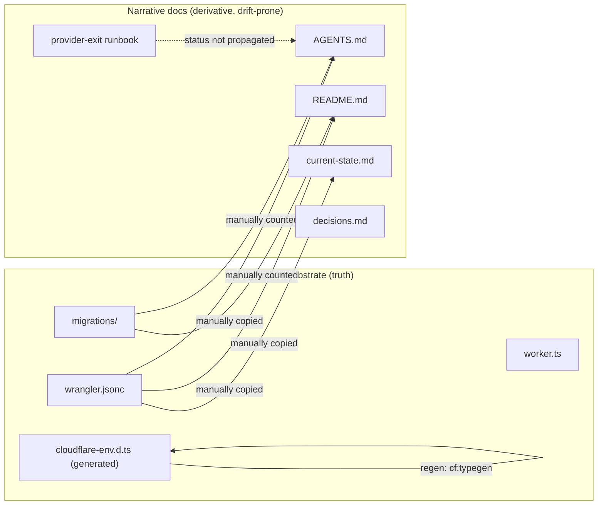
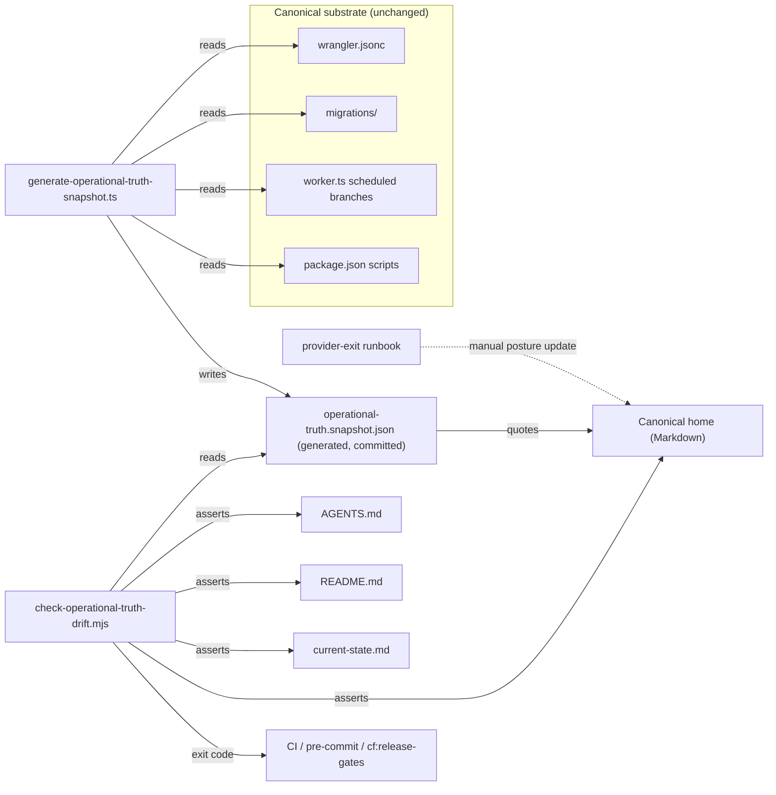

# 06 — Architecture and Technical Design

## Current-state architecture (operational-truth flow today)

**Problem:** every arrow is a *manual* copy. There is no feedback loop. When `wrangler.jsonc` gains a third cron, nothing tells `AGENTS.md`.

## Target-state architecture

**Key shift:** mechanical facts flow **one way** (substrate → generator → snapshot → home), and the detector closes the loop by asserting that narrative docs agree with the snapshot. Posture facts (provider-exit, cost, retention) remain curated but must cite a source.

## Component boundaries

| Component | Responsibility | Owner module | New/existing |
|---|---|---|---|
| `generate-operational-truth-snapshot.ts` | Read-only substrate parse → deterministic JSON | `scripts/` | **new** |
| `operational-truth.snapshot.json` | Generated snapshot artifact (committed) | repo root or `docs/` | **new** |
| `check-operational-truth-drift.mjs` | Assert snapshot vs narrative docs; fail closed | `scripts/` | **new** |
| Canonical home (Markdown) | Human/agent-readable Fast Facts + posture | location OPEN-1 | **new** |
| `AGENTS.md`/`README.md`/`current-state.md` | Narrative docs (assertion targets) | existing | modified (execution phase) |
| CI hook / pre-commit | Invoke detector | `.github/workflows/` or husky | new wiring |

## Data flow & ownership

- **Mechanical facts** (cron, migration count, bindings, compat): snapshot is authoritative; canonical home *quotes* the snapshot (or is regenerated from it). Detector asserts the quote matches.
- **Posture facts** (provider-exit, cost tier, retention): canonical home is authoritative *narrative*, but must cite a source doc (runbook, `AGENTS.md` cost paragraph) and carry a status. Detector asserts the citation marker exists, not the narrative truth.
- **Generated types** (`cloudflare-env.d.ts`): explicitly **out of scope** for the detector — they are already auto-synced via `cf:typegen`. The home notes this.

## Reusable abstractions (do not invent new ones)

- Reuse `scripts/check-cloudflare-worker-readiness.ts`'s `wrangler.jsonc` parse approach (it already extracts bindings/crons/vars). The generator should *not* re-implement JSONC parsing ad hoc if a shared helper exists; if not, a small focused parser is acceptable (wrangler.jsonc is JSONC, not JSON — comments must be tolerated).
- Reuse `scripts/generate-cloudflare-queues-cron-proof.ts`'s cron extraction as a cross-check (the generator's `crons` field should equal this script's output).
- **Do not** rely on `generate-cloudflare-migration-inventory.ts` for the active D1 count — it scans `supabase/migrations/` only (§3.5 latent bug). The generator counts `migrations/` directly.

## Coupling & dependency direction

- Generator → substrate (read-only). Detector → snapshot + narrative docs (read-only). CI → detector. No narrative doc depends on the generator at runtime; the dependency is *authoring-time* (a human/agent regenerates then copies into the home).

## Failure boundaries

- Generator crash → no snapshot → detector fails closed (REL-1).
- Detector regex miss (a fact-class not yet asserted) → silent skip → mitigated by AC-FR-3e (per-fact summary) and the adversarial suite (TEST-1) which must cover every asserted class.
- Substrate schema change (e.g. wrangler adds a new binding type) → generator must be updated; flagged by the generator's own field-list assertion or a unit test that pins expected fields.

## Architectural alternatives (see `15_DECISIONS` for full trade study)

- **ALT-A (chosen):** Markdown canonical home + JSON snapshot + mjs detector. Best readability + cheap + no runtime cost.
- ALT-B: fully-generated Markdown (no hand-written home). Rejected: posture facts resist generation.
- ALT-C: single source = `AGENTS.md` only, all facts inlined. Rejected: `AGENTS.md` is already large; inlining generated content makes it noisy and conflict-prone under concurrent edits.
- ALT-D: KV/Durable Object live-truth endpoint. Rejected: adds runtime dependency, cost, and a new auth surface for a docs problem.

## Stack contract alignment

- **Next.js/React:** n/a (no app code). The home is plain Markdown, not a route.
- **Cloudflare:** the generator reads `wrangler.jsonc` locally only; it does **not** call the Cloudflare API (no auth, no quota, no paid add-on). Provider readback stays out of scope (those facts live in evidence JSON under the migration pack, referenced, not re-fetched).
- **TypeScript:** generator is `.ts` (run via `bun run`), detector is `.mjs` (Node, for pre-commit/CI speed without a TS compile step). Both type-checked where practical; the mjs detector may use JSDoc types.
- **Tailwind/design-system:** n/a.
