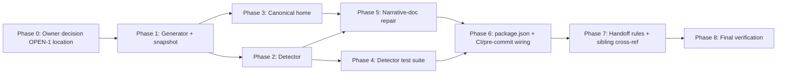

# 11 — Implementation Plan

This is the authoritative execution guide for the future implementation AI. **Planning-only task: this plan does not execute these phases.** Phases are dependency-aware; tasks carry exact paths/symbols or explicit blocker tags.

Conventions: new repo-relative paths are exact. `OPEN-*` items are owner decisions (see `15_DECISIONS`). `DISCOVERY-REQUIRED` items have a safe read-only first step.

## Phase order & dependency graph

Each phase below is a durable goal unit (ultragoal-style contract).

---

## Phase 0 — Owner decision: canonical-home location (BLOCKED-EXTERNAL until confirmed)

- **Objective:** Confirm the canonical-home path. (OPEN-1)
- **Requirements:** FR-1.
- **Options (full trade study in `15_DECISIONS` DEC-HOME):**
  1. `docs/OPERATIONAL_TRUTH.md` (recommended) — top-level, visible, conventional.
  2. `.ai/10_state/operational-truth.md` — co-located with `current-state.md`; signals "agent brain".
- **Recommendation:** option 1 (top-level `docs/`), because non-`.ai` readers (new contributors, external reviewers) find it; agents already read `docs/`.
- **Decision owner:** Philip Lewis.
- **Implementation impact:** option 1 vs 2 only changes the path in FR-1/AC-FR-1 and the `AGENTS.md` pointer. Either is implementation-safe.
- **Stop condition:** owner confirms path. Until then, downstream phases use `docs/OPERATIONAL_TRUTH.md` as the working assumption and note the final swap.

## Phase 1 — Generator + snapshot (T-01)

- **Objective:** produce `scripts/generate-operational-truth-snapshot.ts` and a committed `operational-truth.snapshot.json` matching the schema in `07_DATA…`.
- **Requirements:** FR-2, DATA-1, SEC-1.
- **Prerequisites:** Phase 0 working assumption.
- **Task T-01:** create `scripts/generate-operational-truth-snapshot.ts`.
  - Exact path: `scripts/generate-operational-truth-snapshot.ts` (**new**).
  - Responsibility: read-only parse → deterministic JSON.
  - Public contract: `export function generateOperationalTruthSnapshot(rootDir: string): OperationalTruthSnapshot` (typed); CLI `main()` writes to `operational-truth.snapshot.json` at repo root.
  - Inputs: `wrangler.jsonc` (JSONC-tolerant parse — strip `//` and `/* */` comments then `JSON.parse`, or reuse existing helper if `check-cloudflare-worker-readiness.ts` exports one — DISCOVERY-REQUIRED: grep `scripts/` for an exported JSONC parser; if none, inline a ≤20-line comment-stripper with a unit test), `migrations/*.sql` (`readdir` + sort), `worker.ts` (regex for `controller.cron === "..."` branches), `package.json` (`scripts` keys, allowlist).
  - Output: JSON per `07` schema; includes `cronConfigVsDispatchMismatch` warning field when `crons !== cronDispatched`.
  - Security: allowlist fields only; never read `.env*`/`dev.vars`/secrets; never echo full `vars` (echo only the public `ARCH_UPLOAD_HOSTED_*` set, by name).
  - Failure cases: missing `wrangler.jsonc`/`migrations/`/`worker.ts` → throw with clear message (caller exits non-zero).
  - Tests to add: `tests/unit/operational-truth-snapshot.test.ts` — asserts `migrationCount`, `crons`, `cronDispatched`, `worker.name`, `d1.binding`, `d1.latestMigrationFile`, secret-absence, determinism (two runs → deep-equal modulo `generatedAt`), `cronConfigVsDispatchMismatch` population when worker.ts is mutated.
  - Validation: `bun run type-check`; `bun run ops:truth:snapshot` (after Phase 6) and eyeball JSON; `bunx vitest run tests/unit/operational-truth-snapshot.test.ts`.
  - Completion evidence: committed snapshot JSON matches `ls migrations/*.sql | wc -l` and `wrangler.jsonc` crons; test green.
  - Parallelization: **parallel-safe** with Phase 2's *design* but not its *test* (Phase 4 depends on both). Phase 1 owns `scripts/generate-…ts` + snapshot; no other phase writes these.
  - Complexity: Medium.

## Phase 2 — Detector (T-02)

- **Objective:** `scripts/check-operational-truth-drift.mjs` asserts snapshot vs narrative docs; fail-closed.
- **Requirements:** FR-3, REL-1, SEC-1 (no secret logging).
- **Prerequisites:** Phase 1.
- **Task T-02:** create `scripts/check-operational-truth-drift.mjs`.
  - Exact path: `scripts/check-operational-truth-drift.mjs` (**new**, Node ESM, zero deps).
  - Responsibility: read snapshot + narrative docs; per-fact assertions; exit code.
  - Public contract: CLI `node scripts/check-operational-truth-drift.mjs`; exit 0 = clean, 1 = drift, 2 = internal error (parse failure).
  - Assertions (per fact-class), each with a target-doc + locator strategy:
    - **cron count in `AGENTS.md`**: regex locate the cron sentence; extract integer before "cron trigger"; assert equals `snapshot.crons.length`. Also assert the listed expressions are a subset of `snapshot.crons`.
    - **cron count in `README.md`**: same.
    - **cron wording in `current-state.md`**: assert the string "both cron schedules" / "both matched jobs" is **absent** (or replaced by "three") — a targeted guard for the known stale phrase.
    - **migration count in `AGENTS.md`**: regex "N SQL files" → assert `migrationCount`.
    - **migration count in `README.md`**: regex "N migrations" / "N D1 migrations" → assert.
    - **latest migration in `README.md`**: regex `latest \`00NN_…\`` → assert `latestMigrationFile`.
    - **bindings in `AGENTS.md`**: assert each of the 7 binding names appears at least once (subset assertion).
    - **canonical home vs snapshot**: assert the home's quoted cron list / migration count / binding list equal the snapshot (catches home/snapshot split).
    - **snapshot freshness (DATA-1)**: regenerate in-memory; assert committed JSON deep-equal modulo `generatedAt`; else exit 1 with "run ops:truth:snapshot".
  - Output: stdout lines `cron-count[AGENTS.md]: PASS|FAIL (expected X, found Y)` etc.; final line `RESULT: PASS` or `RESULT: FAIL (<n> drift)`.
  - Failure behavior: any throw → exit 2 with stack (REL-1).
  - Tests to add: `tests/unit/operational-truth-drift.test.ts` (or `.test.mjs`) — for each assertion, a "mutate doc → expect non-zero" case (TEST-1).
  - Validation: `node scripts/check-operational-truth-drift.mjs` on `main` (after Phase 5 repair) → exit 0; mutation suite green.
  - Completion evidence: detector exit 0 on repaired `main`; exit 1 on each injected drift.
  - Parallelization: owns `scripts/check-…mjs`; depends on Phase 1 snapshot schema (frozen before T-02 starts).
  - Complexity: Medium.

## Phase 3 — Canonical home (T-03)

- **Objective:** create the canonical home Markdown with Fast Facts + posture, mechanical section quoting the snapshot.
- **Requirements:** FR-1, FR-7, ERGO-1..3, DOC-1.
- **Prerequisites:** Phase 0 confirmed path (or working assumption), Phase 1 snapshot exists.
- **Task T-03:** create the home at the Phase-0 path (assumed `docs/OPERATIONAL_TRUTH.md`).
  - Exact path: `docs/OPERATIONAL_TRUTH.md` (**new**) — swap if owner chooses `.ai/10_state/`.
  - Structure: `# Operational Truth` → `> Canonical source for operational facts. Mechanical facts are generated from the substrate by \`bun run ops:truth:snapshot\`; do not hand-edit them.` → `## Fast Facts` (≤30 lines: Worker, crons, migration count+latest, bindings, provider-exit status, cost tier, retention) → `## Cron triggers (source: wrangler.jsonc)` → `## D1 migrations (source: migrations/)` → `## Bindings (source: wrangler.jsonc)` → `## Provider-exit posture (source: 35_PROVIDER_EXIT_…_RUNBOOK.md, status: OPEN/NOT READY)` → `## Cost tier (source: AGENTS.md)` → `## Retention (source: worker.ts retention pass + 0034 migration)` → `## wrangler.next-dev.jsonc caveat` → `## Update protocol` (link to FR-4 table) → `## When this file disagrees with the snapshot` (run detector).
  - Mechanical sections quote the snapshot values verbatim (the detector asserts this).
  - Posture sections are curated; each cites a source doc + status.
  - Public contract: none (Markdown).
  - Validation: `bun run ops:truth:check` passes (home-vs-snapshot assertion); DOC review checklist.
  - Completion evidence: detector home-assertion green; Fast Facts answers the three FR-1e questions.
  - Parallelization: owns the home file exclusively.
  - Complexity: Small–Medium.

## Phase 4 — Detector adversarial test suite (T-04)

- **Objective:** the TEST-1 mutation suite proving AC-FR-3b/c/d and AC-REL-1a.
- **Requirements:** TEST-1, FR-3.
- **Prerequisites:** Phase 2.
- **Task T-04:** create `tests/unit/operational-truth-drift.test.ts`.
  - Exact path: `tests/unit/operational-truth-drift.test.ts` (**new**).
  - Cases: (1) clean docs → exit 0; (2) inject "two cron triggers" into a fixture `AGENTS.md` → exit 1; (3) inject "29 migrations" into fixture `README.md` → exit 1; (4) stale `current-state.md` phrase → exit 1; (5) home/snapshot mismatch → exit 1; (6) stale snapshot (DATA-1) → exit 1; (7) malformed `wrangler.jsonc` → exit 2 (REL-1). Each uses a temp fixture dir, not the real repo files.
  - Validation: `bunx vitest run tests/unit/operational-truth-drift.test.ts`.
  - Completion evidence: all 7 cases pass.
  - Parallelization: owns the test file; depends on Phase 2 contract.
  - Complexity: Medium.

## Phase 5 — Narrative-doc repair (T-05, T-06, T-07, T-08)

- **Objective:** fix the known stale operational-fact lines so the detector passes on `main`.
- **Requirements:** indirectly FR-3 (detector must pass on repaired main); correctness.
- **Prerequisites:** Phase 2 (detector exists), Phase 3 (home exists, so pointers can be added).
- **High-concurrency warning:** these edit high-traffic files. Each task re-reads the file immediately before editing and runs `git diff --check` after. Each declares file ownership in the coordination ledger.
- **Task T-05 (`AGENTS.md`):**
  - Path: `AGENTS.md`. Symbols/lines: L40 cron sentence ("Two cron triggers" → "Three cron triggers", add `30 3 * * *`); L40 add `ASSETS` binding mention; L39 add `www.archestimator.com`; add one restart-read bullet pointing to `docs/OPERATIONAL_TRUTH.md` (FR-5).
  - Tests: none (doc). Validation: `bun run ops:truth:check` exit 0; `bun run validate:agents`.
  - Complexity: Small.
- **Task T-06 (`README.md`):**
  - Path: `README.md`. Lines: L36 (29→38), L211 (29→38, `0029`→`0038`), L39 (cron 2→3), deploy-substrate table L225.
  - Validation: detector exit 0. Complexity: Small.
- **Task T-07 (`current-state.md`):**
  - Path: `.ai/10_state/current-state.md`. Edits: L3040/L3062 "both cron schedules" → "three cron schedules"; L3601 "both matched jobs" → reword; add a FAST PATH bullet pointing to the canonical home.
  - Note: this is an append-only history log; the corrective approach is to **add a new dated Fast-Path entry** stating "operational truth consolidated; cron count is three (see docs/OPERATIONAL_TRUTH.md)" rather than rewriting historical entries. Only the Fast-Path summary block and the new entry are touched; historical narrative stays.
  - Validation: detector exit 0. Complexity: Small.
- **Task T-08 (`supabase/README.md`, minor):**
  - Path: `supabase/README.md` L15 (14→10 pending-review). P2; optional.
  - Complexity: Small.
- Parallelization: T-05/T-06/T-07/T-08 are **sequential by file** but the four files are independent → can be parallel across distinct owners with ledger coordination. Each owns exactly one file.

## Phase 6 — package.json + CI/pre-commit wiring (T-09, T-10)

- **Objective:** expose scripts; wire the detector into a gate.
- **Requirements:** FR-6, OPS-1.
- **Prerequisites:** Phases 1, 2, 4.
- **Task T-09 (`package.json`):** add `"ops:truth:snapshot": "bun run scripts/generate-operational-truth-snapshot.ts"` and `"ops:truth:check": "node scripts/check-operational-truth-drift.mjs"`. Optionally add `ops:truth:check` to a composite `ops:check`. Validation: both scripts run.
- **Task T-10 (CI/pre-commit, OPS-1):**
  - Options: (a) re-enable a GitHub Actions workflow that runs `ops:truth:check` on PRs touching `wrangler.jsonc`/`migrations/`/`AGENTS.md`/`README.md`/`docs/OPERATIONAL_TRUTH.md`; (b) husky pre-commit running it on the same paths; (c) hook into existing `cf:release-gates`. **Recommended:** (a) + (c) — CI gate for merge, release-gate aggregation for launch. If Actions stays disabled (§3.6), ship (b) pre-commit + document the weekly manual regen.
  - Path: `.github/workflows/operational-truth.yml` (**new**) when Actions is re-enabled; or `.husky/pre-commit` edit.
  - Validation: PR with intentional drift is blocked (CI) or rejected (pre-commit).
  - DISCOVERY-REQUIRED: confirm whether husky is already configured (`ls .husky`); if not, option (a)/(c) only.
  - Complexity: Small–Medium.

## Phase 7 — Handoff rules + sibling cross-reference (T-11, T-12)

- **Objective:** FR-5 handoff rules in the home + `AGENTS.md`; sibling boundary cross-ref.
- **Task T-11:** add a `## Agent handoff rules` section to the home (FR-5 content) and ensure `AGENTS.md` minimum-restart-read bullet (from T-05) points here.
- **Task T-12:** add a one-line cross-reference in `.ai/03_plans/2026-07-07-d1-migration-state-and-schema-integrity/` (README or Phase-4 doc) noting the umbrella detector lives in this pack and the D1 migration-count assertion is a fact-class within it. **Doc-only; do not modify the sibling's technical content.**
- Validation: `validate:agents`; manual read.
- Complexity: Small.

## Phase 8 — Final verification (T-13)

- **Objective:** prove the stop condition: future agents discover reality quickly and stale facts are detectable.
- **Task T-13:** run `bun run ops:truth:snapshot && bun run ops:truth:check` (exit 0); run the mutation suite (green); time the scripts (<2s each, PERF-1); secret-scan the snapshot + home (SEC-1); confirm FR-1e questions answerable from the home alone; confirm a deliberate drift is caught by the gate.
- **Completion evidence:** captured in `17_FINAL_READINESS_REVIEW` of *this* pack updated post-execution, plus a commit message citing this plan.
- Complexity: Small.

---

## Per-task parallelization summary

| Task | Parallel-safe? | Reason |
|---|---|---|
| T-01 generator | parallel with T-02 design only | owns scripts/generate-… + snapshot |
| T-02 detector | sequential after T-01 | needs frozen snapshot schema |
| T-03 home | parallel with T-02/T-04 | owns home file |
| T-04 detector tests | sequential after T-02 | needs detector contract |
| T-05..T-08 doc repairs | parallel across files (distinct owners) | one file each |
| T-09 package.json | sequential after T-01/T-02 | needs script paths |
| T-10 CI | sequential after T-09 | needs script names |
| T-11/T-12 handoff | parallel after T-03 | owns home section / sibling pointer |
| T-13 verify | last | needs all |

## Rollback considerations (per phase)

- All phases are **additive or text-only**. Rollback = `git revert` the phase's commit. No data repair, no provider action, no migration rollback.
- The detector is non-destructive: removing it restores prior (drift-prone) behavior without side effects.
