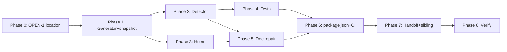

# Operational Data Readiness — Source of Truth

**Plan date:** 2026-07-07 (Asia/Manila)
**Plan folder:** `.ai/03_plans/2026-07-07-operational-data-readiness-source-of-truth/`
**Plan profile:** exhaustive
**Plan status:** **CONDITIONALLY READY**
**Verification mode:** `emulated` (cap 97; see `17_FINAL_READINESS_REVIEW.md`)

> This is a **planning-only** pack. It does **not** change application code, tests, migrations, scripts, `wrangler.jsonc`, or provider state. It defines the plan to eliminate operational source-of-truth drift. Execution is future work.

## What this plan solves

Operational facts (migrations applied, cron schedules, Cloudflare bindings, provider-exit posture) currently live in ≥6 overlapping artifacts and have drifted from the canonical deploy substrate. Confirmed drift on `main`:

- **Crons:** `wrangler.jsonc` + `worker.ts` dispatch **three** (`0 3`, `15 3`, `30 3`); `AGENTS.md:40`, `README.md:39`, and `current-state.md` all say **two**.
- **Migrations:** `AGENTS.md` is current (38/latest `0038`); **`README.md`** is stale (29/latest `0029`). *(The original PROMPT premise attributing this to AGENTS.md is itself stale — corrected in `02`.)*
- **Provider-exit:** `AGENTS.md:39` says "migration complete"; the runbook says **OPEN/NOT READY** (5 blockers). Two distinct facts collapsed into one.
- **No drift detector exists.** `generate-cloudflare-migration-inventory.ts` scans only legacy `supabase/migrations/`.

## The four deliverables (to be implemented later)

1. **Canonical home** (`docs/OPERATIONAL_TRUTH.md` recommended — OPEN-1): Fast Facts + posture, single source agents read first.
2. **Generated snapshot** (`scripts/generate-operational-truth-snapshot.ts` → `operational-truth.snapshot.json`): mechanical facts read from `wrangler.jsonc`/`migrations/`/`worker.ts`; no hand-maintained numbers.
3. **Stale-doc detector** (`scripts/check-operational-truth-drift.mjs`): asserts snapshot vs `AGENTS.md`/`README.md`/`current-state.md`/home; fails closed.
4. **Update protocol + recurring audit:** per-fact-class owner table + CI/pre-commit gate.

## Implementation start document

**`11_IMPLEMENTATION_PLAN.md`** — the authoritative execution guide. Phase order:

```
Phase 0 (owner decision OPEN-1: home location)
  → Phase 1 (generator + snapshot)  ──┐
  → Phase 2 (detector)                ├── Phase 4 (detector test suite)
  → Phase 3 (canonical home)          │
                                      ├── Phase 5 (narrative-doc repair)
  → Phase 6 (package.json + CI wiring)
  → Phase 7 (handoff rules + sibling cross-ref)
  → Phase 8 (final verification)
```

## Dependency graph



## Traceability

Full requirement → phase → task → test → rollout map: **`16_REQUIREMENTS_TRACEABILITY_MATRIX.md`**. 15 requirements (FR-1..7, ARCH-1, DATA-1, SEC-1, PERF-1, REL-1, OPS-1, TEST-1, DOC-1), all traced.

## Blocked decisions

| ID | Decision | Owner | Blocks? | Recommendation |
|---|---|---|---|---|
| OPEN-1 | Canonical-home path (`docs/` vs `.ai/`) | Philip | IMPLEMENTATION-READY status (cheap swap) | `docs/OPERATIONAL_TRUTH.md` |
| OPEN-2 | CI vs. pre-commit wiring | Philip | OPS-1 detail | CI + release-gate; pre-commit fallback while Actions disabled |
| OPEN-3 | Weekly manual audit cadence | Philip | FR-6 detail | weekly until Actions re-enabled |

## Stale-plan revalidation checklist (before executing)

- [ ] Re-confirm `wrangler.jsonc` still declares 3 crons (`0 3`, `15 3`, `30 3`).
- [ ] Re-confirm `migrations/` count + latest (was 38/`0038`); re-run if migrations added since 2026-07-07.
- [ ] Re-confirm `AGENTS.md:40` cron line and `README.md:36/211` migration lines are still the stale ones (or already fixed by another agent — if so, reduce Phase 5 scope).
- [ ] Re-confirm `worker.ts` retention branch still at L107-111.
- [ ] Re-confirm no new sibling pack duplicated the detector (DEC-CANONICAL-SCRIPT).
- [ ] Re-check whether GitHub Actions is still disabled (§3.6) — affects OPS-1/Phase 6.

## Commands to run before the first edit

```bash
git status --short --branch          # confirm shared-worktree state
git diff --check                      # no whitespace conflicts
ls migrations/*.sql | wc -l           # reconfirm count (expect 38 or higher)
grep -n "cron trigger" AGENTS.md      # reconfirm the stale line
bun run type-check                    # baseline green before adding scripts
```

## Files explicitly off-limits (for this planning task; execution-phase edits are scoped in `11`)

- `wrangler.jsonc`, `worker.ts`, `migrations/*`, `cloudflare-env.d.ts` — read-only.
- Any provider/production resource (D1/R2/DO/Queue/Email/Images) — no calls at all.
- Sibling packs' technical content — only a doc cross-reference (T-12).

## Files and systems intentionally unaffected

- The deployed Worker, all routes, auth, sessions, user data — zero runtime impact.
- All `cf:*` scripts — unchanged (new `ops:*` namespace added in Phase 6).
- Better Auth, TanStack Query, Zustand, Tailwind — n/a.

## External proof remaining before production rollout

None for the feature itself (no runtime change). The only "external" items are owner decisions (OPEN-1/2/3), not provider/hosted proof.

## Archive policy

Do **not** archive automatically. Archive this pack only after Phases 1–8 land, the detector is green on `main`, and the owner confirms the canonical home is in active use. If only some slices complete, archive completed slices and keep the rest live.

## Key documents

| Doc | Purpose |
|---|---|
| `01_EXECUTIVE_SUMMARY.md` | One-paragraph problem + deliverables |
| `02_FEATURE_BRIEF_AND_SCOPE.md` | Brief + corrected premise + scope/non-goals |
| `03_SOURCE_AND_CODEBASE_AUDIT.md` | The evidence backbone (drift tables) |
| `04_REQUIREMENTS_SPECIFICATION.md` | 15 requirements with ACs |
| `06_ARCHITECTURE_AND_TECHNICAL_DESIGN.md` | Current vs target flow |
| `11_IMPLEMENTATION_PLAN.md` | **Execution guide (start here for implementation)** |
| `15_DECISIONS_ASSUMPTIONS_AND_ALTERNATIVES.md` | DEC-HOME, DEC-CANONICAL-SCRIPT, OPEN items |
| `17_FINAL_READINESS_REVIEW.md` | Verifier pass + scores (CONDITIONALLY READY) |
