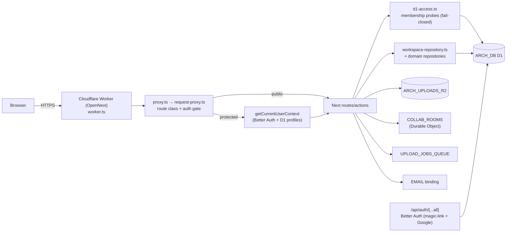

# 06 — Architecture and Technical Design

## Current-state architecture (verified)

### Trust boundaries
1. **Edge/Worker** (`worker.ts`) — TLS termination, OAuth state-cookie validation,
   canonical host redirect. No app-level authz here (no WAF binding — SEC-02).
2. **Proxy** (`request-proxy.ts`) — route classification (protected/auth/public),
   session presence, terms gate, dev-bypass (non-prod only). Skips `/api`.
3. **Route/Action handler** — `requireCurrentUserContext` + D1 membership probe.
4. **Repository / D1-action-client** — SQL scoping by `workspace_id`/`user_id`/`estimate_id`.
5. **D1** — relational store; no RLS (Postgres RLS is historical). App-authz is the gate.
6. **R2** — object store; reads server-mediated, no presigned URLs.
7. **DO** — `CollaborationRoom` per-message authz.

### State ownership
- **Server session:** Better Auth D1 `session` (cookie-cache disabled → every check hits D1).
- **Tenant/workspace:** `profile.default_workspace_id` (session-derived, never path/body).
- **Client server-state:** TanStack Query (estimates, library, publications).
- **Client ephemeral:** Zustand (estimate editor local state).
- **URL state:** share token, recipient token, route params.
- **Cookies:** session, terms, closed-beta, publication access/session, CSRF, pending-invite.

## Target-state architecture (no structural change recommended)

The architecture is sound. The target state is **hardening within the existing shape**,
not a redesign:

1. Keep Better Auth + D1 app-authz (do not reintroduce RLS or a second auth system).
2. Add durable D1 rate limiting where in-memory is currently used (estimate mutations) —
   reuse the `security_rate_limit_events` pattern.
3. Close the invite-origin fail-open (SEC-01) and add the WebSocket upgrade rate limit
   (SEC-04) within the existing modules.
4. Optional edge/WAF layer (SEC-02) — additive, owner decision.

## Component boundaries (auth-relevant)

| Boundary | Owner module | Contract |
|---|---|---|
| AuthN | `src/lib/auth/**` | session cookie → `CurrentUserContext` |
| AuthZ | `src/lib/authz/d1-access.ts` | `(db, resourceId, user) → boolean`, fail-closed |
| Publication security | `src/lib/publication/security.ts` | token/password/cookie/CSRF primitives |
| Publication repo | `src/lib/publication/public-repository.ts` | resolve-by-token, rate limits, recipient scoping |
| Rate limiting | `security_rate_limit_events` (D1) + in-memory admission | reserve/rollback (privacy), record/count (publication) |
| Proxy | `src/lib/auth/request-proxy.ts` | route class + gate headers |
| Uploads | `src/lib/uploads/**` + routes | server-mediated R2, magic-byte, scan gate |

## Coupling / dependency direction
- `routes/actions` → `repositories` → `d1-access` → D1. (One direction; no cycles.)
- `d1-access` is depended on by *every* authenticated read/write — **highest blast
  radius** single file.
- `publication/security.ts` primitives are reused across all 8 share routes.

## Framework-specific (Next.js 16 + React 19) gates
- ✅ Server Components for data loading (share page, workshop pages).
- ✅ Server Actions are the mutation surface (directly reachable POSTs — each has authz).
- ✅ Route Handlers for API + internal/job routes.
- ✅ `"use client"` scoped to interactive components (forms, editors).
- ✅ `cookies()`/`headers()` read in server land only; no secret leakage to client.
- ⚠️ Cache: `session.cookieCache.enabled: false` (good — no stale privilege). Share
  routes are `force-dynamic` + `Cache-Control: no-store`.
- ⚠️ No `revalidateTag` usage; mutations use `revalidatePath` + TanStack invalidate.
- N/A Cache Components / `use cache` — not in use on auth surfaces.

## Rejected alternatives
- **Reintroduce Postgres RLS / SECURITY DEFINER:** rejected — the codebase exited
  Supabase; D1 is SQLite-based, app-authz is the correct model.
- **Add a separate API gateway service:** rejected — Cloudflare Worker + proxy is the
  gateway; adding a second service increases blast radius without benefit.
- **Move authz into a middleware-only layer:** rejected — defense-in-depth requires
  authz at the resource boundary (route/action/repository), not only at the edge;
  the proxy cannot know resource ownership.

## Per-route App Router boundary & cache contract (Improve-Plan-Prompt mandate)

A generic "use cache correctly" is insufficient. Every affected route's boundary,
rendering mode, cache directive, and revalidation owner is specified below. **No route
uses Next.js Cache Components / `use cache` / `cacheLife` / `cacheTag`** — the project is
on the default App Router caching model. Token-bearing/private routes all default to
no-store.

| Route | Boundary | Dynamic? | Cache / header directive | Revalidation owner | Notes |
|---|---|---|---|---|---|
| `/api/auth/[...all]` (all methods) | Route Handler (node runtime) | force-dynamic | `Cache-Control: private, no-cache, no-store, max-age=0, must-revalidate` (forced by `withAuthNoStore`) | n/a (Better Auth internal) | OAuth state-cookie normalized at worker edge |
| `/api/ai/*` | Route Handler | force-dynamic | no-store (handler-set) | n/a | feature-flagged |
| `/api/compliance/privacy-requests` | Route Handler | force-dynamic | no-store | n/a | anonymous intake |
| `/api/component-library/*`, `/api/projects/*`, `/api/estimate-row-images` | Route Handler | force-dynamic | no-store; image/attachment bytes streamed | n/a | opaque 404 on auth fail |
| `/api/internal/*` | Route Handler | force-dynamic | no-store | n/a | Bearer-secret job routes |
| `/api/share/[token]/*` (8 routes) | Route Handler | force-dynamic | **enforced** `Cache-Control: no-store` + `shareHardeningHeaders` (nosniff, DENY frame, no-referrer, HSTS, noindex) | n/a | per-request `React.cache` memoization of access/snapshot rows |
| `/api/health` | Route Handler | static-eligible | none (public) | n/a | service+timestamp only |
| `/share/[token]` (page) | Server Component | `export const dynamic = "force-dynamic"` | enforced CSP + `shareHardeningHeaders` + no-store | n/a (read-only) | `generateMetadata` Server Component; loading skeleton + not-found |
| `/invite/[token]/*` | Route Handler + Server Component | force-dynamic | no-store + hardening headers | n/a | pending-invite cookie |
| `/workshop/**` (pages) | Server Component (data) + Client Components (interaction) | dynamic (session-derived) | `private, no-cache, no-store` via `withSensitiveRouteCacheControl` | TanStack Query client invalidate + `revalidatePath` on mutations | terms gate via proxy |
| Marketing pages (`/`, `/about`, etc.) | Server Component | static | `s-maxage=31536000` (public, cacheable) | deploy | public |

**Mutation revalidation model:** Server Actions use `revalidatePath` (no `revalidateTag`
anywhere in `src/`) for the affected path + TanStack Query `invalidateQueries` on the
client. Estimate tree mutations **deliberately skip** `revalidatePath` (comment at
`actions.ts:2971`) — the client reconciles optimistic state + refetch. Read-your-own-writes
is preserved via pessimistic invalidate-on-success
(`src/hooks/use-estimate-row-mutations.ts:643,654,698-716`).

**Read-your-own-writes invariant:** publication access rows are memoized per-request via
`React.cache` (`getCachedPublicationAccessRowByToken`) so a single request sees consistent
state; cross-request freshness is guaranteed by `force-dynamic` + no-store.

**Cache Components not in scope:** confirmed — no `use cache` / `cacheLife` / `cacheTag`
boundaries exist on any auth surface. If Cache Components is later adopted, token-bearing
routes must be re-proven to default to no-store (local docs:
`node_modules/next/dist/docs/01-app/02-guides/caching-without-cache-components.md`).
