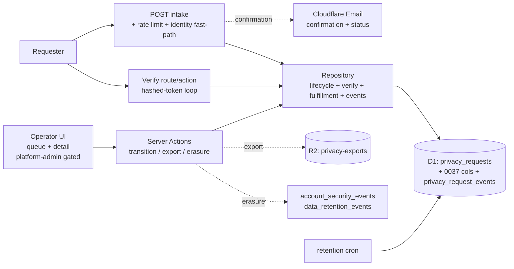

# 06 — Architecture And Technical Design

## Current-state architecture

```mermaid
flowchart LR
  U[Anonymous / Authenticated requester]
  R[POST /api/compliance/privacy-requests\nanonymous, no rate limit, no email]
  Repo[privacy-request-repository.ts\ncreatePrivacyRequest + listPrivacyRequests\n(0 callers)]
  D1[(D1: privacy_requests\n0033 + data_retention_events 0034)]
  Cron[worker.ts cron 03:30 UTC\nrunRetentionPassInD1]
  U --> R --> Repo --> D1
  Cron --> D1
```

- Single anonymous write path. No read/transition/fulfillment path. Retention cron independently purges terminal requests.

## Target-state architecture



Principles:

1. **Repository is the single source of truth for transitions** — the state machine lives there; UI/actions only call it.
2. **Reuse, don't invent** — operator gate (`beta-allowlist-admin.ts`), rate limit (`ai/rate-limit.ts`), audit hashing (`account-audit.ts`), email (`transactional-email-client.ts`), retention audit sink (`data_retention_events`).
3. **Destructive actions are two-step** — erasure is always dry-run → confirm.
4. **No raw personal data in evidence** — HMAC hashes only.

## Server / Client boundary

| Surface | Type | Why |
|---|---|---|
| `POST /api/compliance/privacy-requests` | Route Handler (server) | Anonymous public write; stays a route |
| `GET /api/compliance/privacy-requests` + `[id]` | Route Handler (server) | Operator-gated read for the queue (could also be a server component fetch) |
| Queue page (`workshop/settings/privacy-requests/page.tsx`) | Server Component | Reads via repository; gating server-side |
| Detail page | Server Component | Same |
| Queue filters / transition buttons / erasure dialog | `"use client"` island (smallest boundary) | Interactive only |
| Transition / export / erasure | Server Actions | Mutations; authz inside the action |
| Verify link | Route or Server Action | Token-bearer; sets `identity_verified` |
| Status lookup (requester) | Route Handler (server) | Token-bearer read |

- No server component calls an internal route handler; it calls the repository directly (avoiding the anti-pattern flagged in the directive).
- `"use client"` is scoped to the interactive island only; the queue/detail shells stay server-rendered.

## Streaming / Suspense

- Route-level `loading.tsx` skeletons for queue/detail (server fetch). No heavy streamed sections in closed-beta.
- Mutations are pessimistic (await the action; show inline pending); no optimistic UI for state transitions (correctness over perceived speed).

## Cache / freshness contract

| Layer | Owner | Key | TTL | Invalidation | Read-your-writes |
|---|---|---|---|---|---|
| Intake POST | n/a | n/a | `no-store` | n/a | n/a |
| Queue GET | operator session | url+filter | `no-store` (force-dynamic) | refetch on action | TanStack Query invalidate after transition |
| Detail GET | operator session | request id | `no-store` | invalidate after transition | same |
| Status lookup | token+id | token+id | `no-store` | n/a | n/a |

- All operator/read surfaces are `no-store` (privacy-sensitive, low-volume). No `use cache`/`cacheTag` needed at this scale.
- After a transition action, the client invalidates the queue/detail query (TanStack Query).

## State-machine enforcement

- The repository's `transitionStatus(id, to, actorUserId)` performs: read current status → guard (allowed transition? `identity_verified`? fulfillment evidence for `access`/`erasure`→`completed`?) → write new status + lifecycle timestamps → write `privacy_request_events` row — all in one D1 transaction where the runtime allows, else compare-and-set on `status`.
- Concurrency: two concurrent legal transitions race; the second either no-ops (same `to`) or returns `409` (different `to`). See `DATA-3`.

## Reliability boundaries

- Intake must not fail due to email (circuit breaker degrades silently).
- Audit/event write failure must not silently swallow (opaque log per `account-audit.ts` RISK-016 pattern); the transition still succeeds (audit is best-effort, like the existing retention audit).
- Erasure partial failure → fix-forward via the retention cron (which already handles batched deletes with audit).

## Tailwind / design system

- Reuse `src/components/ui/` (table, badge, button, dialog, alert, skeleton, empty-state). No new design tokens for closed-beta.
- Status badges use existing token palette + icon+text (non-color cue).

## Where new agent rules / docs live (if any)

- No new agent rules. Update `.ai/10_state/current-state.md` at execution closeout with the workflow facts.
