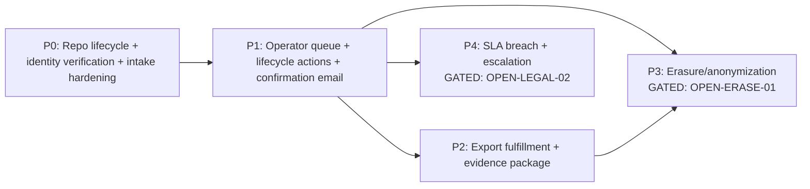

# Plan Pack: Privacy Request Operations And Erasure Workflow

- **Plan status:** `CONDITIONALLY READY`
- **Implementation-ready slices:** `P0` (intake hardening + identity verification), `P1` (operator queue + lifecycle actions + confirmation email), `P2` (export fulfillment + evidence package)
- **Owner-gated slices (NOT implementation-ready):** `P3` (erasure/anonymization execution — gated on `OPEN-ERASE-01` retention-conflict decision), `P4` (SLA breach escalation + breach runbook cross-link — gated on `OPEN-LEGAL-02`)
- **Verification mode:** `emulated` (same-agent separated passes; no native independent reviewer). Cap: overall readiness ≤ 97 and, for this high-blast-radius exhaustive pack, status capped at `CONDITIONALLY READY` until an independent reviewer or the owner accepts the package.
- **Plan profile:** `exhaustive` (touches D1 schema/migrations, app authorization, identity verification, email, audit evidence, and data erasure — all high-blast-radius surfaces per `AGENT_OPERATING_PROTOCOL.md`).
- **Created:** 2026-07-07 (Asia/Manila)
- **Plan folder:** `/Users/philiplewis/Documents/archestimator/.ai/03_plans/2026-07-07-privacy-request-operations-and-erasure-workflow`

> This is a **planning-only** pack. No application code, tests, migrations, schemas, or provider state were modified. The pack is complete when a future executor can implement and verify privacy request operations end to end (per the `PROMPT.md` stop condition).

---

## Start here

- **Implementation start document:** `11_IMPLEMENTATION_PLAN.md`
- **Phase order:** `P0 → P1 → P2 → P3 → P4`. See the dependency graph below.
- **Begin with** `P0-T1` (extend the repository with lifecycle functions) — it is the contract every downstream phase depends on and is fully implementation-ready.
- The first three phases (`P0`, `P1`, `P2`) are self-contained and landable. `P3`/`P4` require the named owner decisions before any edit.

## Headline findings

- **Intake exists; the rest of the lifecycle does not.** `src/app/api/compliance/privacy-requests/route.ts` is a POST-only anonymous intake. `src/lib/compliance/privacy-request-repository.ts` exposes only `createPrivacyRequest` and `listPrivacyRequests` (the latter has **zero callers**). No GET, no `[id]` route, no status-transition function, no operator UI, no confirmation email, no fulfillment path. See `03_SOURCE_AND_CODEBASE_AUDIT.md`.
- **The data model already carries lifecycle columns** (`triaged_at`, `resolved_at`, `triaged_by`) and a 5-state enum (`submitted → in_triage → in_progress → completed | rejected`), but no code writes them. The lifecycle is a build-out, not a schema greenfield — though a new migration is needed for SLA timers, notes/history, and verification evidence.
- **Proven patterns exist for every missing piece.** Platform-admin queue gate (`beta-allowlist-admin.ts`), D1 sliding-window rate limit (`ai/rate-limit.ts`), HMAC-hashed audit (`account-audit.ts` + `AUTH_AUDIT_HASH_PEPPER`), Cloudflare Email with circuit breaker (`transactional-email-client.ts`), retention-driven deletion with audit (`retention-core.ts`). The plan reuses these rather than inventing new primitives.
- **Retention already governs the end of life.** `retention-core.ts` rule registry purges `privacy_requests_completed` (2555d) and `privacy_requests_rejected` (365d) via the `worker.ts` daily cron. The erasure phase (`P3`) must reconcile **operator-initiated erasure** with this **schedule-driven purge** — this is the core tension behind `OPEN-ERASE-01`.
- **Identity verification is the highest-risk gap.** The migration comment defers verification to "triage," but no token, email-confirmation-loop, or knowledge-based check exists. `P0-T3` builds a hashed-token email verification loop (mirrors the magic-link pattern) because erasure must not fire on an unverified anonymous request.

## Blocked decisions (owner)

| ID | Decision | Blocks | Recommended |
|---|---|---|---|
| `OPEN-LEGAL-01` | Privacy-notice wording sign-off (counsel) — gates whether the public form can name the workflow and what identity-assurance claims it makes | `P0-T4` (public form copy), confirmation-email body in `P1` | Owner/legal to approve the notice section that references the request workflow; until then the form stays generic |
| `OPEN-LEGAL-02` | SLA policy (e.g. 30/45-day clock) — what statutory/contractual SLA applies, when the clock starts, and breach-escalation owner | `P4` (SLA breach detection + escalation + breach-runbook cross-link) | Adopt a conservative default (clock starts at `in_triage`, 30-day target) as an owner-delegated planning decision; confirm with counsel |
| `OPEN-ERASE-01` | Erasure scope vs. retention/legal-hold — exactly which tables/rows an approved erasure touches, and how it interacts with the existing retention cron and any future legal-hold flag | `P3` (erasure execution) | Ship `P3` as a **dry-run + operator-confirmed** action with an explicit, counsel-reviewed scope list; never auto-purge on approval |
| `OPEN-OPS-01` | Who is the operator role — reuse `isPlatformAdminRole` (`ceo`/`admin`) or introduce a dedicated `operator`/`dpo` role | Operator gate across `P1`/`P3` | Reuse `isPlatformAdminRole` for closed-beta (proven, zero new role surface); defer a dedicated DPO role to post-beta |

## Dependency graph



## Requirement / task / test traceability

- Requirements register: `04_REQUIREMENTS_SPECIFICATION.md` (IDs `FR-*`, `IDENT-*`, `SLA-*`, `OPS-*`, `EMAIL-*`, `ERASE-*`, `EVID-*`, `ABUSE-*`, `UX-*`, `A11Y-*`, `ARCH-*`, `SEC-*`, `TEST-*`, `DOC-*`).
- Implementation phases & tasks: `11_IMPLEMENTATION_PLAN.md` (tasks `P0-Tn` … `P4-Tn`).
- Test & validation: `12_TEST_AND_VALIDATION_STRATEGY.md` (proof contracts `PC-01`…`PC-18`).
- Full bidirectional trace: `16_REQUIREMENTS_TRACEABILITY_MATRIX.md`.

## Stale-plan revalidation checklist (before executing any phase)

1. Re-confirm `wrangler.jsonc` bindings (`ARCH_DB`, `EMAIL`) and that `ARCHESTIMATOR_EMAIL_PROVIDER` resolves to a `cloudflare-email*` value.
2. Re-confirm `AUTH_AUDIT_HASH_PEPPER` is set as a Worker secret in all target environments (production throws if absent — `account-audit.ts`).
3. Re-read `src/lib/compliance/privacy-request-repository.ts` and `migrations/0033_privacy_request_register.sql` for drift since this plan was written.
4. Re-read `retention-core.ts` `DEFAULT_RETENTION_RULES` — if the `privacy_requests_completed`/`privacy_requests_rejected` TTLs changed, re-validate `P3` erasure-vs-purge reconciliation.
5. Confirm the highest migration number is still `0036` (or note the new highest and sequence the new migration at `0037`).
6. Run `git status` and confirm a clean working tree (or declared branch) before the first edit.

## Commands / checks to run before the first edit

```bash
git status
bun run type-check
bun run test -- tests/vitest/compliance-privacy-request-repository.test.ts
```

(Do not run `bun run validate` / `bun run build` as a gate for narrow slices — proportional verification per `AGENTS.md`.)

## Files explicitly off-limits (this planning pass)

- Any file outside `.ai/03_plans/2026-07-07-privacy-request-operations-and-erasure-workflow/`.
- No edits to `src/`, `migrations/`, `tests/`, `worker.ts`, `wrangler.jsonc`, `package.json`, or any provider state.

## Files / systems intentionally unaffected by the *plan*

- `retention-core.ts` rule registry and the `worker.ts` daily retention cron (referenced, not changed; `P3` must coexist with them).
- `account_security_events` table and `AUTH_AUDIT_HASH_PEPPER` rotation discipline (reused as-is).
- Historical Supabase project `ebxxqidacheyapmmzavr` (untouched; provider-exit evidence only).
- All non-compliance routes, components, and queues.

## External proof still required before production rollout

- `P1` confirmation email: Cloudflare Email deliverability proof (send + receive + bounce handling) against the bound `EMAIL` binding — local-only sends are not deliverability proof.
- `P3` erasure: a **dry-run-then-confirm** operator proof against a staging D1 with seeded user data, plus a backup snapshot timestamp recorded in the evidence ledger before any destructive run. D1 daily backup + `cf:d1-restore-rehearsal` is the cheaper recovery path (per `AGENTS.md`).
- `P4` SLA: confirmed SLA clock definition and escalation owner from `OPEN-LEGAL-02`.

## Archive policy

Do **not** archive automatically. Archive the pack only after `P0`–`P2` are implemented and verified, and `P3`/`P4` are either implemented or explicitly deferred by the owner with the `OPEN-*` decisions resolved.

## Document index

| Doc | Purpose |
|---|---|
| `README.md` | This entry document |
| `00_AGENT_COORDINATION.md` | Master `/goal`, skills used, specialist lanes, coordination ledger |
| `01_EXECUTIVE_SUMMARY.md` | Headline synthesis, decisions, readiness scores |
| `02_FEATURE_BRIEF_AND_SCOPE.md` | Verbatim brief, scope, non-goals, success criteria |
| `03_SOURCE_AND_CODEBASE_AUDIT.md` | Evidence backbone: every relevant file/symbol/migration/test |
| `04_REQUIREMENTS_SPECIFICATION.md` | Stable-ID requirements + shadow-path matrices + open decisions |
| `05_UX_UI_ACCESSIBILITY_PLAN.md` | State inventory, journeys, a11y proof matrix, full state matrix |
| `06_ARCHITECTURE_AND_TECHNICAL_DESIGN.md` | Current/target architecture, Server/Client boundaries, cache/freshness |
| `07_DATA_DATABASE_API_NETWORK_PLAN.md` | D1 schema/migration blueprint, API contracts, access-path matrix |
| `08_SECURITY_PRIVACY_THREAT_MODEL.md` | Threat model, credential material taxonomy, abuse controls |
| `09_PERFORMANCE_RELIABILITY_OBSERVABILITY.md` | Performance evaluator contracts, reliability, observability, rollout gates |
| `10_BLAST_RADIUS_AND_DEPENDENCIES.md` | Phase blast radius, direct/transitive impact, dependency graph |
| `11_IMPLEMENTATION_PLAN.md` | Authoritative execution guide; durable-goal contract per phase |
| `12_TEST_AND_VALIDATION_STRATEGY.md` | Test execution matrix, adversarial matrix, known-red ledger |
| `13_ROLLOUT_ROLLBACK_AND_OPERATIONS.md` | Rollout rings, rollback steps, runbook, feature flags |
| `14_RISK_REGISTER.md` | Single risk table `RISK-01…RISK-16` |
| `15_DECISIONS_ASSUMPTIONS_AND_ALTERNATIVES.md` | Decisions `DEC-01…DEC-09`, assumptions, rejected alternatives |
| `16_REQUIREMENTS_TRACEABILITY_MATRIX.md` | Source → requirement → task → test → rollout, bidirectional |
| `17_FINAL_READINESS_REVIEW.md` | Per-doc + category scores, verification matrix, residual gaps |
| `18_STACK_CONTRACT_AND_PRODUCTION_STANDARDS.md` | Cross-cutting stack production decisions |
| `19_RESEARCH_REVIEW_AND_QA_EVIDENCE.md` | Research, adversarial `AQ-*`, verifier evidence, validation gaps |
