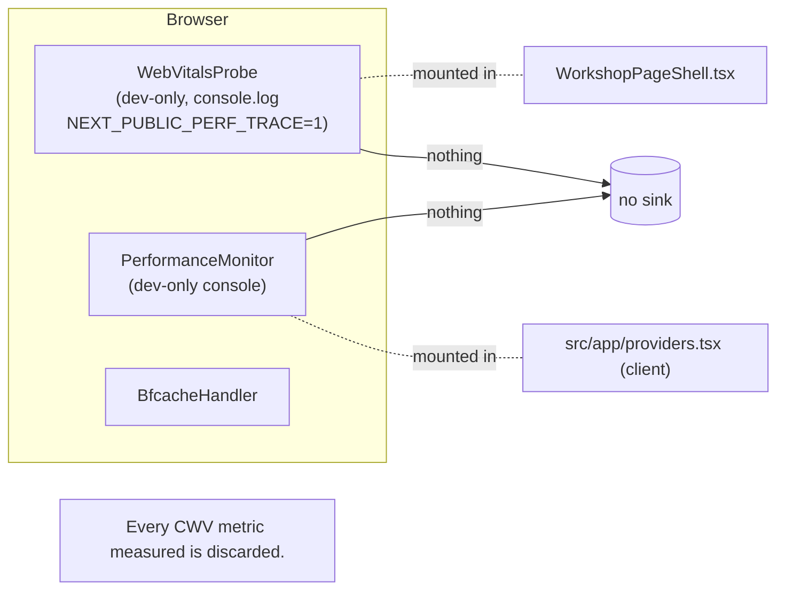

# 06 — Architecture And Technical Design — Production RUM And CWV Telemetry

## Current-state architecture (RUM/CWV)



**Today:** no production transmission. The only analytics are third-party
(Cloudflare Web Analytics, GA4, Clarity) consent-gated on landing/public via
`LandingAnalyticsLoader`; workshop loads nothing.

## Target-state architecture

```mermaid
flowchart LR
  subgraph Browser
    RR["RumReporter<br/>(new, client)"]
    RB["route-bucket normalizer<br/>(new, client)"]
    SA["sampler<br/>(new, client)"]
    RR --> RB
    RR --> SA
  end
  subgraph Providers2["src/app/providers.tsx"]
    RR
  end
  RR -->|"sendBeacon / fetch keepalive<br/>POST /api/internal/rum<br/>(≤8KB JSON, visibilitychange/pagehide)"| Route["/api/internal/rum<br/>(new route handler)"]
  Route --> Gate["same-origin + Fetch-metadata<br/>+ IP rate-limit (in-mem)<br/>+ 8KB cap + schema allowlist"]
  Gate -->|"env.RUM.writeDataPoint"| AE[("Workers Analytics Engine<br/>binding RUM<br/>100K writes/day, ~90d")]
  Gate -.->|"no IP, no URL, no PII"| AE
  subgraph Cron["daily Cron Trigger (worker.ts scheduled)"]
    Roll["rollup p75 per metric×route<br/>7d/28d"]
    Ret["delete rows older than N days"]
  end
  AE --> Roll
  Roll --> D1[("D1 ARCH_DB<br/>rum_rollup table (new mig)")]
  Ret --> D1
  subgraph Landing["landing/public only"]
    CFWA["CloudflareWebAnalytics<br/>(existing, consent-gated)"]
  end
  CFWA -.->|beacon| CF dashboard["CF Web Analytics<br/>Vitals Explorer"]
  AE -.query.-> SQL["Analytics Engine SQL API<br/>(p75 queries, runbook)"]
  D1 -.query.-> RG["release gate query"]
```

## Component boundaries (target)

| Component | Layer | Responsibility | New/existing |
|---|---|---|---|
| `RumReporter` | Client component | Register `web-vitals` callbacks + flush listeners; call sender | New (`src/components/observability/RumReporter.tsx`) |
| `rum-client` | Client lib | `sendRumEvent(payload)`: sendBeacon/fetch keepalive; payload builder; 8KB cap | New (`src/lib/observability/rum-client.ts`) |
| `rum-route-bucket` | Shared lib | allowlist normalizer: path → `routeBucket` | New (`src/lib/observability/rum-route-bucket.ts`) — usable client + server |
| `rum-server` | Server lib | schema allowlist, AE data-point writer, redaction | New (`src/lib/observability/rum-server.ts`) |
| `/api/internal/rum` route | Route Handler | gate, rate-limit, validate, write DP | New (`src/app/api/internal/rum/route.ts`) |
| `scheduled()` cron | Worker | daily rollup + retention | Existing `worker.ts` extended |
| `RUM` binding | wrangler config | Analytics Engine | New in `wrangler.jsonc` |
| `rum_rollup` table | D1 | rollup rows | New migration `migrations/0039_rum_rollup.sql` |
| `CloudflareWebAnalytics` | Client component | managed beacon (landing) | Existing — enable via env/property |

## Data flow (per beacon)

1. Page load → `AppProviders` renders `RumReporter`.
2. `web-vitals` `onLCP`/`onINP`/`onCLS`/`onTTFB`/`onFCP` fire; each produces a
   `metric` object (`name`, `value`, `rating`, `id`, `delta`, `navigationType`).
3. `RumReporter` builds a payload: metric fields + `routeBucket` (normalized
   from `window.location.pathname`) + `sampleRate` + `clientTs` + `appVersion`.
4. Sampler: `Math.random() < rate`? If not, drop silently.
5. On metric-ready (immediate) and on `visibilitychange`/`pagehide` (final),
   `sendRumEvent` POSTs to `/api/internal/rum` via `sendBeacon` (fallback
   `fetch` keepalive). Body ≤8KB enforced before send.
6. Route handler: same-origin + Fetch-metadata gate → IP rate-limit → 8KB cap →
   schema allowlist → `env.RUM.writeDataPoint({blobs:[routeBucket, name, rating, navigationType], doubles:[value, sampleRate, clientTs], indexes:[routeBucket]})`.
   **IP is used only as the rate-limit key; never persisted/logged.**
7. Daily cron: query AE → compute p75 per (metric×route) for 7d/28d → upsert
   into `rum_rollup`; delete rows older than N days.

## Control flow / state ownership

- **No app state.** The RUM client keeps a module-local buffer of pending
  metrics (flushed on visibilitychange/pagehide) — not React state, not Zustand,
  not URL state. Rationale: ephemeral, non-interactive.
- **No cache/revalidation** interaction (the sink is write-only from the
  client's view; queries are operator-run).
- **No TanStack Query / Server Action** involvement.

## Shared contracts

- **Beacon JSON schema** (client→server), allowlisted keys (PRIV-02):
  `{name, value, rating, id, delta, navigationType, routeBucket, sampleRate, clientTs, appVersion?}`.
- **AE data-point shape** (server→sink): `blobs:[routeBucket, name, rating, navigationType]`, `doubles:[value, sampleRate, clientTs]`, `indexes:[routeBucket]`.
- **D1 `rum_rollup` row**: `(day DATE, metric TEXT, route_bucket TEXT, p75 REAL, sample_count INT, poor_share REAL, window TEXT, PRIMARY KEY(day,metric,route_bucket,window))`.

## Architectural alternatives (rejected — full set in `15_…`)

- Next `useReportWebVitals` instead of `web-vitals` npm — rejected (less control over flush/transport; COLLECT-02).
- D1 as primary sink instead of Analytics Engine — rejected (per-row-scan read cost burns 5M/day budget on percentile queries; SINK-01).
- Managed beacon on workshop — rejected (identifying URLs; PRIV-07).
- GA4 for CWV — rejected (not cookieless; COST-01).
- Paid RUM vendor — rejected (no paid add-ons; COST-01).

## Decision rationale

- **Why one global component in providers.tsx:** covers all routes once;
  providers is already the global client mount and the home of the dev-only
  `PerformanceMonitor` (natural neighbor).
- **Why `/api/internal/rum` and not reuse `/api/internal/client-error`:** same
  pattern, different schema/sink/rate; keeping them separate avoids coupling
  error and perf telemetry lifecycles.
- **Why Analytics Engine primary + D1 rollup secondary:** AE is built for this
  and free; D1 rollup gives cheap long-window + release-gate SQL without the
  per-row-scan penalty on the hot path.
- **Why no `request.cf` in v1:** geo re-identification + cardinality risk; the
  privacy posture is tighter without it (`OPEN-PRIV-02`).

## Coupling / dependency direction

- `RumReporter` → `web-vitals`, `rum-client`, `rum-route-bucket`.
- `rum-client` → (browser APIs only).
- `route handler` → `rum-server`, Worker `Env` (the `RUM` binding), `consoleAppLogger`.
- `cron` → D1 `ARCH_DB`, AE SQL API.
- No dependency on auth, session, or any repository.

## Failure boundaries

- Client send failure → silent (REL-01).
- Route handler overloaded → 204 + no write (SAMPLE-02).
- AE over-quota → log + 204 (REL).
- Cron failure → log + retry next day (idempotent upsert).
- Managed beacon network failure → silent (browser handles).

## Streaming/Suspense/cache impact

None. The RUM path is write-only fire-and-forget; no Suspense, no cache, no
revalidation, no RSC payload change. The client component adds a negligible
(~2KB `web-vitals`) JS cost — see `09_…` for the bundle budget.

## Cloudflare resource-boundary impact

- New binding `RUM` (Analytics Engine) inside the bound Worker
  `archestimator-proof`. Within standing authorization (AGENTS.md).
- New D1 table in `ARCH_DB` (`archestimator-proof-db`). Migration
  `0039_rum_rollup.sql` follows the `0038_…` ordering.
- No new KV/R2/Queue/DO/Email. No change to crons count semantics (the existing
  `triggers.crons` array gets one more entry, or a branch in `scheduled()`).
- `cf:typegen` must run after the `RUM` binding is added.
