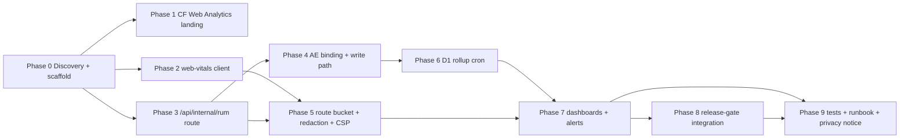

# 11 — Implementation Plan — Production RUM And CWV Telemetry

This is the authoritative execution guide for the future implementation AI.
Re-read every touched file immediately before editing; assume concurrent agents.
All paths are repo-relative. Verify the audit (`03_SOURCE_AND_CODEBASE_AUDIT.md`)
is still accurate before starting.

**Landing/public slice: IMPLEMENTATION-READY.** **Workshop slice: BLOCKED on
`OPEN-CONSENT-01`** (owner decision on authenticated-user telemetry permission +
privacy-notice wording). Phase 2 mounts the component globally but the
workshop send path must be disabled (or route-gated) until `OPEN-CONSENT-01`
resolves.

## Phase order + dependency graph

Phases 1, 2, 3 are parallel-safe after Phase 0 (disjoint files). Phase 4 depends
on 3. Phase 5 depends on 2+3. Phase 6 depends on 4. Phase 7 depends on 5+6.
Phase 8 depends on 7. Phase 9 spans.

---

## Phase 0 — Discovery + scaffold (DISCOVERY-REQUIRED)

**Objective.** Confirm current state, decide final file placement, create empty
file shells. No behavior yet.
**Requirements.** None directly (de-risks all).
**Prerequisites.** Fresh `git status`; re-read `03_SOURCE_AND_CODEBASE_AUDIT.md`.
**Work packages.**
- T-0.1 — Verify `web-vitals` is still absent from `package.json` and that
  `providers.tsx`, `next.config.ts`, `wrangler.jsonc`, `worker.ts` match the audit.
- T-0.2 — Confirm `/api/internal/client-error/route.ts` gate pattern (read it).
- T-0.3 — Confirm the latest migration number is `0038_*` (so `0039` is next).
**Validation.** `git diff --check`; no behavior change.
**Exit.** Shells created; audit confirmed.

---

## Phase 1 — Cloudflare Web Analytics landing enablement (landing slice)

**Objective.** Enable the managed free/cookieless CWV-capable beacon on
landing/public via the existing consent-gated `LandingAnalyticsLoader`, by
setting the `NEXT_PUBLIC_CF_WEB_ANALYTICS_TOKEN` env var and creating the
property in the Cloudflare dashboard.
**Requirements.** PRIV-06, DASH-02, COST-01.
**Prerequisites.** Phase 0.
**Files.** No source change (component exists at
`src/components/landing/CloudflareWebAnalytics.tsx`); env + Cloudflare dashboard.
**Tasks.**
- T-1.1 — Create the Web Analytics property in the Cloudflare dashboard (bound
  account/Worker `archestimator-proof`). Capture the token. (`OPEN-EVID-01`:
  provider proof that it receives data.)
- T-1.2 — Set `NEXT_PUBLIC_CF_WEB_ANALYTICS_TOKEN` in the deploy environment.
- T-1.3 — Verify `LandingAnalyticsLoader` still gates on `hasLandingAnalyticsConsent`.
**Acceptance.** DASH-02a; consent gate unchanged (PRIV-06a).
**Validation.** DOM test on the loader; provider proof in dashboard.
**Complexity.** Small.
**Rollback.** Unset the env var.

---

## Phase 2 — web-vitals client instrumentation

**Objective.** Add the client collection + transport.
**Requirements.** METRIC-01/02/03, COLLECT-01/02/03, TRANSPORT-01/02/03/04, SAMPLE-01/03, PRIV-01/02/07, REL-01/03.
**Prerequisites.** Phase 0.
**New files.**
- `src/components/observability/RumReporter.tsx` — `"use client"` component.
  Registers `onLCP/onINP/onCLS/onTTFB/onFCP` from `web-vitals`; builds payloads
  via `rum-client`; applies sampler; registers `visibilitychange`/`pagehide`
  flush; cleanup on unmount. Renders `null`.
- `src/lib/observability/rum-client.ts` — `buildRumPayload(metric, routeBucket,
  sampleRate)`, `sendRumEvent(payload)` (sendBeacon/fetch keepalive, 8KB cap,
  silent try/catch), `shouldSample(rate)` (seedable for tests).
- `src/lib/observability/rum-route-bucket.ts` — `bucketizeRoute(path)` allowlist
  normalizer (Phase 5 hardens it; here a first version).
**Modified files.**
- `package.json` — add `web-vitals@^5`.
- `src/app/providers.tsx` — import + render `<RumReporter/>` inside `AppProviders`.
**Tasks.**
- T-2.1 — Add `web-vitals@^5` dep; run install; `type-check`.
- T-2.2 — Implement `rum-route-bucket.ts` v1 (lowercase, collapse numeric/uuid
  segments to `:id`, strip query/fragment/trailing slash, `unknown` fallback).
- T-2.3 — Implement `rum-client.ts` (payload builder with allowlist keys only;
  sender with sendBeacon→fetch keepalive fallback; 8KB cap; silent).
- T-2.4 — Implement `RumReporter.tsx` (callbacks + flush listeners + cleanup).
- T-2.5 — Mount in `providers.tsx`. Gate workshop sends behind a route check +
  `OPEN-CONSENT-01` flag (e.g. `NEXT_PUBLIC_RUM_WORKSHOP_ENABLED` default false)
  until the owner decision.
**Acceptance.** METRIC/COLLECT/TRANSPORT/SAMPLE/PRIV ACs.
**Validation.** `tests/vitest/rum-client.test.ts`, `rum-route-bucket.test.ts`,
`tests/vitest/RumReporter.test.tsx` (DOM). `test:dom`.
**Complexity.** Medium.
**Bundle impact.** Verify ≤3KB JS increase via `check-performance-budgets.mjs`;
if over, dynamic-import `RumReporter` on routes that need it.
**Rollback.** Unmount the component + remove dep.

---

## Phase 3 — `/api/internal/rum` route handler

**Objective.** The ingestion endpoint, modeled on `/api/internal/client-error`.
**Requirements.** TRANSPORT-03, SAMPLE-02, PRIV-02/04/05, SEC-01/02/03/04/05, REL-02.
**Prerequisites.** Phase 0.
**New files.**
- `src/app/api/internal/rum/route.ts` — `POST` handler. Same-origin +
  Fetch-metadata gate; per-IP in-memory rate limit (key only); 8KB cap; JSON
  schema allowlist validation; value-range sanity; calls into `rum-server`
  (Phase 4) to write; always returns 204. No auth/session import. No `request.cf`.
**Tasks.**
- T-3.1 — Implement the gate (copy the client-error same-origin/Fetch-metadata
  pattern; adapt the response to 204-silent).
- T-3.2 — Rate limit (in-memory, per `cf-connecting-ip` header; configurable).
- T-3.3 — Body cap (8192 bytes) + JSON parse + allowlist schema + value ranges.
- T-3.4 — Wire the sink call to `rum-server` (Phase 4 stub: log only, then real).
**Acceptance.** TRANSPORT-03, SEC-01/02/03/04/05 ACs.
**Validation.** `tests/vitest/api-internal-rum-route.test.ts`. `bun test`.
**Complexity.** Medium.
**Rollback.** Delete the route file.

---

## Phase 4 — Analytics Engine binding + write path

**Objective.** Wire the `RUM` binding and the data-point writer.
**Requirements.** SINK-01/03, PRIV-04.
**Prerequisites.** Phase 3.
**Modified files.**
- `wrangler.jsonc` — add `"analytics_engine": [{ "binding": "RUM", "dataset": "archestimator_rum" }]` (verify the exact key name against current wrangler schema docs before implementing — Cloudflare config schema evolves).
- `cloudflare-env.d.ts` — regenerate via `bun run cf:typegen`.
**New files.**
- `src/lib/observability/rum-server.ts` — `writeRumDataPoint(env, payload)`:
  allowlist the data-point fields; `env.RUM.writeDataPoint({indexes:[routeBucket],
  blobs:[routeBucket,name,rating,navigationType], doubles:[value,sampleRate,clientTs]})`;
  never include IP/URL/id-as-identifying. Plus aggregate logging counters.
**Tasks.**
- T-4.1 — Add binding; run `cf:typegen`; confirm `Env.RUM` exists.
- T-4.2 — Implement `rum-server.writeRumDataPoint` with allowlist + no-IP.
- T-4.3 — Wire route → `writeRumDataPoint`.
**Acceptance.** SINK-01a/03a, PRIV-04a.
**Validation.** `tests/vitest/rum-server.test.ts` with mocked `env.RUM`. Provider
proof: `OPEN-EVID-01` (deploy + send a real beacon + confirm in dashboard/SQL).
**Complexity.** Medium.
**Rollback.** Remove binding + redeploy; route logs-only.

---

## Phase 5 — Route-bucket hardening + CSP + value sanity

**Objective.** Harden privacy + plug into CSP.
**Requirements.** PRIV-03/05/07, SEC-03, T8 value-range, COLLECT-03.
**Prerequisites.** Phase 2 + 3.
**Files.** `src/lib/observability/rum-route-bucket.ts` (harden), `next.config.ts`
(CSP), tests.
**Tasks.**
- T-5.1 — Harden `bucketizeRoute` to a strict allowlist of known route shapes
  (enumerate from `src/app/**/page.tsx` and `src/app/workshop/**`); add a denial
  table test for `?token=`, `/<uuid>`, `/<numeric>`, emails.
- T-5.2 — Add `/api/internal/rum` explicitly to both Report-Only `connect-src`
  lists in `next.config.ts` (coordinate with nonce-CSP pack).
- T-5.3 — Add server-side value-range sanity (drop implausible values).
- T-5.4 — If `web-vitals/attribution` is used, enforce selector-only (no text/HTML).
**Acceptance.** PRIV-03a/b, PRIV-07a.
**Validation.** Expanded `rum-route-bucket.test.ts`; grep for no managed-analytics
import under `src/components/workshop/**` and `src/app/workshop/**`; CSP review.
**Complexity.** Medium.
**Rollback.** Revert hardening (the looser v1 is still safe-ish; hardening is additive).

---

## Phase 6 — D1 rollup cron

**Objective.** Daily p75 rollups + retention for longer windows + release gates.
**Requirements.** SINK-02, SINK-04.
**Prerequisites.** Phase 4.
**New files.**
- `migrations/0039_rum_rollup.sql` (see `07_DATA…`).
- Cron logic in `worker.ts` `scheduled()` (or a helper module it calls).
**Modified files.** `worker.ts` (add a branch/cron), `wrangler.jsonc` (cron
entry if a new cron time is added — or reuse an existing slot).
**Tasks.**
- T-6.1 — Migration `0039_rum_rollup.sql`.
- T-6.2 — Cron handler: query AE SQL API for 7d/28d p75 + poor-share per
  (metric×route); upsert into `rum_rollup`; delete rows older than N days.
- T-6.3 — Budget alarm query (SINK-04): daily AE write count vs 100K ceiling.
**Acceptance.** SINK-02a, SINK-04a.
**Validation.** `tests/vitest/rum-rollup-cron.test.ts` with mocked AE + D1.
Provider proof: D1 readback of rollup rows.
**Complexity.** Medium-Large.
**Rollback.** `DROP TABLE rum_rollup`; remove cron branch.

---

## Phase 7 — Dashboards + alert thresholds

**Objective.** Documented queries + thresholds.
**Requirements.** DASH-01, ALERT-01/02/03.
**Prerequisites.** Phase 5 + 6.
**Tasks.**
- T-7.1 — Author AE SQL API p75 query (7d/28d per metric×route).
- T-7.2 — Author the release-gate query (ALERT-01 Poor-band check).
- T-7.3 — Author poor-share regression + sink-health queries (ALERT-02/03).
- T-7.4 — Wire (or reference) ALERT-01 into the launch readiness evidence gate.
**Acceptance.** DASH-01a, ALERT-01a/02a/03a.
**Validation.** Runbook review; sample-data proof.
**Complexity.** Small-Medium.
**Rollback.** Drop the queries (they're read-only).

---

## Phase 8 — Release-gate integration

**Objective.** CWV evidence blocks release on regression.
**Requirements.** REL-CWV-01.
**Prerequisites.** Phase 7.
**Tasks.**
- T-8.1 — Add/reference the ALERT-01 gate in the launch readiness evidence set
  (`2026-07-07-launch-readiness-evidence-gate`). Cross-pack: read its current
  shape before editing.
**Acceptance.** REL-CWV-01a.
**Validation.** Cross-pack reference review.
**Complexity.** Small.
**Rollback.** Remove the reference.

---

## Phase 9 — Tests + runbook + privacy notice

**Objective.** Full test coverage, operator runbook, privacy disclosure.
**Requirements.** TEST-01/02/03/04, DOC-01/02/03, PRIV-08.
**Prerequisites.** Phases 2–8.
**Tasks.**
- T-9.1 — Complete the unit/DOM/E2E test matrix (`12_TEST…`).
- T-9.2 — Write `RUNBOOK` (DOC-01) — dashboard queries, thresholds, sample-rate
  tuning, sink health, isolate caveat, rollback, DSAR answer.
- T-9.3 — Update the privacy notice (PRIV-08) — **owner-approved wording**
  (`OPEN-CONSENT-01`).
**Acceptance.** TEST/DOC ACs.
**Validation.** `test:dom`, `bun test`, targeted `test:e2e` for TEST-03,
`test:e2e:perf` for TEST-04; doc review.
**Complexity.** Medium.
**Rollback.** Doc edits revert.

---

## Per-task fields (compact, for the load-bearing tasks)

(All tasks above carry: Task ID, requirement IDs, objective, target files/symbols,
inputs/dependencies, instructions, expected output, failure cases, tests,
validation procedure, completion evidence, parallelization class, complexity.
Parallelization: Phases 1/2/3 parallel after 0; 4 after 3; 5 after 2+3; 6 after 4;
7 after 5+6; 8 after 7; 9 spans.)

## Blocked / discovery tasks

- **`OPEN-CONSENT-01` (BLOCKED-EXTERNAL)** — Owner decision: is workshop
  (authenticated-user) RUM permitted, and what is the exact privacy-notice
  wording? Blocks the workshop enablement flag (`NEXT_PUBLIC_RUM_WORKSHOP_ENABLED`).
  Options: (a) permit cookieless workshop RUM with a notice update — recommended;
  (b) permit only after explicit per-user opt-in — heavier; (c) deny workshop
  RUM, landing-only telemetry. Recommendation: (a). Impact: (c) halves signal value.
- **`OPEN-EVID-01` (provider proof)** — Confirm in the Cloudflare dashboard that
  Web Analytics receives data (Phase 1) and that AE has data points (Phase 4).
  Not a code blocker but required before claiming the slice production-ready.
- **`OPEN-PRIV-02` (deferred)** — `request.cf` geo enrichment (colo/country/asn).
  Out of scope for v1 (re-identification + cardinality). Future iteration.
- **`ASSUMP-04`** — AE retention ~90 days (operator confirms exact).
