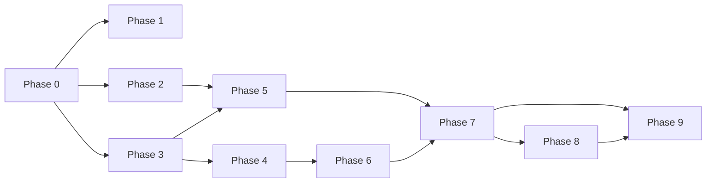

# Plan Pack — Production RUM And CWV Telemetry

| | |
|---|---|
| **Plan folder** | `.ai/03_plans/2026-07-07-production-rum-and-cwv-telemetry` |
| **Date** | 2026-07-07 |
| **Profile** | `exhaustive` |
| **Mode** | `planning-only` (no application code/tests/migrations/config changed by this pack) |
| **Status** | **`CONDITIONALLY READY`** |
| **Overall readiness** | 96 / 100 |
| **verification_mode** | `emulated` (caps 97 / `CONDITIONALLY READY` until independent or owner review) |
| **Source brief** | `PROMPT.md` |

## What this is

A planning pack specifying how to add **privacy-safe Real User Monitoring (RUM)
and Core Web Vitals (CWV) telemetry** to Archestimator on the current
**Cloudflare free-tier** posture — without overbuilding and without violating
privacy constraints. The landing/public slice is implementation-ready now; the
workshop slice is blocked on an owner privacy decision.

**One-line solution:** `web-vitals` v5 client component (global, in
`providers.tsx`) → sampled (10%) + route-bucketed + cookieless + no-PII beacon
→ `POST /api/internal/rum` (same-origin, rate-limited, schema-validated, no
auth, no IP) → Workers Analytics Engine (free) + daily D1 rollup cron →
dashboards (CF Web Analytics Vitals Explorer for landing + AE SQL p75 queries)
+ release-blocking alert thresholds (LCP p75 > 4s, INP p75 > 500ms, CLS p75 >
0.25). Managed beacon on landing only — **never workshop** (identifying URLs).

## Implementation start here

➡️ **`11_IMPLEMENTATION_PLAN.md`**

### Phase order

0. Discovery + scaffold (DISCOVERY-REQUIRED)
1. Cloudflare Web Analytics landing enablement *(landing slice)*
2. `web-vitals` client instrumentation
3. `/api/internal/rum` route handler
4. Analytics Engine binding + write path
5. Route-bucket hardening + CSP + value sanity
6. D1 rollup cron
7. Dashboards + alert thresholds
8. Release-gate integration
9. Tests + runbook + privacy notice

### Dependency graph



Phases 1/2/3 are parallel-safe after Phase 0.

## Blocked / open decisions

| ID | Decision | Owner | Blocks | Recommended |
|---|---|---|---|---|
| `OPEN-CONSENT-01` | Is workshop (authenticated-user) RUM permitted + exact privacy-notice wording? | owner (Philip) | workshop slice (PRIV-08/09, DOC-02) | permit cookieless workshop RUM with notice update |
| `OPEN-EVID-01` | Provider proof: CF Web Analytics + AE receiving data | operator (deploy-time) | production-ready claim | deploy + verify in dashboards |
| `OPEN-PRIV-02` | `request.cf` geo enrichment (colo/country/asn) | future iteration | (deferred feature) | defer until re-id review |
| `ASSUMP-04` | AE retention ≈ 90 days | operator | long-window dashboards | confirm exact in dashboard |

## Stale-plan revalidation checklist (re-run before implementation)

- [ ] `web-vitals` still absent from `package.json` (or note new version).
- [ ] `src/app/providers.tsx`, `next.config.ts`, `wrangler.jsonc`, `worker.ts` match `03_SOURCE_AND_CODEBASE_AUDIT.md`.
- [ ] Latest migration is still `0038_*` (so `0039` is next).
- [ ] `/api/internal/client-error/route.ts` gate pattern unchanged.
- [ ] `wrangler.jsonc` still has no `analytics_engine` binding.
- [ ] CWV thresholds unchanged (LCP 2.5/4.0s, INP 200/500ms, CLS 0.1/0.25).
- [ ] AE free-tier limits unchanged (100K writes/day).
- [ ] Sibling packs (`global-nonced-csp-enforcement`, observability packs) have
      not claimed overlapping surfaces.

## Commands / checks before the first edit

```bash
git status --short --branch          # shared worktree; check concurrency
rg -n "web-vitals" package.json      # confirm absent (or current version)
rg -n "analytics_engine" wrangler.jsonc   # confirm absent
ls migrations | tail -3              # confirm 0038 is latest
bun run type-check                   # baseline green
```

After adding the `RUM` binding (Phase 4): `bun run cf:typegen`.

## Files off-limits to this pack (planning-only)

Everything outside `.ai/03_plans/2026-07-07-production-rum-and-cwv-telemetry/`.
The future *implementation* touches the files named in `03`/`10`/`11` — but the
planning task itself changes none of them.

## Files and systems intentionally unaffected (by the implementation too)

- `src/components/workshop/WebVitalsProbe.tsx` (dev-only probe, unchanged)
- `src/lib/perf/server-timing.ts` (no Server-Timing work here)
- `e2e/route-transition-performance.spec.ts` + synthetic perf scripts (independent)
- `/api/internal/client-error` contract (separate concern)
- Auth/session/repositories (no RUM coupling)

## External proof required before production rollout

- `OPEN-EVID-01`: CF Web Analytics dashboard shows data; AE SQL API returns rows
  after a real beacon.
- `OPEN-CONSENT-01`: owner-approved privacy-notice wording.

## Cost posture

All free-tier. No paid add-ons. See `20_COST_MODEL_AND_PRICING_INPUTS.md`.

## Archive policy

Archive after the landing/public slice is implemented, proven in production
(provider proof), and the privacy notice is merged. Workshop slice may remain
open pending `OPEN-CONSENT-01`. Do not auto-archive.

## Document index

| File | Purpose |
|---|---|
| `00_AGENT_COORDINATION.md` | Master goal, lanes, skills, verification mode |
| `01_EXECUTIVE_SUMMARY.md` | One-paragraph solution, decisions, risks, readiness |
| `02_FEATURE_BRIEF_AND_SCOPE.md` | Source brief, in/out scope, stop conditions |
| `03_SOURCE_AND_CODEBASE_AUDIT.md` | Current-state inventory (paths/symbols) |
| `04_REQUIREMENTS_SPECIFICATION.md` | Stable req IDs + ACs + shadow-path matrix |
| `05_UX_UI_ACCESSIBILITY_PLAN.md` | No UI in v1; proportional browser-proof boundary |
| `06_ARCHITECTURE_AND_TECHNICAL_DESIGN.md` | Current/target architecture (Mermaid), boundaries |
| `07_DATA_DATABASE_API_NETWORK_PLAN.md` | DB blueprint, route contract, access-path matrix |
| `08_SECURITY_PRIVACY_THREAT_MODEL.md` | T1–T8 threat model, privacy posture |
| `09_PERFORMANCE_RELIABILITY_OBSERVABILITY.md` | Budgets, evaluator, hot path = AE-only |
| `10_BLAST_RADIUS_AND_DEPENDENCIES.md` | Direct/transitive impact, cross-pack |
| `11_IMPLEMENTATION_PLAN.md` | Authoritative execution guide (START HERE) |
| `12_TEST_AND_VALIDATION_STRATEGY.md` | Test execution matrix + adversarial matrix |
| `13_ROLLOUT_ROLLBACK_AND_OPERATIONS.md` | Rings, flags, gates, rollback runbook |
| `14_RISK_REGISTER.md` | RISK-01..12 |
| `15_DECISIONS_ASSUMPTIONS_AND_ALTERNATIVES.md` | DEC-01..06, ASSUMP-01..06, rejected alternatives |
| `16_REQUIREMENTS_TRACEABILITY_MATRIX.md` | Every req → source/phase/task/test/rollout |
| `17_FINAL_READINESS_REVIEW.md` | Scores, 2 critique cycles, completion-gate audit |
| `18_STACK_CONTRACT_AND_PRODUCTION_STANDARDS.md` | Cross-cutting stack decisions |
| `19_RESEARCH_REVIEW_AND_QA_EVIDENCE.md` | Research, sibling survey, adversarial matrix, gaps |
| `20_COST_MODEL_AND_PRICING_INPUTS.md` | Free-tier inputs + usage model + rejected paid |
| `LOOP_LEDGER.md` | Append-only coordination log |
| `PROMPT.md` | Source brief (preserved) |

## One-line summary

Free-tier, cookieless, sampled, route-bucketed CWV telemetry: `web-vitals` v5 →
`/api/internal/rum` → Workers Analytics Engine (+ D1 rollup cron), managed
beacon on landing only, release-blocking p75 thresholds — landing-ready now,
workshop gated to owner consent decision.
