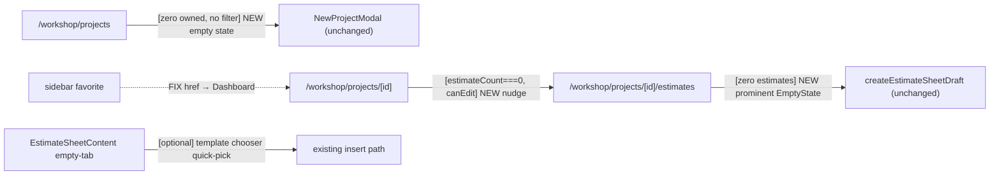

# 06 — Architecture And Technical Design

## Current-state architecture (start path)

```mermaid
flowchart LR
  Login["Login / OAuth / magic-link"] --> Next["resolvePostAuthDestination → /workshop"]
  Next --> Home["/workshop WorkshopDashboard\n(homebase: destination, favorites, recent, continue)"]
  Home -->|"⌘2 / Projects nav"| ProjList["/workshop/projects\nProjectsPageClient (RSC props + useReducer)"]
  ProjList -->|"toolbar 'Add projects'"| NewProjModal["NewProjectModal → NewProjectForm"]
  NewProjModal -->|"createProjectRecord + createEstimateSheetDraft"| ProjList
  ProjList -->|"card open (Link)"| Dash["/workshop/projects/[id]\nProjectDashboardClient"]
  Home -->|"sidebar favorite (href mismatch)"| EstList["/workshop/projects/[id]/estimates\nProjectEstimatesClient + Table"]
  Dash -->|"ProjectMiniSidebar Estimates"| EstList
  EstList -->|"toolbar 'Create Estimate' / inline input"| CreateEst["createEstimateSheetDraft"]
  CreateEst --> Editor["/workshop/projects/[id]/estimates/[nodeId]\nEstimateSheetContent (empty-tab state)"]
  Editor -->|"Add Area / Browse templates / drop row"| Tree["EstimateSheetTree + rows"]
```

### Component boundaries & state ownership (current)
- **Projects list:** Server Component route → `ProjectsPageClient` (Client). State: `useReducer` (in-memory) + localStorage (view-mode/group-by). Data: RSC props + `router.refresh()`. TanStack Query only for favorite toggle.
- **Project dashboard / estimates list / estimate editor:** Server Component routes → respective Client components. Estimates list uses a per-mount Zustand store (`createProjectEstimatesStore`) for optimistic inserts. Estimate editor uses TanStack Query (tree/tabs) + Zustand (workspace UI) + Durable Object collab.
- **Mutations:** `createProjectRecord` / `createEstimateSheetDraft` / `insertEstimateTemplateIntoEstimate` / `insertEstimateRowItemFromLibrary` — all Server Actions with `requireAuth` + workspace scoping + `revalidatePath`.

## Target-state architecture (start path)

Changes are **additive IA/UX layers**, not architectural shifts. No new data stores, no new state owners, no new server actions.

### Decisions
- **D-T1:** New empty states are **presentational Client components** receiving already-fetched props (no new data fetching). Reuse `src/components/ui/empty-state.tsx`.
- **D-T2:** No new Server Actions. FR-01 reuses the existing modal-open dispatch; FR-03 reuses `handleCreateEstimateSheet`; FR-04 reuses `insertEstimateTemplateIntoEstimate`.
- **D-T3:** No new client state owners. Empty states are derived from existing props (`projects.length`, `estimateCount`, `estimates.length`, `estimateTree.length`).
- **D-T4:** Empty-state components are colocated with their surfaces (or in `src/components/workshop/`) and kept small. Lazy-load only if they pull non-trivial new bundle (verify via render baseline).
- **D-T5:** The href mismatch fix (FR-05) changes only the computed `href` for the sidebar favorite to equal `LiveProjectCard`'s `projectHref`.

## Server/Client Component boundary (Next.js 16)

- All routes remain Server Components; the new empty-state UI lives inside existing Client components (`ProjectsPageClient`, `ProjectDashboardClient`, `ProjectEstimatesClient`, `EstimateSheetContent`).
- No new `"use client"` boundary beyond what those components already establish. No server-only data leaks to the client (empty states use counts/arrays already in client props).
- No `fetch` to an internal Route Handler from a Server Component (none exist here).

## Cache, revalidation, freshness

- Projects list: RSC prop + `router.refresh()` after create (unchanged). No TanStack Query list cache introduced.
- Estimates list: Zustand store seeded from server prop; optimistic insert + reconcile/rollback (unchanged).
- Estimate editor: TanStack Query keys (`estimateQueryKeys`) — unchanged.
- Revalidation after create: `revalidatePath("/workshop/projects")` (projects), `revalidateProjectEstimatePaths` (estimates) — unchanged.
- Read-your-own-writes: preserved by existing optimistic + reconcile effects. Empty states flip off once the reconciled data is non-empty.

## State management synchronization

- Empty-state visibility is **derived** from the same props the optimistic layer mutates, so it stays consistent with optimistic create/rollback automatically:
  - Zero-project state hides the moment an optimistic create row appears (it derives from `projectItems.length`/`displayLiveProjects.length`).
  - Estimates empty state hides the moment the optimistic insert lands.
- Failure mode: if server create fails, rollback restores the empty collection → empty state re-renders. No stuck intermediate state.

## React component quality (forced)

- New empty-state components: clear single responsibility, derived props, no effects, no mirrored state, stable keys (n/a for singletons), typed props (no `any`), sized for readability.
- No nested card soup; reuse `EmptyState` primitive.
- Memoization only if a render-cost reason is measured (default: none — they render once per empty condition).

## Database / D1 (no change)

- No migration, no schema change (DATA-01). Start path relies on existing `projects` (with `status` default `ongoing`), `estimates`, `estimate_tabs`, `estimate_templates*`, and workspace scoping via `ensureDefaultWorkspace` / `getCurrentWorkspaceProject` / `assertCanEditProject`.
- Precondition flagged: base `projects`/`estimates` DDL not in `migrations/` (out-of-band provisioned). Not changed by this plan.

## Adversarial / failure-mode handling (architecture)

- **Optimistic create rollback:** empty state must reappear cleanly on rollback (derived-state design handles this).
- **Stale client state:** empty states derive from server props refreshed by `router.refresh()`; stale risk is bounded by existing reconciliation.
- **Concurrent agents editing shared files:** implementation must re-read touched files before edits and keep diffs small (shared worktree discipline).
- **Read-only collaborator:** CTAs hidden (AC-02c/03b/04d) — denial is at the UI + action layer (existing `canEditProject`/`canCreateEstimates` + `assertCanEditProject`).

## Architectural alternatives (rejected)

- **Alt-A: Add a TanStack Query list cache for projects.** Rejected — adds complexity; the RSC-prop + `router.refresh()` model already works and is performance-instrumented. Out of scope.
- **Alt-B: URL-state for filters + create deep-link.** Rejected for this plan (DEC-04) — valuable but a separate, larger change; only documented as a gap.
- **Alt-C: A dedicated `/workshop/start` route.** Rejected — contradicts owner-locked "land at `/workshop`, no wizard" decision.
- **Alt-D: Template chooser at `createEstimateWithDefaultTab` (server).** Rejected as default (OPEN-DEC-02) — changes the core create contract and the empty-tree assumption; recommended alternative is empty-state-only chooser.

## Database Change Blueprint

**Not applicable.** No schema change in this plan (DATA-01). If a future slice adds an estimate `status` or `template_id` column, that would require its own blueprint — explicitly out of scope here.
