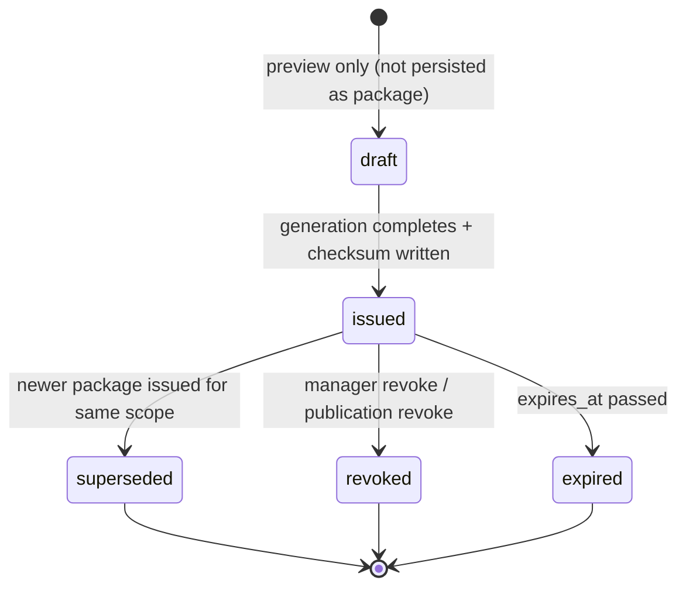

# 06 — Architecture and Technical Design

## Current-state architecture (evidence)

Two independent surfaces, no shared trust ledger:

```mermaid
flowchart LR
  subgraph A[Surface A: Workshop XLSX]
    A1[ProposalExportPreviewDialog<br/>client preview] --> A2[use-estimate-proposal-preview<br/>fetch-then-blob]
    A2 --> A3[GET /export/proposal.xlsx<br/>route.ts]
    A3 --> A4[buildProposalExportModel<br/>applyAudiencePolicy]
    A4 --> A5[createProposalWorkbookBuffer<br/>in-memory Uint8Array]
    A5 --> A6[Response no-store nosniff]
  end
  subgraph B[Surface B: Publication snapshot]
    B1[PublisherDrawer] --> B2[publish/republish<br/>actions.ts RBAC]
    B2 --> B3[buildProjectPublicationSnapshot<br/>opaque IDs + location redact]
    B3 --> B4[replace/rotate<br/>admin-d1-client.ts]
    B4 --> B5[(project_publications<br/>snapshot_json mutable<br/>snapshot_version int)]
    B6[/share token] --> B7[resolveSnapshotByToken<br/>sanitize on read]
    B7 --> B8[Recipient view JSON]
    B9[accept/decline] --> B10[version-lock<br/>signature_intent_hash]
  end
  A -.no link.-> B
```

Gaps: A writes nothing durable; B overwrites in place; neither has a content checksum; staleness is
manager-only; no streaming; recipient proof binds version not content.

## Target-state architecture

Introduce one shared **trust ledger** — `proposal_deliverable_packages` — that both surfaces write
to, content-addressed, append-only, versioned. Both surfaces retain their existing UX; the ledger
is the trust layer underneath.

```mermaid
flowchart TB
  subgraph Shared[Trust ledger - new]
    P[(proposal_deliverable_packages<br/>append-only<br/>content_sha256<br/>source_as_of<br/>state<br/>storage_ref)]
    AU[audit: generation/download/republish/revoke/view/accept]
  end
  subgraph A2[Surface A: XLSX]
    AX[export route] -->|write package row + checksum| P
    AX -->|threshold?| ST{size threshold}
    ST -->|below| INLINE[inline buffer + hash header]
    ST -->|above| STREAM[ReadableStream OR Queue job]
    STREAM --> R2[(R2 ARCH_UPLOADS_R2<br/>optional large artifact)]
    STREAM --> P
  end
  subgraph B2[Surface B: snapshot]
    BX[publish/republish] -->|new package row, old retained+superseded| P
    BY[/share token read] -->|staleness to recipient| RZ[recipient view]
    RZ -->|accept records content_sha256| P
  end
  CHECK[Web Crypto sha256] --> P
```

## Component boundaries

- **`proposal-deliverable-packages` repository** (new, `src/lib/repositories/`): the only writer
  for `proposal_deliverable_packages` + deliverable audit rows. Owns checksum computation ordering
  (hash before `issued`), state transitions, supersession.
- **`proposal-export` module** (existing): unchanged public API; route adds a post-buffer step to
  hash + persist + return hash header. Workbook builder unchanged.
- **`publication` module** (existing): `buildProjectPublicationSnapshot` gains a canonicalize-then-
  hash step; `replace_project_publication` becomes insert-new + mark-old-superseded (instead of
  overwrite-in-place for rotate).
- **Export route** (existing): branches on size threshold (inline vs stream vs job).
- **Share page/API** (existing): adds staleness to payload; accept path records content hash.
- **Client** (existing dialog + share page): display-only of server-provided hash/staleness.

## Data flow — XLSX export (target)

1. Route auth + rate limit + parse settings (unchanged).
2. Load estimate tree (caps unchanged).
3. `resolveExportAudience` (unchanged).
4. Build model + workbook buffer (unchanged) — **redaction broadened** (FR-5).
5. **New:** compute `content_sha256 = sha256(buffer)` via Web Crypto.
6. **New:** insert `proposal_deliverable_packages` row (`package_kind=xlsx`, `state=issued`,
   `content_sha256`, `source_as_of`, `source_estimate_revision`, `size_bytes`, `storage_ref=null`
   for inline).
7. Response: `Content-Disposition`, `no-store`, `nosniff`, **`X-Archestimator-Package-Hash:
   <prefix8>`**, **`X-Archestimator-Package-Id`**.
8. **New:** insert download audit row.

Above streaming threshold → step 4–6 move to a `ReadableStream` transform or a Queue job (202 +
job id); client polls/downloads.

## Data flow — snapshot publish (target)

1. RBAC + `buildSnapshotForProject` (unchanged).
2. `buildProjectPublicationSnapshot` (unchanged redaction) → canonical JSON.
3. **New:** `content_sha256 = sha256(canonical_json)`.
4. `replace_project_publication` becomes: insert new publication row **and** insert a
   `proposal_deliverable_packages` row (`package_kind=snapshot`, `content_sha256`,
   `source_as_of`, `snapshot_version`, `storage_ref = publication_id`); prior package row marked
   `superseded_by = new`.
5. Recipient read: unchanged sanitize + **staleness computed and included**.
6. Recipient accept: record `content_sha256_at_decision`.

## State machine (FR-10)



Only `issued/superseded/revoked/expired` rows are immutable. `draft` is never persisted as a
package (preview stays client-side, as today).

## Streaming decision (DEC-STREAM-1)

| Size band | Path | Rationale |
|---|---|---|
| Below threshold (e.g. < ~60% of caps or measured < ~8MB / < ~30s) | Inline buffer + hash (current path + checksum) | Simplest; within `maxDuration=60` |
| Mid (crosses threshold, fits streaming) | `ReadableStream` response with hash computed via stream digest | Bounded memory; still one request |
| Large (near caps, risks > 60s) | Queue job (existing `UPLOAD_JOBS_QUEUE` + new `proposal_export` kind) → R2 object → package row → notify/poll | Removes ceiling; idempotent; DLQ exists |

Exact thresholds are **DISCOVERY-REQUIRED** (perf measurement, PERF-2) — the executor sets them
from the evaluator, not from guessing.

## Cloudflare resource boundaries

- D1 `ARCH_DB`: new table + columns (migration `0040_*` or next free number — confirm at execute
  time). App-authz via existing repository pattern + RBAC. No service-role escalation.
- R2 `ARCH_UPLOADS_R2`: **only** for large artifacts above the streaming threshold. Object keys
  unguessable (random + hash). Server-mediated access (no public bucket). Object lifecycle:
  retained with the package row; cleanup tied to publication revoke/workspace delete (existing
  patterns).
- Queue `UPLOAD_JOBS_QUEUE`: new `proposal_export` job kind on the existing consumer (ASSUMP-2 —
  executor confirms consumer wiring). DLQ reuse.
- DO `COLLAB_ROOMS`: **not used** by this feature.
- Email `EMAIL`: optional notify on async job completion (existing digest patterns).

## Server/client boundary

- All hashing, package writes, staleness computation, audit writes = **server-only**.
- Client receives: hash prefix, staleness object, package version, job status — display only.
- No secret crosses to the client. `content_sha256` is a public integrity marker (not a credential).
- `"use client"` boundaries unchanged; the preview dialog stays client but renders server-provided
  trust fields.

## Cache/revalidation

- Export route stays `no-store` (unchanged) — deliverables must never be cached.
- Share snapshot stays `no-store` (unchanged).
- Manager summary staleness: existing 5-min in-memory cache (`workspace-repository.ts:1038`)
  reused; recipient staleness computed per-request (no cross-user cache).
- Package reads by managers: TanStack Query with conservative `staleTime`; invalidation on
  republish.

## State ownership

- Package table state: server (D1) — source of truth.
- Dialog UI state (download progress, panel display): local React state.
- Async job status: server (D1 row / queue) + TanStack Query polling.
- URL state: none required (download is an action, not navigable state).

## Architectural alternatives considered (summary — full in `15_*.md`)

- **Per-surface tables** (two ledgers) vs **shared ledger**. Shared wins: one audit story, one
  checksum shape, cross-surface content binding possible later. (DEC-ARCH-1)
- **Always R2** vs **threshold R2**. Threshold wins: small exports stay simple + free-tier-friendly.
  (DEC-STORE-1)
- **Hash the model** vs **hash the bytes**. Bytes wins: it's what the recipient actually receives.
  For snapshots, hash canonicalized JSON (stable ordering) so the hash is reproducible. (DEC-HASH-1)
- **PKI signature** vs **SHA-256 content binding**. SHA-256 wins: no key management, sufficient for
  "prove what was issued"; PKI is a separate legal-signature decision. (DEC-SIG-1)
