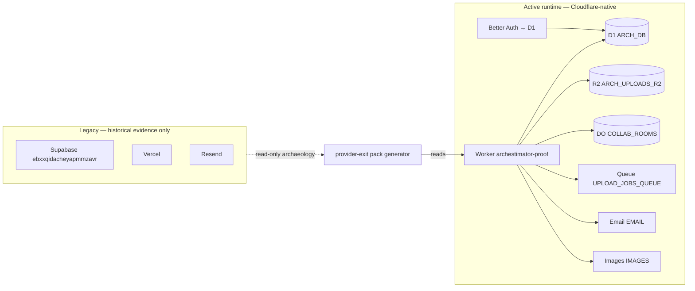
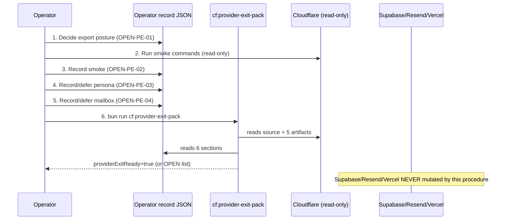

# 06 — Architecture and Technical Design

## 6.1 Current-state architecture (provider posture)

The active runtime has **zero edges** to Supabase/Vercel/Resend. The legacy
providers exist only as historical evidence consumed (read-only) by the
provider-exit pack generator and the operator record.

## 6.2 Target-state architecture

No architecture change. The target is a *state change in the operator record
and the generated pack*, not a code or topology change:

- Operator record: 4 `missing` sections → `recorded` or `accepted-deferral`.
- Generated pack: `providerExitReady` → `true`.
- Legacy providers: posture clarified per owner decision (rollback-window /
  read-only-retention / accepted-loss), but **not mutated** by this plan.

## 6.3 Component boundaries

| Boundary | Owner | Change? |
|---|---|---|
| `scripts/generate-cloudflare-provider-exit-pack.ts` | generator | none (documented, not modified) |
| Operator record JSON | operator (single shared mutable) | filled at execution time, not by this plan |
| 5 upstream JSON artifacts | their generator scripts | none (regenerated only if stale) |
| `current-state.md` | doc owner | none by this plan (separate future task) |

## 6.4 Data flow (closure procedure)

## 6.5 Architectural decisions

- **No new abstraction**: the generator + operator record already implement the
  gate model. This plan documents and operationalizes them; it does not add
  layers.
- **Single source of truth**: the operator record is the only mutable closure
  artifact. The generated pack is derived (reproducible). The 5 upstream
  artifacts are inputs.
- **No hybrid recommendation**: Cloudflare is the sole active runtime. Legacy
  providers are rollback/export surfaces only, posture-dependent.

## 6.6 Coupling / dependency direction

- Generator depends on (read-only): repo source, 5 JSON artifacts, operator
  record. Nothing depends on the generator's output except human/agent review.
- This plan depends on (read-only): `wrangler.jsonc`, `package.json`,
  `cloudflare-env.d.ts`, the generator, the last pack run, `current-state.md`
  FAST PATH, `supabase/README.md`.
- Nothing in `src/` depends on legacy providers (proven by `rg`).

## 6.7 Failure boundaries

| Failure | Effect on closure | Mitigation |
|---|---|---|
| Operator record malformed | generator parse error | `cf:provider-exit-operator-template` regenerates starter |
| Upstream artifact stale/missing | gate 1-6 may flip | re-run the artifact's generator script (`cf:release-gates` etc.) |
| Cloudflare route probe fails (smoke) | `cloudflareSmokePassed=false` | diagnose via `cf:check-readiness`; do not claim closure |
| Owner defers persona/mailbox | gates 11/12 → `accepted-deferral` | permitted; recorded with rationale; pack stays honest |
| Two agents edit operator record | JSON conflict | LOOP_LEDGER file-ownership lease; first-writer-wins |
