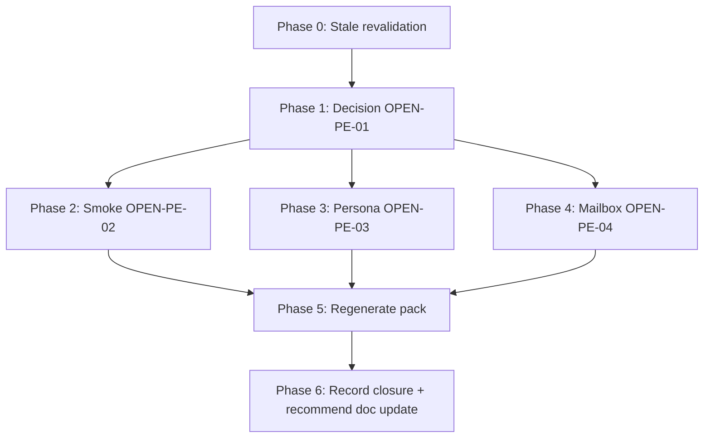

# 11 — Implementation Plan

> **This is a planning-only task.** "Implementation" here means *executing the
> closure procedure defined by this pack*, which is an operator/owner action
> sequence — not a code change. No application code, tests, migrations, or
> infra config are modified. The only mutated artifact at execution time is
> the sanitized operator-record JSON (sibling evidence folder).

## 11.1 Phase order (dependency-aware)

Phases 3 and 4 may run in parallel with Phase 2 (independent gates). Phase 5
requires all of 1-4. Phase 1 (the export/retention/loss decision) gates
everything because rollback posture depends on it.

## 11.2 Phase 0 — Stale revalidation + scaffolding

- **Objective**: confirm repo state matches this plan before executing.
- **Requirements**: none (verification).
- **Prerequisites**: clean-ish `git status`; re-read this pack.
- **Tasks**:
  - T-0.1 — `git status --short --branch` and confirm no unexpected diffs in
    target files. *(Complexity: Small)*
  - T-0.2 — Re-run the stale-revalidation checklist in `README.md`. *(Small)*
  - T-0.3 — Declare file-ownership of the operator-record JSON in `LOOP_LEDGER.md`
    before any edit. *(Small)*
- **Validation**: checklist clean; ownership declared.
- **Exit criteria**: revalidation passes.

## 11.3 Phase 1 — Export/retention/loss decision (OPEN-PE-01)

- **Objective**: owner decides the Supabase data posture.
- **Requirements**: FR-PE-02, FR-PE-04, DATA-PE-01.
- **Prerequisites**: Phase 0.
- **Tasks**:
  - T-1.1 — Owner reviews `07_…` §7.4 (three decisions + data-loss rule) and
    chooses `exported` / `accepted-retention` / `accepted-loss`.
    *(Complexity: Small for retention/loss; Medium for exported — requires
    creating+verifying an external export.)*
  - T-1.2 — If `exported`: operator creates a logical Supabase export, stores
    it **outside the repo**, and records a sanitized
    `backupLocationDescription` (no private path). *(Medium)*
  - T-1.3 — Operator fills operator-record `finalExportsOrRetentionDecision`:
    `status=recorded`, `decision`, `acceptedBy`, `evidenceSource`,
    `rollbackDecision`, (and `backupLocationDescription` if exported).
    *(Small)*
- **Affected paths**:
  `.ai/03_plans/2026-06-29-Cloudflare-Migration-Codex/evidence/2026-07-03-cloudflare-provider-exit-operator-record.json`
- **New files**: none (optionally a sanitized export-metadata evidence file
  outside secrets — e.g., the existing
  `2026-07-03-provider-exit-export-metadata-attempt.{json,md}`).
- **Security**: no secrets in `evidenceSource`/`backupLocationDescription`.
- **Data implications**: see `07_…` §7.4 rollback posture per decision.
- **Rollback of the procedure**: restore prior operator-record JSON.
- **Validation**: `bun run cf:provider-exit-pack` → gate 7 flips PASS.
- **Exit criteria**: gate 7 PASS.
- **Risks**: owner picks `accepted-loss` without sole-runtime proof → mitigated
  by DEC-PE-03 rule.
- **BLOCKED-EXTERNAL**: requires owner decision (Philip).

## 11.4 Phase 2 — Post-exit Cloudflare smoke (OPEN-PE-02)

- **Objective**: run read-only smoke after the export decision.
- **Requirements**: FR-PE-03, REL-PE-01.
- **Prerequisites**: Phase 1 (decision recorded first, per REL-PE-01).
- **Tasks**:
  - T-2.1 — Run the smoke command list in `13_…` §13.3 (read-only). *(Small)*
  - T-2.2 — If any command fails or reports not-ready, diagnose via
    `cf:check-readiness`; do not claim closure. *(Small)*
  - T-2.3 — Fill operator-record `postExitSmoke`: `status=recorded`,
    `cloudflareSmokePassed=true`, `runAt` (ISO timestamp), `commands[]` (the
    exact commands run), `evidenceSource`. *(Small)*
- **Affected paths**: operator-record JSON.
- **Security**: smoke is read-only; no secrets read.
- **Cloudflare boundary**: in-bounds wrangler readback + route probe only.
- **Validation**: `bun run cf:provider-exit-pack` → gate 10 flips PASS.
- **Exit criteria**: gate 10 PASS.
- **Risks**: transient Cloudflare hiccup → re-run smoke.

## 11.5 Phase 3 — Non-owner Google proof or deferral (OPEN-PE-03)

- **Objective**: real persona journey OR owner-accepted deferral.
- **Requirements**: FR-PE-01 (gate 11), SEC-PE-02.
- **Prerequisites**: Phase 0 (independent of Phase 1).
- **Tasks**:
  - T-3.1 — Option A (proof): operator performs a real non-owner Google
    account journey (e.g., invite/sign-in on `archestimator.com`), recording
    only `policyOutcome` + sanitized `evidenceSource`, and sets
    `noCredentialsOrCookiesRecorded=true`. *(Medium — requires a real
    non-owner account; no cookies/credentials recorded.)*
  - T-3.2 — Option B (deferral): owner records `accepted-deferral` with
    `acceptedBy` + `deferralRationale`. *(Small)*
  - T-3.3 — Fill operator-record `nonOwnerGoogleProof` per chosen option.
    *(Small)*
- **Affected paths**: operator-record JSON.
- **Security**: cookies/credentials must NOT be recorded
  (`noCredentialsOrCookiesRecorded=true`).
- **Validation**: `bun run cf:provider-exit-pack` → gate 11 flips PASS.
- **Exit criteria**: gate 11 PASS.
- **BLOCKED-EXTERNAL**: requires a real non-owner persona OR owner deferral.

## 11.6 Phase 4 — Recipient mailbox proof or deferral (OPEN-PE-04)

- **Objective**: real mailbox receipt OR owner-accepted deferral.
- **Requirements**: FR-PE-01 (gate 12), SEC-PE-02.
- **Prerequisites**: Phase 0 (independent of Phase 1).
- **Tasks**:
  - T-4.1 — Option A (proof): operator triggers a real recipient email
    (e.g., publication/invite), observes receipt in a real mailbox, records
    only `mailboxReceiptObserved=true`, `recipientScopedActionObserved=true`,
    `noPrivateEmailContentRecorded=true`, sanitized `evidenceSource`. *(Medium)*
  - T-4.2 — Option B (deferral): owner records `accepted-deferral`.
    *(Small)*
  - T-4.3 — Fill operator-record `recipientMailboxProofOrDeferral`. *(Small)*
- **Affected paths**: operator-record JSON.
- **Security**: private email content must NOT be recorded.
- **Validation**: `bun run cf:provider-exit-pack` → gate 12 flips PASS.
- **Exit criteria**: gate 12 PASS.
- **BLOCKED-EXTERNAL**: requires a real mailbox OR owner deferral.

## 11.7 Phase 5 — Regenerate pack + confirm closure

- **Objective**: derive the closure signal.
- **Requirements**: TEST-PE-01.
- **Prerequisites**: Phases 1-4 (all gates filled).
- **Tasks**:
  - T-5.1 — `bun run cf:provider-exit-pack` (regenerate). *(Small)*
  - T-5.2 — Confirm `providerExitReady=true` and `blockerCount=0` in the
    output JSON + markdown. *(Small)*
  - T-5.3 — If any gate still OPEN, return to the matching phase. *(Small)*
- **Validation**: pack JSON `providerExitReady===true`; pack md status line.
- **Exit criteria**: `providerExitReady=true`.

## 11.8 Phase 6 — Record closure + recommend doc update

- **Objective**: persist the closure outcome (documentation only).
- **Requirements**: DOC-PE-02.
- **Prerequisites**: Phase 5.
- **Tasks**:
  - T-6.1 — Append a closure note to the parent migration pack's runbook
    (`2026-06-29-Cloudflare-Migration-Codex/35_PROVIDER_EXIT_AND_FINAL_PROOF_RUNBOOK.md`)
    recording the decision, smoke run, persona/mailbox outcome, and
    `providerExitReady=true`. *(Small)*
  - T-6.2 — **Recommend** (do not perform unless explicitly asked) updating
    `current-state.md` FAST PATH to record provider exit as final. *(Small)*
- **Affected paths**: parent runbook; (optionally `current-state.md`).
- **Exit criteria**: closure recorded; doc-update recommendation logged.

## 11.9 Task summary

| Task | Phase | Req IDs | Target | Complexity | Parallelization | Blocked? |
|---|---|---|---|---|---|---|
| T-0.1 | 0 | — | `git status` | S | sequential | no |
| T-0.2 | 0 | — | README checklist | S | sequential | no |
| T-0.3 | 0 | — | LOOP_LEDGER lease | S | sequential | no |
| T-1.1 | 1 | FR-02,FR-04,DATA-01 | owner decision | S/M | sequential | **BLOCKED-EXTERNAL** (Philip) |
| T-1.2 | 1 | FR-02 | external export (iff exported) | M | sequential after T-1.1 | external |
| T-1.3 | 1 | FR-02 | operator-record §1 | S | sequential after T-1.1/1.2 | external |
| T-2.1 | 2 | FR-03,REL-01 | smoke commands | S | parallel with P3/P4 after P1 | no |
| T-2.2 | 2 | FR-03 | diagnose (iff fail) | S | sequential after T-2.1 | no |
| T-2.3 | 2 | FR-03 | operator-record §4 | S | sequential after T-2.1 | no |
| T-3.1/3.2 | 3 | FR-01,SEC-02 | persona proof/deferral | M/S | parallel with P2/P4 | **BLOCKED-EXTERNAL** |
| T-3.3 | 3 | FR-01 | operator-record §5 | S | sequential after T-3.1/3.2 | external |
| T-4.1/4.2 | 4 | FR-01,SEC-02 | mailbox proof/deferral | M/S | parallel with P2/P3 | **BLOCKED-EXTERNAL** |
| T-4.3 | 4 | FR-01 | operator-record §6 | S | sequential after T-4.1/4.2 | external |
| T-5.1 | 5 | TEST-01 | `cf:provider-exit-pack` | S | sequential after P1-4 | no |
| T-5.2 | 5 | TEST-01 | confirm ready | S | sequential after T-5.1 | no |
| T-5.3 | 5 | TEST-01 | rework (iff OPEN) | S | conditional | no |
| T-6.1 | 6 | DOC-02 | runbook note | S | sequential after P5 | no |
| T-6.2 | 6 | DOC-02 | recommend doc update | S | sequential after T-6.1 | no |

No task has an unresolved architecture/path/contract/migration decision. The
only blockers are explicitly external (owner/operator/persona/mailbox) and
tagged `BLOCKED-EXTERNAL` with options + recommendation + owner.
