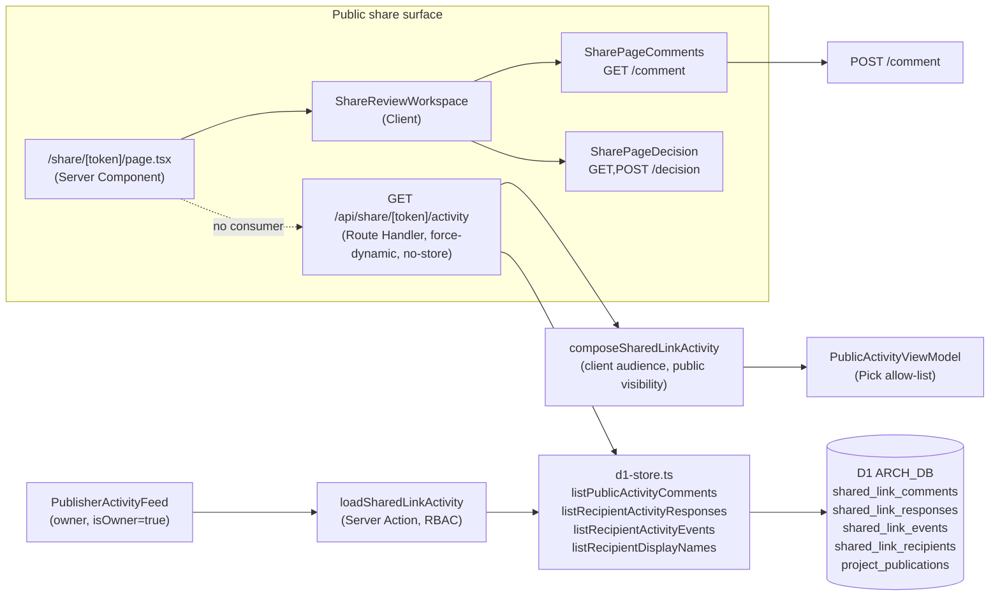
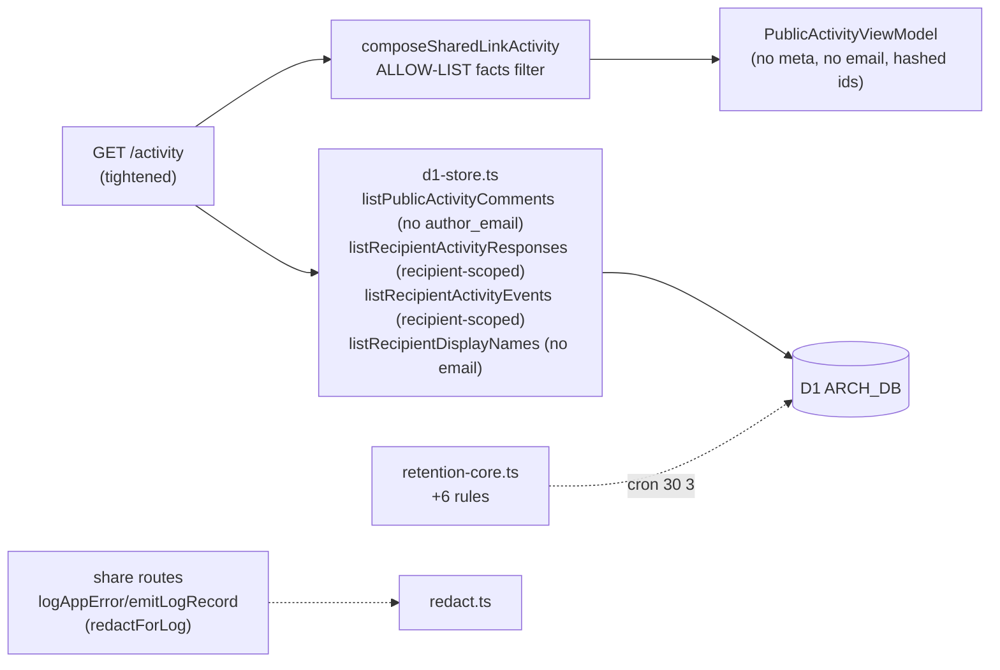

# Architecture and Technical Design

## Current-state architecture

**Key current-state facts (evidence: `03_…md`):**
- One aggregated public activity route; comments always fetched, decisions+events only with verified session.
- Three parallel D1 queries + one batched display-name lookup.
- `force-dynamic` + `Cache-Control: no-store`.
- AES-256-GCM cursor pagination.
- Composer applies client-safety (raw=undefined, internal filter) before the route's `Pick<>` allow-list.
- Owner action `loadSharedLinkActivity` is the full-fidelity mirror (RBAC-gated, `audience: "owner"`).
- **No UI consumer** of the public route on the recipient page.

## Target-state architecture

**Target-state changes (Phases 1-5, internally resolvable):**
1. `PublicActivityViewModel` drops `meta` (or documents it as always-undefined and removes the dead pick).
2. `listPublicActivityComments` SELECT list drops `author_email`; `listRecipientDisplayNames` drops `email`.
3. `composeSharedLinkActivity` `facts` becomes an **allow-list** (keys from `events/route.ts:17` + row coordinates).
4. Share routes log via `logAppError`/`emitLogRecord` (redactor applies).
5. `retention-core.ts` adds 6 rules.

**Target-state changes (Phases 3/6/7, owner-gated):**
6. Four dedicated secrets (SEC-07).
7. Turnstile/WAF on open share links (SEC-08).
8. Server-side session revocation via `session_generation` (SEC-09) — adds a column.

## Component boundaries

- **Route Handler** (`activity/route.ts`): orchestration, gating, response shaping. Owns the public DTO.
- **Repository** (`d1-store.ts`): SQL. Owns SELECT lists and scoping predicates.
- **Service** (`public-repository.ts`): cross-publication scoping (SEC-06), rate limits, telemetry hashing.
- **Composer** (`activity-composer.ts`): pure view-model construction + facts filter.
- **Owner action** (`actions.ts:loadSharedLinkActivity`): full-fidelity mirror, RBAC. **Separation boundary — not minimized.**
- **Retention** (`retention-core.ts`): rule registry + purge. Cron-owned.
- **Redactor** (`redact.ts`): log scrubbing. Cross-cutting.

## Data flow (activity GET)

1. Request → `assertSameOrigin` → rate limit → `getPublicationActivityContextByTokenHash(tokenHash)` → 404 if inactive → password gate (423) → optional session verify.
2. Three parallel queries (comments always; responses+events if session).
3. Display-name batch lookup.
4. Map to `SharedLinkActivityInput` → `composeSharedLinkActivity({audience:"client",visibility:"public"})` → `filterMap` drops internal → `toPublicActivityViewModel`.
5. Encrypt cursor → response `{activities, hasMore, nextCursor, recipientSession}` + `no-store`.

## State ownership

- **Server-authoritative:** publication liveness, recipient identity (signed cookie), all DTO fields.
- **Client:** pagination cursor (opaque), session cookie (HttpOnly, set by server), comment/decision form state (local).
- **No new client state** introduced by this plan.

## Server/Client Component boundary

- `/share/[token]/page.tsx` is a Server Component (snapshot fetch). `ShareReviewWorkspace` + children are Client. **No boundary change.**
- The activity route is a Route Handler (server-only). **No `"use client"` introduced.**
- The owner action is `"use server"`. **No change.**

## Cache, revalidation, freshness

- `force-dynamic` + `Cache-Control: no-store` on every share response (preserve, API-01).
- No Cache Components on share routes (token-bearing private data).
- Cursor is server-secret-keyed AES-256-GCM (no client-controlled offset).
- Read-your-own-writes: comment/decision POST invalidates locally for the posting recipient via the response; activity GET is always fresh (`no-store`).

## Architectural alternatives considered (full: `15_…md`)

- **Split activity route into /comments, /decisions, /events** — rejected. One aggregated route with a tight contract is less surface area and matches the single consumer pattern.
- **Hash recipient email at rest** — rejected (breaks email-matched proposals view).
- **Allow-list vs deny-list facts** — allow-list chosen (SEC-03).
- **Client-side vs server-side pagination cursor** — server-side (preserve).
- **Per-field redaction at SQL vs at composer** — SQL-side for the over-fetches (SEC-01/02; tighter, fail-closed), composer-side for `facts` (allow-list; metadata shape varies).

## Decision rationale

The architecture intentionally keeps the activity route as the single minimizable public surface, with the owner action as the unminimized mirror. This separation means minimization work (Phases 1-2, 4-5) cannot regress the owner experience and vice versa. The lack of a recipient-page UI consumer for the route is treated as an opportunity (OPEN-UX-02): the contract can be tightened before it gains consumers, lowering migration cost.

## Performance implications

- Removing `author_email`/`email` from SELECT lists slightly reduces row width (positive).
- Allow-list facts filter is O(keys) per row (negligible).
- Retention purges are cron-batched (no request-path cost).
- See `09_…md` PERF-01 evaluator.

## Security implications

- Tighter DTO (positive).
- Redactor routing closes a P2 log-leak path.
- Owner-gated hardening (Phases 3/6/7) is documented but not implemented in the minimization scope.

## Reliability implications

- Three-query fan-out failure → 500 uniform (REL-01).
- Retention cron failures are caught + logged + recorded (TEST-03 shadow path).
