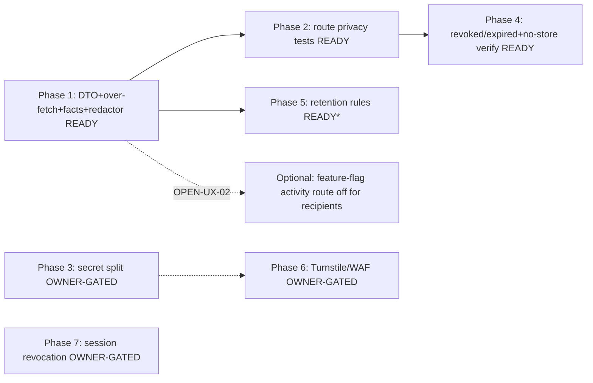

# Blast Radius and Dependencies

## Direct impact

| Area | File / system | Change class | Details |
|---|---|---|---|
| Activity route DTO | `src/app/api/share/[token]/activity/route.ts` | Required change | Drop `meta` from `PublicActivityViewModel` pick + `toPublicActivityViewModel`; preserve all other allow-list fields |
| Public comment SELECT | `src/lib/publication/d1-store.ts:474-496` (`listPublicActivityComments`) | Required change | Remove `author_email` from SELECT; update `SharedLinkActivityCommentD1Row` type |
| Display-name SELECT | `src/lib/publication/d1-store.ts:539-552` (`listRecipientDisplayNames`) | Required change | Remove `email` from SELECT |
| Facts filter | `src/lib/activity/activity-composer.ts:449-452` | Required change | Deny-list regex → allow-list |
| Logging call sites | `src/app/api/share/[token]/activity/route.ts`, `comment/route.ts`, `decision/route.ts`, `password/route.ts`, `events/route.ts`, `src/app/share/[token]/page.tsx` | Required change | `console.error(error, …)` → `logAppError`/`emitLogRecord` |
| Retention rules | `src/lib/compliance/retention-core.ts:79-143` | Required change | Add 6 rules (DATA-01) |
| Tests | new `tests/vitest/share/share-activity-route.test.ts`; extend `tests/vitest/activity-security.test.ts`, retention test, benchmark | Required change | TEST-01/02/03/04, PERF-01 |
| Comment DTO interface | `src/components/share/SharePageComments.tsx:15-29` | Probable change | Remove dead `author_email?` field + fallback |
| `meta` consumer check | `src/components/share/SharedLinkActivityFeed.tsx` | Verification only | Confirm no `meta` read (verified: none) |

## Transitive impact

| Area | Impact class | Notes |
|---|---|---|
| Owner action `loadSharedLinkActivity` | Verification only | Parity check; NOT minimized (full-fidelity owner view). Confirm it still selects `author_email` for owner display. |
| `recipient-proposals-repository.ts` | Explicitly unaffected | Email-matching join preserved (DATA-03). |
| Estimate snapshot | Explicitly unaffected | No snapshot change. |
| Better Auth | Explicitly unaffected | No session model change. |
| Collaboration-realtime DO | Explicitly unaffected | Separate surface. |
| `wrangler.jsonc` | Explicitly unaffected (Phases 1-5) | Phase 6 (WAF) is dashboard-side, not config; Phase 7 is migration-only. |
| Existing vitest suites | Verification only | `project-publication-comments.test.tsx`, `project-publication-activity.test.tsx`, `security-findings-publication-contracts.test.ts` (string assertions may need update if route text changes), `share-no-store-invariants.test.ts`, `project-publication-public-repository.test.ts` (SEC-06). |

## Users / roles impacted

| Role | Impact |
|---|---|
| Anonymous visitor | None (public comments still served) |
| Email-matched recipient | None (decisions/events still recipient-scoped) |
| Manager (owner/admin) | None (owner action untouched) |
| Attacker | Slight reduction in over-fetch exposure (defense in depth) |

## Screens / routes impacted

- `/api/share/[token]/activity` — DTO tightened (transparent to current consumers).
- `/share/[token]` — no visible change (does not consume activity route).
- Workshop Publisher activity feed — no change (uses server action).

## APIs impacted

- `GET /api/share/[token]/activity` — response may omit `meta` (always-undefined today; transparent).

## Services / shared libraries

- `src/lib/activity/*` — composer facts filter change.
- `src/lib/publication/*` — SELECT list changes.
- `src/lib/compliance/retention-core.ts` — rule additions.
- `src/lib/observability/redact.ts` — no change (already covers the patterns); only call sites change.

## Database tables

- No schema change (Phases 1-5).
- Phase 7 (owner-gated): `shared_link_recipients.session_generation` (new column).

## Background jobs

- Retention cron (`30 3 * * *`) — picks up the new rules automatically (no cron code change).

## Integrations

- Resend (email) — unaffected (Phase 1-5). P2-3 (drop UUID tags) is low-priority separate.

## Caches

- None (all `no-store`).

## Authentication / authorization

- No change to token/session/RBAC model (Phases 1-5). Phase 3/7 owner-gated.

## Tests / analytics / monitoring / docs

- Tests: new + extended (above).
- Analytics: `data_retention_events` extended by Phase 5.
- Monitoring: no new dashboard required (Phases 1-5).
- Docs: DOC-01 (data contract), DOC-02 (runbooks for owner-gated phases).

## Backward compatibility

- DTO narrowing is backward-compatible (`meta` was always undefined).
- SELECT narrowing is invisible to clients.
- Retention rules only delete past-TTL data.

## Other active development work

- `2026-07-06-Transition-And-Loading-UX-And-UI/` plan touches share overlay UX (different files: `SharedLinkActivityFeed.tsx` rendering, not the data contract). **No file-edit overlap** with this plan's Phase 1-5 targets except the shared component `SharePageComments.tsx` (this plan touches only the TS interface dead-field; the transition plan touches loading states). Coordinate via the coordination ledger if both execute concurrently.

## Dependency graph

`*` Phase 5 is `IMPLEMENTATION-READY` for the mechanism; TTL values are `CONDITIONALLY READY` (OPEN-RET-01).

## Classification summary

- **Required change:** 8 items (Phase 1-5 code + tests).
- **Probable change:** 1 item (SharePageComments dead field).
- **Verification only:** owner action, recipient-proposals, snapshot, existing tests.
- **Explicitly unaffected:** Better Auth, DO, wrangler (1-5), Resend (1-5).
- **Owner-gated:** Phase 3 (secrets), Phase 6 (Turnstile/WAF), Phase 7 (session revocation), Phase 5 TTLs.
