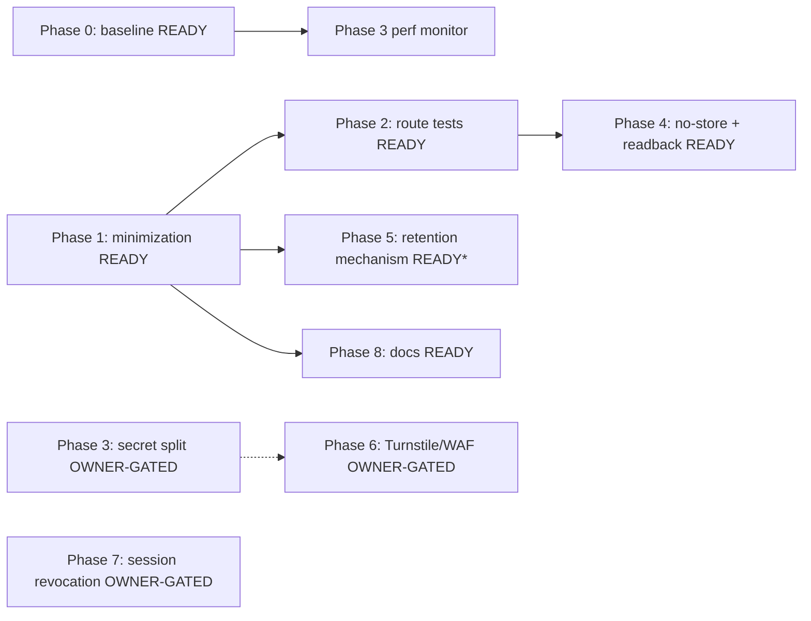

# Public Share Activity Minimization — Plan Pack

**Plan status:** `CONDITIONALLY READY`
**Implementation-ready slices:** Phase 0 (baseline) · Phase 1 (DTO + over-fetch + facts allow-list + redactor routing) · Phase 2 (route privacy tests) · Phase 4 (revoked/expired + no-store + provider readback) · Phase 5 retention-rule **mechanism** · Phase 8 (docs)
**Owner-gated slices:** Phase 3 (secret split, OPEN-SEC-02) · Phase 5 retention TTLs (OPEN-RET-01) · Phase 6 (Turnstile/WAF, OPEN-SEC-03) · Phase 7 (session revocation, OPEN-SEC-04)
**Verification mode:** `emulated` (caps overall readiness at 97 and package status at `CONDITIONALLY READY` for the high-blast-radius owner-gated slices; see `17_FINAL_READINESS_REVIEW.md`)
**Plan profile:** `exhaustive`
**Created:** 2026-07-07 (Asia/Manila)
**Plan folder:** `.ai/03_plans/2026-07-07-public-share-activity-minimization/`

> **This is a planning-only pack.** It narrows the public share activity surface (`GET /api/share/[token]/activity` and its data layer) to the minimum recipient-visible data and defines how to prove no unnecessary data is exposed — without degrading the recipient review journey. **No application code, tests, migrations, configs, or provider state were modified by this pass.**

---

## Start here

- **Implementation start document:** `11_IMPLEMENTATION_PLAN.md`
- **Phase order:** Phase 0 (baseline, optional but recommended) ∥ Phase 1 (minimization) → Phase 2 (route tests) → Phase 4 (readback/no-store) → Phase 5 (retention mechanism, +owner TTLs) → Phase 8 (docs). Phases 3/6/7 owner-gated, independent.
- **Begin with Phase 1** (and Phase 0 in parallel to capture the PERF-01 baseline). Phase 1 is `IMPLEMENTATION-READY`, internally resolvable, security-positive, and requires no schema change or owner decision.

## Goal (master `/goal` summary)

Produce an exhaustive, evidence-based plan that narrows the public share activity surface to the minimum recipient-visible fields, defines the data contract / redaction rules / pagination / rate limits / retention / privacy tests / audit logging / revoked-expired behavior, and lets a future executor tighten the surface and prove no unnecessary data is exposed — **without degrading legitimate recipient review flows**. Full master goal: `00_AGENT_COORDINATION.md`.

## Headline findings (full detail in `01_EXECUTIVE_SUMMARY.md` + `03_SOURCE_AND_CODEBASE_AUDIT.md`)

**Already strong (do not regress):** strict `Pick<>` DTO allow-list; re-hashed IDs (`act_<sha256[:16]>`); internal comments filtered twice (SQL + composer); decisions/events recipient-scoped at SQL; `raw` payload undefined for client; AES-256-GCM cursor; rate-limited 60/min; password gate (423); tokens HMAC-hashed (never raw); `no-store` everywhere; revoked→404 uniform.

**Gaps this plan closes:**
1. Over-fetch of `author_email` (d1-store.ts:484) and recipient `email` (d1-store.ts:545) — fetched then discarded. → SEC-01/02 (Phase 1).
2. Deny-list (not allow-list) `facts` filter (activity-composer.ts:449-452) — pattern-fragile. → SEC-03 (Phase 1).
3. Vestigial `meta` field on `PublicActivityViewModel` (always undefined). → FR-01 (Phase 1).
4. No route-handler-level test for `/activity` GET (only composer tests + brittle string-matching). → TEST-01 (Phase 2).
5. Retention does not cover `shared_link_comments`/`responses`/`recipients`/`publications`/`publication_events`/`digest_log` (only `shared_link_events` 90d + `collaboration_audit_events` 365d). → DATA-01 (Phase 5).
6. Raw `console.error(error)` on share routes bypasses `redactForLog`. → SEC-04 (Phase 1/4).
7. (Owner-gated) No failed-attempt lockout on token guessing (P1-1); no Turnstile/WAF (P1-2); single shared secret (P1-3); no server-side session revocation (P2-6).

**Key architectural fact:** the public activity route has **no UI consumer on the recipient-facing page today** (`share/[token]/page.tsx` renders `ShareReviewWorkspace` → comments + decisions + tabs only; the activity feed is owner-only via the `loadSharedLinkActivity` server action). The contract can be tightened before it gains consumers.

## Blocked decisions (owner)

| ID | Decision | Blocks | Recommended |
|---|---|---|---|
| OPEN-RET-01 | Retention TTLs for share content | Phase 5 production | 730d comments/responses, 365d recipients post-revoke, 1095d publications/events/digest |
| OPEN-SEC-02 | Split the shared secret into 4 env vars | Phase 3 | split (stronger isolation) |
| OPEN-SEC-03 | Adopt Turnstile/WAF on share routes | Phase 6 | adopt for open links, bypass for password |
| OPEN-SEC-04 | Server-side session revocation (`session_generation`) | Phase 7 | add (kill-switch for stolen cookies) |
| OPEN-UX-02 | Feature-flag the activity route off for recipients until a UI ships | Phase 1 scope option | leave reachable (tightening is enough) |

> **Not blocked (internally resolvable, IMPLEMENTATION-READY now):** Phase 1 (DTO + over-fetch + facts + redactor), Phase 2 (route tests), Phase 4 (no-store + readback), Phase 5 retention-rule mechanism, Phase 8 (docs).

## Dependency graph

`*` Phase 5 mechanism is `IMPLEMENTATION-READY`; TTL values are `CONDITIONALLY READY` (OPEN-RET-01).

## Requirement/task/test traceability

- Requirements: `04_REQUIREMENTS_SPECIFICATION.md` (FR/SEC/DATA/API/TEST/PERF/REL/DOC + shadow-path matrices).
- Tasks: `11_IMPLEMENTATION_PLAN.md` (Phases 0-8; each a durable-goal contract; WP-0.1..WP-8.3).
- Tests: `12_TEST_AND_VALIDATION_STRATEGY.md` (Test Execution Matrix).
- Full mapping: `16_REQUIREMENTS_TRACEABILITY_MATRIX.md`.

## Stale-plan revalidation checklist (before executing any phase)

1. Re-verify `next`/`react` versions in `package.json`.
2. Re-verify `force-dynamic` + `Cache-Control: no-store` on `src/app/api/share/[token]/activity/route.ts`.
3. Re-verify the activity route still has no recipient-page UI consumer (`src/app/share/[token]/page.tsx`).
4. Re-verify `listPublicActivityComments` still selects `author_email` (d1-store.ts:~484) and `listRecipientDisplayNames` still selects `email` (d1-store.ts:~545).
5. Re-verify the `facts` filter is still a deny-list regex (activity-composer.ts:~449-452).
6. Re-verify the retention gap (`retention-core.ts:79-143` does not cover share content).
7. Re-verify `console.error(error, …)` sites on share routes.
8. Re-verify the latest migration number (currently `0037_remove_preloaded_component_categories.sql`; Phase 7 would be `0038`).
9. Re-check `git status` + coordination ledger for concurrent-agent edits.
10. Re-read the relevant Next.js 16 local doc only if framework-sensitive (route-handler pattern is stable).

## Commands/checks to run before the first edit (future implementation)

- `git status` + `git diff --check`
- `bun run type-check` (focused; note the known default-heap red is unrelated — use focused)
- `bun run lint` / `bun run lint:design-system` (only if WP-1.7 UI cleanup)
- `bun test tests/vitest/activity-security.test.ts` (composer baseline)
- `bun test tests/vitest/shared-link-activity-benchmark.test.ts` (Phase 0 baseline)
- (Phase 4) `wrangler d1 execute ARCH_DB --local --command "EXPLAIN SELECT …"` or hosted equivalent
- (Phase 7) `wrangler d1 execute ARCH_DB --command "PRAGMA table_info(shared_link_recipients);"`

## Files explicitly off-limits (this planning pass)

All files outside `.ai/03_plans/2026-07-07-public-share-activity-minimization/`. Specifically no edits to `src/**`, `tests/**`, `migrations/**`, `supabase/**`, `package.json`, `next.config.ts`, `wrangler.jsonc`, provider state, or other `.ai/` docs (only the new plan folder).

## Files/systems intentionally unaffected

- D1/R2/DO/Queue/Email/Workers state — no changes by this pass.
- Better Auth, app-authorization, repository boundaries (Phase 1 narrows SELECT lists but does not change authz).
- Estimate snapshot content model.
- Collaboration-realtime DO.
- `loadSharedLinkActivity` owner action (parity check only — NOT minimized).
- `wrangler.jsonc` (Phases 1-5); Phase 6 WAF is dashboard-side; Phase 7 is migration-only.

## External proof still required before production rollout (future phases)

- Phase 0: hosted route probe / Workers Observability p95 baseline.
- Phase 4: D1 EXPLAIN readback (public SELECT excludes `author_email`/`email`); hosted `/activity` curl grep (no `email`/`author_email`/raw UUID).
- Phase 5: dry-run retention log; owner TTL sign-off.
- Phase 6: Turnstile browser proof + Cloudflare WAF dashboard proof.
- Phase 7: `PRAGMA table_info` readback + re-session test.
- All phases: route-level privacy tests green in CI; benchmark p95 within budget.

## Archive policy

Do **not** archive automatically. Archive (or mark slices complete) only after: (a) owner resolves the OPEN-* decisions, (b) Phase 0 baseline captured, (c) Phases 1/2/4 pass their EV gates, (d) Phase 5 mechanism + owner TTLs land, (e) an independent reviewer or owner signs off to lift the `emulated` cap. Phases 1/2/4/8 may be archived independently once complete. Owner-gated phases (3/5-TTL/6/7) archive on their own sign-off.

## Document index

| Doc | Purpose |
|---|---|
| `00_AGENT_COORDINATION.md` | Master goal, lanes, ledger, skills used |
| `01_EXECUTIVE_SUMMARY.md` | Headline findings, decisions, scores |
| `02_FEATURE_BRIEF_AND_SCOPE.md` | Brief, scope, non-goals, success metrics |
| `03_SOURCE_AND_CODEBASE_AUDIT.md` | Evidence backbone (routes, components, data layer, retention, tests) |
| `04_REQUIREMENTS_SPECIFICATION.md` | Requirements + shadow-path matrices |
| `05_UX_UI_ACCESSIBILITY_PLAN.md` | Journey preservation, a11y (minimal — no UI change) |
| `06_ARCHITECTURE_AND_TECHNICAL_DESIGN.md` | Current/target architecture, data contract |
| `07_DATA_DATABASE_API_NETWORK_PLAN.md` | Data ownership, queries, API contract, no-schema-change (1-5) |
| `08_SECURITY_PRIVACY_THREAT_MODEL.md` | Threats T-01..T-12, minimization controls |
| `09_PERFORMANCE_RELIABILITY_OBSERVABILITY.md` | PERF-01 evaluator, failure modes, observability |
| `10_BLAST_RADIUS_AND_DEPENDENCIES.md` | Direct/transitive impact, dependency graph |
| `11_IMPLEMENTATION_PLAN.md` | Authoritative execution guide (Phases 0-8) |
| `12_TEST_AND_VALIDATION_STRATEGY.md` | Test Execution Matrix |
| `13_ROLLOUT_ROLLBACK_AND_OPERATIONS.md` | Rollout rings, gates, runbooks (Phases 3/6/7) |
| `14_RISK_REGISTER.md` | RISK-01..12 |
| `15_DECISIONS_ASSUMPTIONS_AND_ALTERNATIVES.md` | DEC-01..07, assumptions, OPEN-* decisions |
| `16_REQUIREMENTS_TRACEABILITY_MATRIX.md` | Full requirement→task→test→rollout mapping |
| `17_FINAL_READINESS_REVIEW.md` | Scores, verifier search, residual gaps, PASS determination |
| `18_STACK_CONTRACT_AND_PRODUCTION_STANDARDS.md` | Cross-cutting stack production bar |
| `19_RESEARCH_REVIEW_AND_QA_EVIDENCE.md` | Research, AQ-01..18 adversarial matrix, evaluator, verifier |
| `21_ATTACK_SURFACE_AND_CREDENTIAL_MATERIAL.md` | Credential taxonomy + attack-surface inventory |
