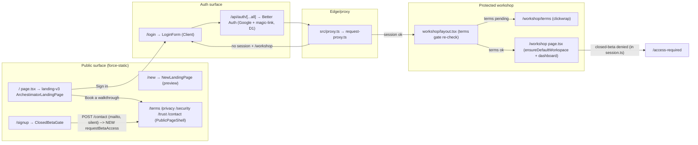
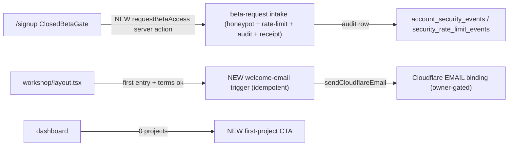

# 06 — Architecture and Technical Design

## 1. Current-state architecture (continuity-relevant slice)

Trust-boundary ordering (must be preserved — ARCH-CONT-02):
1. **Proxy** (`request-proxy.ts`) sets `x-archestimator-auth-verified=proxy` + `x-archestimator-terms-accepted` headers; redirects unauthenticated `/workshop` → `/login?next=`.
2. **`workshop/layout.tsx`** re-checks `isProtectedRouteGateSatisfied`; if terms not accepted → resolves `getCurrentUserContext` + `getCurrentUserTermsAcceptanceStatus` → redirect to `/workshop/terms`.
3. **`getCurrentUserContext`** (`session.ts`) resolves Better Auth identity → **closed-beta allowlist check** → profile. Denial → `/access-required`.

## 2. Target-state architecture (delta only)

The continuity work adds **no new trust boundary** and **no new route-protection logic**. Deltas:

- **`requestBetaAccess`** is a `"use server"` action; reachable as a direct POST endpoint → must self-validate (honeypot, rate-limit, auth-not-required-but-input-validated, no PII beyond email+IP-hash).
- **Welcome-email trigger** runs inside the existing first-workshop-entry path (`workshop/page.tsx` or `account-actions.ts`), guarded by an idempotency flag (e.g., a `welcome_email_sent_at` audit/security-event row or a column on `user_onboarding_profiles`).
- **No proxy/middleware change.** No new gate before the clickwrap.

## 3. CTA / intent continuity contract (FR-CONT-01)

Canonical mapping (to be recorded in `06` and optionally as a doc comment in `contact-mailto.ts`):

| Surface | Auth state | Label | href | intent | Resolves to |
|---|---|---|---|---|---|
| v3 `PrimaryCta` | logged-out | "Book a walkthrough" | `/contact?intent=walkthrough` | walkthrough | contact form (mailto builder) |
| v3 `PrimaryCta` | logged-in | "Open workspace" | `/workshop` | — | workshop dashboard |
| v3 Nav | logged-out | "Sign in" | `/login?next=/workshop/projects` | — | login |
| `LandingCTAs` primary | logged-out | "Start with an estimate" | `/contact?intent=started` | started (normalized) | contact form |
| `LandingCTAs` primary | logged-in | "Open workspace" | `/workshop` | — | dashboard |
| `LandingHeader` | logged-out | "Book a walkthrough" | `/contact` | — | contact |
| `ClosedBetaGate` | logged-out | "Request access" | server action `requestBetaAccess` | beta-request | receipt |
| `/new` `PrimaryCta` | logged-out | "Request access" | `/contact?intent=access` | access→started | contact form |
| `/invite/[token]` | signed-out | "Continue to Archestimator" | `/invite/{token}/continue` | — | bridge → login |

`intent` normalization (`contact-mailto.ts` `normalizeInquiryType`): `access`/`early-access`/`demo` → `started`; `beta-request` is distinct (goes to the new server action, not the mailto builder). **Decision (OPEN-CONT-01, recommended):** keep v3 walkthrough-primary; route "Request access" semantics exclusively through `ClosedBetaGate`.

## 4. Component boundaries and ownership

| Component | Type | Owner module | Change |
|---|---|---|---|
| `ClosedBetaGate` | currently RSC → becomes **Client** wrapper over a server-action form (or stays server with `<form action={requestBetaAccess}>`) | `src/components/auth/` | Phase 3 |
| `requestBetaAccess` | `"use server"` action | new `src/lib/landing/beta-request-actions.ts` | Phase 3 |
| Footer (v3) | inline in `ArchestimatorLandingPage` | `src/components/landing-v3/` | Phase 1 |
| Footer (`/new`) | inline in `NewLandingPage` | `src/components/landing-new/` | Phase 1 |
| Footer (shared) | `LandingFooter` | `src/components/landing/` | Phase 1 |
| `/cookies` page | RSC `force-static` | new `src/app/cookies/page.tsx` | Phase 2 |
| `CookieConsentBanner` | Client | `src/components/landing/` | Phase 2 (add link) |
| Dashboard empty-state CTA | within `WorkshopDashboard`/`WorkshopHomebaseClient` | `src/components/workshop/dashboard/` | Phase 5 |
| `/workshop/onboarding` redirect | RSC | `src/app/workshop/onboarding/page.tsx` | Phase 5 |
| Welcome-email trigger | server (in `account-actions` or new `welcome-email.ts`) | `src/lib/auth/` | Phase 4 |

## 5. Server/Client boundary decisions
- **Public pages stay `force-static`** (Server Components). No new `"use client"` on landing/legal pages.
- **`ClosedBetaGate` form + `requestBetaAccess` success transport — DECIDED (DEC-CONT-08):**
  - **Transport:** Server Action returns a typed DTO `{ ok: boolean; reason?: 'invalid' }` (uniform `ok:true` for success/duplicate/rate-limited/honeypot). The form uses `<form action={requestBetaAccess}>` (progressive enhancement — submit works without JS).
  - **Receipt rendering:** `ClosedBetaGate` becomes a **Client Component** (`"use client"`) that consumes the action's return value via `useActionState` (React 19) and renders the receipt region in-place on `ok:true`, or an inline validation error on `reason:'invalid'`. This is the one justified `"use client"` boundary in the plan.
  - **Why this choice (vs `redirect()`-with-searchParam):** in-place receipt keeps focus management deterministic (`05` §3: focus moves to the receipt heading via a ref + `useEffect`, announceable via `aria-live`). A redirect-with-searchParam would require `/signup?beta=submitted` to render the receipt server-side, but `/signup` is `force-static` — a searchParam-driven receipt would either force it dynamic (bad for the static-route contract test) or need a separate receipt route. The `useActionState` path preserves `force-static` on `/signup` (the Client Component is a static island) and is the lighter option.
  - **Why this choice (vs pure RSC re-render):** Server Actions in App Router do not natively re-render the calling RSC with a return value without a client wrapper; `useActionState` is the idiomatic React 19 primitive for this.
  - **Bundle impact:** tiny (the existing `GoogleButton`/`MagicLinkButton` are already Client; `ClosedBetaGate` joining them is negligible incremental JS).
  - **No-JS fallback:** without JS, `<form action>` POSTs and the action's `redirect()`-on-`ok:true` branch (a plain redirect to `/signup?beta=submitted` rendering a static receipt fallback) ensures the user still gets a receipt. The action supports both paths: DTO for the client, redirect for no-JS.
- **Welcome email:** server-only; `sendCloudflareEmail` is server-only (uses `getCloudflareContext()`); never imported into a Client Component.
- **Cookie banner:** already Client; adding a link does not change the boundary.

## 6. State ownership
- **CTA target:** derived from `isLoggedIn` (display-only cookie hint via `getLandingAuthState` — already exists, does NOT hit D1). No new client state.
- **ClosedBetaGate receipt:** transient form state (server action return value or URL search-param state for no-JS). Not global state.
- **Dashboard CTA visibility:** derived from server-fetched `projectCount` (already in homebase data). No new client state.
- **Welcome-email idempotency:** durable server state (D1 row), not client state.

## 7. Route-specific App Router boundary / cache contract (per Improve-Plan-Prompt §4)

Every affected route, named to its exact file. "Dynamic triggers" = request-time APIs (`cookies()`, `headers()`, `searchParams`) that opt the route out of static rendering. Archestimator does **not** use Next.js 16 Cache Components (`use cache`/`cacheLife`/`cacheTag`) on these routes — caching is via `force-static` + edge `Cache-Control` set by `src/proxy.ts`. Verified: no `use cache` boundaries exist in `src/app/` for these routes.

| Route file | Rendering | Data ownership | Props → Client | Dynamic triggers | Cache headers (proxy) | Revalidation on mutation |
|---|---|---|---|---|---|---|
| `src/app/page.tsx` (`/`) | `force-static` RSC | none at request time; `isLoggedIn` is a display-only cookie hint (`getLandingAuthState`, **no D1**) | none (v3 reads cookie client-side for CTA label) | none in RSC (guarded by `public-static-route-contract.test.ts`) | marketing `s-maxage=31536000` | n/a (footer/CTA edits redeploy) |
| `src/app/new/page.tsx` (`/new`) | `force-static` RSC | as above | none | none | marketing | n/a |
| `src/app/login/page.tsx` (`/login`) | cacheable RSC + Client island | none (RSC); `next` from `searchParams` read in the **Client** `LoginFormFromSearchParams` (in `<Suspense>`) so the RSC stays cacheable | `next` string to `LoginForm` | none in RSC | cacheable | n/a |
| `src/app/signup/page.tsx` (`/signup`) | `force-static` RSC | none at request time | `ClosedBetaGate` (becomes **Client** per `06` §5) consumes `useActionState` | none in RSC | cacheable (Client island is static) | n/a (Server Action result in-place) |
| `src/app/terms/page.tsx` (`/terms`) | `force-static` RSC | static content (`CURRENT_TERMS`) | none | none | marketing (after FR-CONT-04) | n/a |
| `src/app/privacy/page.tsx` (`/privacy`) | `force-static` RSC | static content | none | none | marketing (after FR-CONT-04) | n/a |
| `src/app/cookies/page.tsx` (`/cookies`, NEW) | `force-static` RSC | static content | none | **must avoid** `cookies()`/`headers()`/`searchParams` (extend `public-static-route-contract.test.ts`) | marketing | n/a |
| `src/app/workshop/onboarding/page.tsx` | **dynamic** RSC (auth-gated) | reads project count to decide redirect (reuse `getWorkshopHomebaseData`/repo helper — auth context via `cookies()`) | none (redirects before render) | yes (`cookies()`) — already dynamic; adding the fetch does **not** change posture | `private,no-cache,no-store` | n/a (redirect only) |
| `src/app/workshop/page.tsx` (`/workshop`) | dynamic RSC | `getWorkshopHomebaseData` + `ensureDefaultWorkspace` | `WorkshopDashboard`/`WorkshopHomebaseClient` props (`projectCount`, etc.) | yes (`cookies()`) — already dynamic | `private,no-cache,no-store` | n/a (welcome email does not mutate visible state) |

**Cache Components posture:** not in use on these routes. The plan does **not** introduce `use cache`/`cacheLife`/`cacheTag`. Token-bearing/private/auth routes (`/workshop/*`, `/api/auth/*`, `/invite/*`) remain no-store by proxy config — unchanged. Read-your-own-writes: the only mutation (`requestBetaAccess`) renders its result in-place via `useActionState` (no cache dependency); the welcome email does not mutate user-visible state. No `revalidatePath`/`revalidateTag` needed for any change in this plan.

## 7a. Cache, revalidation, freshness (summary)
- Public pages: `force-static`, marketing `s-maxage=31536000` (proxy). Footer/legal changes redeploy; no runtime invalidation.
- `/cookies`: `force-static`; must be added to `public-static-route-contract.test.ts`.
- `requestBetaAccess`: `Cache-Control: no-store` (mutation); result rendered in-place (no revalidation).
- Dashboard CTA / onboarding redirect: workshop routes already `private,no-cache,no-store`; no change.
- TanStack Query: not involved in these server-rendered surfaces.

## 8. Data flow (delta)
- `requestBetaAccess` → D1 audit row in **`account_security_events`** (event_type `beta_access_requested`, ip_hash via `hashAccountSecurityValue`/`AUTH_AUDIT_HASH_PEPPER`) + rate-limit via **`security_rate_limit_events`** (`scope`+`key_hash`, helper `recordSecurityRateLimitEventInD1`). **No new table.** (See `21` A.)
- Welcome-email idempotency → reuse **`account_security_events`** (event_type `welcome_email_sent`); fallback `user_onboarding_profiles.welcome_email_sent_at` only if profiling demands. (See `21` B.)

## 9. Coupling and integration points
- The continuity contract (`06` §3) couples `landing-v3`, `landing-new`, `landing`, and `auth/ClosedBetaGate`. Phase 0 documents it; Phases 1–3 implement consistently.
- **Welcome-email trigger site — DECIDED (DEC-CONT-09):** fire exactly once from **`src/lib/auth/account-actions.ts` `completeOnboarding`** (after workspace resolve + the `onboarding_completed` security event is recorded, before the redirect). Do **not** also wire `workshop/page.tsx`/`ensureDefaultWorkspace`. Rationale: `completeOnboarding` is the single, explicit "first intentional onboarding completion" seam with a clear auth context (`user_id`, `email`, `displayName`); wiring `ensureDefaultWorkspace` would double-fire for users who skip onboarding or enter via other workshop routes. Idempotency (check `account_security_events` for `welcome_email_sent` before send, insert after) is the backstop for any edge case. This resolves the prior "pick ONE" ambiguity.

## 10. Architectural alternatives considered (summary; full in `15`)
- **A:** Self-serve signup now. **Rejected** — owner hasn't flipped `L-FUN-2`; closed-beta grant model stays.
- **B:** Pre-signup terms checkbox (double gate). **Rejected** — DEC-CONT-01 keeps single post-auth clickwrap; pre-link is non-binding.
- **C:** Keep mailto beta-request. **Rejected** — no audit trail, no rate limit, no receipt (security + UX gap).
- **D:** A new `/onboarding` wizard route. **Rejected** for closed beta — redirect-to-first-project + dashboard CTA is lighter and sufficient; a wizard is over-engineering for the current stage.
