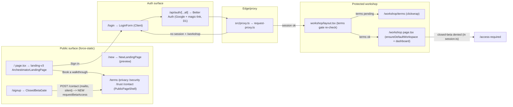
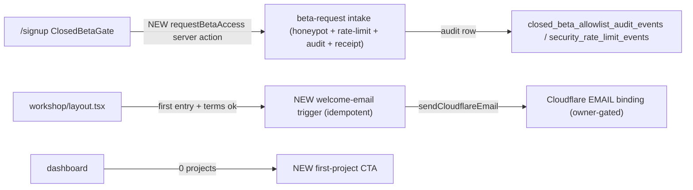

# 06 — Architecture and Technical Design

## 1. Current-state architecture (continuity-relevant slice)

Trust-boundary ordering (must be preserved — ARCH-CONT-02):
1. **Proxy** (`request-proxy.ts`) sets `x-archestimator-auth-verified=proxy` + `x-archestimator-terms-accepted` headers; redirects unauthenticated `/workshop` → `/login?next=`.
2. **`workshop/layout.tsx`** re-checks `isProtectedRouteGateSatisfied`; if terms not accepted → resolves `getCurrentUserContext` + `getCurrentUserTermsAcceptanceStatus` → redirect to `/workshop/terms`.
3. **`getCurrentUserContext`** (`session.ts`) resolves Better Auth identity → **closed-beta allowlist check** → profile. Denial → `/access-required`.

## 2. Target-state architecture (delta only)

The continuity work adds **no new trust boundary** and **no new route-protection logic**. Deltas:

- **`requestBetaAccess`** is a `"use server"` action; reachable as a direct POST endpoint → must self-validate (honeypot, rate-limit, auth-not-required-but-input-validated, no PII beyond email+IP-hash).
- **Welcome-email trigger** runs inside the existing first-workshop-entry path (`workshop/page.tsx` or `account-actions.ts`), guarded by an idempotency flag (e.g., a `welcome_email_sent_at` audit/security-event row or a column on `user_onboarding_profiles`).
- **No proxy/middleware change.** No new gate before the clickwrap.

## 3. CTA / intent continuity contract (FR-CONT-01)

Canonical mapping (to be recorded in `06` and optionally as a doc comment in `contact-mailto.ts`):

| Surface | Auth state | Label | href | intent | Resolves to |
|---|---|---|---|---|---|
| v3 `PrimaryCta` | logged-out | "Book a walkthrough" | `/contact?intent=walkthrough` | walkthrough | contact form (mailto builder) |
| v3 `PrimaryCta` | logged-in | "Open workspace" | `/workshop` | — | workshop dashboard |
| v3 Nav | logged-out | "Sign in" | `/login?next=/workshop/projects` | — | login |
| `LandingCTAs` primary | logged-out | "Start with an estimate" | `/contact?intent=started` | started (normalized) | contact form |
| `LandingCTAs` primary | logged-in | "Open workspace" | `/workshop` | — | dashboard |
| `LandingHeader` | logged-out | "Book a walkthrough" | `/contact` | — | contact |
| `ClosedBetaGate` | logged-out | "Request access" | server action `requestBetaAccess` | beta-request | receipt |
| `/new` `PrimaryCta` | logged-out | "Request access" | `/contact?intent=access` | access→started | contact form |
| `/invite/[token]` | signed-out | "Continue to Archestimator" | `/invite/{token}/continue` | — | bridge → login |

`intent` normalization (`contact-mailto.ts` `normalizeInquiryType`): `access`/`early-access`/`demo` → `started`; `beta-request` is distinct (goes to the new server action, not the mailto builder). **Decision (OPEN-CONT-01, recommended):** keep v3 walkthrough-primary; route "Request access" semantics exclusively through `ClosedBetaGate`.

## 4. Component boundaries and ownership

| Component | Type | Owner module | Change |
|---|---|---|---|
| `ClosedBetaGate` | currently RSC → becomes **Client** wrapper over a server-action form (or stays server with `<form action={requestBetaAccess}>`) | `src/components/auth/` | Phase 3 |
| `requestBetaAccess` | `"use server"` action | new `src/lib/landing/beta-request-actions.ts` | Phase 3 |
| Footer (v3) | inline in `ArchestimatorLandingPage` | `src/components/landing-v3/` | Phase 1 |
| Footer (`/new`) | inline in `NewLandingPage` | `src/components/landing-new/` | Phase 1 |
| Footer (shared) | `LandingFooter` | `src/components/landing/` | Phase 1 |
| `/cookies` page | RSC `force-static` | new `src/app/cookies/page.tsx` | Phase 2 |
| `CookieConsentBanner` | Client | `src/components/landing/` | Phase 2 (add link) |
| Dashboard empty-state CTA | within `WorkshopDashboard`/`WorkshopHomebaseClient` | `src/components/workshop/dashboard/` | Phase 5 |
| `/workshop/onboarding` redirect | RSC | `src/app/workshop/onboarding/page.tsx` | Phase 5 |
| Welcome-email trigger | server (in `account-actions` or new `welcome-email.ts`) | `src/lib/auth/` | Phase 4 |

## 5. Server/Client boundary decisions
- **Public pages stay `force-static`** (Server Components). No new `"use client"` on landing/legal pages.
- **`ClosedBetaGate` form:** preferred shape is `<form action={requestBetaAccess}>` (progressive enhancement, no JS needed to submit) with a Client wrapper only if we want optimistic receipt UX. Decision: keep it a server-action form; the receipt is a redirect-with-state or a re-rendered state — implementer picks the simpler progressive-enhancement path. Justify any `"use client"`.
- **Welcome email:** server-only; `sendCloudflareEmail` is server-only (uses `getCloudflareContext()`); never imported into a Client Component.
- **Cookie banner:** already Client; adding a link does not change the boundary.

## 6. State ownership
- **CTA target:** derived from `isLoggedIn` (display-only cookie hint via `getLandingAuthState` — already exists, does NOT hit D1). No new client state.
- **ClosedBetaGate receipt:** transient form state (server action return value or URL search-param state for no-JS). Not global state.
- **Dashboard CTA visibility:** derived from server-fetched `projectCount` (already in homebase data). No new client state.
- **Welcome-email idempotency:** durable server state (D1 row), not client state.

## 7. Cache, revalidation, freshness
- Public pages: `force-static`, marketing `s-maxage=31536000` (proxy). Footer/legal changes redeploy with the page; no runtime invalidation needed.
- `/cookies`: `force-static`, same cache posture as other legal pages.
- `requestBetaAccess`: `Cache-Control: no-store` (mutation).
- Dashboard CTA: data is already user-scoped/dynamic (workshop routes are `private,no-cache,no-store`). No change.
- TanStack Query: not involved in these server-rendered surfaces.

## 8. Data flow (delta)
- `requestBetaAccess` → D1 audit row (`closed_beta_allowlist_audit_events` reuse, event_type `beta_access_requested`) + rate-limit check (`security_rate_limit_events` reuse). **No new table.** (See `21`.)
- Welcome-email idempotency → reuse `account_security_events` (event_type `welcome_email_sent`) or add a nullable column to `user_onboarding_profiles`. **Decision:** prefer reusing `account_security_events` to avoid a migration (see `21` — migration-free path recommended; column-add is the fallback if a query proves inefficient).

## 9. Coupling and integration points
- The continuity contract (`06` §3) couples `landing-v3`, `landing-new`, `landing`, and `auth/ClosedBetaGate`. Phase 0 documents it; Phases 1–3 implement consistently.
- Welcome-email trigger couples to the existing first-entry path; must not double-fire across `workshop/page.tsx` and `account-actions.completeOnboarding` — pick **one** trigger site (recommendation: `completeOnboarding`/first `ensureDefaultWorkspace` success, since that's the true "first entry").

## 10. Architectural alternatives considered (summary; full in `15`)
- **A:** Self-serve signup now. **Rejected** — owner hasn't flipped `L-FUN-2`; closed-beta grant model stays.
- **B:** Pre-signup terms checkbox (double gate). **Rejected** — DEC-CONT-01 keeps single post-auth clickwrap; pre-link is non-binding.
- **C:** Keep mailto beta-request. **Rejected** — no audit trail, no rate limit, no receipt (security + UX gap).
- **D:** A new `/onboarding` wizard route. **Rejected** for closed beta — redirect-to-first-project + dashboard CTA is lighter and sufficient; a wizard is over-engineering for the current stage.
