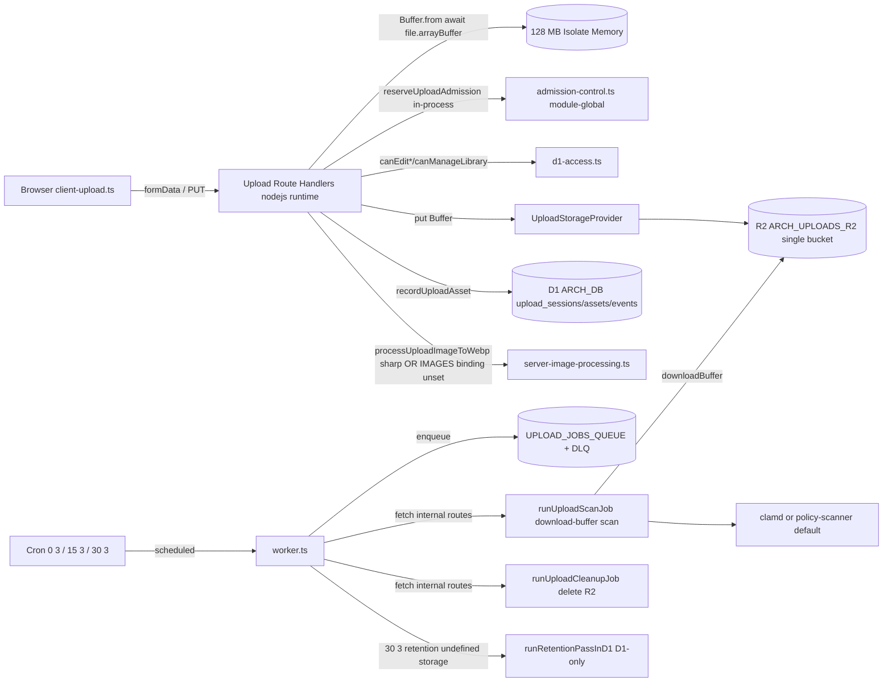
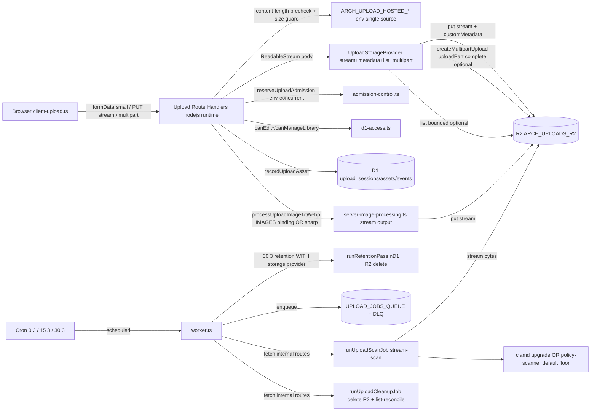

# 06 — Architecture and Technical Design

## Current-state architecture

Key properties:
- **Single R2 bucket**, namespaced by logical-bucket prefix.
- **All writes buffer the whole body** (P0 risk).
- **Admission is in-process, not distributed** (P1).
- **Multipart strategized but 501** (P1).
- **No `customMetadata`, no `list`** in the provider (P2).
- **3rd cron D1-only retention** (P1 leak).
- **Images binding unused at runtime** (P2).

## Target-state architecture

## Component boundaries (target)

- **Routes** (`src/app/api/…/route.ts`): HTTP, authz, admission, content-length pre-check, call
  provider. Do **not** own buffering. May hold a small buffer only for image transform input.
- **`UploadStorageProvider`** (`src/lib/uploads/storage-provider.ts`): widened port —
  `uploadObject(stream | Buffer | Uint8Array, opts?)`, optional `list({prefix,limit,cursor})`,
  optional multipart (`createMultipartUpload`/`uploadPart`/`complete`/`abort`/`resume`),
  `customMetadata` in opts. R2 remains the only runtime implementation.
- **`createCloudflareR2UploadStorageProvider`** (`r2-storage-provider.ts`): implements stream put
  (`env.BUCKET.put(key, stream, {httpMetadata, customMetadata})`), `list`, multipart.
- **`admission-control.ts`**: reads `…CONCURRENT_UPLOADS` from env; stays in-process but documented
  as advisory; durable direct-upload capacity stays in D1.
- **`session-strategy.ts`**: returns `multipart_resumable` above threshold; route executes it when
  DEC-03 enabled, else 501 with honest message.
- **`server-image-processing.ts`**: streams binding `Response.body` to R2 `put(stream)` (DEC-07);
  enforces 20 MB input cap; quota monitor.
- **`cleanup-job.ts`**: gains list-reconciliation mode (dry-run default) using `list`.
- **`worker.ts` / `scheduled-upload-jobs.ts`**: `30 3` passes a real storage provider to retention.

## Control flow — streaming image upload (target)

1. Client POST `formData` with file.
2. Route: authz (`canEdit*`); admission (`reserveUploadAdmission`); content-length pre-check vs env
   cap; magic-byte sniff on first 64 bytes (tiny read).
3. Route: `file.stream()` → `processUploadImageToWebp` (reads bytes for transform; output as
   `ReadableStream`) → `provider.uploadObject(stream, {customMetadata})`.
4. Route: `recordUploadAsset` (D1) with checksum prefix; return DTO.
5. On any failure after R2 write: rollback via `removeObjects` (existing pattern).

## Control flow — streaming attachment upload (target)

1. Client POST `formData` with file.
2. Route: authz (`canManageLibrary`); admission; content-length pre-check; magic-byte sniff.
3. Route: `provider.uploadObject(file.stream(), {customMetadata})`; record asset `scan_status: pending`.
4. Cron scan job: `provider.downloadObject` → stream to scanner (or buffered only if clamd needs it)
   → write status.
5. Download gated by `decideUploadScanGate` until `clean`/`override_approved`.

## Control flow — direct multipart upload (target, if DEC-03)

1. Client POST `action:create` → `createSignedUpload` + `recordPendingUploadSession` (D1 durable
   capacity) → returns app-owned `uploadUrl` + `multipart` plan (part size, count).
2. Client PUT each part → route `uploadPart(sessionId, partNumber, body stream)` →
   `provider.uploadPart` → D1 `upload_multipart_parts` row (etags) if DATA-02.
3. Client POST `action:finalize` → `provider.complete(parts)` → `finalizeUploadSessionAsset` → DTO.
4. Abort/failure → `provider.abort` + cleanup pending parts; retention reconciles stragglers.

## Decision rationale (summary — full in `15`)

- **Stream over buffer:** official memory-safe pattern; only way to stay under 128 MB isolate under
  concurrency. Rejected: larger isolate (paid); chunked buffering (still complex).
- **Widen one port, don't fork:** keeps provider-portability tests meaningful; avoids sprawl.
- **Env as single source:** removes three-answers-to-max-upload confusion. Rejected: per-route env
  (fragile).
- **Multipart enable (recommended):** free-tier-supported; closes 501; enables future large files.
  Rejected: stay 501 (caps first-user files artificially); presign direct-to-R2 (bypasses app
  authz/metadata/scan).
- **customMetadata + list:** enables lifecycle + orphan reconciliation; cheap. Rejected: D1-only
  truth (drift orphans).
- **3rd cron storage provider:** closes D1-only retention leak. Rejected: separate cleanup-only
  cron (operation-cost duplication).
- **Policy scanner as documented floor:** honest; ClamAV is reachable upgrade. Rejected: pretend
  policy scanner is AV (dishonest); mandate ClamAV now (network-egress risk, owner decision).
- **Images binding (owner):** free-tier transforms; binding streams from R2. Rejected: keep sharp
  (bundle size, Workers-compat, proof-build 501).

## Coupling / dependency direction

- Routes depend on `UploadStorageProvider` (port), not on R2 directly.
- `runtime-storage-provider.ts` is the single composition root binding port→R2.
- `cleanup-job.ts` / `scan-job.ts` depend on the port + D1 writers.
- `server-image-processing.ts` depends on the port (to put transformed output) + optional IMAGES
  binding.
- No new cross-module coupling introduced.

## Failure boundaries

- Route → provider: provider errors → 503 storage; route rolls back R2 write on post-write D1 fail.
- Provider → R2: R2 errors surface as typed provider errors; multipart abort on part failure.
- Scan job → scanner: scanner error → `failed_transient` (retry) or `failed_permanent` (DLQ).
- Cron → route: bearer-secret; dry-run-default; idempotency key.
- Client → route: timeout 45 s; abort; multipart resume by part etag.

## Architectural alternatives considered (preview — `15` for full)

1. **Buffer but cap lower** — rejected: still OOM-prone under concurrency; doesn't solve root cause.
2. **Presign direct-to-R2 URLs** — rejected: bypasses app authz, metadata, scan, admission.
3. **Separate storage microservice** — rejected: over-engineering; Worker + R2 is the substrate.
4. **Cloudflare CDR now** — rejected: paid; record as future.
5. **Workers Paid plan** — rejected: violates free-tier constraint unless owner approves.
