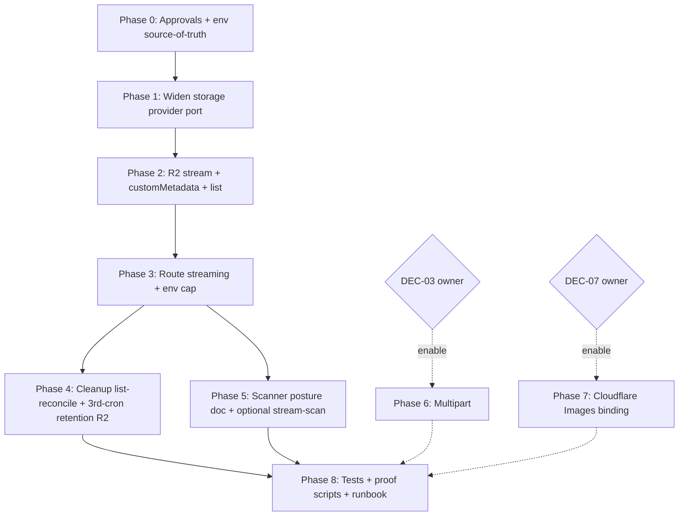

# 11 — Implementation Plan (execution guide)

This is the authoritative execution guide for the future implementation AI. Phases are
dependency-aware. Each phase carries a durable-goal contract (ultragoal-style). All paths are
repo-relative and exact. No phase is "implementation" until the package is approved and the owner
resolves OPEN-01/02/DEC-03/DEC-07 where named.

**Owner-delegated gates that must be resolved before specific tasks:** OPEN-01 (image cap 12→4 MiB
ack) before T-02 image-route cap edit; DEC-03 before T-09..T-12 (multipart); OPEN-02 before T-15
(ClamAV enable); DEC-07 before T-16..T-18 (Images binding).

## Phase order + dependency graph

Phases 1–5 are the first-user-safe critical path. Phase 6/7 are owner-gated. Phase 8 is continuous.

---

## Phase 0 — Approvals and env source-of-truth

**Objective:** Lock the decisions that gate later tasks; make `ARCH_UPLOAD_HOSTED_*` the documented
single source.
**Requirements addressed:** FR-02 (partial), DEC-03, DEC-07, OPEN-01, OPEN-02.
**Prerequisites:** This package approved.
**Parallelizable:** none (decision gate).
**Sequential:** yes.
**Affected paths:** `wrangler.jsonc` (vars/comments only), this pack's runbook (`13`).
**Validation:** owner ack recorded in ledger; `git diff --check`.
**Exit criteria:** OPEN-01/02 + DEC-03/DEC-07 decisions recorded; env vars documented as
authoritative.
**Risks:** image-cap change surprises users — mitigated by OPEN-01 ack + clear copy.

### Durable-goal contract — Phase 0
- **Goal ID:** G-P0
- **Objective:** Resolve owner gates; declare env authoritative.
- **Scope:** decisions only; no code beyond `wrangler.jsonc` comments.
- **Requirements covered:** FR-02 (doc), DEC-03, DEC-07, OPEN-01, OPEN-02.
- **Required evidence:** ledger entries with owner decision + date.
- **Completion audit:** each OPEN/DEC has a recorded decision (enable/defer + date).
- **Checkpoint artifacts:** `13_ROLLOUT_ROLLBACK_AND_OPERATIONS.md` runbook section.
- **Stop condition:** all four gates recorded.
- **Blocker condition:** owner unavailable → package stays CONDITIONALLY READY for those tasks.
- **Review gate:** owner sign-off.
- **QA gate:** n/a (decisions).

### Tasks
- **T-00:** Record owner decisions for OPEN-01, OPEN-02, DEC-03, DEC-07 in the implementation
  ledger. (Small; sequential; BLOCKED-EXTERNAL until owner responds.)

---

## Phase 1 — Widen the storage provider port

**Objective:** `UploadStorageProvider` accepts stream input + optional `list` + `customMetadata` +
optional multipart methods, without breaking existing callers.
**Requirements addressed:** FR-01, FR-04, FR-05, ARCH-02.
**Prerequisites:** Phase 0.
**Parallelizable:** no (shared interface — single owner).
**Sequential:** yes (unblocks Phase 2/3).
**Affected paths:** `src/lib/uploads/storage-provider.ts`.
**Relevant symbols:** `UploadStorageProvider`.
**New files:** none.
**Interfaces/contracts:** widened `uploadObject(body: ReadableStream | Buffer | Uint8Array, opts?: {customMetadata?, httpMetadata?})`; optional `list({prefix, limit, cursor})`; optional `createMultipartUpload(key, opts)`/`uploadPart(upload, n, body)`/`complete(upload, parts)`/`abort(upload)`/`resumeMultipartUpload(key, id)`.
**Data implications:** none.
**Security implications:** none (interface only).
**Performance implications:** enables streaming (P0).
**Server/client boundary:** unchanged (server-only port).
**Streaming/Suspense:** n/a.
**Cache/revalidation:** n/a.
**Bundle/RSC/API payload:** none.
**DB query/index:** none.
**Render/client-state:** none.
**Tailwind/design-system:** none.
**Cloudflare resource boundary:** R2 only; legacy n/a.
**Performance measurement/rollback gate:** type-check + provider-portability tests green.
**Validation commands:** `bun run type-check`; `bunx vitest run tests/vitest/upload-provider-portability.test.ts tests/vitest/upload-storage-provider.test.ts --maxWorkers=1`.
**Tests required:** interface compiles; existing portability tests green.
**Acceptance criteria:** AC-FR-01a, AC-FR-04a (type), AC-FR-05a (type), AC-ARCH-02a.
**Exit criteria:** widened interface compiles; no caller broken (callers updated in Phase 2/3).
**Rollback:** revert interface file.
**Risks:** breaking existing callers — mitigated by keeping `Buffer|Uint8Array` overload.

### Durable-goal contract — Phase 1
- **Goal ID:** G-P1
- **Objective:** Widen storage port without breaking callers.
- **Scope:** `storage-provider.ts` only.
- **Requirements covered:** FR-01, FR-04, FR-05, ARCH-02.
- **Required evidence:** type-check green; portability tests green.
- **Completion audit:** AC-FR-01a, AC-FR-04a, AC-FR-05a, AC-ARCH-02a proven.
- **Checkpoint artifacts:** updated interface file + test output.
- **Stop condition:** interface widened + green tests.
- **Blocker condition:** none internal.
- **Review gate:** Phase 1 review (maker/checker).
- **QA gate:** type-check + targeted vitest.

### Tasks
- **T-01:** Widen `UploadStorageProvider` (`src/lib/uploads/storage-provider.ts`): add stream input
  to `uploadObject`, optional `list`, optional multipart methods, `customMetadata`/`httpMetadata`
  opts. Keep `Buffer|Uint8Array` overload. (Small; sequential; G-P1.)

---

## Phase 2 — R2 provider: stream put + customMetadata + list

**Objective:** `createCloudflareR2UploadStorageProvider` implements stream `put` (with
`customMetadata`), bounded `list`, and (conditionally) multipart.
**Requirements addressed:** FR-01, FR-04, FR-05, FR-03 (conditional).
**Prerequisites:** Phase 1.
**Parallelizable:** no (single provider file; leased).
**Sequential:** yes (unblocks Phase 3/4/6).
**Affected paths:** `src/lib/uploads/r2-storage-provider.ts`.
**Relevant symbols:** `createCloudflareR2UploadStorageProvider`, `buildCloudflareR2ObjectKey`,
`CloudflareR2UploadBucket`, `assertSafeStoragePath`, `assertSafeLogicalBucket`.
**New files:** none.
**Interfaces/contracts:** implements Phase-1 port against `env.ARCH_UPLOADS_R2`.
**Data implications:** R2 objects gain `customMetadata` (FR-04).
**Security implications:** path validators retained (SEC-03); customMetadata non-PII (T-13).
**Performance implications:** stream put avoids buffer (P0); list bounded (Class B cost — cap).
**Server/client boundary:** unchanged.
**Streaming/Suspense:** n/a.
**Cache/revalidation:** n/a.
**Bundle/RSC/API payload:** none.
**DB query/index:** none.
**Render/client-state:** none.
**Tailwind/design-system:** none.
**Cloudflare resource boundary:** `ARCH_UPLOADS_R2` only.
**Performance measurement/rollback gate:** provider test asserts stream put + metadata + list;
  memory harness (Phase 8) asserts no whole-body buffer.
**Validation commands:** `bunx vitest run tests/vitest/cloudflare-r2-storage-provider.test.ts tests/vitest/upload-runtime-storage-provider.test.ts --maxWorkers=1`.
**Tests required:** extend provider test: stream put writes customMetadata; list paginates; unsafe
  path still rejected.
**Acceptance criteria:** AC-FR-01b (provider), AC-FR-04b, AC-FR-05a/b.
**Exit criteria:** stream put + customMetadata + list implemented + green tests.
**Rollback:** revert provider file (callers fall back to Buffer overload).
**Risks:** R2 stream quirks (disturbed stream) — mitigated by passing body untouched.

### Durable-goal contract — Phase 2
- **Goal ID:** G-P2
- **Objective:** R2 provider stream + metadata + list.
- **Scope:** `r2-storage-provider.ts`.
- **Requirements covered:** FR-01, FR-04, FR-05.
- **Required evidence:** provider tests green; customMetadata present on test object.
- **Completion audit:** AC-FR-01b, AC-FR-04b/c, AC-FR-05a/b proven.
- **Checkpoint artifacts:** provider file + test output.
- **Stop condition:** stream/metadata/list green.
- **Blocker condition:** R2 binding unavailable in test env → use existing mock provider.
- **Review gate:** maker/checker.
- **QA gate:** targeted vitest.

### Tasks
- **T-02:** Implement stream `put` + `customMetadata` in `createCloudflareR2UploadStorageProvider`.
  Pass `request.body`/`file.stream()` untouched to `env.ARCH_UPLOADS_R2.put(key, stream,
  {httpMetadata, customMetadata})`. (Medium; sequential; G-P2.)
- **T-03:** Implement bounded `list({prefix, limit:1000, cursor})` returning keys + metadata.
  (Small; sequential; G-P2.)
- **T-04 (conditional, DEC-03):** Implement multipart (`createMultipartUpload`/`uploadPart`/
  `complete`/`abort`/`resumeMultipartUpload`) against `env.ARCH_UPLOADS_R2`. (Large; sequential;
  G-P2; BLOCKED on DEC-03.)

---

## Phase 3 — Upload routes: stream + env cap + customMetadata

**Objective:** Each of the 5 routes streams the body, enforces env cap, writes customMetadata,
  retains authz/magic-byte/scan semantics.
**Requirements addressed:** FR-01, FR-02, FR-04, SEC-01, SEC-02, SEC-03, API-01.
**Prerequisites:** Phase 2.
**Parallelizable:** yes — each route is an independent file scope once the provider is ready.
  Lease each route file before editing.
**Sequential:** provider must be ready first.
**Affected paths:**
- `src/app/api/projects/images/route.ts`
- `src/app/api/estimate-row-images/route.ts`
- `src/app/api/component-library/images/route.ts`
- `src/app/api/component-library/attachments/route.ts`
- `src/app/api/component-library/attachments/direct-upload/route.ts`
- `src/lib/uploads/admission-control.ts` (env `…CONCURRENT_UPLOADS`)
- `src/lib/uploads/policy.ts` (per-surface cap from env)
**Relevant symbols:** per-route POST/PUT handlers; `reserveUploadAdmission`; `getUploadPolicy`;
  `readMagicMime`; `decideUploadScanGate`.
**New files:** none.
**Interfaces/contracts:** route DTOs unchanged (API-01 adds stable error codes).
**Data implications:** none (D1 rows unchanged; customMetadata echo optional in recordUploadAsset).
**Security implications:** authz retained (SEC-01); magic-byte sniff on first bytes before streaming
  rest (SEC-02); path validators retained (SEC-03).
**Performance implications:** eliminates whole-body buffer (P0).
**Server/client boundary:** unchanged (`runtime = "nodejs"`, server-only).
**Streaming/Suspense:** n/a.
**Cache/revalidation:** GET routes keep `no-store` (verify).
**Bundle/RSC/API payload:** none.
**DB query/index:** none.
**Render/client-state:** none.
**Tailwind/design-system:** none.
**Cloudflare resource boundary:** `ARCH_UPLOADS_R2` + `ARCH_DB`.
**Performance measurement/rollback gate:** memory harness (Phase 8) asserts no whole-body buffer per
  route; env-cap test asserts changing env changes cap.
**Validation commands:** route vitest per surface; `bun run type-check`.
**Tests required:** per-route stream test; env-cap parametrized test; authz denial tests stay green;
  magic-byte test stays green.
**Acceptance criteria:** AC-FR-01b/c/d, AC-FR-02a/b/c, AC-FR-04b, AC-SEC-01a, AC-SEC-02a,
  AC-SEC-03a, AC-API-01a.
**Exit criteria:** all 5 routes stream + env cap + customMetadata; green tests.
**Rollback:** revert route files (buffering returns).
**Risks:** `formData()`-consumes-body trap — mitigate by reading `file.stream()` from FormData, not
  `request.body`; image transform needs bytes — buffer only transform input (≤ cap); lowering image
  cap 12→4 MiB — OPEN-01 ack.

### Durable-goal contract — Phase 3
- **Goal ID:** G-P3
- **Objective:** Routes stream + enforce env cap + customMetadata.
- **Scope:** 5 routes + admission + policy.
- **Requirements covered:** FR-01, FR-02, FR-04, SEC-01/02/03, API-01.
- **Required evidence:** per-route stream test; env-cap test; denial tests green.
- **Completion audit:** all AC above proven route-by-route.
- **Checkpoint artifacts:** route files + test output.
- **Stop condition:** 5 routes streaming + caps + metadata green.
- **Blocker condition:** OPEN-01 not acked for image cap edit.
- **Review gate:** maker/checker per route.
- **QA gate:** per-route vitest + denial matrix.

### Tasks
- **T-05:** Stream image upload in `projects/images/route.ts` (file.stream →
  processUploadImageToWebp → provider.uploadObject(stream, {customMetadata})); env cap;
  customMetadata. (Medium; parallel-after-P2; G-P3.)
- **T-06:** Stream `estimate-row-images/route.ts`. (Medium; parallel; G-P3.)
- **T-07:** Stream `component-library/images/route.ts`. (Medium; parallel; G-P3.)
- **T-08:** Stream `component-library/attachments/route.ts` (+ scan posture retained,
  customMetadata). (Medium; parallel; G-P3.)
- **T-09:** Stream direct-upload PUT in `direct-upload/route.ts`; env cap; customMetadata.
  (Medium; parallel; G-P3.)
- **T-10:** Make `admission-control.ts` read `…CONCURRENT_UPLOADS` from env (safe fallback).
  (Small; parallel; G-P3.)
- **T-11:** Make `policy.ts` per-surface cap derive from env. (Small; parallel; G-P3.)

---

## Phase 4 — Cleanup list-reconcile + 3rd-cron retention R2 delete

**Objective:** Close the D1/R2 drift leaks (FR-05, FR-06).
**Requirements addressed:** FR-05, FR-06, REL-01.
**Prerequisites:** Phase 2 (provider `list`).
**Parallelizable:** FR-05 (cleanup) and FR-06 (retention cron) are independent file scopes — parallel.
**Sequential:** provider `list` first.
**Affected paths:**
- `src/lib/uploads/cleanup-job.ts`, `cleanup.ts` (FR-05)
- `worker.ts`, `src/lib/cloudflare/scheduled-upload-jobs.ts` (FR-06)
- `src/lib/compliance/retention-core` (read-only confirm)
**Relevant symbols:** `runUploadCleanupJob`, `listUploadCleanupJobRecords`,
  `createUploadCleanupStorageFromProvider`; `runRetentionPassInD1`; scheduled handler.
**New files:** none.
**Interfaces/contracts:** cleanup gains dry-run-default reconcile mode using `list`; scheduled `30 3`
  passes a real storage provider.
**Data implications:** `data_retention_events` records R2 delete outcomes.
**Security implications:** destructive — must stay dry-run-default; bound by retention cutoffs;
  bearer-secret cron.
**Performance implications:** `list` is Class B — cap frequency (daily in cleanup cron).
**Server/client boundary:** unchanged.
**Streaming/Suspense:** n/a.
**Cache/revalidation:** n/a.
**Bundle/RSC/API payload:** none.
**DB query/index:** existing indexes suffice.
**Render/client-state:** none.
**Tailwind/design-system:** none.
**Cloudflare resource boundary:** `ARCH_UPLOADS_R2` + `ARCH_DB`.
**Performance measurement/rollback gate:** reconcile dry-run test; retention-R2-delete test.
**Validation commands:** `bunx vitest run tests/vitest/upload-cleanup-job.test.ts tests/vitest/cloudflare-scheduled-upload-jobs.test.ts --maxWorkers=1`.
**Tests required:** reconcile flags orphan R2 (dry-run); retention deletes R2 for purged rows +
  records event; dry-run-default.
**Acceptance criteria:** AC-FR-05c, AC-FR-06a/b/c.
**Exit criteria:** reconcile + retention-R2-delete green.
**Rollback:** revert cleanup-job + scheduled handler (D1-only retention returns — known leak, documented).
**Risks:** accidental delete — mitigated by dry-run-default + retention cutoffs + bearer secret.

### Durable-goal contract — Phase 4
- **Goal ID:** G-P4
- **Objective:** Close D1/R2 drift leaks.
- **Scope:** cleanup-job + scheduled + worker.
- **Requirements covered:** FR-05, FR-06, REL-01.
- **Required evidence:** reconcile + retention-R2 tests green.
- **Completion audit:** AC-FR-05c, AC-FR-06a/b/c proven.
- **Checkpoint artifacts:** files + test output.
- **Stop condition:** both leaks closed green.
- **Blocker condition:** none internal.
- **Review gate:** maker/checker (destructive surface).
- **QA gate:** targeted vitest + dry-run proof.

### Tasks
- **T-12:** Add dry-run-default orphan reconcile to `cleanup-job.ts` using `provider.list` (FR-05).
  (Medium; parallel; G-P4.)
- **T-13:** Pass a real storage provider to the `30 3` retention pass in `worker.ts` /
  `scheduled-upload-jobs.ts`; record R2 delete outcomes (FR-06). (Medium; parallel; G-P4.)

---

## Phase 5 — Scanner posture documentation + optional stream-scan

**Objective:** Document the honest scanner floor (FR-07); optionally stream-scan to avoid scan-job
  buffering.
**Requirements addressed:** FR-07, SEC-02.
**Prerequisites:** none (doc) / Phase 2 (stream-scan optional).
**Parallelizable:** doc lane independent.
**Sequential:** no.
**Affected paths:** `18_STACK_CONTRACT_AND_PRODUCTION_STANDARDS.md` (this pack),
  `13_ROLLOUT_ROLLBACK_AND_OPERATIONS.md` (runbook), optionally `scan-job.ts` (stream-scan),
  `wrangler.jsonc` (comment noting `UPLOAD_SCAN_PROVIDER`).
**Validation:** doc review; existing scan tests stay green.
**Acceptance criteria:** AC-FR-07a/b/c.
**Exit criteria:** posture documented; runbook has ClamAV enable steps.
**Risks:** none (doc). Stream-scan optional — clamd `zINSTREAM` already streams chunks.

### Durable-goal contract — Phase 5
- **Goal ID:** G-P5
- **Objective:** Honest scanner posture.
- **Scope:** docs + optional scan-job stream.
- **Requirements covered:** FR-07, SEC-02.
- **Required evidence:** docs complete; scan tests green.
- **Completion audit:** AC-FR-07a/b/c proven.
- **Checkpoint artifacts:** docs + test output.
- **Stop condition:** docs done.
- **Blocker condition:** OPEN-02 (ClamAV enable is owner decision — but doc can proceed).
- **Review gate:** doc review.
- **QA gate:** existing scan tests.

### Tasks
- **T-14:** Write scanner-posture section in `18_STACK_CONTRACT` + ClamAV/CDR runbook in `13`.
  (Small; parallel; G-P5.)
- **T-15 (optional, OPEN-02):** Stream-scan in `scan-job.ts` (feed `downloadObject` stream to clamd
  `zINSTREAM` instead of materializing bytes). (Medium; parallel; G-P5; BLOCKED on OPEN-02 for
  production enable; doc regardless.)

---

## Phase 6 — Multipart (owner-gated, DEC-03)

**Objective:** Real R2 multipart for direct uploads.
**Requirements addressed:** FR-03, DATA-02.
**Prerequisites:** Phase 2 (T-04), DEC-03 enable.
**Parallelizable:** independent lane (direct-upload surface only).
**Sequential:** provider multipart first.
**Affected paths:** `src/app/api/component-library/attachments/direct-upload/route.ts`,
  `src/lib/uploads/session-strategy.ts`, `src/lib/uploads/provider-portability.ts`,
  `src/lib/uploads/direct-upload-records.ts`, `src/lib/uploads/component-attachment-client.ts`,
  `migrations/0041_upload_multipart_parts.sql` (if DATA-02; next free number — re-confirm at impl).
**Validation:** multipart harness; operation-count budget (`20`).
**Acceptance criteria:** AC-FR-03a/b/c/d/e.
**Exit criteria:** multipart end-to-end green; operation budget within free tier.
**Rollback:** revert + `DROP TABLE` (if DATA-02); 501 returns.
**Risks:** operation-count cost; partial-upload cleanup; client complexity.

### Durable-goal contract — Phase 6
- **Goal ID:** G-P6
- **Objective:** Multipart enabled end-to-end.
- **Scope:** direct-upload surface + migration (conditional).
- **Requirements covered:** FR-03, DATA-02.
- **Required evidence:** multipart test; `cf:inventory`; operation budget.
- **Completion audit:** AC-FR-03a-e proven.
- **Checkpoint artifacts:** files + migration + test output.
- **Stop condition:** multipart green within free tier.
- **Blocker condition:** DEC-03 not enabled → phase skipped (501 retained, documented).
- **Review gate:** maker/checker.
- **QA gate:** multipart harness + operation budget.

### Tasks
- **T-16 (DEC-03):** Wire `session-strategy.ts` `multipart_resumable` to the provider multipart
  path; remove the 501. (Large; sequential-after-T-04; G-P6.)
- **T-17 (DEC-03, DATA-02):** Add `migrations/0041_upload_multipart_parts.sql` (next free number; re-confirm at impl) if durable part rows
  needed; implement part-record read/write in `direct-upload-records.ts`. (Medium; sequential; G-P6.)
- **T-18 (DEC-03):** Add multipart client orchestration in `component-attachment-client.ts` +
  `client-state.ts` (part-progress action) + `client-upload.ts`. (Large; parallel; G-P6.)

---

## Phase 7 — Cloudflare Images binding (owner-gated, DEC-07)

**Objective:** Production image processing via `IMAGES` binding (or restore sharp).
**Requirements addressed:** FR-08.
**Prerequisites:** DEC-07 decision.
**Parallelizable:** independent lane (`server-image-processing.ts` only).
**Sequential:** no.
**Affected paths:** `src/lib/uploads/server-image-processing.ts`,
  `src/lib/uploads/sharp-cloudflare-stub.ts`, `next.config.ts`, `wrangler.jsonc` (var
  `ARCHESTIMATOR_IMAGE_PROCESSING_PROVIDER`), possibly `package.json` (sharp dep).
**Validation:** `cf:provider-proof` Images path; vitest on processing; thumbnail parity check.
**Acceptance criteria:** AC-FR-08a/b/c/d (binding) or AC-FR-08e (sharp).
**Exit criteria:** image uploads no longer 501 in Workers proof build; quota monitor present.
**Rollback:** revert provider var; sharp fallback.
**Risks:** Images free-quota (5,000/month); sharp bundle size/Workers-compat.

### Durable-goal contract — Phase 7
- **Goal ID:** G-P7
- **Objective:** Production image processing decided + working.
- **Scope:** server-image-processing + config.
- **Requirements covered:** FR-08.
- **Required evidence:** provider-proof Images path green; vitest; (hosted) thumbnail parity.
- **Completion audit:** AC-FR-08a-d or AC-FR-08e proven.
- **Checkpoint artifacts:** files + proof output.
- **Stop condition:** image uploads work in Workers proof build.
- **Blocker condition:** DEC-07 not decided → phase deferred; image uploads may 501 (recorded risk).
- **Review gate:** maker/checker.
- **QA gate:** provider-proof + vitest.

### Tasks
- **T-19 (DEC-07 binding):** Stream binding `Response.body` to R2 `put(stream)`; enforce 20 MB input
  cap; add transform-quota monitor + alert. (Large; sequential; G-P7.)
- **T-20 (DEC-07 sharp-alt):** If owner keeps sharp, restore sharp for Workers runtime (or
  Workers-compatible image lib) so proof build no longer 501s. (Large; sequential; G-P7.)

---

## Phase 8 — Tests, proof scripts, runbook (continuous)

**Objective:** Full test/proof coverage + operational runbook.
**Requirements addressed:** TEST-01, DOC-01, OPS-01, PERF-01, PERF-02, REL-01.
**Prerequisites:** Phases 1–7 (continuous).
**Parallelizable:** tests alongside each lane; proof scripts after.
**Affected paths:** `tests/vitest/upload-*.test.ts`, `tests/vitest/<route>-*.test.ts`,
  `scripts/verify-hosted-upload-*.ts`, `13_ROLLOUT_ROLLBACK_AND_OPERATIONS.md`.
**Validation:** `bun run test:dom`; `cf:verify-hosted-upload-runtime`;
  `cf:verify-hosted-upload-lifecycle`; (hosted) `cf:verify-hosted-performance`.
**Acceptance criteria:** AC-TEST-01a, AC-DOC-01a, AC-OPS-01a, AC-PERF-01a, AC-PERF-02a, AC-REL-01a.
**Exit criteria:** Test Execution Matrix (`12`) fully green; runbook complete.
**Risks:** hosted proof gaps (memory pressure, CPU/ms) — documented in `17`.

### Durable-goal contract — Phase 8
- **Goal ID:** G-P8
- **Objective:** Coverage + runbook.
- **Scope:** tests + proof + docs.
- **Requirements covered:** TEST-01, DOC-01, OPS-01, PERF-01/02, REL-01.
- **Required evidence:** green test matrix; runbook.
- **Completion audit:** every requirement's test in `12` green or documented-skip.
- **Checkpoint artifacts:** test output + runbook.
- **Stop condition:** matrix green (minus documented hosted gaps).
- **Blocker condition:** hosted env unavailable → hosted gaps recorded.
- **Review gate:** maker/checker.
- **QA gate:** full upload vitest suite.

### Tasks
- **T-21:** Extend `verify-hosted-upload-runtime.ts` body-probe to assert peak memory + env-cap
  enforcement (PERF-01/02 hosted). (Medium; after P3; G-P8.)
- **T-22:** Add memory/streaming deny-test (grep-deny `arrayBuffer()` on request body in streaming
  paths + behavior test). (Small; after P3; G-P8.)
- **T-23:** Write `13_ROLLOUT_ROLLBACK_AND_OPERATIONS.md` runbook (env vars, ClamAV, multipart,
  orphan reconcile, rollback per phase). (Small; parallel; G-P8.)

---

## Tasks with unresolved placement (explicit)

None. All tasks have exact paths. T-00 is BLOCKED-EXTERNAL (owner decisions). T-04/T-16-18 are
BLOCKED on DEC-03. T-15/T-19/T-20 are BLOCKED on OPEN-02/DEC-07. All other tasks are
implementation-ready with exact paths/symbols.
