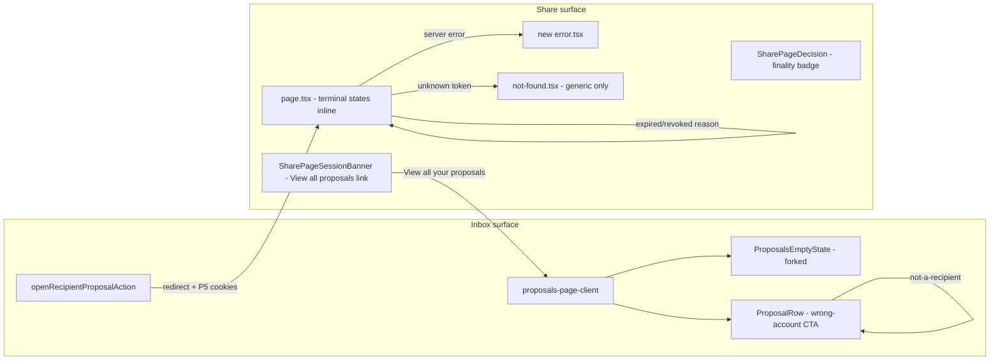

# 06 — Architecture and Technical Design

## Current-state architecture

```mermaid
flowchart LR
  subgraph AppAuth[App auth - Better Auth]
    A1[workshop session cookie]
  end
  subgraph Inbox[Inbox surface - signed-in]
    I1["/workshop/proposals<br/>page.tsx (RSC)"]
    I2["proposals-page-client.tsx<br/>(use client, TanStack Query)"]
    I3["recipient-proposals-repository.ts<br/>listRecipientProposals (D1, email-keyed)"]
    I4["openRecipientProposalAction<br/>(use server)"]
  end
  subgraph Share[Share surface - token/session]
    S1["/share/[token]<br/>page.tsx (RSC, force-dynamic)"]
    S2["SharePageDecision (use client)"]
    S3["/api/share/[token]/{decision,session,password}"]
    S4["shared_link_session_[token] cookie (P5)"]
  end
  subgraph D1[Cloudflare D1 ARCH_DB]
    D1a[project_publications]
    D1b[shared_link_recipients]
    D1c[shared_link_responses]
  end

  A1 --> I1
  I1 --> I2
  I2 -->|loadRecipientProposals| I3
  I3 -->|lower(email) = ?| D1b
  D1b --> D1a
  D1a -.-> D1c
  I2 -->|Review click| I4
  I4 -->|authorize RPC, mint P5 cookies, redirect| S1
  S1 --> S2
  S2 -->|POST decision| S3
  S3 -->|verify P5 cookie| S4
  S3 --> D1c
```

**Key property:** two distinct auth surfaces that do not share identity. The inbox is app-session-bound (Better Auth); the share page is P5-session-cookie-bound (signed, per-token). `openRecipientProposalAction` is the only bridge (inbox → share), and it is one-way.

## Target-state architecture (V1)

V1 adds **no new auth surface and no new API route**. It adds recovery/continuity affordances and differentiated terminal states, all within the existing component tree.



## Architectural decisions

### ARCH-01 — Server/Client boundary preserved
The inbox retains exactly one `"use client"` boundary (`proposals-page-client.tsx`). The `proposals-page/` sub-components that are client (`ProposalRow`, `ProposalsList`) stay client; the rest stay server/presentational. New CTAs are server-action forms (`openRecipientProposalAction` reuse, sign-out action) or plain `<Link>`/`<a>`. **No new `"use client"` file.**

### ARCH-02 — Share↔inbox bridge via link, not new state
The share→inbox continuity is a plain link on `SharePageSessionBanner` (visible only when `isValid`). No new cookie, no new store, no URL param. The inbox→share bridge remains `openRecipientProposalAction`. **Rationale:** adding a bridge cookie (à la `archestimator_pending_invite`) would conflate the two auth surfaces; a link is sufficient and safer.

### ARCH-03 — No new auth path
V1 keeps listing email-keyed (`lower(recipient.email) = ?`) and acting session-bound (`verifySharedLinkSessionCookieValue`). This is the recommended hybrid (OPEN-IA-01). Moving listing to session-bound `recipientId` would break "list all my proposals" (a session is per-token) and is rejected for V1.

### ARCH-04 — Terminal-state differentiation mechanism (chosen: inline render in `page.tsx`)
**Decision:** render expired/revoked terminal states **inline in `page.tsx`** rather than via `notFound()`. Today `page.tsx` calls `notFound()` when `resolveProjectPublicationAccessByToken` returns null, which collapses expired/revoked/unknown into one `not-found.tsx`.

**Chosen approach (c):** `resolveProjectPublicationAccessByToken` already distinguishes "not found" from "found but inactive" at the repository layer (`isActivePublication`). The page will:
1. Resolve access by token.
2. If the publication row exists but is inactive → render an inline terminal component with the reason (expired vs revoked), keeping the generic `not-found.tsx` only for the truly-unknown-token case.
3. If no row exists → `notFound()` (generic copy, anti-enumeration — SEC-05).

**Rejected alternatives:**
- *(a) Terminal route segments* (`/share/[token]/expired`) — rejected: requires redirect/rewrite, leaks state in the URL, complicates the token-resolution path.
- *(b) `notFound()` + search-param reason* — rejected: `not-found.tsx` cannot easily read a dynamic reason without a parallel data fetch, and search params are user-tamperable (could fake "expired" copy on an unknown token, mild confusion risk).

**Why (c):** keeps the reason server-side and authoritative, requires no routing change, and the publication row is already loaded by the time we know it is inactive.

### ARCH-05 — Wrong-account CTA reuses existing sign-out path
The `not-a-recipient` CTA routes to the existing sign-out/login path (Better Auth `/api/auth/signout` → `/login`). No new "switch account" primitive. The invite flow's `archestimator_pending_invite` bridge cookie is **not** reused (different surface; the recipient already has an app session, they just need to switch identities).

### ARCH-06 — Notifications stay email-only (V1)
In-app notification dispatch (`publication_activity` kind) is downstream of client-ready-proposal-workflow Phase 5 / DATA-04. V1 makes no changes to `src/lib/notifications/*` or `src/features/notifications/*`. OPEN-IA-04 records the dependency.

## Component boundaries and ownership

| Boundary | Owner | Change in V1 |
|---|---|---|
| Inbox client (`proposals-page-client.tsx`) | This pack | Wrong-account CTA wiring; consume forked empty state |
| Inbox sub-components (`proposals-page/*`) | This pack | Empty-state fork; row wrong-account CTA |
| Inbox repository (`recipient-proposals-repository.ts`) | This pack | None (V1); document decision-history V2 deferral |
| Inbox action (`recipient-proposals/actions.ts`) | This pack | None (trivial wrapper) |
| Open action (`publication/actions.ts::openRecipientProposalAction`) | This pack (narrow) | None to the action itself; the wrong-account branch is row-side UX |
| Share page (`share/[token]/page.tsx`) | This pack (narrow) | Inline terminal states (ARCH-04); reason passed to a terminal component |
| Share not-found (`share/[token]/not-found.tsx`) | This pack | Generic-only copy (anti-enumeration) |
| Share error (`share/[token]/error.tsx`) | This pack | New file (FR-10b) |
| Share decision (`SharePageDecision.tsx`) | This pack (narrow) | Finality badge copy alignment (FR-08) |
| Share session banner (`SharePageSessionBanner.tsx`) | This pack (narrow) | "View all your proposals" link (FR-02) |
| Decision/session/password/activity API routes | **Sibling packs / unchanged** | None |
| `security.ts` primitives | **Sibling packs / unchanged** | None |
| Owner publisher UI / digest | **client-ready-proposal-workflow** | None |

## Data flow

- **Inbox list:** RSC `page.tsx` → `listRecipientProposals` (D1, email-keyed) → SSR-seeded TanStack Query → `ProposalsPageClient` → rows. Refresh via debounced focus/visibility or manual.
- **Open:** row form → `openRecipientProposalAction` → authorize RPC → mint P5 cookies (passwordless) → `redirect("/share/<token>")`.
- **Decide:** `SharePageDecision` → `POST /api/share/[token]/decision` (CSRF + P5 session) → 201 → locked badge → (email) owner digest.
- **Terminal:** `page.tsx` → `resolveProjectPublicationAccessByToken` → inline terminal component (expired/revoked) or `notFound()` (unknown).

## State ownership

- **URL state:** none new (terminal reason is server-side, not URL-encoded).
- **Server state:** TanStack Query (`recipient-proposals`, `share-decision`).
- **Local React state:** `ProposalRow` `useActionState`; `SharePageDecision` `useReducer`. No new stores.
- **Zustand:** none for this surface.
- **D1:** authoritative for publications/recipients/responses (read-only in V1).

## Cache, revalidation, freshness

- Inbox: TanStack Query `staleTime: 30_000`, `refetchOnWindowFocus: false`, manual debounced refresh. No Next.js cache layer (the page is dynamic; data is fresh per SSR). Read-your-own-writes: after a decision on the share page, navigating to the inbox triggers a debounced refresh (FR-02).
- Share page: `force-dynamic`, no cache. The decision GET is `retry: false`, enabled only when `isValid`.
- **No `use cache` / `cacheLife` / `cacheTag` changes** for V1.

## Failure boundaries

- Inbox: soft banner (refresh failed) + hard error (no data) — existing.
- Share: new `error.tsx` (FR-10b) catches server errors in `page.tsx` before they hit `global-error.tsx`.

## Coupling and dependency direction

- `proposals-page-client.tsx` → `recipient-proposals/actions.ts` → `recipient-proposals-repository.ts` → D1.
- `ProposalRow` → `openRecipientProposalAction` (publication/actions.ts) → D1 RPC + security.ts.
- `SharePageDecision` → `/api/share/[token]/decision` → public-repository.ts → D1.
- No new coupling introduced.

## Reusable abstractions

- The invite-flow wrong-account pattern (`/invite/[token]` shows both emails + sign-out) is the *inspiration* but **not** reused as code — the publication surface has different constraints (no `invited_email` comparison at the route; the row already knows the mismatch via the RPC).

## Architectural alternatives (recorded)

| Alternative | Rejected because |
|---|---|
| Bridge cookie for share→inbox (à la invite) | Conflates two auth surfaces; a link suffices |
| Move listing to session-bound recipientId | Breaks "list all my proposals"; session is per-token |
| Terminal route segments for expired/revoked | URL state leak; routing complexity |
| New `/api/recipient-proposals/*` routes for V1 | No need; server action + existing routes suffice |
| In-app notification dispatch in V1 | Downstream of notification-infra work (OPEN-IA-04) |
