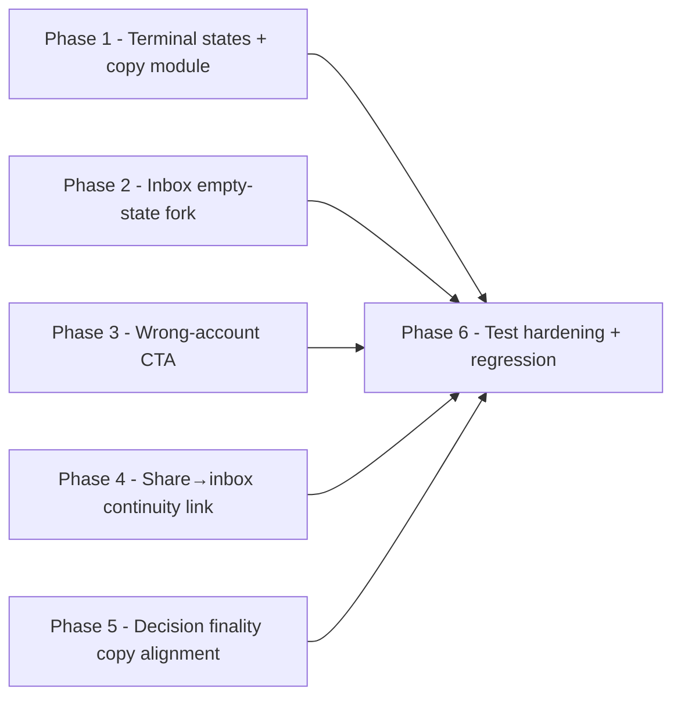

# 11 — Implementation Plan

This is the authoritative execution guide. Phases are dependency-aware. Each phase includes a durable-goal contract. Every task has exact paths and symbols or a safe DISCOVERY-REQUIRED step.

**Before the first edit**, run the stale-plan revalidation checklist in `README.md` and re-read every touched file (six sibling packs are concurrently evolving the publication surface).

## Phase ordering and dependency graph

Phases 1–5 are **parallel-safe** (disjoint file scopes) once the shared copy module (Phase 1 task 1.1) is landed. Phase 6 depends on all of them. Within each phase, tasks are sequential only where noted.

---

## Phase 1 — Terminal states + shared copy module

**Objective:** Differentiate expired/revoked link copy (anti-enumeration) and add a share-level error boundary.

**Requirements addressed:** FR-09, FR-10, UX-06, SEC-05, ARCH-04.

**Prerequisites:** Re-read `src/app/share/[token]/page.tsx`, `not-found.tsx`, `src/lib/publication/share-copy.ts`, `src/lib/publication/public-repository.ts` (the `isActivePublication` / `resolveProjectPublicationAccessByToken` boundary).

**Durable-goal contract:**
- Goal ID: `IA-P1`
- Objective: Differentiated, non-leaky terminal states + share error boundary.
- Scope: `src/app/share/[token]/page.tsx`, `src/app/share/[token]/not-found.tsx`, **new** `src/app/share/[token]/error.tsx`, `src/lib/publication/share-copy.ts`.
- Requirements covered: FR-09, FR-10, UX-06, SEC-05.
- Required evidence: DOM/route tests for expired/revoked/unknown/error copy (TEST-09, TEST-10); credential-free assertion stays green.
- Completion audit: every terminal state has differentiated copy + recovery action; unknown-token stays generic; error.tsx renders recovery.
- Checkpoint artifacts: the four edited/new files + the new test file.
- Stop condition: TEST-09 + TEST-10 pass; no enumeration (T-01 denial test).
- Blocker condition: `resolveProjectPublicationAccessByToken` does not expose the inactive reason → DISCOVERY-REQUIRED (see task 1.2).
- Review gate: code review on the terminal-render branch + copy.
- QA gate: TEST-09/10 green.

### Task 1.1 — Add differentiated copy constants to `share-copy.ts`
- Task ID: `IA-P1-T1`
- Requirement IDs: FR-09, FR-10, UX-06
- Objective: Add `PROPOSAL_EXPIRED_COPY` and `PROPOSAL_REVOKED_COPY` constants alongside the existing `SHARED_LINK_UNAVAILABLE_COPY` (which stays for unknown tokens).
- Why: Centralizes copy; the not-found/inline terminal components import from one place.
- Target file: `src/lib/publication/share-copy.ts`
- Target symbol: new exports `PROPOSAL_EXPIRED_COPY`, `PROPOSAL_REVOKED_COPY` (shape `{ title, body, action? }`).
- Inputs/dependencies: existing `SHARED_LINK_UNAVAILABLE_COPY` shape.
- Implementation instructions: Add two constants. Expired body: "This proposal has expired." + action label "Ask the sender for a fresh link." Revoked body: "This proposal is no longer available." + same action label. Do not include an `href` (the action is informational — recipients must contact the sender out-of-band; no in-app "ask sender" route exists).
- Expected output: two new exports; no change to `SHARED_LINK_UNAVAILABLE_COPY`.
- Failure cases: copy accidentally leaks the project/workspace name → keep copy generic.
- Tests: unit snapshot of the copy constants.
- Validation: `bun run test:dom` (any share-copy test).
- Completion evidence: the constants exist and are imported by Phase 1 task 1.3.
- Parallelization: sequential first (other Phase 1 tasks depend on it).
- Complexity: Small.

### Task 1.2 — DISCOVERY: confirm the inactive-reason is available at the resolve boundary
- Task ID: `IA-P1-T2`
- Requirement IDs: FR-09, FR-10, ARCH-04
- Objective: Confirm whether `resolveProjectPublicationAccessByToken` (and/or `isActivePublication`) can distinguish "row exists but expired/revoked" from "row does not exist," so the inline terminal render (ARCH-04) can pick the right copy.
- Why: ARCH-04 chosen mechanism depends on this. If the resolver collapses both to `null`, the implementation must extend the resolver to return a discriminated `{ status: 'active' | 'expired' | 'revoked' | 'unknown' }` (read-only repository change, no schema change).
- Target file: `src/lib/publication/public-repository.ts` (`resolveProjectPublicationAccessByToken`, `isActivePublication`).
- Inputs/dependencies: none (read-only inspection).
- Stop condition: the implementer can determine, from a resolved row, whether it is expired vs revoked vs unknown, OR has a named, scoped, read-only repository extension to do so.
- Expected evidence: a one-line note in the implementation commit/PR describing the resolver's return shape and the chosen approach.
- Parallelization: sequential before 1.3.
- Complexity: Small (inspection) → Small/Medium (if a read-only extension is needed).
- Status: `DISCOVERY-REQUIRED` (read-only; no behavior change beyond exposing an already-computed status).

### Task 1.3 — Render inline terminal states in `page.tsx`
- Task ID: `IA-P1-T3`
- Requirement IDs: FR-09, FR-10, SEC-05
- Objective: When `resolveProjectPublicationAccessByToken` returns a row that is inactive, render an inline terminal component with the differentiated copy (expired vs revoked). When no row exists, keep `notFound()` (generic, anti-enumeration).
- Target file: `src/app/share/[token]/page.tsx`
- Target symbols: the access-resolution block (~line 153–154, ~226); add a terminal-render branch. Possibly a small inline `ShareTerminalState` component or reuse a shared card.
- Implementation instructions: After resolving access, if the row exists but `isActivePublication` is false, branch on `status`/`revoked_at`/`expires_at` to render `PROPOSAL_EXPIRED_COPY` or `PROPOSAL_REVOKED_COPY`. Keep `notFound()` only for the null-row case. **Do not** render any snapshot/project metadata in the terminal state (decision `:793` — locked pages must not render metadata until access proven; a terminal state is never proven).
- Expected output: expired/revoked visitors see differentiated copy; unknown-token visitors see generic.
- Failure cases: leaking metadata in the terminal branch → render only the copy constants.
- Tests: TEST-09, TEST-10.
- Validation: `bun run test:dom` route-level test (mock the resolver).
- Completion evidence: three distinct copy states asserted.
- Parallelization: after 1.1 + 1.2.
- Complexity: Medium.

### Task 1.4 — Add share-level `error.tsx`
- Task ID: `IA-P1-T4`
- Requirement IDs: FR-10b
- Objective: Add `src/app/share/[token]/error.tsx` so a server error in `page.tsx` does not fall through to `global-error.tsx`.
- Target file: **new** `src/app/share/[token]/error.tsx`
- Implementation instructions: Default-export a client error boundary (`"use client"`) with a recovery surface: "Something went wrong loading this proposal." + a "Try again" button (`reset()`) and "Ask the sender for a fresh link" copy. Follow the existing `global-error.tsx` shape and Tailwind tokens. No inline scripts.
- Expected output: a 500 in `page.tsx` renders the share error boundary, not the global one.
- Tests: TEST-10 (error boundary assertion).
- Validation: `bun run test:dom` (error boundary render).
- Completion evidence: file exists; renders recovery.
- Parallelization: parallel with 1.3 (disjoint file).
- Complexity: Small.

**Phase 1 exit criteria:** expired/revoked/unknown/error each render distinct, non-leaky copy; credential-free assertion green; no new client bundle beyond the error boundary (which is a route boundary, expected).

**Risks:** resolver-shape surprise (mitigated by 1.2 DISCOVERY). Rollback: revert the four files.

---

## Phase 2 — Inbox empty-state fork

**Objective:** Distinguish "no proposals" from "you may be signed in as the wrong email."

**Requirements addressed:** FR-04, UX-03.

**Durable-goal contract:**
- Goal ID: `IA-P2`
- Objective: Forked, non-leaky empty state with a sign-out/switch-account affordance.
- Scope: `src/components/workshop/proposals-page/ProposalsEmptyState.tsx` (possibly the client to pass a flag).
- Requirements covered: FR-04, UX-03.
- Required evidence: TEST-04 (both copy branches + sign-out link).
- Stop condition: TEST-04 green; copy non-leaky.
- Review gate: copy review for leak avoidance.

### Task 2.1 — Fork the empty-state copy + add sign-out link
- Task ID: `IA-P2-T1`
- Requirement IDs: FR-04, UX-03, A11Y-01
- Objective: Add a secondary line + a sign-out/switch-account link to `ProposalsEmptyState`.
- Target file: `src/components/workshop/proposals-page/ProposalsEmptyState.tsx`
- Implementation instructions: Keep the primary "No proposals yet" heading. Add a secondary callout: "Not seeing a proposal you were expecting? It may have been sent to a different email." + a link/button to sign out (route to the Better Auth sign-out path → `/login`). The link must be a native `<a>`/`<button>` (keyboard-reachable). Do **not** add any logic that scans for proposals under other emails.
- Expected output: the empty state renders the secondary line + sign-out link.
- Failure cases: copy that confirms/denies proposals for other emails → keep it informational only.
- Tests: TEST-04.
- Validation: `bun run test:dom`.
- Completion evidence: TEST-04 green.
- Parallelization: parallel with Phases 1, 3, 4, 5 (disjoint file).
- Complexity: Small.

**Phase 2 exit criteria:** empty state forked; sign-out link present and keyboard-reachable; copy non-leaky.

---

## Phase 3 — Wrong-account recovery CTA

**Objective:** Replace the bare `not-a-recipient` inline message with a differentiated recovery CTA.

**Requirements addressed:** FR-06, UX-04, SEC-04, A11Y-01.

**Durable-goal contract:**
- Goal ID: `IA-P3`
- Objective: Wrong-account CTA that never discloses the intended email.
- Scope: `src/components/workshop/proposals-page/ProposalRow.tsx`.
- Requirements covered: FR-06, UX-04, SEC-04.
- Required evidence: TEST-06 (CTA renders for `not-a-recipient`, absent for `unavailable`/`invalid`; asserts no email in the DOM).
- Stop condition: TEST-06 green.

### Task 3.1 — Wrong-account CTA in `ProposalRow`
- Task ID: `IA-P3-T1`
- Requirement IDs: FR-06, SEC-04, A11Y-01
- Objective: When the row's action error is `not-a-recipient`, render a differentiated CTA: "This proposal was sent to a different email. Sign in with the right account." + a sign-out action (form/button to the Better Auth sign-out path).
- Target file: `src/components/workshop/proposals-page/ProposalRow.tsx`
- Target symbols: `readActionErrorMessage` (lines 66–71); add a `not-a-recipient` branch that renders the CTA instead of (or in addition to) the inline message.
- Implementation instructions: Extend `readActionErrorMessage` or add a sibling helper `isWrongAccountError(code)` that returns true only for `not-a-recipient`. Render the CTA (with a sign-out form/links) when true; keep the existing inline message for `unavailable`/`invalid`. The CTA must not include any email value. Reuse the existing sign-out routing.
- Expected output: `not-a-recipient` shows the CTA + sign-out; `unavailable`/`invalid` keep current copy.
- Failure cases: CTA leaks the intended email → assert absence in TEST-06.
- Tests: TEST-06.
- Validation: `bun run test:dom`.
- Completion evidence: TEST-06 green; no email string in the CTA DOM.
- Parallelization: parallel with Phases 1, 2, 4, 5 (disjoint file).
- Complexity: Medium.

**Phase 3 exit criteria:** wrong-account CTA renders only for `not-a-recipient`; non-leaky; keyboard-reachable.

---

## Phase 4 — Share→inbox continuity link

**Objective:** Add a "View all your proposals" link on the share session banner (when `isValid`).

**Requirements addressed:** FR-02, UX-01.

**Durable-goal contract:**
- Goal ID: `IA-P4`
- Objective: One-way share→inbox link (no new state).
- Scope: `src/components/share/SharePageSessionBanner.tsx`.
- Requirements covered: FR-02.
- Required evidence: TEST-01b (link renders when `isValid`, absent otherwise).
- Stop condition: TEST-01b green.

### Task 4.1 — "View all your proposals" link in `SharePageSessionBanner`
- Task ID: `IA-P4-T1`
- Requirement IDs: FR-02, A11Y-01
- Objective: When a valid P5 session is active, show a link to `/workshop/proposals` alongside the existing "Not you?" button.
- Target file: `src/components/share/SharePageSessionBanner.tsx`
- Implementation instructions: Add a `<Link href="/workshop/proposals">View all your proposals</Link>` (or `<a>`) in the valid-session branch. Keep the existing "Not you?" DELETE-session button. Do not add the link in the anonymous branch (the recipient has no app session to go to). The workshop gate will handle the signed-out case (login → terms → inbox) per public-to-beta-trust-onboarding-continuity.
- Expected output: link present when `isValid`; absent otherwise.
- Failure cases: link shown to anonymous users → gate on `isValid`.
- Tests: TEST-01b.
- Validation: `bun run test:dom`.
- Completion evidence: TEST-01b green.
- Parallelization: parallel with Phases 1, 2, 3, 5 (disjoint file).
- Complexity: Small.

**Phase 4 exit criteria:** link present iff `isValid`; routes to `/workshop/proposals`.

---

## Phase 5 — Decision finality copy alignment

**Objective:** Align the locked-badge copy with immutability (OPEN-IA-03) without changing the dialog copy or the API contract.

**Requirements addressed:** FR-08, UX-05.

**Durable-goal contract:**
- Goal ID: `IA-P5`
- Objective: Badge communicates finality; dialog stays neutral; copy-contract test reconciled.
- Scope: `src/components/share/SharePageDecision.tsx`, `tests/vitest/share/share-page-decision-bar-copy-contract.test.tsx`.
- Requirements covered: FR-08.
- Required evidence: TEST-08 (badge copy + updated contract test).
- Stop condition: TEST-08 green; no API change.

### Task 5.1 — Locked-badge finality copy + contract-test reconciliation
- Task ID: `IA-P5-T1`
- Requirement IDs: FR-08, UX-05
- Objective: Ensure the locked badge says "Decision recorded" (finality) and the copy-contract test asserts the *dialog* is neutral while the *badge* communicates finality.
- Target files: `src/components/share/SharePageDecision.tsx` (locked-badge branch, ~lines 338–365); `tests/vitest/share/share-page-decision-bar-copy-contract.test.tsx`.
- Implementation instructions: Verify/update the badge copy to "Decision recorded" (it currently announces "Decision recorded: {label}" — confirm this reads as final). Update the contract test: the assertion that the dialog does NOT say "final and cannot be changed" stays; add an assertion that the *badge* communicates finality (e.g. contains "Decision recorded"). Do not change the confirm-dialog copy. Do not change the API.
- Expected output: badge communicates finality; dialog neutral; test reconciled.
- Failure cases: implying the decision can be changed → assert against in the test.
- Tests: TEST-08 (extend `share-page-decision-bar-copy-contract.test.tsx`).
- Validation: `bun run test:dom`.
- Completion evidence: TEST-08 green.
- Parallelization: parallel with Phases 1–4 (disjoint files, but touches a test — own it).
- Complexity: Small.

**Phase 5 exit criteria:** badge finality clear; contract test green; no API/contract change.

---

## Phase 6 — Test hardening + regression

**Objective:** Ensure every recovery state has automated coverage and the receiver E2E skip rationale is recorded.

**Requirements addressed:** TEST-01 … TEST-20.

**Durable-goal contract:**
- Goal ID: `IA-P6`
- Objective: Full recovery-state coverage; E2E skip documented.
- Scope: `tests/vitest/recipient-proposals-*.test.tsx`, `tests/vitest/share/*.test.tsx`, `e2e/shared-link-receiver.spec.ts` (doc-only skip note).
- Requirements covered: all TEST-*.
- Required evidence: the Test Execution Matrix in `12_TEST_AND_VALIDATION_STRATEGY.md` is filled and green (or skip-documented).
- Stop condition: every new/changed behavior has a passing focused test; `bun run test:dom` green.
- Review gate: maker/checker on the test additions.

### Task 6.1 — Add/extend vitest DOM tests for all recovery states
- Task ID: `IA-P6-T1`
- Requirement IDs: TEST-01 … TEST-20
- Objective: Implement the Test Execution Matrix entries that are not already covered.
- Target files: extend `tests/vitest/recipient-proposals-page.test.tsx`, `tests/vitest/recipient-proposals-action.test.ts`, `tests/vitest/share/share-page-decision-bar-copy-contract.test.tsx`; add a route-level test for terminal states (e.g. `tests/vitest/share/share-terminal-states.test.tsx`).
- Implementation instructions: See `12_TEST_AND_VALIDATION_STRATEGY.md` for each test's fixture, command, expected evidence. Reuse existing mock patterns (mocked D1 rows, mocked `resolveProjectPublicationAccessByToken`).
- Expected output: all TEST-* green.
- Validation: `bun run test:dom`.
- Completion evidence: green test run output.
- Parallelization: sequential after Phases 1–5.
- Complexity: Medium.

### Task 6.2 — Record E2E skip rationale + optional unblock
- Task ID: `IA-P6-T2`
- Requirement IDs: TEST (E2E)
- Objective: Document why `e2e/shared-link-receiver.spec.ts` is skipped and what would unblock it (seed `tests/fixtures/shared-link.ts` + `ARCHESTIMATOR_E2E_SHARED_LINK=1`). Optionally add the fixture if cheap.
- Target file: `e2e/shared-link-receiver.spec.ts` (doc comment) + possibly `tests/fixtures/shared-link.ts`.
- Implementation instructions: Ensure the skip comment is accurate. Do not claim E2E coverage that does not run.
- Expected output: skip rationale clear; no false-green claim.
- Validation: `bun run test:e2e` (confirms skip behavior).
- Completion evidence: skip comment accurate.
- Parallelization: parallel with 6.1.
- Complexity: Small.

### Task 6.3 — Add receiver-E2E cases for recovery states (optional, if fixture unblocked)
- Task ID: `IA-P6-T3`
- Requirement IDs: TEST (E2E recovery)
- Objective: If the fixture is unblocked, add E2E cases for expired/revoked/wrong-account/empty/decline/revision.
- Target file: `e2e/shared-link-receiver.spec.ts`.
- Status: `DISCOVERY-REQUIRED` (depends on fixture availability + a seeded publication — coordinate with `2026-07-07-e2e-fixture-smoke-harness`).
- Complexity: Large (deferred).

**Phase 6 exit criteria:** Test Execution Matrix green or skip-documented; no false-green E2E claim.

---

## Cross-cutting implementation notes

- **Server/client boundary:** no new `"use client"` file except the route-level `error.tsx` (expected). ARCH-01.
- **Cache/revalidation:** none changed.
- **Bundle/RSC/API payload:** ±trivial; verify with `bun run build`.
- **D1 query-count/index impact:** zero (no query change).
- **Tailwind/design-system:** reuse existing chips/cards/buttons/links; no new tokens.
- **Cloudflare resource-boundary impact:** none (no binding/migration).
- **Performance measurement + rollback gate:** bundle-size + `bun run test:dom`; rollback = revert files.
- **Documentation updates:** `current-state.md` (DOC-01) + `decisions.md` (DOC-02) after OPEN-IA resolution.

## Tasks with unresolved placement

None. Every task has exact paths. Two tasks are `DISCOVERY-REQUIRED` (1.2 resolver-shape, 6.3 E2E fixture) with named, safe, read-only/coordination scopes and falsifiable stop conditions — permitted by the planning directive.
