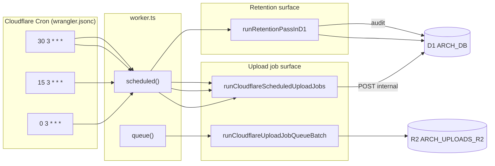
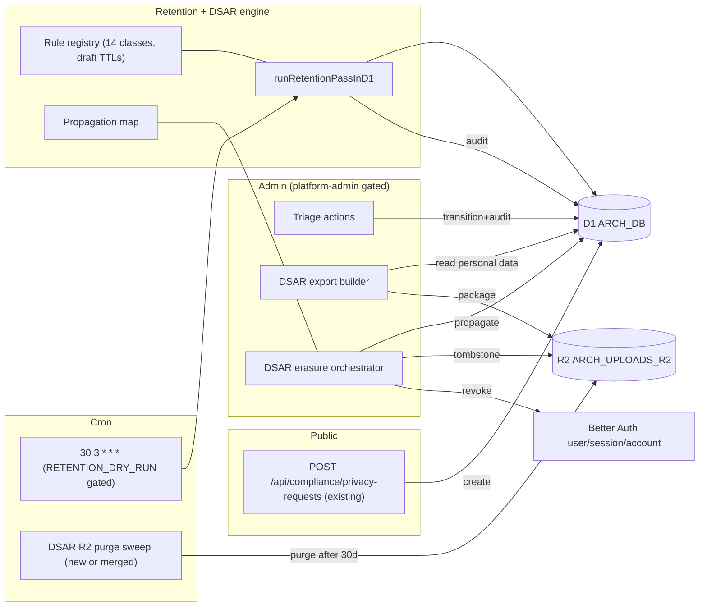
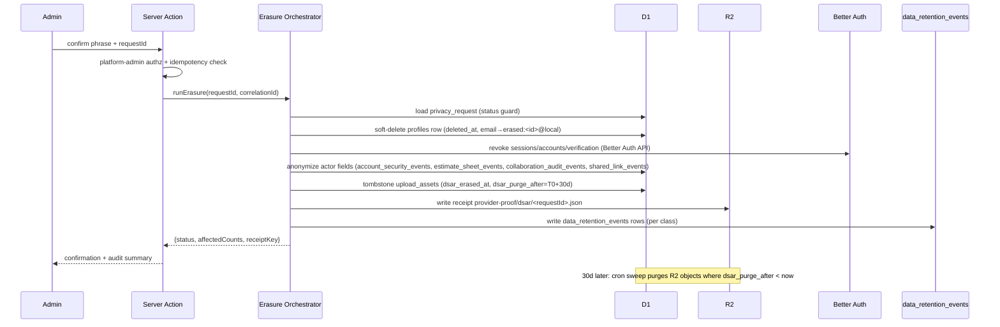
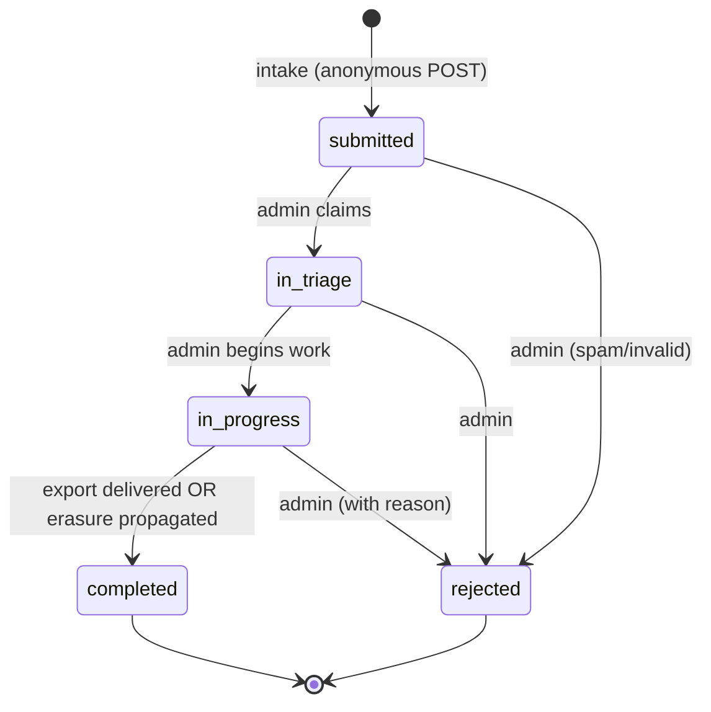

# 06 — Architecture and Technical Design

## §1. Current-state architecture



Key current facts:
- Retention pass runs only on cron `30 3 * * *`, unconditional apply, no env dry-run.
- Retention writes `data_retention_events`; upload cleanup writes `upload_events` (separate).
- Privacy intake is a public POST; no triage/export/erasure consumers.

## §2. Target-state architecture



## §3. Component boundaries and ownership

| Component | Owner module | Responsibility | New/existing |
|---|---|---|---|
| Rule registry | `src/lib/compliance/retention-core.ts` | 14-class TTL + action source of truth | Existing, extended |
| Retention pass | `src/lib/compliance/retention-repository.ts` + `retention-core.ts` | Batched apply/dry-run + audit | Existing, extended |
| Privacy request repo | `src/lib/compliance/privacy-request-repository.ts` | Create + list + **transition** | Existing, extended |
| DSAR export builder | `src/lib/compliance/dsar-export-builder.ts` | Build data-subject package | **New** |
| DSAR erasure orchestrator | `src/lib/compliance/dsar-erasure-orchestrator.ts` | Run propagation map + R2 tombstone + Better Auth revoke | **New** |
| Propagation map | `src/lib/compliance/dsar-propagation-map.ts` | Declarative target→action table | **New** |
| Admin triage action/route | `src/app/api/admin/privacy-requests/` + `src/lib/compliance/privacy-request-actions.ts` | Platform-admin transitions, export, erasure | **New** |
| Retention cron env gate | `worker.ts` + `retention-repository.ts` | `RETENTION_DRY_RUN`/`RETENTION_ENABLED` | Existing, extended |
| DSAR R2 purge sweep | `worker.ts` or merged into retention pass | Purge R2 objects past 30d tombstone | **New** hook |
| Operator dashboard queries | `src/lib/compliance/retention-operational-snapshot.ts` | Read-only snapshot for dashboard | **New** (mirrors `buildUploadCleanupOperationalSnapshot`) |

## §4. Data flow — DSAR erasure (the critical new path)



## §5. DSAR state machine (privacy_requests.status)



Legal transitions enforced in `transitionPrivacyRequest`. Illegal transitions → typed error `PRIVACY_REQUEST_ILLEGAL_TRANSITION`.

## §6. Retention rule registry target shape

The registry stays "data, not a class" (per existing comment). Target:

```ts
// pseudo-shape only; exact signatures are implementation-time
type RetentionRule = {
  className: RetentionClassName;
  ttlDays: number;
  action: RetentionAction;
  selectSql: string;        // select ids past cutoff
  applySql: string;         // DELETE (purged) or UPDATE (anonymized/soft_deleted)
  batchSize: number;        // default 500, capped per D1 limits
  platformManaged?: boolean; // true for logs_worker_observability, logs_email_delivery, sessions_expired → writes acceptance row only
  notes?: string;
};
```

Non-purge action semantics:
- `anonymized`: `UPDATE ... SET <actor_col> = 'erased:' || ?<requestId>, ... WHERE id IN (...)`. Requires an `anonymized_actor` column or in-place rewrite of the existing actor column (see `07_`).
- `soft_deleted`: `UPDATE ... SET deleted_at = ? WHERE id IN (...)`. Requires `deleted_at` column.
- `tombstoned`: metadata flag on R2/upload; object retained for the purge window.
- `skipped_legal_hold`: select returns rows past cutoff AND `legal_hold = 1`; apply is a no-op; audit row records skip + reason.

## §7. Cache, revalidation, and freshness

- The retention pass is cron-driven, not request-driven → no HTTP cache.
- The admin DSAR console uses TanStack Query with `staleTime` and explicit invalidation after each transition/export/erasure (no polling that clobbers form state).
- The operator dashboard is read-only; TanStack Query with a 60s `refetchInterval` is acceptable (low cardinality queries).
- No `use cache`/Cache Components interaction (admin routes are dynamic, auth-scoped, no-store).
- DSAR export package stored in R2 with a short-TTL signed URL; no client cache.

## §8. Server Actions, mutations, contracts

| Action | Surface | Authz | Validation | Idempotency | UI states | Cache invalidation | Audit |
|---|---|---|---|---|---|---|---|
| `transitionPrivacyRequest` | Server Action (admin) | platform-admin | status graph + reason | status guard (optimistic) | pending/success/conflict/error | invalidate queue query | `data_retention_events` (triage class) |
| `buildDsarExport` | Server Action (admin) | platform-admin | user exists + format | cached package within TTL | building/ready/error | invalidate export query | `data_retention_events` (export class) |
| `runDsarErasure` | Server Action (admin) | platform-admin + typed phrase | phrase + status guard | correlation ID + status guard | confirm/pending/success/error | invalidate queue + user query | `data_retention_events` (erasure class) + R2 receipt |

All three are directly reachable as POST endpoints (Server Actions) → must validate auth, authorization, ownership, input, idempotency, and return DTOs. Progressive enhancement: the triage transitions work without JS (form action); export/erasure require JS (destructive + async).

## §9. Server/Client Component boundaries
- All admin routes are dynamic Server Components (auth-scoped). `"use client"` only for the interactive queue table, filter, detail drawer, and confirmation modal.
- Secrets (`AUTH_AUDIT_HASH_PEPPER`) never reach the client; anonymize/erasure run server-side only.
- DSAR export builder is server-only (`"server-only"`).

## §10. State management
- Admin queue: TanStack Query (server state) + local filter state (URL search params for shareable filter).
- Confirmation modal: local React state.
- Operator dashboard: TanStack Query (read-only).
- No Zustand needed for this surface (no cross-component client state that isn't server data or URL state).

## §11. Architectural alternatives considered

| Alternative | Pros | Cons | Decision |
|---|---|---|---|
| Migrate Better Auth `user` table to add `deleted_at` directly | One source of user truth | Mutates Better Auth-managed schema; upgrade risk; Better Auth may overwrite | **Rejected** — use `profiles.deleted_at` + Better Auth revocation API (DEC-003) |
| Single unified audit table (merge `upload_events` into `data_retention_events`) | One trail | Large migration; upload-domain detail lost; touches stable upload code | **Rejected** — keep `upload_events` for upload detail; cross-reference via correlation ID |
| TTLs in a D1 `retention_policy` table (Phase 1) | Operator-tunable without deploy | Adds migration + admin UI; premature for beta | **Deferred** to a later phase; code constant first (DEC-002) |
| DSAR erasure as a one-shot hard delete | Simple | Destroys evidence; no 30-day safety; no R2 receipt | **Rejected** — tombstone + delayed purge (DEC-001/REQ-R2-001) |
| Self-serve public DSAR portal | Lower admin load | Identity verification risk; out of current scope | **Out of scope** (separate epic; roadmap `08-…:63`) |

## §12. Failure boundaries and recovery
- Retention pass per-rule errors → caught, audit row `skipped: error: <name>`, next run catches up (existing pattern, kept).
- DSAR erasure partial failure → correlation ID groups the work; idempotent re-run continues from unfinished targets; R2 tombstones reversible within 30d (object not yet purged).
- Cron D1 outage → `scheduled()` `ctx.waitUntil` rejects are logged; next cron run catches up; no user-visible impact (admin dashboard shows stale).
- Better Auth revocation failure → orchestrator records `revoke_failed` and does not mark `completed`; admin must retry or escalate.

## §13. Integration points
- Better Auth: revocation API (sessions/accounts/verification) — verify exact API during Phase 4 DISCOVERY.
- Cloudflare R2: `removeObjects` (existing), signed read URLs (existing in `r2-storage-provider.ts`).
- Cloudflare Cron: existing triggers; add env-gate.
- Cloudflare Email: optional DSAR email confirmation (`EMAIL` binding), disabled until `OPEN-DEC-002`.
- D1: `data_retention_events`, audit tables, `privacy_requests`, `profiles`, `upload_assets`.
