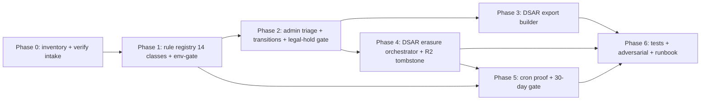

# 10 — Blast Radius and Dependencies

## §1. Affected surfaces (direct + transitive)

| Surface | Direct/Transitive | Impact class | Detail |
|---|---|---|---|
| `src/lib/compliance/retention-core.ts` | Direct | Required change | rule registry → 14 classes; non-purge actions |
| `src/lib/compliance/retention-repository.ts` | Direct | Required change | env-gate wiring |
| `src/lib/compliance/privacy-request-repository.ts` | Direct | Required change | transition + (call) export/erasure |
| `worker.ts` | Direct | Required change | env-gate; DSAR R2 purge hook |
| `wrangler.jsonc` | Possible change | env flags via vars (not secrets) | only if flags move to vars |
| `migrations/0040–0044` | Direct | Required change | new schema (see `07_`) |
| `src/lib/compliance/dsar-export-builder.ts` | Direct (new) | Required change | new file |
| `src/lib/compliance/dsar-erasure-orchestrator.ts` | Direct (new) | Required change | new file |
| `src/lib/compliance/dsar-propagation-map.ts` | Direct (new) | Required change | new file |
| `src/app/api/admin/privacy-requests/` | Direct (new) | Required change | new admin routes |
| `src/app/workshop/admin/privacy-requests/` | Direct (new) | Required change | new admin UI |
| `src/app/workshop/admin/retention/` | Direct (new) | Required change | new operator dashboard |
| `src/lib/authz/d1-access.ts` | Verification only | Unaffected | DSAR uses platform-admin, not `can*InD1` |
| `src/lib/mass-deletion/` | Reuse | Probable (read-only reuse) | import pattern, not modify |
| `src/lib/uploads/cleanup-job.ts` / `cleanup.ts` | Verification only | Unaffected | upload cleanup unchanged; DSAR reuses pattern |
| `src/lib/uploads/r2-storage-provider.ts` | Verification only | Unaffected | uses existing `removeObjects` |
| `src/lib/publication/` | Verification only | Unaffected | shared_link_events already a retention target |
| Better Auth `user`/`session`/`account`/`verification` | Transitive | Required change (API) | revocation via API; no schema migration |
| `data_retention_events` | Direct | Required change (CHECK rebuild) | DB-05 |
| `upload_assets` | Direct | Required change (columns) | DB-03 |
| `profiles` | Direct | Required change (columns) | DB-01 |
| audit tables (4) | Direct | Required change (column) | DB-02 |
| `beta_feedback_submissions`, `legal_terms_acceptances`, membership tables | Transitive | Probable (DSAR export + anonymize) | read + UPDATE actor |
| Workers Observability / Email logs | Transitive | Explicitly unaffected (platform-managed) | documented only |
| Tests | Direct | Required change | new test files (see `12_`) |
| Docs (`.ai/10_state/compliance/retention-schedule.md`, roadmap) | Direct | Required change | status bump after impl |
| Existing users | Transitive | Explicitly unaffected (until DSAR exercised) | no behavior change |
| Public landing/routes | Explicitly unaffected | — | no change |
| Open PRs / concurrent agents | Possible | Coordinate | file-scope ownership; this pack is docs-only |

## §2. Dependency graph (implementation order)

## §3. Document-impact matrix

| Document | Update needed? | When |
|---|---|---|
| `.ai/10_state/compliance/retention-schedule.md` | Yes — status bump after `OPEN-DEC-004`; add DSAR-propagation "implemented" note | After impl |
| `.ai/01_roadmap/08-legal-privacy-compliance-readiness.md` | Yes — mark P1.8 in progress / done | After impl |
| `.ai/10_state/decisions.md` | Yes — add `OPEN-DEC-006/007/008` entries | During impl |
| `.ai/10_state/current-state.md` | Yes — append entry on completion | At closeout |
| Privacy notice (`/privacy`) | Maybe — DSAR process copy (gated `OPEN-DEC-002`) | After legal |
| Terms (`/terms`) | No (retention periods not yet user-facing) | — |

## §4. Compatibility
- **Backward compatible**: all schema changes additive (nullable columns); new routes additive; new cron behavior env-gated.
- **Provider boundary**: all work inside `ARCH_DB`, `ARCH_UPLOADS_R2`, `EMAIL` bindings (per `wrangler.jsonc`). No Supabase/Vercel/Resend mutation.
- **Concurrent-agent safety**: docs-only pack; no file conflicts with code work. Implementation phase will declare file ownership in `LOOP_LEDGER.md`.
