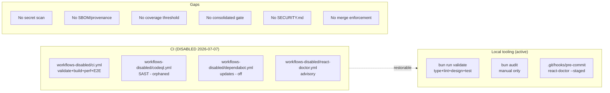
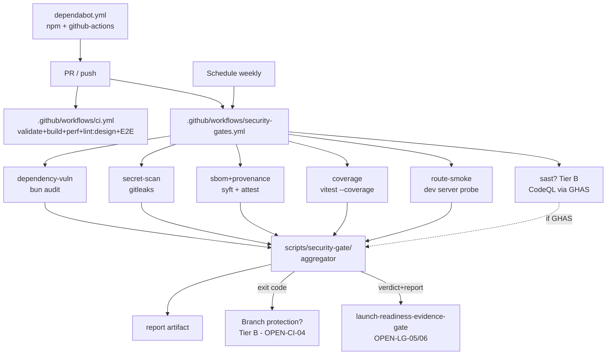
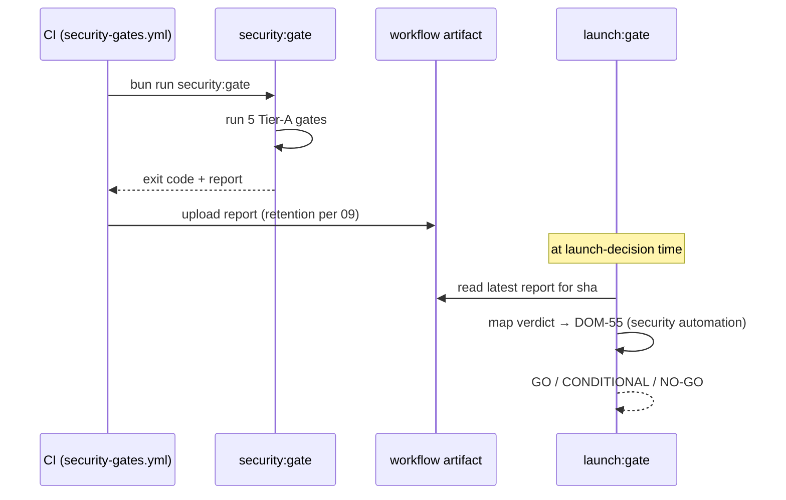

# 06 — Architecture and Technical Design

## §1. Current-state architecture



**Reality:** security automation is either off (workflows) or manual (`bun audit`) or unenforced (CODEOWNERS). The local pre-commit hook is the only active scanner and is **not shared** (lives in `.git/hooks/`, gitignored).

## §2. Target-state architecture



### Design principles
1. **One command, one verdict.** `bun run security:gate` is the local mirror of the CI `security-gates.yml` job. Same gates, same thresholds, same exit semantics.
2. **Free-first.** Tier-A gates run on GitHub Free private at $0. Tier-B gates slot in behind feature flags / GHAS without re-architecting.
3. **Advisory→blocking ratchet.** Every new gate honors `PERF_BUDGET_STRICT`-style env (`SECURITY_*_STRICT=1`) so day-one is advisory and promotion is a secret flip, not a code change (DEC-CI-07).
4. **Aggregator is dumb, gates are smart.** Each gate script owns its pass/fail logic and emits a uniform `{ name, result, threshold, evidencePath, advisory }` object. The aggregator collects, orders, prints, and exits. No gate knows about other gates.
5. **No new runtime dependencies in the app.** All new tooling is build-time/dev-time/CI-time. The deployed Worker (`archestimator-proof`) is untouched.

## §3. Component boundaries

| Component | Responsibility | New? | Owner file |
|---|---|---|---|
| `scripts/security-gate/index.ts` | Entry; runs gates in order; aggregates; prints; exits | new | `scripts/security-gate/` |
| `scripts/security-gate/audit.ts` | `bun audit` parse + severity gate | new | (WP-1) |
| `scripts/security-gate/secrets.ts` | gitleaks invoke + parse | new | (WP-1) |
| `scripts/security-gate/sbom.ts` | syft invoke + validate (Tier A) | new | (WP-1.3) |
| `scripts/security-gate/provenance.ts` | cosign OSS sign-bundle (Tier A) + GitHub attestation probe (Tier B) | new | (WP-1.3) |
| `scripts/security-gate/depdiff.ts` | osv-scanner PR dep-diff (Tier A substitute for dependency-review) | new | (WP-1.6) |
| `scripts/security-gate/coverage.ts` | read vitest coverage summary + threshold check | new | (WP-1) |
| `scripts/security-gate/smoke.ts` | boot dev server + probe routes | new | (WP-1) |
| `scripts/security-gate/smoke-routes.json` | route manifest | new | (WP-1) |
| `scripts/security-gate/types.ts` | `GateResult` shared type | new | (WP-1) |
| `scripts/ratchet-coverage.mjs` | bump threshold to current coverage | new | (WP-4) |
| `.github/workflows/ci.yml` | restored + `permissions` | restored | (WP-0) |
| `.github/workflows/security-gates.yml` | CI security job | new | (WP-2) |
| `.github/dependabot.yml` | restored | restored | (WP-0) |
| `.github/gitleaks-config.toml` | gitleaks allowlist/rules | new | (WP-1) |
| `.github/SECURITY.md` | repo vuln-reporting policy | new | (WP-0) |
| `.github/codeql/codeql-config.yml` | rescoped (drop `supabase`) | modified | (WP-2.3, Tier B) |
| `vitest.config.ts` | `coverage:` block | modified | (WP-4) |
| `package.json` | `security:*` scripts | modified | (WP-0) |

### Why a new `scripts/security-gate/` directory (not a single file)?
Each gate has distinct invocation, parsing, and failure logic; a single `index.ts` would be ~600 lines and hard to test in isolation. A directory with one module per gate + a thin aggregator mirrors the existing `scripts/` pattern (e.g., `scripts/check-cloudflare-release-gates.ts` is already substantial). Each gate module is independently unit-testable (`TEST-CI-01..06`).

### Why not reuse `scripts/check-cloudflare-release-gates.ts`?
That script is **provider-release** specific (Cloudflare bindings/state). Mixing GitHub-CI security gates into it would couple two unrelated concerns and muddy its exit semantics. Separate directory, separate concern. They are *peers* that both feed `launch:gate`.

## §4. Data flow / integration with launch gate



**Artifact contract (PROPOSED — R4 T-5: pending launch-gate ratification):**
```ts
interface SecurityGateArtifact {
  schema: 'archestimator.security-gate.v1';
  sha: string;
  timestamp: string;          // ISO
  verdict: 'PASS' | 'ADVISORY' | 'FAIL';
  exitCode: number;
  gates: Array<{
    name: string;
    result: 'PASS' | 'ADVISORY' | 'FAIL' | 'SKIP';
    threshold?: string;
    evidencePath?: string;
    advisory?: boolean;
    skipReason?: string;
  }>;
}
```
**R4 correction:** this contract is **asserted by this pack but not yet reciprocated by the launch-readiness-evidence-gate consumer** — a repo grep for `SecurityGateArtifact` / `security-gate.v1` in the launch-gate pack returns zero matches, and its DOM-55 is currently `*(missing-evidence)*`. So `06` §4 / `13` §4 are a **proposed** contract pending launch-gate Phase 6 ratification (WP-6 is downgraded to "blocked-on-sibling", not impl-ready). The launch gate's DOM-55 ("security automation") is *intended* to read `verdict` and require `PASS` (or owner-accepted `ADVISORY`) for GO — but until the reader exists, the `security:gate` verdict is produced-and-unused (advisory). This is recorded as RISK-CI-19 (coordination) and in `17`'s deficiency table.

## §5. Architectural alternatives considered (see `15` for full ADRs)

| Decision | Chosen | Rejected alternative | Why rejected |
|---|---|---|---|
| Secret scan | gitleaks (Tier A) | GitHub native (GHAS) | not free on private-Free (`19`) |
| Secret scan | gitleaks | TruffleHog | TH verifies secrets (network egress) — overkill + slower; gitleaks is pattern-only and faster for CI |
| Dep-vuln | `bun audit` primary | Snyk | free tier exhausts fast on private; SCA-only need met by bun audit |
| Dep-vuln | optional `osv-scanner` 2nd | replace `bun audit` | bun audit is built-in, zero new dep; osv is additive |
| Coverage | Vitest in-repo thresholds | Codecov/Coveralls | single maintainer, no external dep, no token (`19` §11) |
| SBOM | Syft (Tier A) | `npm sbom` | Syft handles Bun lockfile + node_modules; `npm sbom` assumes npm |
| Provenance | cosign OSS keyless (Tier A) + GitHub attestation (Tier B GHEC) | GitHub attestation only | R3: attestations need GHEC on private-Free; cosign is the free substitute |
| DAST | route smoke (curl/fetch) | OWASP ZAP | overkill pre-launch; Playwright already covers heavy E2E |
| Aggregation | dedicated `security:gate` | fold into `cf:release-gates` | different concern (CI vs provider); keeps both scripts focused |
| Gate wiring | separate `security-gates.yml` | fold into `ci.yml` | separate triggers (schedule), separate `permissions`, clearer status-check name |

## §6. Coupling / dependency direction

- `scripts/security-gate/` depends on: `bun` (audit), gitleaks binary, syft binary, vitest coverage output, `bun run dev`. **No dependency on `src/` application code** (smoke hits it over HTTP only).
- `vitest.config.ts` coverage block depends on `@vitest/coverage-v8` (new devDep).
- CI workflows depend on pinned actions (SHA-pinned per `19` §13).
- Launch gate depends on the artifact contract (§4); breaking the contract is a P0 planning defect flagged in `10`.

## §7. Failure boundaries

- A gate throwing → caught by aggregator → reported as ERROR for that gate → does not crash other gates.
- Tool binary missing → gate SKIPs with reason (not FAIL) → aggregator notes SKIP count; `SECURITY_GATE_STRICT=1` makes SKIP non-zero.
- Dev server won't boot (smoke) → smoke gate FAILs with boot log; other gates unaffected.
- This isolation is why each gate is a separate module (§3).
