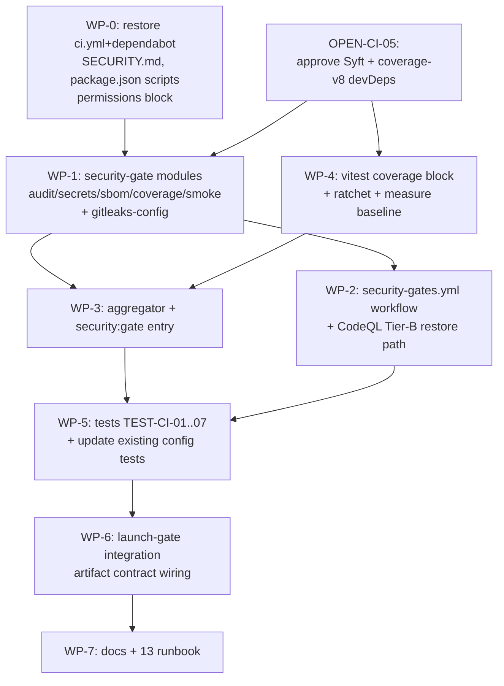

# 10 — Blast Radius and Dependencies

## Direct impact (files the implementation will create/modify)

| Path | Action | Classification | Impact if wrong |
|---|---|---|---|
| `.github/workflows/ci.yml` | restore from `workflows-disabled/` + add `permissions:` | **Required change** | CI behavior |
| `.github/workflows/security-gates.yml` | new | **Required change** | new security gate |
| `.github/dependabot.yml` | restore from `workflows-disabled/` | **Required change** | update PRs resume |
| `.github/SECURITY.md` | new | **Required change** | policy presence |
| `.github/gitleaks-config.toml` | new | **Required change** | secret scan rules |
| `.github/codeql/codeql-config.yml` | modify (rescope paths, drop `supabase`) | **Probable change** (Tier B restore) | SAST scope |
| `scripts/security-gate/` (8 files) | new | **Required change** | the gate itself |
| `scripts/ratchet-coverage.mjs` | new | **Required change** | coverage floor |
| `vitest.config.ts` | modify (add `coverage:` block) | **Required change** | coverage enforcement |
| `package.json` | modify (`security:*` scripts + 2 devDeps) | **Required change** | commands + deps |
| `tests/unit/security-gate/` (6+ files) | new | **Required change** | gate self-tests |
| `tests/vitest/security-automation-config.test.ts` | modify (read active paths) | **Required change** | else red on re-enable |
| `tests/vitest/ci-workflow-pinning.test.ts` | modify (read active paths) | **Probable change** | else red |
| `tests/vitest/supply-chain-toolchain-manifest.test.ts` | modify (R4: currently only asserts `packageManager`; extend to assert a new `scripts/security-gate/tool-manifest.json` with pinned Go binaries — see WP-5) | **Required change** | manifest accuracy; RISK-CI-17 |
| `scripts/security-gate/tool-manifest.json` | new (R4: the 4 Go binaries + pinned versions/checksums — closes RISK-CI-17 since these are outside `bun audit`) | **Required change** | supply-chain posture for Go-binary tools |
| `.gitignore` | modify (add `.security-gate-report.json`, `coverage/`) | **Probable change** | avoid committing reports |
| `bun.lock` | regenerate (2 new devDeps) | **Required change** (consequence) | lockfile |

## Transitive impact

| Surface | Impact | Classification |
|---|---|---|
| `src/` (application) | **none** — gates call over HTTP only | Explicitly unaffected |
| `migrations/` | **none** | Explicitly unaffected |
| `wrangler.jsonc` / `cloudflare-env.d.ts` | **none** | Explicitly unaffected |
| Deployed Worker `archestimator-proof` | **none** — no runtime change | Explicitly unaffected |
| D1 / R2 / DO / Queue / Email | **none** | Explicitly unaffected |
| Sibling security packs | **none** — referenced, not modified | Explicitly unaffected (coordination only) |
| `launch-readiness-evidence-gate` | **integration** — gains a `security:gate` evidence producer | Verification only (additive; contract in `06` §4) |
| `.ai/10_state/current-state.md` | **update** (after impl) — CI no longer disabled | Documentation (post-impl, not this pack) |
| `01_roadmap` dashboard | **update** (after impl) — security-automation row → IMPLEMENTED | Documentation (post-impl) |
| Local `.git/hooks/pre-commit` (react-doctor) | **coexists** — gitleaks can optionally be added as a pre-commit hook too | Optional enhancement (not required) |

## Dependency-graph (implementation order)

## Affected documentation (post-impl, not this planning pack)

| Doc | Update needed |
|---|---|
| `.ai/10_state/current-state.md` | CI no longer disabled; security gates active |
| `.ai/01_roadmap/00-production-readiness-dashboard.md` | security-automation row status |
| `.ai/01_roadmap/01-launch-gates-master-checklist.md` | relevant gate items |
| `2026-07-07-launch-readiness-evidence-gate/` | close OPEN-LG-05 (CI slice) + OPEN-LG-06 (CI slice) |
| `2026-07-07-github-security-pr-comment-loop/LOOP_LEDGER.md` | record Tier-A substitutes live |

## Compatibility / backward-compat

- **`bun.lock`:** adding 2 devDeps is backward-compatible (no runtime dep change).
- **`vitest.config.ts`:** adding `coverage:` is backward-compatible (`vitest run` without `--coverage` ignores it).
- **CI workflow restore:** `ci.yml` from `workflows-disabled/` is the *exact* prior baseline + `permissions:`; backward-compatible by construction.
- **Existing tests:** `security-automation-config.test.ts` reads `workflows-disabled/` paths → **must** be updated to read active paths (or it goes red). This is a known, planned breaking change to the test (WP-0.4), not a regression.

## Risk concentrations

1. **The artifact contract (`06` §4)** is the one coupling to the launch-gate pack. Breaking it silently = launch gate can't read security evidence. Mitigation: schema-versioned (`v1`), test in WP-6.
2. **`security-automation-config.test.ts` update** is the one test that *locks in* the disabled state. Re-enabling without updating it = red CI on day one. Mitigation: WP-0.4 sequences the test update with the workflow restore.
3. **Two new devDeps** (`OPEN-CI-05`) — owner sign-off required by the brief's constraint. If declined, Syft SBOM + Vitest coverage gates defer to Tier B.
