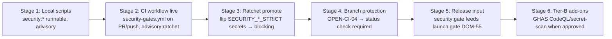

# 13 — Rollout, Rollback, and Operations

## §1. Staged rollout ladder (local → CI → enforcement → release-input)

| Stage | Trigger to enter | Owner action | Reversible? |
|---|---|---|---|
| 1 | scripts land (WP-0..5) | none (devs can run manually) | yes (delete scripts) |
| 2 | WP-2 lands | move workflows from disabled → active | yes (move back) |
| 3 | 2-week advisory window clean | set `SECURITY_*_STRICT=1` secrets | yes (unset secret) |
| 4 | `OPEN-CI-04` closed | enable ruleset requiring `security-gates` check | yes (disable ruleset) — **needs GitHub Pro** |
| 5 | launch-gate Phase 6 | wire DOM-55 reader | yes |
| 6 | `OPEN-CI-01/02` closed | enable GHAS | yes (disable) |

**Velocity protection:** Stages 1–2 are advisory-only (no merge block, no release block). The gate *exists* and *reports* before it *blocks*. This matches `VALIDATION_MATRIX.md` (pre-launch = fast iteration) and the existing `PERF_BUDGET_STRICT` precedent.

## §2. Release-blocking policy (merge vs release) — the brief's explicit ask

| Gate | Tier | Blocks merge? | Blocks release? | Escape hatch | Advisory window | Strict env |
|---|---|---|---|---|---|---|
| `bun audit` (dep-vuln, existing) | A | conditional¹ | **yes** (high/crit) | `--skip-audit`; `SECURITY_AUDIT_STRICT` toggles mod/low | 1 week | `SECURITY_AUDIT_STRICT=1` |
| osv-scanner dep-diff (new deps on PR, SEC-CI-08) | A | conditional¹ | **yes** (new high/crit) | `--skip-depdiff` (local); CI never skips on PR-to-main | 1 week | `SECURITY_DEPDIFF_STRICT=1` |
| gitleaks (secret-scan) | A | conditional¹ | **yes** (any finding) | `--skip-secrets` (local only; CI never skips) | 0 (immediate on PR) | always strict in CI |
| Syft SBOM (SEC-CI-04a) | A | no | **yes** (must exist for release) | n/a | n/a | n/a |
| cosign OSS provenance (SEC-CI-04c) | A | no | advisory² (signed bundle present) | `--skip-provenance` | 2 weeks | `SECURITY_PROVENANCE_STRICT=1` |
| GitHub attestation (SEC-CI-04b) | **B (GHEC)** | no | **yes** (P1; verify before prod) | n/a | n/a | when OPEN-CI-06 |
| coverage threshold | A | conditional¹ | advisory² (floor-guarded, AC-05e) | `--skip-coverage` | 2 weeks (ratchet) | `SECURITY_COVERAGE_STRICT=1` |
| route-smoke | A | conditional¹ | **yes** (auth-regression FAIL) | `--skip-smoke` (CI never skips on PR-to-main) | 1 week | always strict in CI |
| CodeQL (SAST) | **B (Code Security)** | conditional¹ | **yes** (P1 for prod) | n/a | n/a | when OPEN-CI-09 |
| native secret-scan + push protection | **B (Secret Protection)** | conditional¹ | **yes** | n/a | n/a | when OPEN-CI-02 |
| dependency-review action (SEC-CI-08 Tier B) | **B (Code Security)** | conditional¹ | **yes** (`fail-on-severity: high`) | n/a | n/a | when OPEN-CI-09 |

¹ "conditional" = blocks merge **only if branch protection enforces the `security-gates` status check** (Stage 4, `OPEN-CI-04`). Until then, a failed gate does not prevent merge; it *does* prevent release (the `security:gate` verdict is a launch-gate input).
² Coverage is a regression floor; under-threshold is ADVISORY during the ratchet window, then promotes to release-blocking via `SECURITY_COVERAGE_STRICT`.

### The two-tier release rule (simple summary)
- **To release:** `security:gate` verdict must be PASS (all blocking gates green) or ADVISORY-with-owner-acceptance. The launch-gate DOM-55 reads this.
- **To merge (once enforced):** `security-gates` CI check must be green (or admin-bypassed with audit).
- **Pre-enforcement (now):** gates run, report, and block *release*, but a dev can still merge a red PR (no branch protection). This is an accepted pre-launch tradeoff documented in `current-state.md`.

## §3. Rollback / escape hatches / operations

### Rollback (whole gate)
1. Move `.github/workflows/{ci,security-gates,dependabot}.yml` → `workflows-disabled/`.
2. Revert `package.json` `security:*` scripts.
3. Revert `vitest.config.ts` coverage block (keep `@vitest/coverage-v8` or remove).
4. Leave `scripts/security-gate/` in place (harmless) or delete.
5. Update `security-automation-config.test.ts` back to disabled-path reads (or keep both-state version).
- **No data loss, no provider action, fully reversible.** ~15 min.

### Local escape hatches (per gate)
| Hatch | Effect | When safe | Audit |
|---|---|---|---|
| `security:gate --skip-<gate>` | skips one gate | local dev only | logged in local report |
| `security:gate --allow-dirty` | skips git-clean check | local triage | local report |
| `SECURITY_GATE_SKIP=<comma>` env | skip listed gates | CI emergency (admin) | PR comment required |
| `SECURITY_*_STRICT=0` | demote gate to advisory | never in prod-release path | launch-gate sees verdict |

**CI never silently skips gitleaks or smoke on PR-to-main** (they're the security-critical gates); only audit/coverage have advisory modes.

### Runbook (operator, for a red gate)
| Symptom | First check | Fix |
|---|---|---|
| `bun audit` FAIL | the advisory list | patch/override; rerun |
| gitleaks FAIL | the finding (redacted) | if real: rotate + purge; if false-positive: allowlist (reviewed) |
| smoke FAIL (auth-regression) | which route returned 200 | it's a real authz bug — do NOT skip; fix |
| smoke FAIL (boot) | dev server log | port/deps/env |
| coverage FAIL | uncovered lines | add tests or ratchet-down via PR (reviewed) |
| SBOM SKIP | build didn't run | run `bun run build` first |
| CI minute overage | Actions usage | apply `09` §1 cost levers |

### Provenance verification (before production deploy)
- **Tier A (OSS path, SEC-CI-04c):** `cosign verify-blob --certificate-identity <builder> --certificate-oidc-issuer <issuer> sbom.cdx.json --signature sbom.cdx.json.sig` (keyless Sigstore/Rekor).
- **Tier B (GitHub attestation, when OPEN-CI-06/GHEC):** `gh attestation verify <artifact-digest> --repo <owner/archestimator>`.
- Documented here; required reading in the deploy runbook (`01_roadmap/11-release-deployment-go-no-go.md`). Until GHEC, the cosign path is the provenance control.

## §4. Mapping to launch readiness (DOC-CI-01)

This pack **closes two open decisions** in `2026-07-07-launch-readiness-evidence-gate`:

| Sibling open-decision | This pack's answer |
|---|---|
| **OPEN-LG-05** "Re-enable CI + decide merge-gate strictness" | WP-0 restores CI; `13` §2 defines merge-gate policy; Stage 4 (`OPEN-CI-04`) is the enforcement trigger. **CI slice = closed by this pack; enforcement slice = OPEN-CI-04.** |
| **OPEN-LG-06** "Resolve GitHub hosted sec 403/404" (CI slice) | Tier-A substitutes (gitleaks, bun-audit, SBOM) make the *automation* progress without GHAS. The hosted-control 403/404 itself remains owner/GitHub-admin. **Automation slice = closed; hosted-control slice = remains OPEN-LG-06.** |

### Launch-gate DOM-55 ("security automation") wiring
- **Producer:** `scripts/security-gate/index.ts` → `.security-gate-report.json` (v1 schema, `06` §4).
- **Consumer:** launch-gate reader — **does not yet exist** (R4 T-5/T-6). The launch-gate pack's DOM-55 is `*(missing-evidence)*` with no reader; a repo grep for `SecurityGateArtifact` returns zero matches.
- **Verdict mapping (intended, pending ratification):** `PASS` → DOM-55 green; `ADVISORY` → DOM-55 yellow (owner-accept required for GO); `FAIL` → DOM-55 red (NO-GO).
- **R4 honesty:** until BOTH (a) the launch-gate reader exists (its Phase 6) AND (b) branch protection (OPEN-CI-04) is enabled, the `security:gate` verdict is **produced but advisory** — it does not yet enforce anything. The "blocks release" language elsewhere in this pack is the *intended* end-state, conditional on those two externals. Recorded as RISK-CI-19 + `17` deficiency.

## §5. Rollout performance gates (per directive §13)

| Metric | Baseline | Target | Source | Gate |
|---|---|---|---|---|
| `security:gate` local runtime | TBD (WP-4.1) | < 120s | local `time` | +50% → investigate |
| `security-gates.yml` CI duration | ~8.5 min (est) | < 12 min | Actions UI | +30% → investigate |
| CI minutes/mo | 0 (disabled) | < 1,500 (Tier A) | Actions billing | warn > 1,800; hard cap 2,000 → apply cost levers (`09` §1) |
| `bun audit` high/crit count | 0 (`15-dependency-advisory-triage.md`) | 0 | audit JSON | > 0 → FAIL |
| gitleaks findings | 0 | 0 | report | > 0 → FAIL |
| coverage % | baseline (WP-4.1) | monotonic ↑ | coverage-summary | regression → FAIL |

Regression window: 10 CI runs post-launch for trend; minimum sample for p95 = 10.

## §6. Observability / monitoring (operator)

- GitHub Actions tab: run history, duration, failures.
- Dependabot dashboard: open update PRs, merge latency.
- `.security-gate-report.json` committed? **No** — gitignored; CI artifact only.
- Alerting: none new (pre-launch, single contributor). Post-launch, wire CI-failure alerts to the observability stack (owned by `01_roadmap` APM "LEFT TO DO").

## §7. Stale-plan revalidation checklist (before relying on this pack)

- [ ] Re-confirm `.github/workflows/` state (still disabled?).
- [ ] Re-confirm GitHub plan tier (still Free private? → Tier model still holds).
- [ ] Re-confirm `bun.lock` advisories clean (`bun audit`).
- [ ] Re-confirm `@vitest/coverage-v8` not yet added (else WP-4 partial).
- [ ] Re-confirm gitleaks/Syft availability decision (`OPEN-CI-05`).
- [ ] Re-confirm sibling pack list (`03` §7) — new packs may have landed.
- [ ] Re-confirm `OPEN-LG-05`/`OPEN-LG-06` still open in launch-gate pack.
- [ ] Re-confirm CodeQL action SHA (v4; deprecation timeline `19` §2).

If any changed, update `03`/`06`/`11` before implementing.
