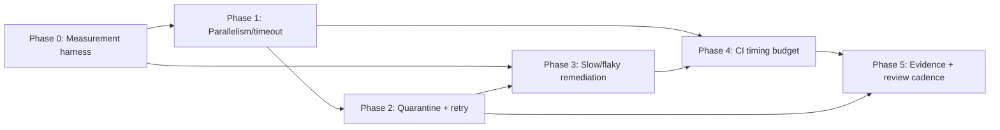

# Test Harness Stability And Flake Budget — Plan Pack

**Date:** 2026-07-07 (Asia/Manila)
**Plan folder:** `.ai/03_plans/2026-07-07-test-harness-stability-and-flake-budget`
**Plan profile:** `exhaustive` (cross-cutting test harness; launch-readiness adjacent)
**Plan status:** `CONDITIONALLY READY`
**Verification mode:** `emulated` (single planning agent; no native independent reviewer available this session). Emulated verification caps overall readiness at **97** and caps an exhaustive package at `CONDITIONALLY READY` until an independent reviewer or the owner accepts. **The cap is procedural, not a content gap** — every task has exact paths/symbols; all content gates pass. Lift to `IMPLEMENTATION-READY` by accepting the pack or running an independent review pass.
**Overall readiness:** 97 / 100 (emulated cap)

> **Planning only.** No application source, tests, migrations, configs, provider state, or Git state was modified. Only new files inside this folder.

---

## What this pack delivers

A planning contract so a future executor can stabilize the Archestimator test
harness — reduce slow/flaky behavior, define an explicit flake budget, and make
parallelism/quarantine/retry/CI-timing policy measurable — **before first-user
launch**, with clear before/after metrics and **no hidden coverage loss**.

Today the stability posture is implicit: one inline comment in
`vitest.config.ts:9-17` documents that `fileParallelism:false` is "load-bearing"
because a ~525s full run causes GC pressure that pushes individual tests past
15s (they pass in isolation). CI is **fully disabled** (empty
`.github/workflows/`; the pipeline lives in `.github/workflows-disabled/`).
There is no flake detector, no quarantine ledger, no measured flake rate, no
retry policy, and no CI timing budget. Removing coverage for speed is a real
risk the PROMPT explicitly forbids without replacement proof.

**In scope:** current test inventory · slowest/flakiest candidates · fixture
cleanup posture · parallelism strategy · quarantine policy · CI timing budgets ·
retry rules · evidence reporting · owner thresholds.

**Out of scope (de-conflicted):**
- E2E fixture factory, auth-setup, D1 seed, smoke-flow list, CI matrix,
  cross-browser exhaustiveness → `2026-07-07-e2e-fixture-smoke-harness`.
- Production bundle-size budgets, route-transition production latency budgets,
  authenticated Tier-B deep harness, hosted pre-release gate →
  `2026-07-07-bundle-and-route-performance-gate-hardening`.

---

## Implementation start document

**`11_IMPLEMENTATION_PLAN.md`** is the authoritative execution guide. Start there.

### Phase order (dependency-aware)

```
Phase 0 — Discovery & measurement harness (read-only; establishes baselines)
   │   flakewatch runner + timing JSON; N-run flake scan; per-file p95
   ▼
Phase 1 — Parallelism & timeout policy (critical path; vitest.config.ts)
   │   fileParallelism / pool / poolOptions / testTimeout tiers
   ▼
Phase 2 — Quarantine policy + retry rules (policy + tooling)
   │   quarantine ledger; flake-vs-feature-gate classification; retry table
   ▼
Phase 3 — Slowest/flakiest candidate remediation (per-file, incremental)
   │   heavy-waitFor suites; real-timer setTimeout waits; perf-suite isolation
   ▼
Phase 4 — CI timing budget + re-enablement posture (operations)
   │   job timing budget table; split-group strategy; owner thresholds
   ▼
Phase 5 — Evidence reporting + owner review cadence (closure)
       flakewatch report command; dashboard/runbook links
```

### Dependency graph



---

## The one-sentence summary

**Define the flake rate before fixing it.** Phase 0 establishes a measured
baseline (wall-clock, per-file p95, N-run flake rate) so every later phase can
prove a before/after improvement without guessing, and so removing a test for
speed always leaves a recorded replacement.

## Blocked decisions (owner-gated)

| Decision | Owner | Why external | Impact if deferred |
|---|---|---|---|
| Re-enable CI at all | Philip | CI is currently deliberately disabled; re-enabling is an operations decision with build-minute cost | Phase 4 timing-budget steps that edit `.github/workflows/` are blocked; measurement/baseline steps still proceed |
| Allow parallel execution of perf-suite vs keep serial | Philip | `fileParallelism:false` is documented load-bearing to protect perf-suite serial semantics; changing it alters what perf assertions mean | Phase 1 parallelism recommendation stays conservative (file-parallel within non-perf projects) until owner confirms |
| Max acceptable flake rate threshold | Philip | "flake budget" is a product/reliability call (how much nondeterminism is launch-acceptable) | Phase 2 defines a *recommended* default (≤2% file-level fail-rate over 10 runs) pending owner confirmation |
| Quarantine auto vs manual | Philip | auto-quarantine on N failures changes merge-time feedback; owner must opt in | Phase 2 prescribes *manual* quarantine by default with auto as an opt-in |

See `15` §blocked-decisions for options + recommendations.

---

## Commands / checks before the first edit

```bash
# 1. Confirm current stability posture unchanged since this plan was written.
sed -n '9,17p' vitest.config.ts          # expect fileParallelism:false, testTimeout:30_000
git status --short --branch              # fresh concurrency check

# 2. Establish the baseline this plan's Phase 0 will reproduce.
time bun run test:dom                    # full vitest run, ~525s baseline (vitest.config.ts:14)
bun run test                             # bun-test unit runner (tests/unit)
bun run test:e2e --list                  # playwright spec inventory (most skip without auth env)

# 3. Confirm CI posture.
ls -la .github/workflows/                # expect empty (disabled)
ls -la .github/workflows-disabled/       # expect ci.yml + codeql/dependabot/react-doctor
```

## Files explicitly off-limits to this plan's *planning* pass

- Any file outside `.ai/03_plans/2026-07-07-test-harness-stability-and-flake-budget/`.
- (Implementation-time edits to `vitest.config.ts`, `playwright.config.ts`,
  `package.json`, `.github/workflows/*`, and specific test files are *prescribed*
  by `11` but are not performed in this planning pass.)

## Files and systems intentionally unaffected

- Application source under `src/` (no behavior change).
- D1 migrations, R2 policies, Durable Objects, Queues, Email.
- The *content* of any test assertion (coverage is preserved; only execution
  posture, isolation, and timing are changed).

## External proof remaining before production rollout

None required for a planning deliverable. The *implementation* of this pack will
need: (a) local N-run flake evidence, (b) before/after wall-clock evidence, and
(c) hosted CI timing evidence once CI is re-enabled — all named in `11`/`12`.

## Archive policy

Do **not** auto-archive. Archive only after the owner confirms the implemented
flake budget is holding (Phase 5 owner-review milestone) and the quarantine
ledger shows a stable residual flake rate.

---

## Document index

| Doc | Purpose |
|---|---|
| `00_AGENT_COORDINATION.md` | Master goal, workstreams, ledger, boundary, skills, stale-revalidation |
| `01_EXECUTIVE_SUMMARY.md` | Findings, decisions, readiness at a glance |
| `02_FEATURE_BRIEF_AND_SCOPE.md` | Brief, scope, non-goals, success/failure metrics |
| `03_SOURCE_AND_CODEBASE_AUDIT.md` | Test inventory, configs, scripts, CI, candidate characterization |
| `04_REQUIREMENTS_SPECIFICATION.md` | FR/PERF/REL/OPS/TEST requirements with stable IDs + shadow paths |
| `05_UX_UI_ACCESSIBILITY_PLAN.md` | Developer-experience + accessibility posture of the harness |
| `06_ARCHITECTURE_AND_TECHNICAL_DESIGN.md` | Target harness architecture, parallelism, isolation model |
| `07_DATA_DATABASE_API_NETWORK_PLAN.md` | N/A handling + the small data contract (timing JSON, ledger) |
| `08_SECURITY_PRIVACY_THREAT_MODEL.md` | Harness trust boundaries (no auth/data risk; supply-chain notes) |
| `09_PERFORMANCE_RELIABILITY_OBSERVABILITY.md` | Flake budget, timing budgets, evaluator contract |
| `10_BLAST_RADIUS_AND_DEPENDENCIES.md` | Affected surfaces, sibling-pack boundary, compatibility |
| `11_IMPLEMENTATION_PLAN.md` | Authoritative phased execution guide with exact paths/symbols |
| `12_TEST_AND_VALIDATION_STRATEGY.md` | Test-execution matrix for the harness itself; proof commands |
| `13_ROLLOUT_ROLLBACK_AND_OPERATIONS.md` | CI re-enablement, timing budgets, rollback, runbook |
| `14_RISK_REGISTER.md` | Risks with severity, mitigation, contingency |
| `15_DECISIONS_ASSUMPTIONS_AND_ALTERNATIVES.md` | Load-bearing decisions, rejected alternatives, assumptions |
| `16_REQUIREMENTS_TRACEABILITY_MATRIX.md` | Requirement → task → evidence → rollout |
| `17_FINAL_READINESS_REVIEW.md` | Verifier matrix, scores, verification mode, residual gaps |
| `18_STACK_CONTRACT_AND_PRODUCTION_STANDARDS.md` | Cross-cutting stack standards for the harness |
| `19_RESEARCH_REVIEW_AND_QA_EVIDENCE.md` | Research, evidence appendix, adversarial QA, perf evaluator |
