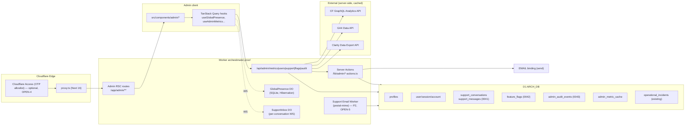

# 06 — Architecture and Technical Design

## 6.1 Current-state architecture (summary)

- Next.js 16 (App Router, flat routes, `proxy.ts` edge gate) on OpenNext +
  Cloudflare Workers (`archestimator-proof`).
- Better Auth (Google OAuth + magic link) → D1 (`ARCH_DB`); app role in
  `profiles.role`; identity in BA-generated `user`/`session`/`account`/`verification`.
- No `/admin` route; staff surfaces under `/workshop/settings/*` gated by
  `isPlatformAdminRole`.
- Analytics (Clarity/GA4/CF Web Analytics) injected on public pages only,
  consent-gated; client IDs in `NEXT_PUBLIC_*`.
- Realtime = per-project `CollaborationRoom` DO (SQLite, Ed25519 token auth).
- Observability = `logs/dev.ndjson` (local) + Cloudflare Workers Logs (prod).
- No metrics/stats aggregation module, no `/api/admin/*`, no support tables.

## 6.2 Target-state architecture

## 6.3 Component boundaries

- **Edge layer:** `proxy.ts` adds `/admin` to `PROTECTED_PREFIXES` and an
  admin-role short-circuit; optional Cloudflare Access JWT validation (FR-AUTH-03).
- **Route layer:** `src/app/admin/**` Server Components fetch via
  `src/lib/admin/*-repository.ts`; client islands in `src/components/admin/**`
  keep `"use client"` minimal.
- **Data layer:** `src/lib/admin/*-repository.ts` owns all D1 reads/writes for
  admin; reuses `getCloudflareD1Database()` and the `QueryResult<T>` idiom.
- **Realtime layer:** `GlobalPresence` DO + `SupportInbox` DO (new), routed in
  `worker.ts`, auth via the existing Ed25519 token pattern.
- **Integration layer:** `src/lib/admin/{cloudflare-analytics,ga4,clarity}-client.ts`
  — server-only, secret-gated, D1-cached.
- **Audit layer:** `src/lib/admin/audit.ts` `writeAdminAuditEvent()` called by
  every mutating action.

## 6.4 Data flow (key paths)

### Presence (live count)
1. Authenticated client opens WS to `/__cloudflare/global-presence` with an
   Ed25519 token (server-issued on session).
2. `GlobalPresence` DO `webSocketMessage(authorize, token)` validates; on
   success the socket is counted via `getWebSockets(tag=userId).length`.
3. DO broadcasts the new count to all admin listeners on change (debounced 1 s).
4. Optional: DO alarm writes a count data point to Analytics Engine every 60 s
   for the trend chart (within free 100K writes/day at solo-dev scale).

### Support reply
1. Admin composes reply → Server Action `sendSupportReply({conversationId, body, clientMessageId})`.
2. Action: admin authz → idempotency check `(conversation_id, client_message_id)`
   → insert `support_messages` row (`sender_role='admin'`) → send via `EMAIL`
   binding to the user's email → on success update `support_conversations.last_message_at`
   + `status='pending'`; on failure keep row flagged `send_failed`, surface error,
   preserve draft.
3. `SupportInbox` DO broadcasts the new message to any open admin/user threads.

### Metrics pull (CF Analytics)
1. `/api/admin/metrics/cloudflare` checks `admin_metric_cache` for fresh row
   (`expires_at > now`); if fresh, return cached payload.
2. If stale/missing: async refresh — call CF GraphQL Analytics API with scoped
   token, write `admin_metric_cache`, return cached-or-default. On failure →
   return `{ degraded: true }` and the UI shows the link-out tile.

## 6.5 State ownership

| State | Owner |
|---|---|
| Server data (users, metrics, flags, audit) | Server Component fetch + TanStack Query cache |
| Realtime presence | `GlobalPresence` DO (authority) + client mirror |
| Inbox thread | `SupportInbox` DO (authority) + TanStack Query cache |
| Admin UI nav/sidebar | Zustand `admin-ui-store.ts` (collapsed sidebar, active section) — mirrors `navigation-ui-store.ts` pattern |
| URL state | search params for pagination/filters (shareable, back/forward works) |

## 6.6 Reusable abstractions

- `requireAdminContext()` — `requireCurrentUserContext()` + admin check; throws
  `AuthorizationError` (reuse existing).
- `writeAdminAuditEvent()` — one-liner after mutations.
- `adminMetricCache` helper — `get/set/refresh` with TTL.
- `QueryResult<T>` — existing pagination shape.

## 6.7 Architectural alternatives considered

| Decision | Options | Chosen | Why rejected others |
|---|---|---|---|
| Admin home | (a) `/workshop/admin` (b) `/admin` (c) `/dashboard` | `/admin` | (a) couples to workshop shell + gating; (c) name collides with user dashboards elsewhere |
| Presence | (a) DO (b) D1 heartbeat (c) KV TTL (d) Analytics Engine only | (a) DO + optional (d) | (b) D1 write-per-heartbeat cost; (c) eventually-consistent/laggy; (d) alone has ingestion latency for "right now" |
| Charts | (a) recharts (b) Tremor (c) extend d3 | (a) | (b) heavier, opinionated dashboard kit; (c) too much bespoke work for an admin surface |
| Support | (a) D1+DO in-app chat (b) third-party widget (c) email-only | (a) + P2 email | (b) data ownership/brand; (c) not "chat inbox" per brief |
| Flags | (a) D1 (b) KV (c) LaunchDarkly | (a) | (b) eventual consistency (KV is cache-only per AGENTS); (c) overkill pre-revenue |

## 6.8 Failure boundaries

- External provider down → tile degrades to link (REL-DEGRADE-01).
- DO unreachable → presence shows last-known value; inbox falls back to poll.
- D1 read failure → section error state with retry; never blocks sibling sections.
- Email send failure → draft kept, error surfaced (REL-INBOX-02).
- WebSocket disconnect → client auto-reconnect with backoff; reconnect-safe
  (idempotent presence; message dedupe).

## 6.9 Next.js / React decisions

- Admin routes are `force-dynamic` (operator-only, always fresh).
- `"use client"` scoped to: presence hook, inbox thread+composer, flags toggle,
  charts wrappers. Everything else is Server Component.
- TanStack Query for client-side polling/invalidation; no mirror of server data
  into Zustand.
- Admin chunk isolated via `next/dynamic` so recharts never loads on non-admin
  routes (PERF-BUNDLE-01).
- URL search params own pagination/filter state (shareable; back/forward works).
- No Server Component calls an internal Route Handler for its own data — it
  calls the repository directly (repo anti-pattern to avoid).

## 6.10 Tailwind v4 / design-system

- Reuse tokens; no new tokens for MVP. Admin shell MAY adopt glass tokens
  (owner-deferred).
- `lint:design-system` must pass.
- `recharts` theming mapped to `--brand-*`/`--success/warning/danger` tokens.
