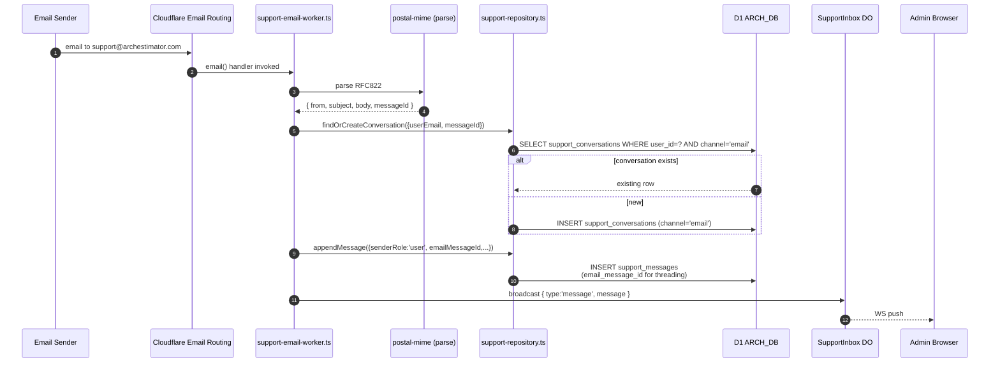
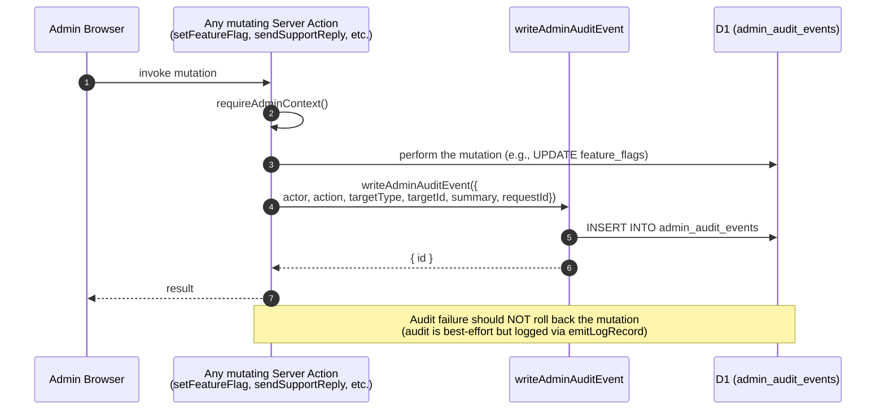
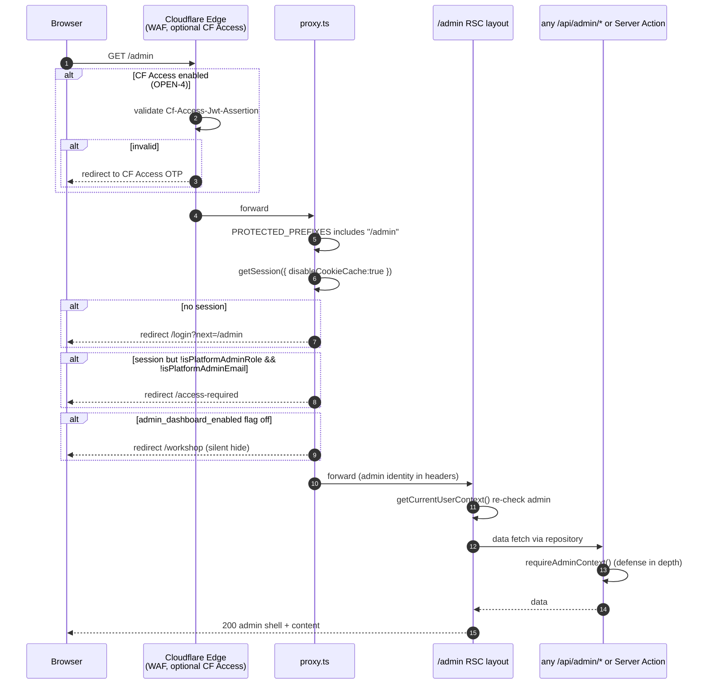
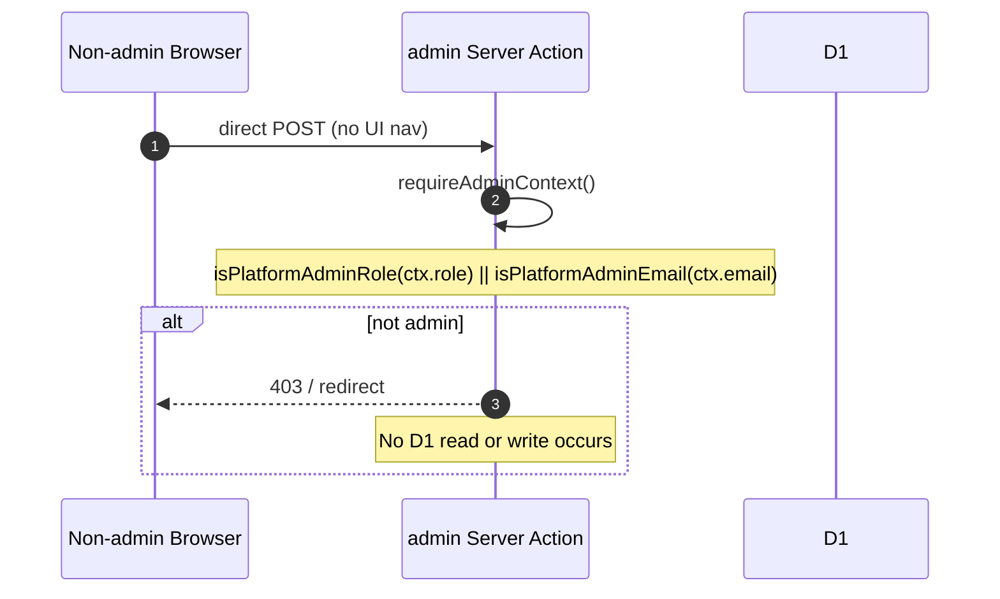
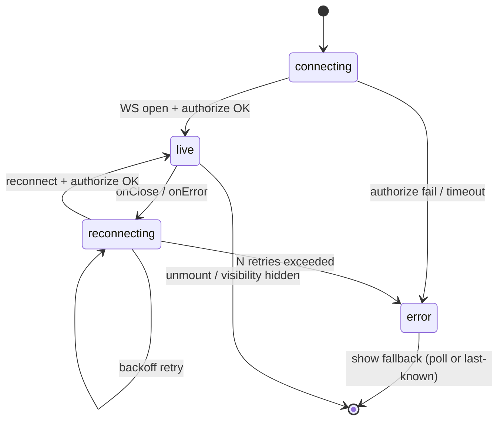
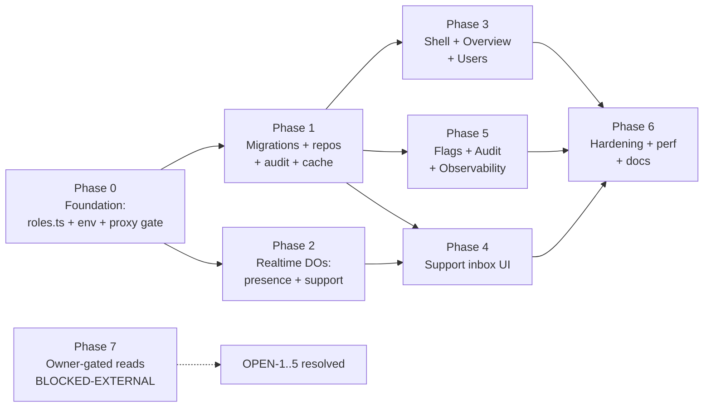

# 24 — Data Flow and Sequence Diagrams

**Created:** 2026-07-09 (Asia/Manila)
**Purpose:** Mermaid sequence diagrams for the realtime and mutation flows
that prose alone cannot disambiguate. Closes GAP-4 from `20`. Pairs with
`06` (architecture) and `23` (component APIs).

This is planning-only. Diagrams are executable-shape contracts; they do
not authorize implementation.

---

## 24.1 Diagrams included

1. Presence (live users-online count) — connect, count, broadcast, reconnect
2. Support reply — optimistic insert, email send, idempotency, audit
3. Support inbound message (in-app chat from user) — WS push
4. Metrics pull (CF Analytics) — cache-first with degrade
5. Audit write — every mutation writes one audit row
6. Feature flag toggle — optimistic update + audit + cache invalidate
7. Admin route access — layered gate (CF Access → proxy → RSC → action)
8. Email-to-ticket (Phase 2, OPEN-5) — Email Worker → conversation
9. WebSocket reconnection lifecycle
10. Idempotency dedupe (duplicate `client_message_id`)

---

## 24.2 Presence (live users-online count)

### Connect + count + broadcast

```mermaid
sequenceDiagram
    autonumber
    participant Browser as Admin Browser<br/>(useGlobalPresence hook)
    participant Worker as Worker<br/>(proxy.ts → route)
    participant PDO as GlobalPresence DO
    participant Admins as Other Admin Browsers

    Browser->>Worker: WS upgrade /__cloudflare/global-presence
    Worker->>Worker: issue Ed25519 token (server-side, in RSC)
    Browser->>PDO: { type:"authorize", token }
    PDO->>PDO: verify token; tag socket with userId
    PDO->>PDO: getWebSockets().length → N
    PDO-->>Browser: { type:"presence", count:N }
    PDO-->>Admins: { type:"presence", count:N } (debounced 1s)
    Note over PDO: Hibernation API keeps sockets alive across DO sleep
```

### Reconnect (network blip)

```mermaid
sequenceDiagram
    autonumber
    participant Browser as Admin Browser
    participant PDO as GlobalPresence DO

    Note over Browser: WS onClose fires
    Browser->>Browser: state = "reconnecting"; show amber subline
    Browser->>Browser: backoff 1s, 2s, 4s, 8s, max 30s
    Browser->>PDO: WS reconnect + authorize
    PDO-->>Browser: { type:"presence", count:N }
    Browser->>Browser: state = "live"; clear subline
    Note over PDO: Old socket auto-pruned by Hibernation API on next sweep
```

### Hibernation survival

```mermaid
sequenceDiagram
    autonumber
    participant Browser as Connected Browser
    participant PDO as GlobalPresence DO (hibernated)
    participant Runtime as Workers Runtime

    Note over PDO: DO hibernates when idle
    Browser->>PDO: send WS message
    Runtime->>PDO: wake DO; restore WebSocket set
    PDO->>PDO: handle message; getWebSockets() reflects restored set
    PDO-->>Browser: response / broadcast
    Note over PDO: Count survives hibernation per CF docs
```

---

## 24.3 Support reply (admin → user)

### Happy path

```mermaid
sequenceDiagram
    autonumber
    participant Admin as Admin Browser<br/>(AdminSupportComposer)
    participant Action as sendSupportReply<br/>Server Action
    participant Audit as writeAdminAuditEvent
    participant Repo as support-repository.ts
    participant D1 as D1 ARCH_DB
    participant Email as EMAIL binding
    participant SDO as SupportInbox DO
    participant User as User Browser<br/>(SupportChatWidget)

    Admin->>Admin: optimistic insert (status="pending",<br/>clientMessageId=crypto.randomUUID())
    Admin->>Action: sendSupportReply({conversationId, body, clientMessageId})
    Action->>Action: requireAdminContext()
    Action->>Repo: appendMessage({..., clientMessageId})
    Repo->>D1: INSERT ... UNIQUE(conv_id, client_msg_id)
    alt row inserted
        D1-->>Repo: success
        Repo-->>Action: { message, inserted:true }
        Action->>Email: send({ to:userEmail, body })
        alt email sent
            Email-->>Action: messageId
            Action->>D1: UPDATE support_messages SET send_status='sent'<br/>WHERE id=message.id
            Action->>D1: UPDATE support_conversations<br/>SET last_message_at=now(), status='pending'
            Action->>Audit: writeAdminAuditEvent({action:'support.reply',...})
            Action->>SDO: broadcast { type:'message', message }
            SDO-->>User: WS push new message
            SDO-->>Admin: WS push (echo back; reconciles optimistic)
            Action-->>Admin: { ok:true, message, conversation }
            Admin->>Admin: replace optimistic row with real
        else email failed
            Email-->>Action: error
            Action->>D1: UPDATE support_messages SET send_status='send_failed'
            Action-->>Admin: { ok:false, error:'email_send_failed', message }
            Admin->>Admin: keep row visible (red border + retry)<br/>preserve draft in textarea
        end
    else row already exists (duplicate click)
        D1-->>Repo: UNIQUE violation
        Repo-->>Action: { message:existingRow, inserted:false }
        Action-->>Admin: { ok:true, message:existingRow }<br/>(treat as success - idempotent)
    end
```

### Idempotency dedupe

```mermaid
sequenceDiagram
    autonumber
    participant Admin as Admin Browser
    participant Action as sendSupportReply
    participant D1 as D1

    Note over Admin: User double-clicks Send
    Admin->>Action: sendSupportReply({clientMessageId:"abc"})
    Admin->>Action: sendSupportReply({clientMessageId:"abc"})
    Action->>D1: INSERT (conv_id, "abc", ...)
    D1-->>Action: success
    Action->>D1: INSERT (conv_id, "abc", ...)
    D1-->>Action: UNIQUE violation
    Action->>Action: catch; fetch existing row by client_msg_id
    Action-->>Admin: { ok:true, message:existingRow } (no audit, no email)
```

---

## 24.4 Support inbound message (user → admin)

### In-app chat (Phase 1 path)

```mermaid
sequenceDiagram
    autonumber
    participant User as User Browser<br/>(SupportChatWidget)
    participant Action as userSendSupportMessage<br/>Server Action
    participant Repo as support-repository.ts
    participant D1 as D1 ARCH_DB
    participant SDO as SupportInbox DO
    participant Admin as Admin Browser<br/>(AdminSupportThread)

    User->>Action: userSendSupportMessage({conversationId, body})
    Action->>Action: requireCurrentUserContext()<br/>verify conversation ownership
    Action->>Repo: appendMessage({senderRole:'user', clientMessageId,...})
    Repo->>D1: INSERT INTO support_messages
    Repo->>D1: UPDATE support_conversations<br/>SET unread_for_admin = unread_for_admin + 1
    Action->>SDO: broadcast { type:'message', message }
    SDO-->>Admin: WS push new message
    Admin->>Admin: append to thread; aria-live announces<br/>"New message from {user}"
```

### Email-to-ticket (Phase 2, OPEN-5)



---

## 24.5 Metrics pull (CF Analytics)

### Cache-first with degrade

```mermaid
sequenceDiagram
    autonumber
    participant Admin as Admin Browser
    participant Route as /api/admin/metrics/cloudflare
    participant Cache as admin_metric_cache (D1)
    participant CFGQL as CF GraphQL Analytics API
    participant Audit as audit (no audit; read-only)

    Admin->>Route: GET /api/admin/metrics/cloudflare
    Route->>Route: requireAdminContext()
    Route->>Cache: SELECT payload_json WHERE key='cf_analytics_24h'<br/>AND expires_at > now
    alt cache fresh
        Cache-->>Route: payload
        Route-->>Admin: 200 { requests, errors, fetchedAt, degraded:false }
    else cache stale or missing
        Cache-->>Route: null or expired
        alt CF_ANALYTICS_API_TOKEN set
            Route->>CFGQL: POST GraphQL query<br/>(httpRequestsAdaptiveGroups)
            alt success
                CFGQL-->>Route: data
                Route->>Cache: UPSERT payload + expires_at=now+24h
                Route-->>Admin: 200 { ..., degraded:false }
            else token revoked / quota
                CFGQL-->>Route: 401/429
                Route-->>Admin: 200 { degraded:true }<br/>UI shows "View in Cloudflare →"
            end
        else token not set
            Route-->>Admin: 200 { degraded:true }
        end
    end
```

---

## 24.6 Audit write (every mutation)



---

## 24.7 Feature flag toggle

```mermaid
sequenceDiagram
    autonumber
    participant Admin as Admin Browser<br/>(AdminFlagsList)
    participant Action as setFeatureFlag
    participant Repo as feature-flags.ts
    participant D1 as D1
    participant Audit as writeAdminAuditEvent
    participant Cache as metric/flag cache

    Admin->>Admin: optimistic toggle (UI flips)
    Admin->>Action: setFeatureFlag({key, enabled})
    Action->>Action: requireAdminContext()
    Action->>Repo: setFeatureFlag({key, enabled, actor})
    Repo->>D1: UPDATE feature_flags SET enabled=?, updated_at=now(), updated_by=?
    Repo->>D1: SELECT * FROM feature_flags WHERE key=?
    D1-->>Repo: updated row
    Action->>Audit: writeAdminAuditEvent({action:'flag.update',<br/>  targetType:'feature_flag', targetId:key,<br/>  summary:{prev, new}})
    Action->>Cache: invalidate flag cache (if any)
    Action-->>Admin: { ok:true, flag }
    Admin->>Admin: confirm toggle; toast "Flag updated."
```

### Failure / revert

```mermaid
sequenceDiagram
    autonumber
    participant Admin as Admin Browser
    participant Action as setFeatureFlag

    Admin->>Admin: optimistic toggle
    Admin->>Action: setFeatureFlag(...)
    Action-->>Admin: { ok:false, error:'unauthorized' }
    Admin->>Admin: revert toggle; toast "Couldn't update flag. Reverted."
```

---

## 24.8 Admin route access (layered gate)

### Authenticated admin



### Direct POST bypass attempt



---

## 24.9 WebSocket reconnection lifecycle



---

## 24.10 Idempotency dedupe (deep dive)

```mermaid
flowchart TD
    Start([Client sends]) --> GenUUID[Generate clientMessageId<br/>crypto.randomUUID]
    GenUUID --> Optimistic[Optimistic UI insert<br/>status='pending']
    Optimistic --> Action[Call Server Action]
    Action --> IdemCheck{D1 UNIQUE check on<br/>(conv_id, client_msg_id)}
    IdemCheck -->|new row| Insert[INSERT message]
    Insert --> EmailSend[Try email send]
    EmailSend -->|success| StatusSent[UPDATE status='sent']
    EmailSend -->|fail| StatusFailed[UPDATE status='send_failed']
    StatusSent --> Audit[Write audit]
    StatusFailed --> KeepDraft[Keep draft; toast error]
    Audit --> Broadcast[Broadcast via DO]
    Broadcast --> Done([Done])
    IdemCheck -->|existing row| FetchExisting[Fetch existing]
    FetchExisting --> ReturnAs[Return as success<br/>no email, no audit]
    ReturnAs --> Done
```

---

## 24.11 Phase 0 → Phase 6 dependency flow



---

## 24.12 Reused building blocks (callouts)

These diagrams assume the following existing patterns (no rebuild):

- **Ed25519 token issuer** — `src/lib/collaboration/realtime-identity-server.ts`
  `issueRealtimeIdentityEnvelope`. Extended for `global-presence` topic and
  `support-inbox:<conversationId>` topic.
- **DO SQLite + Hibernation API** — `src/lib/cloudflare/collaboration-room.ts`
  pattern; new DOs (`GlobalPresence`, `SupportInbox`) follow the same shape.
- **DO router** — `src/lib/cloudflare/collaboration-room-router.ts` pattern;
  new routers (`global-presence-router.ts`, `support-inbox-router.ts`).
- **QueryResult<T>** — existing pagination shape from
  `src/lib/repositories/*-repository.ts`.
- **requireCurrentUserContext()** — `src/lib/auth/session.ts`; reused via
  `requireAdminContext()` wrapper.
- **emitLogRecord** — `src/lib/observability/logger.ts`; admin errors use
  `event: 'admin_*'`.
- **EMAIL binding** — existing `EMAIL` binding for outbound; Phase 2 adds
  Email Routing inbound.

---

## 24.13 What this doc does NOT specify

- Exact Ed25519 token claim schema (existing pattern; extend with topic).
- Internal DO state machine beyond the broadcast pattern (existing).
- Wire format beyond the JSON message shapes shown (see `23` for TS types).
- Network timeouts (see `07` §7.4).
- Error HTTP status codes (see `07` §7.3).

---

## 24.14 Confirmation

No application code, tests, migrations, schemas, `wrangler.jsonc`,
`package.json`, provider state, or runtime data were modified. All writes
are confined to `.ai/03_plans/2026-07-08/Admin-Dashboard-Planning/`.
