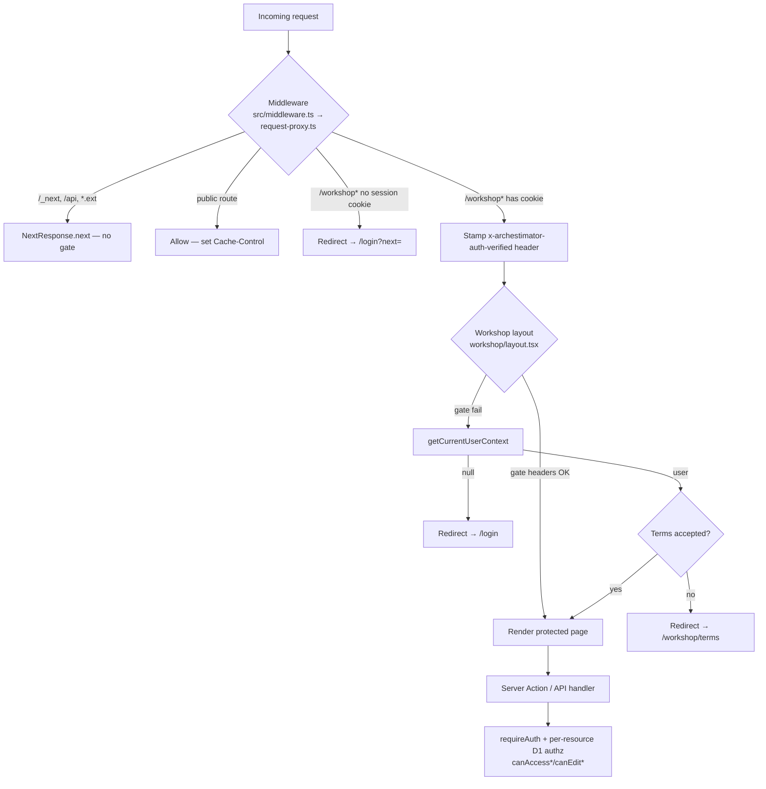

# 03 — Source and Codebase Audit

This document is the **evidence base** for the entire pack. Every finding here
was produced by parallel read-only exploration lanes (Lanes A–D) and, for the
load-bearing files, directly re-verified by the lead. File paths are
repo-relative; line numbers reflect the audited HEAD.

---

## A. The access-control model (current state)

Archestimator enforces auth through **four defense-in-depth layers**:



| Layer | File | What it checks | Bypass risk |
|---|---|---|---|
| 1. Middleware | `src/lib/auth/request-proxy.ts:157` | Cookie **presence** + path allowlist | Low — presence ≠ validity, but layer 2/3 catches it |
| 2. Workshop layout | `src/app/workshop/layout.tsx:18` | Header gate + live session + terms | None found |
| 3. Server Action/handler | `src/lib/auth/session.ts:100` (`requireAuth`) | Live Better Auth session via D1 | None found (see ⚠️ Gap B) |
| 4. Per-resource D1 authz | `src/lib/authz/d1-access.ts` | `canAccess*`/`canEdit*` RPC probes | See Gap D (8 repos unscoped) |

**Middleware matcher** (`request-proxy.ts:255`): `["/((?!_next/static|_next/image|favicon.ico).*)"]`
— every page route runs through `proxy()`. The `proxy()` body early-bails on
`/_next`, `/api`, and any path containing `.` (line 162–168), so static assets
and API routes are correctly excluded from the middleware gate. **API routes
must enforce their own auth** (they do — see section C).

**Public-route allowlist** (`request-proxy.ts:21–33`):
`/`, `/about`, `/features`, `/pricing`, `/contact`, `/privacy`, `/terms`,
`/trust`, `/signup`, `/invite`, `/share`, `/access-required`. Everything under
`/workshop` is protected. `/login` is the only auth route.

**Minor nit (Gap A):** `/new` and `/security` pages render `PublicPageShell` and
are intended public, but are not in the allowlist. They are NOT under `/workshop`
so they fall through to `return response` (line 251) and render publicly as
intended — **no auth bypass**, only a missing marketing-cache header. Cosmetic.

---

## B. Better Auth configuration (current state)

**Verified version: Better Auth 1.6.23** (`node_modules/better-auth/package.json`).

| Aspect | Value / File | Assessment |
|---|---|---|
| Auth providers enabled | **Google OAuth + magic link only** | ✅ Matches owner intent ("logging in with google auth and the magic link thing") |
| Password login | **Disabled** (no `emailAndPassword` plugin) | ✅ No `/api/auth/sign-in/email` possible |
| Session store | Cloudflare D1 (`ARCH_DB` binding) | ✅ |
| `BETTER_AUTH_SECRET` | Required, ≥32 chars enforced (`cloudflare-better-auth-runtime.ts:13`) | ✅ |
| Cookie cache | **Disabled** (`cookieCache.enabled:false` + `disableCookieCache:true` always) | ✅ Secure (always reads live session from D1) |
| Session cookie | `better-auth.session_token` / `__Secure-` variant; `httpOnly:true`, `sameSite:"lax"`, `secure:true` (prod), 7-day maxAge | ✅ Correct defaults |
| `trustedOrigins` | Dynamic per-request (baseURL + Host + env lists) | ✅ |
| Admin / org / 2FA plugins | **None registered** | Neutral (not required for closed beta) |
| Better Auth client (`createAuthClient`) | **None** — all flows via Server Actions + `auth.handler` | ✅ No client-side session exposure |
| `getSession` | `auth.api.getSession({ headers, query: { disableCookieCache: true } })` | ✅ Hardened |
| Closed-beta gate | `closed-beta-access.ts` → `closed_beta_allowed_emails` D1; enforced in `session.ts:64–72` → `/access-required` | ✅ Owner-curated |
| Dev auth bypass | `dev-auth-gate.ts` — triple-gated (non-prod + localhost + ≥32-char secret) | ✅ Safe |

**Config builder:** `src/lib/auth/better-auth-cloudflare.ts` (lazily built
per-request via `src/lib/auth/cloudflare-better-auth-runtime.ts`).

**Magic-link plugin — PRODUCTION** (`better-auth-cloudflare.ts:210–242`):
```ts
return magicLink({
  sendMagicLink: async ({ email, url }) => { /* sends via Cloudflare Email */ },
});
```
⚠️ **Only `sendMagicLink` is configured.** No `expiresIn`, no `rateLimit`, no
`storeToken`. Compare the **proof fixture** (`src/lib/cloudflare/better-auth-proof-router.ts:227–241`)
which sets `expiresIn:60`, `rateLimit:{window:60,max:10}`, and `storeToken:"plain"`.

**⚠️ P1:** Production lacks explicit magic-link `expiresIn` (falls back to
Better Auth default ~300s/5min — acceptable but not explicit) and `rateLimit`
(falls back to Better Auth global default — see Gap C).

---

## C. Server Actions + Route Handlers — auth coverage (current state)

**28 Server Action files** audited. **28 API route handlers** + **4 app routes** audited.

### Verdict summary

| Surface | Count | ✅ Checked | ⚠️ Partial | ❌ Missing |
|---|---|---|---|---|
| Server Actions | 28 | 27 | 1 (`loadRecipientProposals`) | 0 |
| API routes (`/api/*`) | 28 | 26 intentionally-bounded public + checked | 0 | 0 |
| App routes (`/auth`, `/invite`, `/workshop/pending-invite`) | 4 | 4 | 0 | 0 |

### ⚠️ Gap B — `loadRecipientProposals` action (P2, defense-in-depth)

`src/lib/recipient-proposals/actions.ts:8–10` — the action body calls
`listRecipientProposals()` with **no action-layer auth call**.
**Mitigation:** the repository `src/lib/repositories/recipient-proposals-repository.ts:88–91`
is fail-closed: `getCurrentUserContext()` → returns `{ok:false,error:"unauthorized"}`
if no user, and queries are scoped `WHERE lower(recipient.email) = ?`.
**Verdict:** NOT exploitable. But it is the **only** action in the codebase
without an action-layer auth call — a future refactor that swaps the repository
call could remove the safety net. **Fix:** add `await requireCurrentUserContext();`
at the action entry for parity.

### Intentionally-public surfaces (all properly bounded — NOT findings)

| Route | Why public is safe |
|---|---|
| `GET /api/health` | Returns only `{ok,service,timestamp}`; no DB, no sensitive data |
| `POST /api/internal/client-error` | Same-origin + sec-fetch + IP rate-limit (10/min) + 16KB cap; logs only |
| `POST /api/compliance/privacy-requests` | Dual rate-limit (5/hr IP, 3/hr email) + 16KB cap + opaque errors + metadata sanitization |
| `GET/POST /api/share/[token]/*` (route, password, comment, decision, session, activity, events, unsubscribe) | Token-resolved + password-cookie gated + recipient-session + `assertSameOriginPublicPost` (CSRF) + rate-limited + snapshot-conflict protection |
| `GET/POST /api/internal/*` (upload-scan, cleanup, runtime, *-proof) | `Bearer ${CRON_SECRET}` (503 if unset, 401 if mismatch); *-proof routes seed only synthetic fixtures |
| `GET /auth/callback` | **Deliberately disabled** — records `auth_callback_legacy_disabled` + redirects with error |
| `/invite/[token]/*` (page, accept, continue, sign-out) | Hashed token (`hashInviteToken`, sha256+pepper) + rate-limit + origin check + replay protection (`used_at` atomic guard) |

### Auth checks confirmed on all mutating/returning handlers

All `/api/projects/*`, `/api/component-library/*`, `/api/estimate-row-images`,
`/api/projects/[projectId]/estimates/*/export/*`, `/api/ai/*` routes call
`requireCurrentUserContext()` / `getCurrentUserContext()` + per-resource D1 authz
(`canAccessProjectInD1`, `canEditEstimateInD1`, `isWorkspaceEditorInD1`, etc.).
AI routes additionally reject dev-admin-DB bypass and require provider-backed auth mode.

### Service-role / admin paths

`createPublicationAdminClient` / `createPublicationAdminD1Client` is used ~14×
in `publication/actions.ts`. **Every call site is preceded by**
`requireCurrentUserContext()` + `assertProjectPublicationManager` (enforces
workspace/project manager rank ≥ admin, or `ceo`/`admin` platform role). No
ungated admin-client path found.

---

## D. Auth database schema + token storage (current state)

### D1 migrations (`./migrations/`, files 0001–0040)

App-owned auth-adjacent tables are properly defined in committed migrations:
`profiles` (0003), `closed_beta_allowed_emails` + audit (0001),
`account_security_events` (0004 + 0035 HMAC rebuild), `legal_terms_acceptances`
(0002), `user_onboarding_profiles`/`workspace_account_settings` (0005),
`ai_audit_*`/`security_rate_limit_events` (0006), `workspaces`/`projects`/
`estimates`/`*_members`/`collaboration_invitations`/`collaboration_invitation_tokens`
(0007), `workspace_members`/`project_favorites` (0013), `project_publications`/
`shared_link_*`/`publication_digest_log` (0014), `privacy_requests` (0033),
`data_retention_events` (0034+0040), `operational_incidents` (0040).

### 🔴 Gap C (P0) — Better Auth core tables NOT in migration pipeline + magic-link tokens stored PLAINTEXT

**Two related critical findings:**

1. The four Better Auth core tables (`user`, `session`, `account`,
   `verification`) are **never created by any `.sql` file in `./migrations/`**.
   They are generated at runtime by `compileCloudflareBetterAuthD1Migrations()`
   (`better-auth-cloudflare.ts:254–258`) and applied out-of-band. The compiled DDL
   is recorded only as evidence in
   `.ai/03_plans/2026-06-29-Cloudflare-Migration-Codex/evidence/2026-06-30-cloudflare-better-auth-d1-schema.sql`.
   **Risk:** schema drift between the migration pipeline and the auth schema is
   invisible to normal `wrangler d1 migrations` tooling. Operational integrity
   concern.

2. **Magic-link verification tokens are stored in PLAINTEXT in the D1
   `verification` table.** Better Auth's magic-link plugin defaults to
   `storeToken: "plain"` (`node_modules/better-auth/dist/plugins/magic-link/index.mjs:25–35`):
   a 32-char random token is stored verbatim as `verification.identifier` (with
   `value` = JSON `{email,name}`, `expiresAt` = now + 300s), and the raw token
   is placed in the email URL. The app's production config
   (`better-auth-cloudflare.ts:218`) passes only `sendMagicLink` — so plaintext
   storage is active.

   **Impact:** anyone with read access to the D1 `verification` table (DB dump,
   backup leak, support access, a future read primitive) can mint valid
   magic-link sessions for any email within the 5-minute expiry window. This is
   a **stark inconsistency** with the rest of the codebase, where invite tokens,
   publication tokens, and publication passwords are all hashed (see below).

   **Contrast (good):** OAuth state tokens (also in `verification`) ARE hashed
   by Better Auth core via `defaultKeyHasher`. Only the magic-link path is plaintext.

   **Fix:** pass `storeToken: "hashed"` to `magicLink()` at
   `better-auth-cloudflare.ts:218`. Better Auth's `storeToken` function then
   calls `defaultKeyHasher(token)` before storing and `consumeVerificationValue`
   compares the hash. One-line config change; Better Auth handles the verify path.

### App-level credentials — all properly hashed (NOT findings)

| Material | Storage | Algorithm | File |
|---|---|---|---|
| Invite tokens | `collaboration_invitation_tokens.token_hash` | sha256("v1:"+pepper+":"+token), pepper 64-hex | `collaboration/invite-entry.ts:54–64` |
| Publication share tokens | `project_publications.token_hash` | HMAC-SHA256 (`hmac-sha256-v1`) | `publication/security.ts:78–98` |
| Publication encrypted tokens | `project_publications.encrypted_token` | AES-256-GCM (`aes-256-gcm-v1`) | `publication/security.ts` |
| Publication passwords | `project_publications.password_hash` | scrypt (`scrypt-sha256-v1`) + `timingSafeEqual` | `publication/security.ts:142–166` |
| Recipient tokens | `shared_link_recipients.recipient_token_hash` | hash, unique | `0014:65` |
| Account audit IP/UA | `account_security_events` | `hmac-sha256:` keyed digests | `auth/account-audit.ts:48` |

### Gap D (P1) — 8 repositories lack internal access checks (defense-in-depth gap)

Centralized access layer exists: `src/lib/authz/d1-access.ts` exposes
`canAccessProjectInD1`, `canEditProjectInD1`, `canAccessEstimateInD1`,
`canEditEstimateInD1`, `isWorkspaceMemberInD1`, `isWorkspaceEditorInD1`.
**But** 8 of 13 repository files have **no internal access check**:

- `estimate-repository.ts`, `estimate-schema-compat.ts`,
  `project-activity-repository.ts`, `project-charts-repository.ts`,
  `project-data-repository.ts`, `project-estimate-sheets-repository.ts`,
  `project-location-repository.ts`, `recipient-proposals-repository.ts`

These rely entirely on **callers** (route/page server components, actions) having
run `requireCurrentUserContext()` + a `canAccess*` probe. The pattern is
inconsistent — `workspace-repository.ts` DOES check internally (lines 2646–2680,
3624–3682). A future caller that forgets the gate would get unscoped data.
**Defense-in-depth is missing** because D1 has no actual RLS (unlike the legacy
Supabase stack). `recipient-proposals-repository.ts` is fail-closed internally
(see Gap B mitigation) but the data-repository pattern should be uniform.

### SQL injection — NOT a finding

All 108 `.prepare()` call sites use `?` placeholders + `.bind()`. The only
dynamic SQL is in two query builders, both guarded:
- `publication/admin-d1-client.ts:81–89` — `assertKnownTable` (15-table allowlist) + `assertSafeIdentifier` (`/^[A-Za-z_][A-Za-z0-9_]*$/`).
- `estimates/d1-action-client.ts:626–654` — `mapColumn` fixed allowlist map.
Dynamic `IN (${placeholders})` clauses generate `?,?,?` from array lengths; values bound, not interpolated. **Safe.**

---

## E. Token / credential replay protection (current state)

| Flow | Replay protection |
|---|---|
| Magic link | `allowedAttempts:1` hardcoded → atomic one-shot consume; row deleted on use. ⚠️ But plaintext-stored (P0 above). |
| OAuth state | Hashed in `verification`; Better Auth validates + deletes. OAuth callback cookie-normalized for Cloudflare ordering quirk (`route.ts:65–71`). State-mismatch → `Clear-Site-Data` + cookie zeroing (`request-proxy.ts:131–155`). |
| Invite tokens | `used_at` atomic guard (`COALESCE(used_at,?)` + `used_at IS NULL`); `revoked_at`; `expires_at`. Replay → `already_member`/`already_used`/`collaboration_invite_replay_blocked` audit. |
| Shared-link recipient tokens | Bound to publication; recipient-session cookie verified against current DB snapshot (not cookie-derived). |
| AI package-builder draft tokens | `verifyPackageDraftToken` binds draft+hash+userContext; Apply requires feature flags + draftHash match + explicit confirmation. |

---

## F. CSP / security headers (current state)

Defined in `next.config.ts:154–288`. **All CSP is Report-Only** except `/share/:path*`
(enforced, line 191). `landingReportOnlyCsp` and `workshopReportOnlyCsp` still
allow `'unsafe-inline'` + `'unsafe-eval'` in `script-src` (deferred nonce work,
lines 177–179, 230–236). Global catch-all: `X-Content-Type-Options:nosniff`,
`X-Frame-Options:DENY`, `Referrer-Policy:no-referrer`, HSTS. Middleware sets
**no CSP itself** — only `Cache-Control` and OAuth `Clear-Site-Data`.

**Gap E (P2):** CSP is Report-Only on landing + workshop. Not an auth bypass, but
weakens XSS defense-in-depth. Migration to enforced CSP requires nonce/allowlist
reconciliation (phase 4).

---

## G. Attack-vector coverage matrix (audit conclusion)

| Attack vector | Status | Evidence |
|---|---|---|
| Direct nav to `/workshop` unauthenticated | ✅ Blocked | Middleware redirects; layout re-checks |
| Direct POST to a Server Action unauthenticated | ✅ Blocked | `requireAuth`/`requireCurrentUserContext` in 27/28; 1 mitigated by repo |
| Direct call to `/api/*` data handler unauthenticated | ✅ Blocked | All checked or bounded-public |
| Cookie tampering / forgery | ✅ Blocked | Cookie-cache disabled; `getSession` validates against D1; httpOnly+secure+sameSite |
| Session fixation | ✅ Mitigated | Better Auth issues new session on auth; cookies cleared on sign-out + state-mismatch |
| Magic-link token theft from DB | 🔴 **OPEN (P0)** | Plaintext `verification.identifier` |
| Magic-link brute force | ⚠️ Partial | `allowedAttempts:1` + 32-char token is strong, but no explicit per-email rate limit on production magic-link |
| OAuth state fixation/replay | ✅ Mitigated | Hashed state + mismatch cleanup |
| CSRF on Server Actions | ✅ Mitigated | Next.js 16 built-in origin check |
| CSRF on public POST routes | ✅ Mitigated | `assertSameOriginPublicPost` + unsubscribe double-submit |
| Open redirect via `next` param | ✅ Mitigated | `sanitizeNextPath` (`redirects.ts`) |
| Privilege escalation (cross-workspace) | ✅ Blocked | `canAccess*`/`canEdit*` D1 probes; service-role always preceded by RBAC |
| IDOR on protected resources | ✅ Blocked | Per-resource D1 authz |
| SQL injection | ✅ Not present | Parameterized queries throughout |
| XSS via rendered content | ⚠️ Partial | CSP Report-Only; magic-link email HTML escaped |
| Dev-auth bypass in production | ✅ Safe | Triple-gated (non-prod + localhost + secret) |
| Internal/proof routes | ✅ Safe | `CRON_SECRET` bearer, fail-closed |
| Legacy `/auth/callback` | ✅ Safe | Deliberately disabled |
| Beta-allowlist bypass | ✅ Mitigated | D1 allowlist enforced in session resolution |
| Repository unscoped reads (future regression) | ⚠️ Open (P1) | 8 repos lack internal authz |

> **V2 additions to this matrix** (from `20_INDUSTRY_STANDARD_FACETS_ANALYSIS.md`):
> Session-token theft from DB (SEC-11 — 🔴 new P1), magic-link token in logs (SEC-12),
> `BETTER_AUTH_SECRET` overload (SEC-13), account-merge ATO (SEC-14). See full
> mapping in `20` and attacker chains in `22`.

**Bottom line (v2 honesty-corrected):** No current **auth-method bypass** exists
(Google+magic-link exclusivity holds; all surfaces enforce auth). **However, two
verifier-compromise hardening items** — magic-link token plaintext (SEC-1/F-1) and
session token plaintext (SEC-11/F-7) — mean a D1 read-exposure could mint
sessions. These are hardening items, not active bypasses, but the v1 framing
("no current exploitable bypass") understated them. The work is **hardening**:
close SEC-1 (P0) and SEC-11 (P1), add defense-in-depth to the 8 unscoped repos
and the 1 action lacking action-layer auth, resolve the RFU-gated items (SEC-5/12/13/14),
and move toward enforced CSP.
