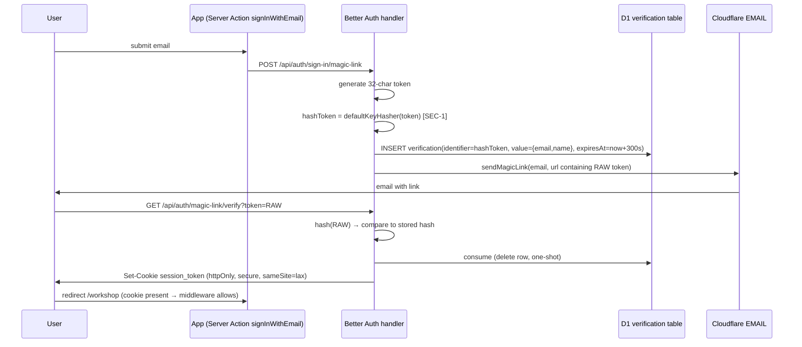
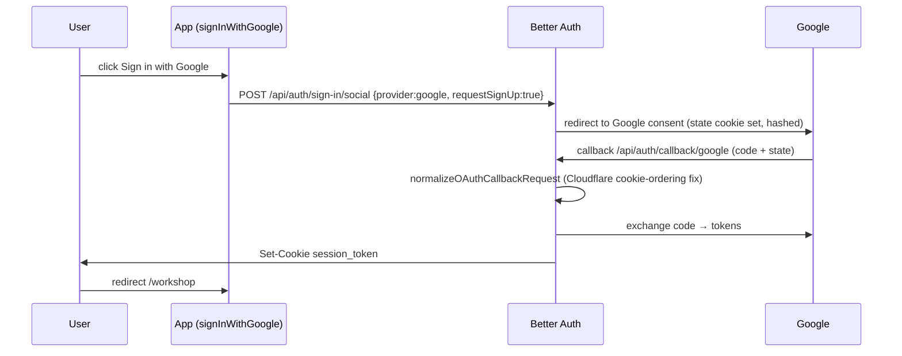

# 06 — Architecture and Technical Design

## Current-state architecture (verified)

```mermaid
flowchart TB
    subgraph Edge[Cloudflare Worker - archestimator-proof]
        MW[Next.js Middleware<br/>src/middleware.ts → request-proxy.ts<br/>matcher: all except _next/static, _next/image, favicon]
    end
    subgraph App[Next.js App - OpenNext]
        SC[Server Components<br/>workshop/layout.tsx gate]
        SA[Server Actions<br/>28 files - requireAuth]
        RH[Route Handlers<br/>/api/auth/[...all], /api/projects/*, etc.]
        AUTHZ[authz layer<br/>d1-access.ts canAccess/canEdit]
    end
    subgraph Data[Cloudflare Bindings]
        D1[(D1 ARCH_DB<br/>user/session/account/verification<br/>+ app tables)]
        R2[(R2)]
        EMAIL[EMAIL binding<br/>send_email]
    end
    BA[Better Auth 1.6.23<br/>better-auth-cloudflare.ts<br/>Google + magicLink plugins]
    MW --> SC
    MW --> RH
    SC --> SA
    SA --> AUTHZ
    RH --> AUTHZ
    AUTHZ --> D1
    SA --> BA
    RH --> BA
    BA --> D1
    BA --> EMAIL
```

## Four-layer gate (current — sound)

| Layer | Component | Check |
|---|---|---|
| 1 | Middleware (`request-proxy.ts`) | Cookie **presence** + public-allowlist path match |
| 2 | Workshop layout (`workshop/layout.tsx`) | Header gate + live session (getCurrentUserContext) + terms acceptance |
| 3 | Server Action / Route Handler | `requireAuth` / `requireCurrentUserContext` (live Better Auth session) |
| 4 | Per-resource D1 authz | `canAccessProjectInD1` / `canEditEstimateInD1` / `isWorkspaceEditorInD1` |

This layered model is **retained unchanged**. The plan only hardens layers 3 and 4
(SEC-3/SEC-4) and the credential-storage confidentiality (SEC-1).

## Target-state architecture (post-plan)

Same four-layer model, with:
- **SEC-1:** Magic-link tokens hashed at rest (D1 `verification.identifier` stores a hash).
- **SEC-3:** All repositories are fail-closed (layer 4 enforced at the data-access boundary too).
- **SEC-4:** `loadRecipientProposals` has action-layer auth (layer 3 uniform).
- **SEC-5:** Explicit rate limits on auth endpoints (abuse defense).
- **SEC-6:** Enforced CSP (XSS defense-in-depth).
- **SEC-7:** Documented contract for BA core schema (operational integrity).

## Auth flow (magic link — target state)



## Auth flow (Google OAuth — unchanged)



## Component boundaries (unchanged by plan)

- **No new `"use client"` boundaries.** Auth is server-driven.
- **No Better Auth client.** Session never read on client.
- **Data access via repositories** (SEC-3 hardens their authz).
- **State:** session is D1-backed; no Zustand/TanStack change.

## Shared contracts (unchanged)

- `requireCurrentUserContext()` / `requireAuth()` — canonical session helper (`session.ts:100`).
- `canAccess*` / `canEdit*` — D1 authz probes (`authz/d1-access.ts`).
- `assertProjectPublicationManager` — service-role gate.
- `assertSameOriginPublicPost` — public POST CSRF guard.

## Architectural alternatives (rejected)

| Alternative | Rejected because |
|---|---|
| Move authz into D1 (stored procedures / views) | D1/SQLite has no RLS; app-layer is the correct boundary |
| Add a separate API gateway for auth | Over-architected; middleware + handler auth is sufficient |
| Session in JWT (stateless) | Better Auth's D1-validated session is more secure (revocation = row delete); cookie-cache-disabled ensures freshness |
| Client-side session (Better Auth client) | Exposes session to client; current Server-Action model is more secure |
