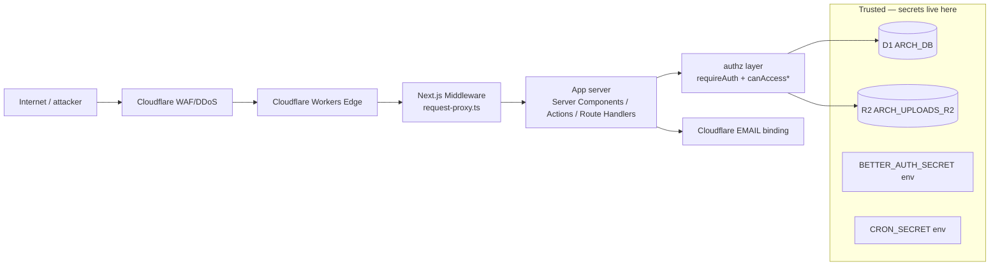

# 08 — Security, Privacy, and Threat Model

## Trust boundaries

| Boundary | Crossed by | Control |
|---|---|---|
| Internet → Worker | HTTP request | Cloudflare WAF/DDoS, TLS, security headers |
| Worker → App | Forwarded headers | Middleware stamps `x-archestimator-auth-verified` (presence-only; NOT a trust grant on its own) |
| App → Data | DB query | `requireAuth` + `canAccess*`/`canEdit*` D1 probes |
| App → Email | `EMAIL.send()` | Gated by `ARCHESTIMATOR_EMAIL_DELIVERY_ENABLED` + provider check |

## Actors

| Actor | Capabilities | Goal |
|---|---|---|
| Anonymous visitor | Reach public pages; submit magic-link request; access share/invite via token | Must NOT reach any protected surface |
| Authenticated user (closed-beta) | Reach `/workshop`; mutate own workspace data | Must NOT access other workspaces' data |
| Platform admin (`ceo`/`admin` role) | Beta allowlist mgmt; scan overrides; digest review | Elevated; every admin action still audited |
| Service/cron (CRON_SECRET bearer) | Internal job routes (upload-scan/cleanup/runtime/proof) | Bearer-gated, fail-closed |
| DB-read attacker (threat model for P0) | Has read access to D1 dump/backup | Must NOT be able to mint sessions (P0 closes this) |

## Threat catalog (STRIDE + the owner's "all attack vectors" ask)

| T-ID | Threat | Vector | Current control | Gap | Req |
|---|---|---|---|---|---|
| T-1 | **Spoofing** via stolen magic-link token | DB read of `verification.identifier` (plaintext) | `allowedAttempts:1`, 5-min expiry, 32-char | 🔴 Plaintext at rest → session minting | SEC-1 |
| T-2 | **Spoofing** via forged/tampered session cookie | Cookie tampering | Cookie-cache disabled; getSession validates vs D1; httpOnly+secure | ✅ None | — |
| T-3 | **Spoofing** via session fixation | Reusing session id across auth | Better Auth issues fresh session on auth | ✅ None | — |
| T-4 | **Spoofing** via dev-auth bypass in prod | Header/cookie secret | Triple-gated (non-prod+localhost+secret) | ✅ None | — |
| T-5 | **Tampering** via direct Server Action POST (bypassing UI) | Direct POST to `"use server"` endpoint | `requireAuth`/`requireCurrentUserContext` in 27/28; 1 mitigated | ⚠️ Gap B | SEC-4 |
| T-6 | **Tampering** via direct API call | Direct fetch to `/api/*` | `requireCurrentUserContext` + `canAccess*` | ✅ None | — |
| T-7 | **Repudiation** — actions without audit | Mutation without log | `account_security_events`, `collaboration_audit_events`, `security_rate_limit_events` | ✅ Largely covered | — |
| T-8 | **Information disclosure** via cross-workspace read | IDOR on resource ID | `canAccessProjectInD1`/`canEditEstimateInD1` probes | ✅ None (caller-side) | — |
| T-9 | **Information disclosure** via unscoped repository (future regression) | Caller forgets gate | 8 repos trust caller | ⚠️ Gap D | SEC-3 |
| T-10 | **Information disclosure** via magic-link token leak | Token in URL (logs, referer, history) | 5-min expiry, one-shot | ⚠️ Inherent to magic-link design; mitigated by short expiry + SEC-5 rate limit | SEC-5 |
| T-11 | **DoS/abuse** via magic-link flooding | Repeated requests | `allowedAttempts:1`; ⚠️ no explicit prod rate limit | ⚠️ Gap C | SEC-5 |
| T-12 | **DoS/abuse** via OAuth spam | Repeated social sign-in | Better Auth default | ⚠️ Gap C | SEC-5 |
| T-13 | **Elevation of privilege** via service-role admin client | Ungated admin call | Every call site preceded by `assertProjectPublicationManager` | ✅ None | — |
| T-14 | **Elevation of privilege** via internal route | Direct call to `/api/internal/*` | `CRON_SECRET` bearer, fail-closed (503/401) | ✅ None | — |
| T-15 | **CSRF** on Server Actions | Cross-site POST | Next.js 16 origin check | ✅ None | — |
| T-16 | **CSRF** on public POST (share/invite) | Cross-site POST | `assertSameOriginPublicPost` + double-submit | ✅ None | — |
| T-17 | **Open redirect** via `?next=` | Malicious next param | `sanitizeNextPath` | ✅ None | — |
| T-18 | **XSS** via rendered user content | Script injection | CSP Report-Only; HTML-escape on magic-link email | ⚠️ Report-Only only | SEC-6 |
| T-19 | **SQL injection** | Malicious input in query | Parameterized queries throughout | ✅ None | — |
| T-20 | **OAuth state replay/fixation** | Stolen state | Hashed state + mismatch cleanup | ✅ None | — |
| T-21 | **Invite/publication token replay** | Reuse consumed token | Hashed+pepper, atomic `used_at`/`revoked_at` | ✅ None | — |
| T-22 | **Legacy `/auth/callback` abuse** | Old OAuth code exchange | Deliberately disabled + audit event | ✅ None | — |
| T-23 | **Beta-allowlist bypass** | Unauthorized email | D1 allowlist enforced in session resolution | ✅ None | — |
| T-24 | **Schema drift** on auth tables | Runtime-applied BA schema diverges | Out-of-band apply, not in migration pipeline | ⚠️ Gap F-6 | SEC-7 |
| **T-25** | **Spoofing via stolen session token from DB** | DB read of `session.token` (raw `generateId(32)`) | `getSession` compares cookie↔D1; httpOnly cookie | 🔴 **SEC-11** — verifier-held secret not hashed | SEC-11 |
| T-26 | **Abuse/confusion** via `BETTER_AUTH_SECRET` overload | Secret used for session + terms + publication cookies | None (shared secret) | ⚠️ SEC-13 | SEC-13 |
| T-27 | **Elevation/ATO** via account merge | Magic-link + Google same email auto-merge | Closed-beta curation | ⚠️ SEC-14 (RFU-2) | SEC-14 |
| T-28 | **Information disclosure** via magic-link token in logs | Workers Logs retains `?token=` (CWE-532) | 5-min TTL | ⚠️ SEC-12 (RFU-4) | SEC-12 |
| T-29 | **DoS** via magic-link email bombing | Flood victim inbox + exhaust Email quota | `allowedAttempts:1` doesn't help per-request | ⚠️ SEC-5 | SEC-5 |
| T-30 | **Information disclosure** via email enumeration | Auth response leaks email existence | `?sent=1` uniform | ✅ **CONTROL** (CWE-204) | — (document) |
| T-31 | **Open redirect** via `?next=`/callbackURL | Phishing via malicious redirect | `sanitizeNextPath` + BA `originCheck` | ✅ **CONTROL** (CWE-601) | — (document) |

> **V2 additions (T-25–T-31):** T-25 (SEC-11) is the second verifier-compromise vector (the first is T-1/SEC-1 magic-link). T-30/T-31 are documented as **strong controls** that v1 didn't credit explicitly. See `22_ATTACKER_PLAYBOOK.md` for full chains.

## Privacy considerations

- **Data minimization:** Magic-link token stores `{email,name}` in `verification.value`
  (JSON). After SEC-1 hashes `identifier`, the token is protected but `value` still
  contains the email — acceptable (email is the identifier, not a secret), but the
  row is deleted on consume (one-shot). No retention concern.
- **Account audit hashing:** IP/user-agent stored as `hmac-sha256:` keyed digests
  (`account-audit.ts:48`), not raw. ✅
- **Client-error intake:** Sanitizes `token|secret|password|cookie|authorization`
  keys before logging. ✅
- **Privacy requests:** `/api/compliance/privacy-requests` writes to a dedicated
  intake table; opaque errors; rate-limited. ✅
- **Session token in D1:** `session.token` is stored — this is necessary for
  validation. It's a random 32-char token; revocation = sign-out (row deleted).
  Not separately hashed in D1, but access is server-only and the token is also
  required as the cookie. Acceptable.

## Abuse-resistance summary

| Surface | Rate limit | Body cap | Notes |
|---|---|---|---|
| Magic-link request | ⚠️ Better Auth default only (SEC-5 adds explicit) | n/a | SEC-5 |
| Client-error intake | 10/min per IP | 16KB | ✅ |
| Privacy requests | 5/hr per IP + 3/hr per email | 16KB | ✅ |
| Share password attempts | Exponential backoff + rate limit | n/a | ✅ |
| Share comment/decision | Rate limit + circuit breaker | n/a | ✅ |
| Invite accept | `checkInviteAcceptRateLimit` | n/a | ✅ |
| Estimate actions | `assertEstimateActionRateLimit` | n/a | ✅ |
| Uploads | Per-session capacity caps | n/a | ✅ |
| AI ask | `checkAiAskQuota` (429) | n/a | ✅ |

## Security testing requirements

- **Denial tests:** Phase 5 harness must prove every protected surface rejects
  unauthenticated requests (redirect/401/403).
- **Role-matrix tests:** Cross-workspace access denied; admin actions audited.
- **Cookie-attribute tests:** httpOnly/secure/sameSite verified.
- **Token-confidentiality test (SEC-1):** Hosted D1 readback shows hashed
  `verification.identifier`.
- **Rate-limit tests:** SEC-5 limits enforced.
