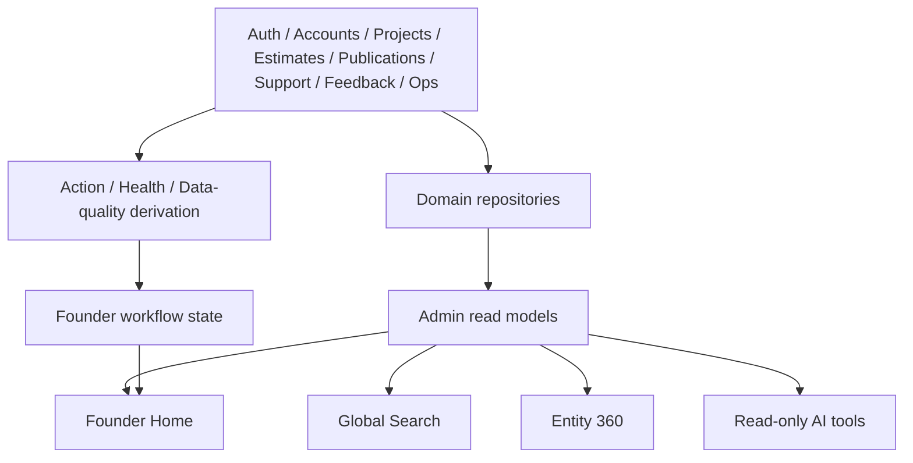

# 12 — Data Model, API, Security, and Architecture

## 1. Architectural principles

1. Existing domains remain canonical.
2. Admin aggregates reads and founder workflow state.
3. One domain mutation has one owner.
4. New tables store founder-specific state or durable cross-domain records.
5. Provider data is cached/snapshotted and labeled.
6. Admin routes remain server-first and no-store/private.
7. Every action reauthorizes.
8. Add schema only when a product slice needs it.

## 2. Read architecture



## 3. Admin read models

Suggested modules:

```text
src/lib/admin/
  founder-home-repository.ts
  action-items/
  search/
  customer-health/
  entity-360/
  releases/
  data-quality/
  cost-capacity/
  founder-notes/
  weekly-review/
```

Do not grow one giant `admin-repository.ts`.

## 4. Founder Home DTO

```ts
type FounderHomeSnapshot = {
  asOf: string;
  checkpoint: {
    lastReviewedAt: string | null;
    changesSince: FounderChangeSummary;
  };
  urgentActions: AdminActionItemSummary[];
  customerAttention: AdminActionItemSummary[];
  release: AdminReleaseSummary | null;
  systemHealth: AdminSystemHealthSummary;
  dataQuality: AdminDataQualitySummary;
  growth: AdminGrowthPulse;
  upcomingFollowUps: AdminFollowUpSummary[];
  recentChanges: AdminRecentChange[];
  degradedSources: AdminDegradedSource[];
};
```

Each section has independent error/freshness metadata where practical.

## 5. Additive schema proposals

### `admin_operator_preferences`

```sql
user_id TEXT PRIMARY KEY
timezone TEXT NOT NULL
density TEXT NOT NULL
home_layout_json TEXT NOT NULL
last_home_reviewed_at TEXT
last_weekly_reviewed_at TEXT
created_at TEXT NOT NULL
updated_at TEXT NOT NULL
```

### `admin_pins`

```sql
id TEXT PRIMARY KEY
user_id TEXT NOT NULL
entity_type TEXT NOT NULL
entity_id TEXT NOT NULL
label_snapshot TEXT NOT NULL
position INTEGER NOT NULL
created_at TEXT NOT NULL
UNIQUE(user_id, entity_type, entity_id)
```

### `admin_saved_views`

```sql
id TEXT PRIMARY KEY
user_id TEXT NOT NULL
view_type TEXT NOT NULL
name TEXT NOT NULL
filters_json TEXT NOT NULL
sort_json TEXT NOT NULL
created_at TEXT NOT NULL
updated_at TEXT NOT NULL
```

Validated filter schema only.

### `admin_founder_notes`

```sql
id TEXT PRIMARY KEY
created_by TEXT NOT NULL
body TEXT NOT NULL
state TEXT NOT NULL
follow_up_at TEXT
completed_at TEXT
created_at TEXT NOT NULL
updated_at TEXT NOT NULL
```

### `admin_founder_note_entities`

```sql
note_id TEXT NOT NULL
entity_type TEXT NOT NULL
entity_id TEXT NOT NULL
PRIMARY KEY(note_id, entity_type, entity_id)
```

### `admin_action_item_state`

Stores founder-specific state for derived items:

```sql
dedupe_key TEXT PRIMARY KEY
state TEXT NOT NULL
custom_priority TEXT
assigned_to TEXT
snoozed_until TEXT
duplicate_of TEXT
resolution_code TEXT
resolution_note TEXT
last_source_revision TEXT
created_at TEXT NOT NULL
updated_at TEXT NOT NULL
resolved_at TEXT
```

The action item content itself can remain derived.

### `admin_releases`

As specified in Release Center.

### `admin_release_checks`

```sql
id TEXT PRIMARY KEY
release_id TEXT NOT NULL
check_key TEXT NOT NULL
state TEXT NOT NULL
summary TEXT
evidence_url TEXT
waiver_reason TEXT
checked_at TEXT
checked_by TEXT
UNIQUE(release_id, check_key)
```

### `admin_release_events`

Append-only release timeline.

### `admin_signal_annotations`

Annotations over feedback/support/error source records:

```sql
source_type TEXT NOT NULL
source_id TEXT NOT NULL
status TEXT NOT NULL
severity TEXT
product_area TEXT
desired_outcome TEXT
workaround TEXT
duplicate_of_type TEXT
duplicate_of_id TEXT
github_url TEXT
notion_url TEXT
follow_up_at TEXT
closed_loop_at TEXT
updated_by TEXT
updated_at TEXT NOT NULL
PRIMARY KEY(source_type, source_id)
```

### `admin_signal_themes`

Theme metadata.

### `admin_signal_theme_links`

Many-to-many source/theme.

### `admin_data_quality_checks`

Check run metadata.

### `admin_data_quality_findings`

Finding contract.

### `admin_repair_runs`

```sql
id TEXT PRIMARY KEY
finding_id TEXT
repair_key TEXT NOT NULL
mode TEXT NOT NULL  -- dry_run / apply
status TEXT NOT NULL
reason TEXT NOT NULL
affected_count INTEGER
preview_json TEXT
result_json TEXT
idempotency_key TEXT NOT NULL UNIQUE
requested_by TEXT NOT NULL
created_at TEXT NOT NULL
finished_at TEXT
```

### `admin_metric_definitions`

Optional if definitions need UI governance. They may begin in code.

### `admin_metric_snapshots`

Only after direct queries require snapshots.

### `admin_provider_snapshots`

```sql
id TEXT PRIMARY KEY
provider TEXT NOT NULL
snapshot_kind TEXT NOT NULL
status TEXT NOT NULL
payload_json TEXT NOT NULL
source_as_of TEXT
collected_at TEXT NOT NULL
error_code TEXT
```

Store compact aggregate data, not raw provider logs.

Do not create custom subscription/payment/invoice tables merely to make the dashboard look ready. Until a billing system is selected, define read DTOs and explicit unavailable states. After selection, the billing domain/provider remains authoritative; Admin may cache only bounded operational summaries and mapping/reconciliation state required for founder workflows.

## 6. Tables not recommended initially

Do not add:

- full generic task table;
- generic workflow engine;
- arbitrary key-value dashboard widgets;
- generic entity graph table;
- copied provider logs/traces;
- AI vector store for all admin data;
- custom billing tables before billing choice;
- duplicate support/feedback messages.

## 7. Search architecture

### Phase 1 repositories

Parallel search functions:

```ts
searchAdminUsers()
searchAdminAccountsAndWorkspaces()
searchAdminProjects()
searchAdminEstimates()
searchAdminPublications()
searchAdminSupportAndSignals()
searchAdminOperations()
```

Contract:

```ts
type AdminSearchResult = {
  type: AdminEntityKind;
  id: string;
  label: string;
  secondary: string | null;
  status: string | null;
  matchedField: string;
  href: string;
  updatedAt: string | null;
};
```

### Indexing

Add/reuse indexes on normalized searchable fields based on actual queries.

Avoid leading-wildcard scans for main path. Exact and prefix first.

### Search projection

Deferred until measured.

## 8. API and action routes

### Reads

- `GET /api/admin/home`
- `GET /api/admin/search`
- `GET /api/admin/actions`
- `GET /api/admin/entities/:type/:id`
- `GET /api/admin/releases/:id`
- `GET /api/admin/data-quality`
- `GET /api/admin/cost-capacity`

Server Components may call repositories directly. APIs serve interactive client islands and future AI tools.

### Writes

Prefer Server Actions for internal admin UI:

- review checkpoint;
- action state/snooze/resolve;
- notes/follow-ups;
- signal annotation/theme;
- release draft/check/decision;
- incident update;
- repair preview/apply;
- flag update;
- communication draft/publish.

Public/provider webhooks use Route Handlers.

## 9. Action contract

```ts
type AdminCommandContext = {
  actor: AdminActor;
  requestId: string;
  idempotencyKey: string;
  reason?: string;
  expectedRevision?: number;
};
```

Result:

```ts
type AdminCommandResult<T> =
  | { ok: true; data: T; auditEventId: string }
  | { ok: false; code: string; message: string; retryable: boolean; requestId: string };
```

No raw provider/database error crosses to the client.

## 10. Capabilities

Suggested:

### Read

- `admin.home.read`
- `admin.search.read`
- `admin.customer.read`
- `admin.project.read`
- `admin.operations.read`
- `admin.audit.read`
- `admin.sensitive.read`

### Customer actions

- `admin.user.intervene`
- `admin.session.revoke`
- `admin.support.reply`
- `admin.signal.manage`
- `admin.outreach.publish`

### Product/operations

- `admin.flag.change`
- `admin.release.manage`
- `admin.incident.manage`
- `admin.repair.preview`
- `admin.repair.apply`
- `admin.notification.publish`
- `admin.privacy.manage`

For one founder, capabilities map to CEO/admin but are still checked per action.

## 11. High-risk action standard

Require:

- server authorization;
- target validation;
- self/peer/founder floor;
- fresh auth;
- reason;
- exact impact;
- expected revision;
- idempotency;
- transactional mutation/audit or outbox;
- postcondition;
- recovery.

High-risk:

- ban/suspend;
- session revoke all;
- flag kill switch;
- campaign publish/retract;
- repair apply;
- privacy deletion;
- migration/provider operation;
- rollback/deployment;
- scan override;
- data export.

## 12. Audit model

Separate:

- operator audit;
- security events;
- product/domain activity;
- operational events;
- AI usage.

Audit event fields:

- actor;
- action;
- target;
- outcome;
- request;
- reason;
- affected count;
- safe before/after summary;
- source;
- timestamp.

Sensitive reads:

- session/security detail;
- privacy export/deletion;
- raw error context;
- support sensitive content where policy requires;
- provider logs.

## 13. Transactionality

Where D1 supports the involved mutations, use batch/transaction-like atomicity.

Examples:

- user status + admin audit + session-revocation outbox;
- notification command + run + audit;
- release decision + event + action-state update;
- repair mutation + audit + finding state;
- signal resolution + follow-up event.

Email/provider delivery is never held inside the transaction. Use outbox/job state.

## 14. Provider snapshots

Scheduled collector:

```text
Provider API
→ validate/redact
→ compact aggregate snapshot
→ D1
→ Admin read
```

Requirements:

- source_as_of;
- collected_at;
- last success/error;
- quota/cost;
- retention;
- no raw secrets;
- no Home blocking fetch.

Every provider adapter returns both data and integration health. Pull/webhook success, local freshness, and domain reconciliation are separate signals. Failed or delayed adapters must not replace the last known value with zero.

```ts
type AdminProviderRead<T> = {
  data: T | null;
  status: "not_configured" | "ok" | "partial" | "stale" | "unavailable";
  sourceAsOf: string | null;
  collectedAt: string | null;
  lastSuccessAt: string | null;
  lastFailureAt: string | null;
  lagSeconds: number | null;
  warnings: AdminWarning[];
};
```

Financial adapters additionally expose definition version, source currency, account/workspace mapping status, webhook delivery state, and reconciliation cutoff. Traffic adapters expose only aggregate or consent-approved dimensions and must not persist raw IP, full user agent, session token, or unrestricted query strings.

## 15. Home query performance

Do not build one enormous join.

Use independent bounded read models in parallel:

- actions;
- customer attention;
- release;
- health;
- data quality;
- growth;
- follow-ups.

Render separate Suspense/error boundaries.

For repeated counts, introduce compact daily/current summaries only after profiling.

## 16. Caching

- Admin/user-specific data: private/no-store by default.
- React `cache()` may dedupe request-local reads.
- Feature/config reads can use short server cache if safe.
- Provider snapshots are explicitly stale-tolerant.
- Mutations revalidate precise paths/tags.
- Search results are not globally cached across users unless capability scope is in key.

## 17. Error and degraded contract

Every read model returns:

```ts
type AdminReadResult<T> = {
  data: T;
  status: "ok" | "partial" | "stale" | "unavailable";
  sourceAsOf: string | null;
  generatedAt: string;
  warnings: AdminWarning[];
};
```

Do not replace partial data with zero.

## 18. Retention

Define for:

- action state;
- notes;
- release history;
- signal annotations;
- data findings;
- repair runs;
- provider snapshots;
- metric snapshots;
- AI invocation records.

Legal hold and privacy deletion apply where user-linked.

## 19. AI boundary

AI tools consume the same authorized read DTOs.

No raw DB connection.

Every tool call records:

- actor;
- tool;
- entity scope;
- source revisions;
- model;
- token/cost;
- result status.

## 20. Implementation constraint

Add schema by vertical slice.

Do not ship all proposed tables in one migration.

Recommended:

1. operator preferences/pins/notes/action state;
2. releases/checks/events;
3. signal annotations/themes;
4. data-quality checks/findings/repair runs;
5. provider/metric snapshots only when used.
