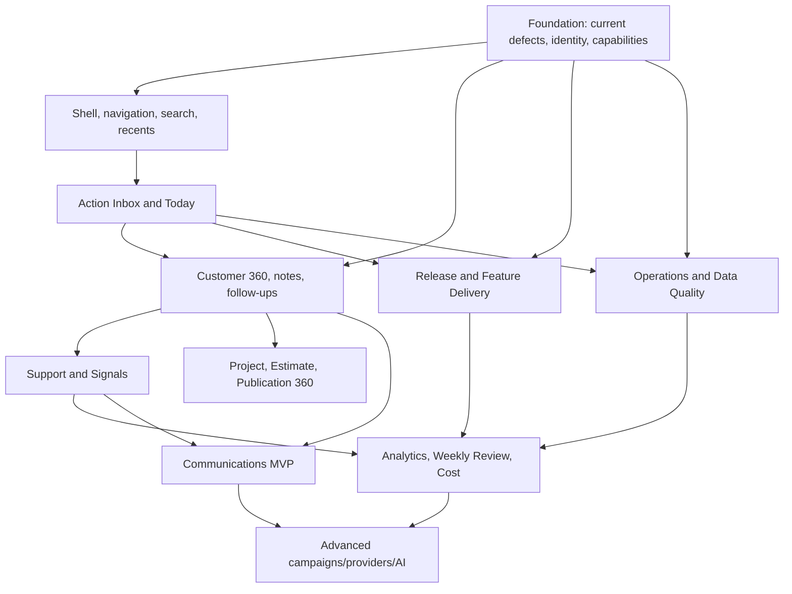

# 13 — Implementation Roadmap

## 1. Roadmap principle

This document is the single canonical execution program for the consolidated pack.

Execution must:

- absorb the existing plan’s P0 correctness/security work;
- deliver the founder’s daily Homebase early;
- add vertical slices that produce usable operating workflows;
- keep advanced campaigns and provider integrations conditional;
- use one `LOOP_LEDGER.md`;
- stop when the founder outcome is proven.

## 2. Consolidated dependency shape

## 3. Work-in-progress rule

At most:

- one foundation/security slice;
- one founder-facing product slice;
- one independent repository/research lane.

Do not execute all slices in parallel.

## 4. Slice F0 / UNIT-001 — Current Truth, Correctness, and Security

### Source

Absorb existing plan Units 001–006.

### Deliver

- reconcile current route/repository/migration/test inventory;
- fix searched-user binding;
- verify affected rows;
- protect founder/admin floor;
- canonical identity semantics;
- User 360 base;
- safe status/session actions;
- real audit UI foundation;
- placeholder Admin API disposition;
- exact capability checks.

### Acceptance

- no fake success;
- no fake product activity;
- no last-admin/founder lockout;
- current list/detail truthful;
- high-risk actions have reason/idempotency/audit/fresh-auth policy;
- source and plan agree.

### Founder value

A safe foundation for everything else.

## 5. Slice F1 / UNIT-002 — Admin Shell, Global Search, Recents, and Pins

### Deliver

- grouped navigation;
- full-width shell;
- global `⌘K`;
- federated bounded search;
- entity result DTO;
- recent items;
- pins;
- new header environment/status;
- context drawer framework;
- URL filter standard.

### Primary code areas

- `src/components/admin/AdminShell.tsx`
- `AdminSidebar.tsx`
- `AdminHeader.tsx`
- new `src/lib/admin/search/*`
- new pins/preferences repository/actions
- shared context drawer.

### Acceptance

- email/ID/project code/estimate name search;
- exact results open in one step;
- results reauthorize;
- keyboard path;
- no raw secret-token search;
- shell remains usable with degraded search source.

### Default non-test evidence

- repository/query contract and index inspection for exact/prefix search;
- server authorization and minimized-result DTO review;
- keyboard/focus source-state inventory;
- persistence schema, uniqueness, and action postcondition review.

## 6. Slice F2 / UNIT-003 — Today and Action Inbox

### Deliver

- action derivation registry;
- founder action-state table;
- priority/reason model;
- Home first viewport;
- accept/resolve/duplicate/dismiss/snooze;
- since-last-review checkpoint;
- action deep links;
- initial sources:
  - incidents;
  - support;
  - feedback;
  - failed jobs;
  - upload scans;
  - identity mismatches;
  - founder follow-ups.

### Acceptance

- no source duplication;
- stable dedupe;
- source changes reconcile;
- snoozed item returns;
- resolution/audit;
- partial source failure does not erase other Home sections;
- founder can clear or intentionally snooze every item.

### Default non-test evidence

- derivation key and dedupe contract review;
- state/source reconciliation table;
- snooze return and resolution postconditions;
- independent read-model failure boundary review.

## 7. Slice F3 / UNIT-004 — Customer Success and Customer 360

### Deliver

- activation stage;
- rule-based health;
- customer attention queue;
- User 360 completion;
- Account/Workspace 360;
- founder notes/follow-ups;
- cohorts;
- next-best-action rules;
- links to projects/estimates/publications/support/feedback.

### Acceptance

- health reasons visible;
- no session-as-activity;
- no missing-auth/profile silent loss;
- follow-up becomes action item;
- cohort lists match definitions;
- detail tabs lazy/bounded;
- founder can understand one customer without cross-system reconstruction.

### Default non-test evidence

- activation and health rule tables with source/as-of semantics;
- note/follow-up lifecycle and Action Inbox linkage review;
- identity mismatch and tenant-authorization source review;
- bounded query/pagination plan.

## 8. Slice F4 / UNIT-005 — Support and Customer Signals

### Deliver

- support priority/waiting/age;
- customer context pane;
- internal notes;
- saved replies;
- signal annotations;
- accept/duplicate/decline/snooze;
- themes;
- GitHub/Notion links;
- close-loop queue;
- Action Inbox source.

### Acceptance

- reply versus internal note cannot be confused;
- support/customer context joined safely;
- duplicate preserves evidence;
- theme affected-user count;
- signal linked to work;
- shipped signal can require follow-up;
- overdue support visible on Home.

### Default non-test evidence

- distinct internal-note and customer-reply action/repository paths;
- waiting/unread, duplicate/theme, and close-loop transition tables;
- stable client-message idempotency contract and affected-row proof.

## 9. Slice F5 / UNIT-006 — Release Center and Feature Delivery

### Deliver

- release records;
- typed checks;
- go/no-go;
- commit/provider/evidence links;
- migrations/flags/rollback;
- post-deploy monitoring period;
- release correlation;
- feature definition registry;
- flag owner/review/expiry/release;
- stale flag action items.

### Acceptance

- no release shown healthy from absent evidence;
- production decision durable;
- rollback reference immediate;
- release associated with incidents/errors;
- expired/unowned flag visible;
- existing simple flag action remains secure.

### Default non-test evidence

- check-state and go/no-go transition tables;
- append-only release-event and flag-expiry schema review;
- authorization, fresh-auth, reason, revision, and rollback contract review.

## 10. Slice F6 / UNIT-007 — Operations and Data Quality

### Deliver

- Operations Home;
- health maturity labels;
- incident create/update/timeline;
- jobs/queues/outbox status;
- data-quality check registry;
- initial identity/membership/publication/job checks;
- data-quality finding UI;
- dry-run repair framework;
- backup/restore freshness;
- existing upload/scan integration;
- provider links.

### Acceptance

- binding presence not labeled healthy capability;
- incident impacts/actions visible;
- stale job actionable;
- finding evidence and source revision;
- dry-run before apply;
- repair bounded/idempotent/audited;
- provider unavailability labeled.

### Default non-test evidence

- deterministic check definitions and source revisions;
- finding upsert/reopen and incident-state transition review;
- repair allowlist, dry-run/apply parity, bounds, idempotency, audit, and postcondition review;
- stale-job query and threshold inspection.

## 11. Slice F7 / UNIT-008 — Project, Estimate, and Publication 360

### Deliver

- search/detail routes;
- project summary/diagnostics;
- estimate summary/diagnostics;
- publication/client portal funnel;
- activity and customer signal links;
- data-quality/action items;
- direct Workshop/Publisher links.

### Acceptance

- no editing mutation duplicated;
- financial data capability-gated;
- source/issue/version explicit;
- all related customer obligations visible;
- large detail loads tabbed/lazy;
- publication decisions create clear founder next action.

### Default non-test evidence

- entity relationship and tenant-authorization predicate review;
- publication funnel/source definition review;
- diagnostic rule and minimized DTO inspection;
- bounded query/pagination plan.

## 12. Slice F8 / UNIT-009 — Analytics, Weekly Review, Cost, and Capacity

### Deliver

- metric definitions;
- activation/funnel;
- retained activated cohorts;
- publication/client-review metrics;
- 7/30-day founder scorecard;
- weekly review;
- checkpoint/snapshot;
- local cost/capacity;
- provider snapshot framework only for approved sources;
- instrumentation backlog.

### Acceptance

- denominator/source/as-of;
- unavailable is not zero;
- bot/admin activity excluded as defined;
- weekly snapshot definition version;
- cost source labeled;
- missing instrumentation creates explicit backlog.

### Default non-test evidence

- metric definition, dedupe, funnel, and cohort-cutoff contracts;
- snapshot definition/version and source-status inspection;
- cost/capacity source, threshold, and as-of review.

## 13. Slice F9 / UNIT-010 — Communications MVP

### Reprioritized from existing Units 007–010

### Deliver

- draft;
- audience preview/count;
- specific user/account/cohort targeting;
- one-time immediate or simple future send;
- preview;
- idempotent publish;
- run/delivery history;
- delivery issues;
- retract/replace where channel supports it;
- audit;
- User 360 outreach action.

### Explicitly defer

- recurring series;
- complex DST revision;
- digest orchestration;
- large generalized queue platform;
- multi-operator approvals;
- arbitrary rules builder.

### Retained predecessor contracts

The reduced MVP must remain forward-compatible with the predecessor's durable model without building the deferred machinery early:

- immutable definition/version and audience revision;
- explicit intended, eligible, excluded, materialized, pending, failed, retried, read, dismissed, and acknowledged denominators;
- snapshot audience by default and explicit future-enrollment policy when recurrence is later activated;
- canonical Better Auth identity mapped to the current inbox recipient key without silently excluding mismatched profiles;
- recipient/run/job/event state with stable idempotency and affected-row proof;
- preferences, mandatory-notice override, retention, redaction, cancellation, retraction, replacement, and preserved evidence;
- D1 as authoritative state; Queue/Cron are dispatch mechanisms, never the source of truth;
- hosted queue/provider claims remain separate from local implementation evidence.

### Acceptance

- no all-users accidental send;
- exact eligible count;
- audience snapshot;
- duplicate publish safe;
- delivery/materialization semantics honest;
- failure queue actionable;
- preferences/consent respected.

## 14. Slice F10 / UNIT-011 — Advanced Scale and AI

Conditional:

- recurring campaigns;
- advanced cohort enrollment;
- provider analytics/deployment APIs;
- experiments;
- AI operator;
- multi-operator assignments;
- customer portal account archive;
- billing/revenue.

Each requires its own measured need and success criterion.

When recurring campaigns are activated, retain immutable occurrences, UTC storage plus IANA/local intent, explicit DST policy, series edit/cancel history, bounded-horizon scheduling, retry/DLQ/reconciliation, pause/resume/cancel concurrency, digest policy, and numeric free-tier headroom. Do not create a generalized workflow or queue platform unless the measured requirement cannot be satisfied by the existing notification and Cloudflare boundaries.

## 15. Fragmented-tool consolidation unit

This is a cross-slice migration, not a standalone early project.

Sequence per tool:

1. show status/link from Admin;
2. reuse source repository;
3. add Admin read view;
4. add Admin mutation with parity;
5. redirect workshop route;
6. remove duplicate mutation UI;
7. update settings links.

Tools:

- allowlist users;
- feedback review;
- upload operations;
- scan overrides.

## 16. Suggested milestone releases

### M1 — Safe Admin Foundation

F0.

### M2 — Founder Homebase Alpha

F1 + F2 + notes/follow-ups.

### M3 — Customer Operations

F3 + F4.

### M4 — Ship and Operate

F5 + F6.

### M5 — Full Product Context

F7 + F8.

### M6 — Communications

F9.

### M7 — Leverage

Selected F10.

## 17. Definition of done per slice

A slice is done when:

- founder outcome works;
- source truth and degraded states are correct;
- high-risk mutations safe;
- only required schema exists;
- evidence matches the claim;
- documentation/current state updated;
- next slice is explicitly activated or not.

It is not done merely because all listed components/tables exist.

## 18. Evidence and test authorization

Every `AC-*` defaults to `test_requirement: NOT_REQUIRED`, `test_trigger: NONE`, and `test_ids: []`. Implementers use the cheapest decisive source, diff, typed contract, schema, query-plan, dry-run, narrow runtime, hosted, or operator evidence. If a named critical invariant cannot be proved that way, record one `TEST_PROPOSAL` with the risk and exact narrow command and wait. Only an explicit current-task user request may change a criterion to `TEST_TASK` and authorize test, build-as-gate, browser, or broad QA execution.

No fixed staffing, reviewer count, test matrix, or workflow invocation is a readiness condition. Use the fewest lanes and artifacts that materially improve correctness, preserve one lead/integrator for shared contracts and `plan-pack.json`, and stop when the mapped founder outcome is grounded.
